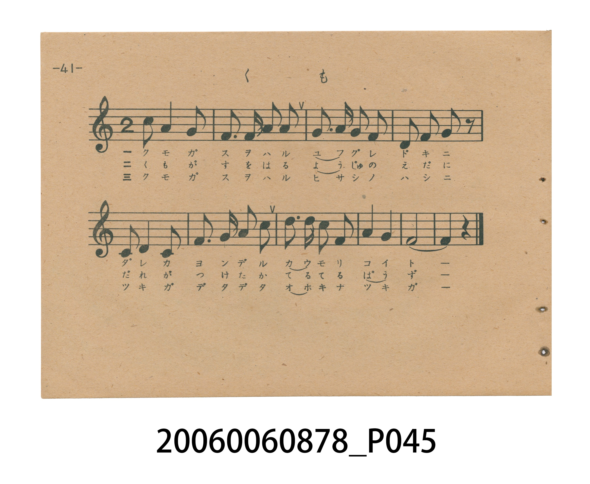
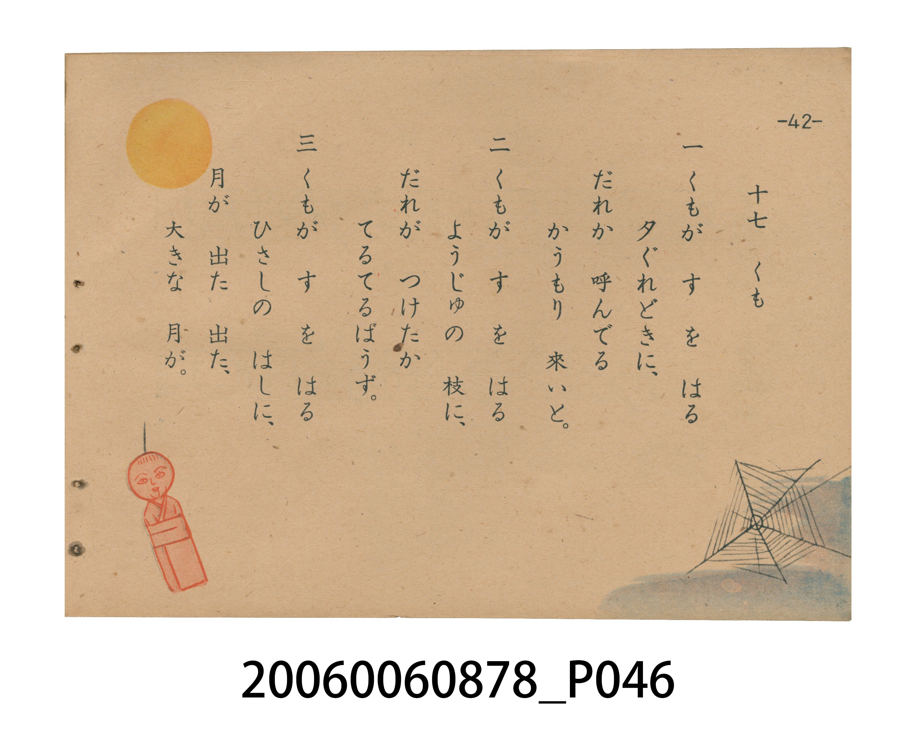

# くも（蜘蛛）

> Re:Shōka 使用 AI 協助辨識與重建樂譜，可能會有錯誤。歡迎回報。

- **鋼琴伴奏版**：<br><audio controls src="kumo.mp3"></audio>
- **NEUTRINO 歌聲合成版**：<br><audio controls src="kumo_neutrino.mp3"></audio>

- 日治時期國民學校唱歌（うたのほん 下・第十七課）
- 國立臺灣歷史博物館典藏

## 說明


- 出處：臺灣總督府編《うたのほん 下》（國民學校初等科第二學年用），第十七課〈くも〉（蜘蛛），原書第 41–42 頁。
- 調性與拍號：ヘ調（F 大調五聲音階，原書五線譜省略調號，實際音高終止於 F 音），2/4 拍，共 10 小節（後樂段末尾將主音以連結線延展為第 9–10 小節，營造黃昏與月夜靜謐悠遠的餘韻），速度 != 96。
- 背景與曲風：極具臺灣地方特色的是**第二節歌詞**：日本內地版原詞作「梅の 小枝に」（梅樹小枝上），臺灣總督府版特別改編為**「ようじゅの 枝に」（榕樹的樹枝上）**，將臺灣隨處可見、氣根垂懸的榕樹寫入教材，第 42 頁並繪有圓月高懸於晴天娃娃與蜘蛛網間的插圖。
- 版本說明：本檔案為原書單聲部五線譜旋律之忠實數位化版本。

### 編曲說明（鋼琴伴奏版）：

1. 前奏 (Intro, 4 小節)：擷取主旋律核心樂句作為導奏，建立調性與拍感。
2. 主歌伴奏 (Kumo)：右手 (PianoRH) 演奏原書歌唱主旋律；左手 (PianoLH)
依國民學校低學年教材純樸明朗之風格配以和聲伴奏。


## 歌詞

```text
一　くもが　すを　はる
夕ぐれどきに、
だれか　呼んでる
かうもり　來いと。

二　くもが　すを　はる
ようじゅの　枝に、
だれが　つけたか
てるてるばうず。

三　くもが　すを　はる
ひさしの　はしに、
月が　出た　出た、
大きな　月が。
```

## ABC

```abc
X:1
T:くも（蜘蛛）
M:2/4
L:1/16
Q:1/4=96
K:F
V:V1 name="Piano" snm="Pia"
[V:V1]
c2 A4 G2 | F3 F A2 A2 | G3 A G2 F2 | D2 F2 G2 z2 |
w: 1.~く も が | す を は る | ゆ ふ ぐ れ | ど き に
w: 2.~く も が | す を は る | よ う じゅ の | え だ に
w: 3.~く も が | す を は る | ひ さ し の | は し に
C2 D4 C2 | F3 G A2 c2 | d3 d c2 F2 | A4 G4 |
w: 1.~だ れ か | よ ん で る | か う も り | こ い
w: 2.~だ れ が | つ け た か | て る て る | ば う
w: 3.~つ き が | で た で た | お ほ き な | つ き
F8- | F4 z4 |
w: 1.~と | _
w: 2.~ず | _
w: 3.~が | _
```

## TMD 檔案連結

- [主旋律 TMD 檔案](kumo.tmd) [[在 TMD Studio 編輯](https://tmdlang.github.io/Tmd-TS/#tmd=s7IKdvYPcrWy4qpTUCpJTLdSyC_KTM_MsypJzCxPzIvPT0vLTM5MzFHi0tJSeNzY_7ip6f2ejhdzZryYPfv9nk4FLS0uRVsFSzMue1sFNy4bI30TO5BJz6YvfbZp97OZTc_mzH86p_vZholP1-54tmDh0ykbn63tAZrwuLHtceP8x43rHjfuftw0WeHJju7Hzbufr1nztLfxyY7mF6s2AU1XAhkF1P58dfeL9l3PGxc_W7v9af-mp72znneufLlkxdPWHS-m9ytxcelrKdhSC3ApKCg8bpjwbPam57PXvVi16tmMvscNE8Gizbuftu96MXPq-z2zIO55vmPv87mLn-6a83z7iscNXdg81dAN9C1KEHTMfb628_nyiUDPPtnVAxR8unPL8ykrgP59v6cHOQQeNwCDCRTijxuAUohAByp72jf_2ewdQMUKJoaPGiabGCm8XND4uKEJ6swXq_Y_a1j-oqP9WXfvi5nzge593DwDKAg0xU3h6ZLlQOaTXVNeNG56OX_zy1l9cAOBgs-3z3qxds7zOY3Ppy4FKgPr7nm6ftnLWbNBilfPeL616dnaRc-m7VFwUwCKQNwDjHcFoF0gpa0bFQwNFJ5u6H--vgHk9X09z1Y0PVu39dmc1U837Hu6of3Jjt1AfU92L33ZsPj51glAC5_u3vZ049TnTbtAHrIE-gfJgJ7n7fNfNix4ubv52Yx-kI_mdDxdMufl3Dkv1kx41rTgZeOC57NaXi6Z8XL-bohTXjbMf7prmQI4VSKFSHPPs5nrQfpnb3q5CBjYs54t3fq0dTskHp_O2fBs2s7nnTtfdG4CGvdsxnotLUj0AN0ATLAvVs7T0gLpASbrOWueti4Hanje2QEMNKDMk71zHjf0PFvUCox4kLOfzZv7uHH14wZgaHQARZ-t2AkRfLKjC-JC9LTT2QG0-WnH0mdTdgLTETAYtLSABj5ugmSSGY-bwCajGLtsKtBYkEtX7ISbDHJhDzB8Ica_nLUCmFKf9q9_sQyYCBufbVj8bMHOp_OanrXvAOkDG_B0_eqnrUufTZ35bO4ESNpTgKSkJzuWPd-56tmczqdzJgMDHBjrQG3AKH82c8vTJSufrmgGImBYQlLk822bXk6bDDK0f9LTOdMQYQ70GDC0IFkIFHhz1jxbNeXZwg6gDyHJ7em0daA02LwCnu6eTe9-uq_7yc7up_sXABPds6k7nuztfdozDWIUyGho9oQYAImap60rnk1rB7rnyY61IMaqeS_WrgfmWWBAoeUQUND1NT_r7wc6RCHAwMQUKAOkzMDx0gk2-8mOhscNDdB819gDZs983DQJzFj_uKkbpOjpkqmPGyc8bup53LjycWMvOF4awS5rXAAWBQZ5w9OJe4CFwOPG5VBNIFFghAKNbeoCSj_ZB4zclseNwIIDHGCgHA52OTCons5ZAQ1bYP7YBkqSkPQPLFCfdrQBowoYNS9WbXi2FphyVwDteTpt1ouJ00HZvKHnxdyZL-YueLp_NdCCpxOBngEWH8A0A_XdLoiP8PoOLeUB5WBpD8WPEN1LHjdOBBd6UD8uAxoCIzeAjQE6iggPQlIk0KKXC9aC03PPkx29z-cvBeZFkE_7ZgMFn-xqQ06BQHMRsdZJhL8aNz1uBEbcdIinQBIgNsxfwIQO0Qos5EE-QjDA0sBiExzVq0DhAVVKhL-ebux-vmH7y6au59sXgyOu48mudUCDgbED9A7QbDgblHuX7gVaAyLngDMURDE4EkE-BVpGef0GBQpa-lxc3qW5-VYBmYl5-Q41BjXVIAsUbAzNtOzArBoFUwVdBWMgBkEjIK5RMASzDcGiIFwDFgexQTRItkbBLB7KBAkZgITAxvkY1oBaEEA-MJKghgJDEawFGFsQftMkIHs9mNUNkWlqg6rcCsQTwDIwPSvB4r1gcjWqXUbk2dUBVdkGxKDkD-asg2oDSQITPzbrjMmyrnETVOVUIJ6OYhdYHVQMYRcsWkABDA5lEATzYDFjBI4VULwB4wEsYgbmQWIGOS5BEKYLAWvgLJCNYBGkyAP7HRz8EHejBRuwyQMs7lB8CKKhAQoOGWDZB5WZDDelBW43sDQk1j3gCEZ3DyzEl0D5E4F4PrJLG5dBXdoNZSNcugFuCiTBQURnEesecAoA2QtJkKjuAYUJiD8fFj5gV4FkQKEB4u-GJ-RVKH5ANg8kCvMrPvfUcnHp2imA8jbYaUC2MhcA)]
- [鋼琴伴奏 TMD 檔案](kumo_piano.tmd) [[在 TMD Studio 編輯](https://tmdlang.github.io/Tmd-TS/#tmd=s7IKdvYPcrWy4tLSUnjc2P-4qen9no4Xc2a8mD37_Z5OIPtl957nE7Y82bPl6dL-550dQEEFLS0uRVsFSzMue1sFNy4bI30TO646BaVn05c-27T72cymZ3PmP53T_WzDxKdrdzxbsPDplI3P1vYAjXrc2Pa4cf7jxnWPG3c_bpqs8GRH9-Pm3c_XrHna2_hkR_OLVZuApiuBjAJqf766-0X7rueNi5-t3f60f9PT3lnPO1e-XLLiaeuOF9P7lbi49LUUbKkFuBQUFB43THg2e9Pz2eterFr1bEbf44aJYNHm3U_bd72YOfX9nlkQ9zzfsff53MVPd815vn3F44YubJ5q6Ab6FiUIOuY-X9v5fPlEoGef7OoBCj7dueX5lBXgIO5BDoHHDcBgAkXD4wZQ6CPFRM_TvvnPZu8AKlYwMXzUMNnESOHlgsbHDU1QZ75Ytf9Zw_IXHe3PuntfzJwPdO_j5hlAQaApbgpPlywHMp_smvKicdPL-ZtfzuqDGwgUfL591ou1c57PaXw-dSlQGVh3z9P1y17Omg1SvHrG861Nz9YuejZtj4KbAlAE4h5gvCsA7QIpbd2oYGig8HRD__P1DSCv7-t5tqLp2bqtz-asfrph39MN7U927Abqe7J76cuGxc-3TgBa-HT3tqcbpz5v2gXykCXQP0gG9Dxvn_-yYcHL3c3PZvSDfDSn4-mSOS_nznmxZsKzpgUvGxc8n9XycsmMl_N3Q5zysmH-013LFMCpEilEmnuezVwP0j9708tFwMCe9Wzp1qet2yHx-HTOhmfTdj7v3PmicxPQuGcz1mtpQaIH6AZggn2xcp6WFkgPMFnPWfO0dTlQAzADAAMNKPNk75zHDT3PFrUCIx7k7Gfz5j5uXP24ARgaHUDRZyt2QgSf7OiCuBA97XR2AG1-2rH02ZSdwHQEDAYtLaCBj5sgmWTG4yawySjGLpsKNBbk0hU74SaDXNgDDF-I8S9nrQCm1Kf9618sAybCxmcbFj9bsPPpvKZn7TtA-sAGPF2_-mnr0mdTZz6bOwGS9hQgKenJjmXPd656Nqfz6ZzJwAAHxjpQGzDKn83c8nTJyqcrmoEIGJaQFPl826aX0yaDDO2f9HTONESYAz0DDG1IFsJaegBDFKRUQcFQT-FpZy9QXEHDM6-kKF9HwQSaADRBoT4ZmOunAZPNs-ndT_d1P1uw4-n-ZmCietq_FBj2wPB6uqEPqBfk-927QGUFUup_1jIf6iAFBSM9YI7cDYxOiBsUNLxLc_NBFjzt3_yss1tBIyAzMS8_yENT4dmeKUAFkDwBVA8steC2v98z--n2ZQjlPh6aENOB4Mm-ucg5_cnePkjuhoTw8y1Tnq3YAQyLZ3OmP9nZDUyFzxbsednaC8wJTyf1ADMjxFkg50LLILgDgKnsaeuKZ9PagZ56smMtiLFq3ou164EFEzBg0YoBUProa37W3_9s1RSFAAMTU6AMkDIDB3gn2OwnOxoeNzRAC5fGHjB75uOmSWDG-sdN3SBFT5dMfdw44XFTz-PGlY8be8GJrxHsssYFYFFgump4OnEPsKR73LgcqgkkCky1QGObuoDST_YBU3DL40Zg6QiOBFAxBnY5KNTnrIAmIGAhsA2U7yCZHFhrPO1oA8YmMP29WLXh2Vpg9lwBtOfptFkvJk4HlWUNPS_mznwxd8HT_auBFjydCPQMsIwEZgyo73ZBfITXd2jZCygHy2AofoToXvK4cSK4ZIf6cRnQEBi5AWwM0FFEeBCS7YAWvVywFpxpe57s6H0-fymwwAH5tG82UPDJrjbkbAY0FxFrnUT4q3HT40ZgxE2HeAokAWLD_AXMzRCtwJoM5CMEAywNrBvAUb0KFB5QpUT46-nG7ucbtr9s6nq-fTE44jqe7FoHNBgYO0DvAM2Gs0GZdOleoDUgcg641IAoBkciyKdAyyivxKFAQUufiwtcolhB87ZDjUFNNTjD2hiaadmBWTUKZgq6QGimYAokDYG4RsEYLKKrYASla8DiyLAGzjKAiXDVotjmg2ybCcKy-HiFaLPcWCDTFMQ0BbEMgQxDKMMAYhKodMLvbJBzkR0Kc6QhWBSEa6AeMAbTEK-ZxUOZICGQ22vAxvkY1oBafUA-MHlBDQXGP1gLMJ1B-E2TgOz1YFY3RKapDapyKxBPAMvA9KwEi_eCydWodhmRZ1cHVGUbEIMyLpizDqoNJAnMttisMybLusZNUJVTgXg6il1gdVAxhF2waAEFMDiUQRDMg8WMEThWQPFGvUSHiDyw38HBD3E3WrABW6TAghrFhyAaGqDgkAGW2lCZyXBTWuB2A8txYt0DjmB098BCfAmUPxGI5yO7tHEZ1KXdUDbCpRvgpkASHER0FrHuAacAkL2QBInqHlCYgPjzYeEDdhVIBhQaIP5ueEJeheIHZPNAojC_4nMPStbGUUYgFwcQBqKoALFARQQssWEUIcQWMLp2CuDSSgHIALko2geoAM42QmIbg9nKXAA)]

## 分析

```text
================================================================================
📊 TMD Song Profile: [ くも（蜘蛛） ]
================================================================================
⏱  Duration:       0:12 (12.5s), 10 measures total
🎼 Key & Tempo:    首調基準 F, != 96.0 BPM, <2/4>
   - 分析範圍：      由實際發聲的音符與和弦推測調性；播放脈絡另行呈現
🎤 人聲音域:    C4 (MIDI 60) – D5 (MIDI 74) [跨度: 14 個半音 / 1.2 個八度, 難度: moderate]
   - 最低音:  C4 in [Kumo #1 @ m.5, 0:05]
   - 最高音: D5 in [Kumo #1 @ m.7, 0:07]
   - 適合: soprano, mezzo-soprano, contralto, tenor, baritone, bass
🏛  結構:      Kumo (12.5s)
⚡ 編曲密度:        Peak 1 軌道同時演奏
🗝  調性診斷：       F 大調（純淨自然大調，未偵測到可信轉調）
   - 風格氣質:    純淨自然大調（陽光明朗、易唱易記，無明顯調外色彩）
   - 轉調歷程:    全曲維持單一推測調性（未偵測到可信轉調）
   - 核心骨幹音:  F, A, G, C, D
   - 調性數值:    F 大調 [相關度: 0.85, 穩定度: High, 自然音純度: 100.0%]
   - 候選調性 (K-S): F 大調 (0.85), D 小調 (0.69), C 大調 (0.57)
   - 五度圈歷程:   -1
   - 各段落調性細節:
     • [Kumo #1]: F 大調 (r: 0.85, 自然音純度: 100.0%)

  [ 五度圈游移軌跡 ]
               C  
        [F ]*          G  
      Bb               D  
      Eb               A  
         Ab           E  
            Db       B  
               F# 
     (* = active key center)

  [ 十二半音累積音高分佈 ]
     C  : ██████████                13.5%
     C# :                            0.0%
     D  : ██████████                13.5%
     D# :                            0.0%
     E  :                            0.0%
     F  : ████████████████████████  33.8%
     F# :                            0.0%
     G  : █████████████             18.9%
     G# :                            0.0%
     A  : ██████████████            20.3%
     A# :                            0.0%
     B  :                            0.0%
--------------------------------------------------------------------------------
Assignment 軌道音域：
  - Piano         : C4 – D5 (14 個半音 / 1.2 個八度, 28 個音符)
================================================================================
```


## 原書掃描頁






