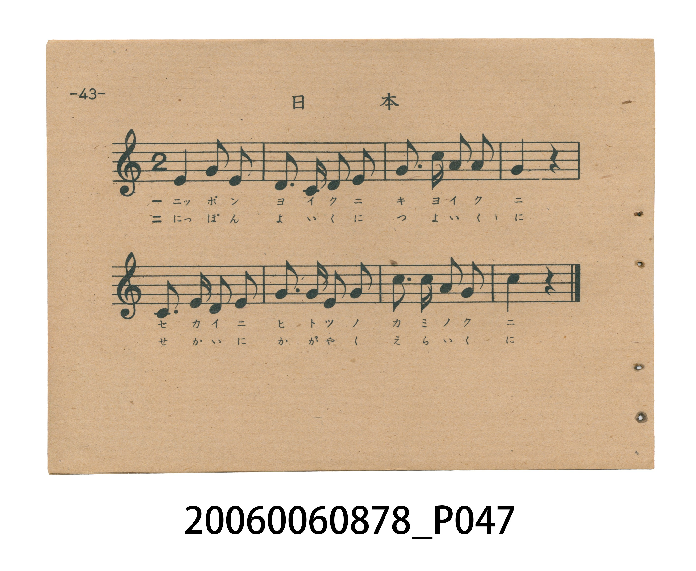
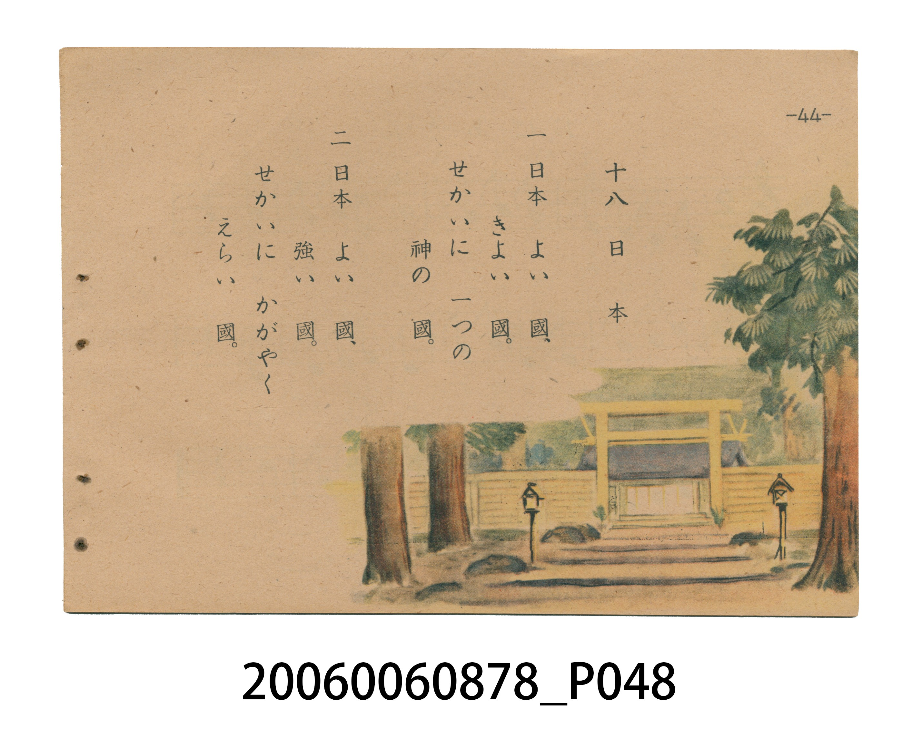

# 日本

> Re:Shōka 使用 AI 協助辨識與重建樂譜，可能會有錯誤。歡迎回報。

- **鋼琴伴奏版**：<br><audio controls src="nippon.mp3"></audio>
- **NEUTRINO 歌聲合成版**：<br><audio controls src="nippon_neutrino.mp3"></audio>

- 日治時期國民學校唱歌（うたのほん 下・第十八課）
- 國立臺灣歷史博物館典藏

## 說明


- 出處：臺灣總督府編《うたのほん 下》（國民學校初等科第二學年用），第十八課〈日本〉，原書第 43–44 頁。
- 調性與拍號：ハ調（C 大調五聲音階，主音為 C，收於高音 `1^`＝C5），2/4 拍，共 8 小節，速度 != 100。
- 背景與曲風：與初等科二年級國語讀本《ヨミカタ》之韻文教材同詞。旋律簡潔莊重，歌詞宣揚「神之國」、「強之國」的戰時皇國史觀，第 44 頁並繪有白雪覆頂的富士山聳立於雲海之上的插圖。
- 版本說明：本檔案為原書單聲部五線譜旋律之忠實數位化版本。

### 編曲說明（鋼琴伴奏版）：

1. 前奏 (Intro, 4 小節)：擷取主旋律核心樂句作為導奏，建立調性與拍感。
2. 主歌伴奏 (Nippon)：右手 (PianoRH) 演奏原書歌唱主旋律；左手 (PianoLH)
依國民學校低學年教材純樸明朗之風格配以和聲伴奏。


## 歌詞

```text
一　日本　よい　國、きよい　國。
せかいに　一つの　神の　國。

二　日本　よい　國、強い　國。
せかいに　かがやく　えらい　國。
```

## ABC

<div class="abc-score" data-abc-src="nippon.abc" aria-label="五線譜載入中"></div>

[下載 ABC 原始檔](nippon.abc)

## TMD 檔案連結

- [主旋律 TMD 檔案](nippon.tmd) [[在 TMD Studio 編輯](https://tmdlang.github.io/Tmd-TS/#tmd=s7IKdvYPcrWy4qpTUCpJTLdSyC_KTM_Ms8rNz0sqLc7IV4JLJOfn5KQml2Tm51mVliTm5Wfk5yEky_JzSnNTrYwQIsX5pUXJqXCl8emp6HLxBYnpqVYBBibmukDCAiFdUJRflpqXmAfUXpKYWZ4I1AwUKMrLLwKakpdalJiDUJtalpmSClJZUJSZm1hUGZ-Snwx0SV4JkttSi4pBri7LT0bWmV9UkpGfXpRYkFFplZFZXAL0OFA-PjsxLxGhqCQjFeitvESQt0GatbQUnk1f-mzOGgUtLS5FWwVDAwMue1sFZy4bI30TO5A2kPSm3c9mNj2bM__pnO5nGyY-Xbvj2YKFT6dsfLa25_2ejseNbY8b5z9uXPe4cffjpskKT3Z0P27e_XzNmqe9jU9bV79Yten9nk6wC4Dan6_uftG-63nj4mdrtz_t3_S0d9bzzpUvl6x42rrjxfR-JS4ufS0FW2oBLgUFhccNE57N3vR89roXq1Y9m9H3uGEiWLR599P2XS9mTn2_ZxbEPc937H0-d_HTXXOeb1_xuKELm6cauoG-RQmCjrnP13Y-Xz4R6Nknu3qAgk93bnk-ZQXQv-_39CCHwOOGDkgwP24AST3tm_9s9g6gAgUT40cNk01MFF4uaHzc0AR12otV-581LH_R0f6su_fFzPlANz5u7gcKAq13Vni6ZDmQ-WTXlBeNm17O3_xyVh_QwCc7dgPZz5t2KTgDec-mbHs2bc_L1TOAYgoJhnEJ7_fMdTaFuAoYrQpAY0GOaN2oYKHwdEP_8_UNQO7LhvlPdy1TgKQBJLc09zybuR7kltmbXi4Cem0WkA33OMjXQC9vmQUMlher5r1Y1wD2Y9fj5hWPm-c_blr9uGk_MNye7Ox-OX_3s2ntz6bOfDZ3wtMJPS9WzgPa8Wx699N93c83LHy2d8qLvq6X7SB3AVMVUPbpusXP-mc9buh5vnQeUDvQ_McNvY8bgKHU83TPdrjI81ktzzo2AFPn81ntQBFgknqxHOQbcNiCg_XJjmXPd656Nqfz-cy9L2everGs7eUCoOqWp-t7ni5e_XTjxheNm4GpEhRgszc92woy-smOLpC5_ZOezpmGCInnnR1Az0GSETAYgOxnq6Y8W9gBDHVIfD6dtg4UJ80rgJHzfPusF2vnQPwHcuz-BU_XL3s2dceTvb1Pe6ZBjAIZDU2iEAOgPm9dAQwpYCg_2bEWxAAG69r1wHQLjH20FAMUedbX_Ky_H-gQBVC5A5QBlTzgmO4Em_1kR8PjhgZY2mt43ATMri1ABjj0Gh839qKKQPzaOPtxYzdItHE1UAJkROMSUFZoaABGBoSBUA10BMSJoDAB2_Nsxvrn-_qeLt0LCmVgnKzbBrTqReM0YCQjiTQBlT3ZMe35VGDi7Xo6BchuAMoixXYT3A-7evD4AZgaCHgAzO553ATk9oO5HY-bOtH1EOkNoG3PZ89G88bLac0vgA6ctgfiH5BsYycwn8LVgHwCtIPyEg0KFLT0ubj8MgsKgLVAQCawQnKoMaipBlmhYGNopmUHZtUoGCvogqEpEIPYNQpGYL4hmIaIgOSAInEKZkAKhGFCugoGULoGbJyPYQ0wYFc_blwMFX7cuBdEAgtHkCZgrEBFW4C4H8xaDZFp7IXIAFWAZEEyIHmwcditMiLbqiUkWAUNJUMw1xgjTEzBPBAbqCYOOZhQxLCH02yoC7vh7oC5cBNUZgXUtcD8BJXphsrsh4oRF0y4bYKZ1wMMD9SwgIZfUycRoVTLxaVrpwBJbGBrgTxlLgA)]
- [鋼琴伴奏 TMD 檔案](nippon_piano.tmd) [[在 TMD Studio 編輯](https://tmdlang.github.io/Tmd-TS/#tmd=s7IKdvYPcrWy4qpTUCpJTLdSSM7PyUlNLsnMz7MqLUnMy8_Iz1OCS5bl55TmploZIUSK80uLklPhSuPTU9Hl4gsS01OtAgxMzHWBhAVCuqAovyw1LzEPqL0kMbM8EagZKFCUl18ENCUvtSgxB6E2tSwzJRWksqAoMzexqDI-JT8Z6JK8EiS3pRYVg1xdkAl0SnxiUVFiXnoqqpL8opKM_PSixIKMSquMzOKS_KLM5MSc-OzEvESEopIMoC6rvERQEICcoKWl8Gz60mdz1rzf0_Gye8_zCVue7NnydGn_886O93s6FbS0uBRtFQwNDLjsbRWcuWyM9E3sQGaB9Gza_Wxm07M585_O6X62YeLTtTueLVj4dMrGZ2t7gGY9bmx73Dj_ceO6x427HzdNVniyo_tx8-7na9Y87W182rr6xapNQOPBzgJqf766-0X7rueNi5-t3f60f9PT3lnPO1e-XLLiaeuOF9P7lbi49LUUbKkFuBQUFB43THg2e9Pz2eterFr1bEbf44aJYNHm3U_bd72YOfX9nlkQ9zzfsff53MVPd815vn3F44YubJ5q6Ab6FiUIOuY-X9v5fPlEoGef7OoBCj7dueX5lBVA_77f04McAo8bOiBh_7gBJPW0b_6z2TuAChRMjB81TDYxUXi5oPFxQxPUaS9W7X_WsPxFR_uz7t4XM-cD3fi4uR8oCLTeWeHpkuVA5pNdU140bno5f_PLWX1AA5_s2A1kP2_apeAM5D2bsu3ZtD0vV88AiikkGMYlvN8z19kU4ipgtCoAjQU5onWjgoXC0w39z9c3ALkvG-Y_3bVMAZIGkNzS3PNs5nqQW2ZverkI6LVZQDbc4yBfA728ZRYwWF6smvdiXQPYj12Pm1c8bp7_uGn146b9wHB7srP75fzdz6a1P5s689ncCU8n9LxYOQ9ox7Pp3U_3dT_fsPDZ3ikv-rpetoPcBUxVQNmn6xY_65_1uKHn-dJ5QO1A8x839D5uAIZSz9M92-Eiz2e1POvYAEydz2e1A0WASerFcpBvwGELDtYnO5Y937nq2ZzO5zP3vpy96sWytpcLgKpbnq7vebp49dONG180bgamSlCAzd70bCvI6Cc7ukDm9k96OmcaIiSACQMYBpBkhDULAcMGpFRBwVBP4WlnL1BcQcMzr6QoX0fBBBrOmkA1zyYDU_40YIxBfP9swY6n-5ufrWh62r_0yd45wDh8uqEPqBcUQ7t3gfILUmp41jIf6iAFBSM9YKrcDQwtiBsUNPwyCwry80BWPO3f_KyzW0EjAFSEBHloKjzbMwWoBJLsgDqAeRdu__s9s59uX4ZQ7uOhCTEfCJ7sm4uc3p_s7YOkcUg0Pt8y5dmKHcDQeDZnOiiGF614tmDPy9beJ7uXPp3UA0yeEIeBHAzNiXAHgCK4dQUwQQC99WTHWhADmHrWrgdmT2DQomUMoMizvuZn_f3PVk1RAJW_QBlQCQwO8k6w2U92NDxuaIBlsYbHTcBSqQXIACeSxseNvagikChtnP24sRsk2rgaKAEyonEJKMc3NADTHISBUA10BMSJoBgE2_Nsxvrn-4AxtReUmIBJb902oFUvGqcB0zKSSBNQ2ZMd055PBebRrqdTgOwGoCxSom6C-2FXDx4_ABM9AQ-A2T2Pm4BcYJgDuR2PmzrR9RDpDaBtz2fPRvPGy2nNL4AOnLYH4h-QbGMnsDiCqwH5BGgH5QU3FCho6XNxgXOQFTQlO9QY1FSDk6eNoZmWHZhVo2CooAuExgpGYFIXKGIKFjEF80BsoJo4sBCQMkMX01UwgNI1XLUoFvogW2iCsC9eIdo0FsowBDFM0EVABkHyI36ngxwIcSrM6SBPAN2J4Rmoy0EYJoTscJBxPoY1wESx-nHjYqjw48a9IBJYf4E0AVMUVLQFiPvBrNUQmcZeiAxQBUgWJAOSBxuH3Sojsq1aQoJV1I9gRDjNhrqwG-4OmAs3QWVWQF0LLAugMt1Qmf1QMeKCCbdNMPN6gOGBGhbQ8GvqJCKU0NIanlQLTqymyKnWBCYCSr5EpW8DiI26dgrgnKIAZEBsj_YBqkXiGYF5ylwA)]

## 分析

```text
================================================================================
📊 TMD Song Profile: [ 日本 ]
================================================================================
⏱  Duration:       0:09 (9.6s), 8 measures total
🎼 Key & Tempo:    首調基準 C, != 100.0 BPM, <2/4>
   - 分析範圍：      由實際發聲的音符與和弦推測調性；播放脈絡另行呈現
🎤 人聲音域:    C4 (MIDI 60) – C5 (MIDI 72) [跨度: 12 個半音 / 1.0 個八度, 難度: easy]
   - 最低音:  C4 in [Nippon #1 @ m.2, 0:01]
   - 最高音: C5 in [Nippon #1 @ m.3, 0:02]
   - 適合: soprano, mezzo-soprano, contralto, tenor, baritone, bass
🏛  結構:      Nippon (9.6s)
⚡ 編曲密度:        Peak 1 軌道同時演奏
🗝  調性診斷：       C 大調（純淨自然大調，未偵測到可信轉調）
   - 風格氣質:    純淨自然大調（陽光明朗、易唱易記，無明顯調外色彩）
   - 轉調歷程:    全曲維持單一推測調性（未偵測到可信轉調）
   - 核心骨幹音:  G, C, E, D, A
   - 調性數值:    C 大調 [相關度: 0.85, 穩定度: Moderate, 自然音純度: 100.0%]
   - 候選調性 (K-S): C 大調 (0.85), G 大調 (0.76), E 小調 (0.73)
   - 五度圈歷程:   +0
   - 各段落調性細節:
     • [Nippon #1]: C 大調 (r: 0.85, 自然音純度: 100.0%)

  [ 五度圈游移軌跡 ]
              [C ]*
         F            G  
      Bb               D  
      Eb               A  
         Ab           E  
            Db       B  
               F# 
     (* = active key center)

  [ 十二半音累積音高分佈 ]
     C  : ██████████████████        23.2%
     C# :                            0.0%
     D  : ██████████                12.5%
     D# :                            0.0%
     E  : ██████████████████        23.2%
     F  :                            0.0%
     F# :                            0.0%
     G  : ████████████████████████  30.4%
     G# :                            0.0%
     A  : ████████                  10.7%
     A# :                            0.0%
     B  :                            0.0%
--------------------------------------------------------------------------------
Assignment 軌道音域：
  - Piano         : C4 – C5 (12 個半音 / 1.0 個八度, 25 個音符)
================================================================================
```


## 原書掃描頁






