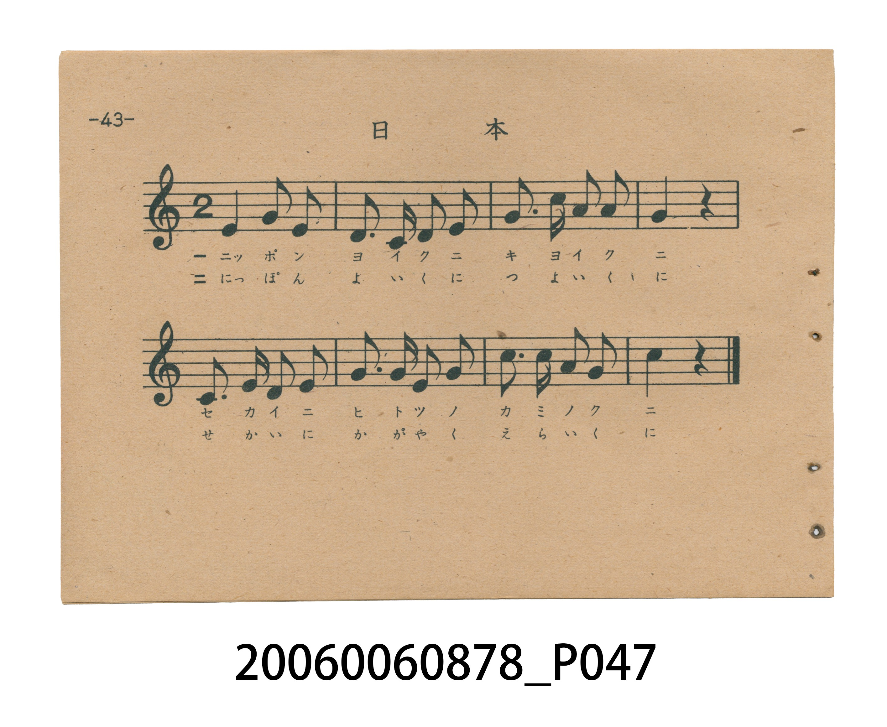
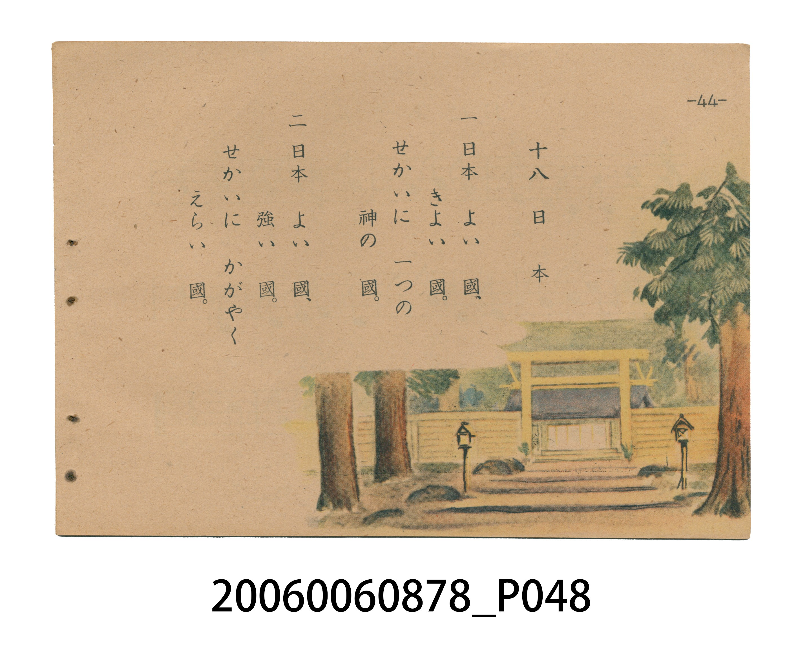

# 日本

> Re:Shoka 使用 AI 協助辨識與重建樂譜，可能會有錯誤。歡迎回報。

<audio controls src="nippon.mp3"></audio>

- 日治時期國民學校唱歌（うたのほん 下・第十八課）
- 國立臺灣歷史博物館典藏

## 說明

【曲目說明】
・出處：臺灣總督府編《うたのほん 下》（國民學校初等科第二學年用），第十八課〈日本〉，原書第 43–44 頁。
・調性與拍號：ハ調（C 大調五聲音階，主音為 C，收於高音 `1^`＝C5），2/4 拍，共 8 小節，速度 != 100。
・背景與曲風：與初等科二年級國語讀本《ヨミカタ》之韻文教材同詞。旋律簡潔莊重，歌詞宣揚「神之國」、「強之國」的戰時皇國史觀，第 44 頁並繪有白雪覆頂的富士山聳立於雲海之上的插圖。
・版本說明：本檔案為原書單聲部五線譜旋律之忠實數位化版本。

・編曲說明（鋼琴伴奏版）：
1. 前奏 (Intro, 4 小節)：擷取主旋律核心樂句作為導奏，建立調性與拍感。
2. 主歌伴奏 (Nippon)：右手 (PianoRH) 演奏原書歌唱主旋律；左手 (PianoLH)
依國民學校低學年教材純樸明朗之風格配以和聲伴奏。

## 歌詞

```text
一　日本　よい　國、きよい　國。
せかいに　一つの　神の　國。

二　日本　よい　國、強い　國。
せかいに　かがやく　えらい　國。
```

## ABC

```abc
X:1
T:日本
M:2/4
L:1/16
Q:1/4=100
K:C
V:V1 name="Piano" snm="Pia"
[V:V1]
E4 G2 E2 | D3 C D2 E2 | G3 c A2 A2 | G4 z4 |
C3 E D2 E2 | G3 G E2 G2 | c3 c A2 G2 | c4 z4 |
```

## TMD 檔案連結

- [主旋律 TMD 檔案](nippon.tmd) [[在 TMD Studio 編輯](https://tmdlang.github.io/Tmd-TS/#tmd=s7IKdvYPcrWy4tLSUng2femzOWsUtLS4FG0VDA0MuOxtFZy5bIz0Tey46hSUQNKbdj-b2fRszvync7qfbZj4dO2OZwsWPp2y8dnanvd7Oh43tj1unP-4cd3jxt2PmyYrPNnR_bh59_M1a572Nj5tXf1i1ab3ezqVQEYBtT9f3f2ifdfzxsXP1m5_2r_pae-s550rXy5Z8bR1x4vp_UpcXPpaCrbUAlwKCgqPGyY8m73p-ex1L1atejaj73HDRLBo8-6n7btezJz6fs8siHue79j7fO7ip7vmPN--4nFDFzZPNXQDfYsSBB1zn6_tfL58ItCzT3b1AAWf7tzyfMoKoH_f7-lBDoHHDR2QYH7cAJJ62jf_2ewdQAUKJsaPGiabmCi8XND4uKEJ6rQXq_Y_a1j-oqP9WXfvi5nzgW583NwPFARa76zwdMlyIPPJrikvGje9nL_55aw-oIFPduwGsp837VJwBvKeTdn2bNqel6tnAMUUEgzjEt7vmetsCnEVMFoVgMaCHNG6UcFC4emG_ufrG4Dclw3zn-5apgBJA0huae55NnM9yC2zN71cBPTaLCAb7nGQr4Fe3jILGCwvVs17sa4B7Meux80rHjfPf9y0-nHTfmC4PdnZ_XL-7mfT2p9Nnfls7oSnE3perJwHtOPZ9O6n-7qfb1j4bO-UF31dL9tB7gKmKqDs03WLn_XPetzQ83zpPKB2oPmPG3ofNwBDqefpnu1wkeezWp51bACmzuez2oEiwCT1YjnIN-CwBQfrkx3Lnu9c9WxO5_OZe1_OXvViWdvLBUDVLU_X9zxdvPrpxo0vGjcDUyUowGZverYVZPSTHV0gc_snPZ0zDRESzzs7gJ6DJCNgMADZz1ZNebawAxjqkPh8Om0dKE6aVwAj5_n2WS_WzoH4D-TY_Querl_2bOqOJ3t7n_ZMgxgFMhqaRCEGQH3eugIYUsBQfrJjLYgBDNa164HpFhj7aCkGKPKsr_lZfz_QIQoBBibmQBkgZQGO6U6w2U92NDxuaIClvYbHTcDs2gJkgEOv8XFjL6oIxK-Nsx83doNEG1cDJUBGNC4BZYWGBmBkQBgI1UBHQJwIChOwPc9mrH--r-_p0r2gUAbGybptQKteNE4DRjKSSBNQ2ZMd055PBSberqdTgOwGoCxSbDfB_bCrB48fgKmBgAfA7J7HTUBuP5jb8bipE10Pkd4A2vZ89mw0b7yc1vwC6MBpeyD-Ack2dgLzKVwNyCdAOygv0aBAQUufi8svs6AgP88qIDMxL9-hxqBGoRpkh4KNoZmWHZgFLEqBgWoFDI7VjxsXA6m9CqCirAZIdgB5LUDcD5IEiTT2ooiCRFaDzAACoF0w03b1EGnaEkKm1SgYK-iCoSkQg9g1CkZgviGYhoiA5IAicQpmQAqEYUK6CgZQugacRJD8OhuIu6FWQxyzCYhXQBzVuA4sApLfD-YR9CymcSBeD9B_CL8BfdrUid-3hmDHGmP4zRTMA7GBauKQvYsihuzfWi4uXTsFSOyDWMpcXAA)]
- [鋼琴伴奏 TMD 檔案](nippon_piano.tmd) [[在 TMD Studio 編輯](https://tmdlang.github.io/Tmd-TS/#tmd=s7IKdvYPcrWy4tLSUng2femzOWve7-l42b3n-YQtT_Zsebq0_3lnx_s9nQpaWlyKtgqGBgZc9rYKzlw2Rvomdlx1CkogPZt2P5vZ9GzO_Kdzup9tmPh07Y5nCxY-nbLx2doeoFmPG9seN85_3LjucePux02TFZ7s6H7cvPv5mjVPexuftq5-sWoT0HglkFFA7c9Xd79o3_W8cfGztduf9m962jvreefKl0tWPG3d8WJ6vxIXl76Wgi21AJeCgsLjhgnPZm96Pnvdi1Wrns3oe9wwESzavPtp-64XM6e-3zML4p7nO_Y-n7v46a45z7eveNzQhc1TDd1A36IEQcfc52s7ny-fCPTsk109QMGnO7c8n7IC6N_3e3qQQ-BxQwck7B83gKSe9s1_NnsHUIGCifGjhskmJgovFzQ-bmiCOu3Fqv3PGpa_6Gh_1t37YuZ8oBsfN_cDBYHWOys8XbIcyHyya8qLxk0v529-OasPaOCTHbuB7OdNuxScgbxnU7Y9m7bn5eoZQDGFBMO4hPd75jqbQlwFjFYFoLEgR7RuVLBQeLqh__n6BiD3ZcP8p7uWKUDSAJJbmnuezVwPcsvsTS8XAb02C8iGexzka6CXt8wCBsuLVfNerGsA-7HrcfOKx83zHzetfty0HxhuT3Z2v5y_-9m09mdTZz6bO-HphJ4XK-cB7Xg2vfvpvu7nGxY-2zvlRV_Xy3aQu4CpCij7dN3iZ_2zHjf0PF86D6gdaP7jht7HDcBQ6nm6Zztc5PmslmcdG4Cp8_msdqAIMEm9WA7yDThswcH6ZMey5ztXPZvT-Xzm3pezV71Y1vZyAVB1y9P1PU8Xr366ceOLxs3AVAkKsNmbnm0FGf1kRxfI3P5JT-dMQ4QEMGEAwwCSjLBmIWDYgJQqKBjqKTzt7AWKK2h45pUU5esomEDDWROo5tlkYMqfBowxiO-fLdjxdH_zsxVNT_uXPtk7BxiHTzf0AfWCYmj3LlB-QUoNz1rmQx2koGCkB0yVu4GhBXGDgoZfZkFBfh7Iiqf9m591ditoBGQm5uUHeWgqPNszBagEkuyAOoB5F27_-z2zn25fhlDu46EJMR8Inuybi5zen-ztg6RxSDQ-3zLl2YodwNB4Nmc6KIYXrXi2YM_L1t4nu5c-ndQDTJ4Qh4EcDM2JcAeAIrh1BTBBAL31ZMdaEAOYetauB2ZPYNCiZQygyLO-5mf9_c9WTVEIMDAxB8oAKQtwkHeCzX6yo-FxQwMsizU8bgKWSi1ABjiRND5u7EUVgURp4-zHjd0g0cbVQAmQEY1LQDm-oQGY5iAMhGqgIyBOBMUg2J5nM9Y_3weMqb2gxARMeuu2Aa160TgNmJaRRJqAyp7smPZ8KjCPdj2dAmQ3AGWREnUT3A-7evD4AZjoCXgAzO553ATkAsMcyO143NSJrodIbwBtez57Npo3Xk5rfgF04LQ9EP-AZBs7gcURXA3IJ0A7KC-4oUBBS5-LC5yDrKAp2aHGoEahGpw-bQzNtOzArBoFQwVdIDRWMAKTukARU7CIKZgHYgPVxIGFgJQZupiuggGUruGqRbHRB8VGE4SF8QrRprFQhiGIYYIuAjIJkiPxOh5Y3wGThBUwMlc_blwMpPYqgOqbGiDZAeS1AHE_SBIk0tiLIgoSWQ3NqcCQgpm2q4dI05YQMq0GHHyQgIQFLCiIgaGIEdTQcAVhmBBysKL5dTYQd0OthjhmExCvgDiqcR1YBCS_H8wj6FlM40C8HqD_EH4D-rSpE79vqZuMkCMfXzoCJx9T5HRkAhMBJSiiUpwBxEpdOwVw4lUAMiDWo7KUubgA)]

## 分析

```text
================================================================================
📊 TMD Song Profile: [ 日本 ]
================================================================================
⏱  Duration:       0:09 (9.6s), 8 measures total
🎼 Key & Tempo:    首調基準 C, != 100.0 BPM, <2/4>
   - 分析範圍：      由實際發聲的音符與和弦推測調性；播放脈絡另行呈現
🎤 人聲音域:    C4 (MIDI 60) – C5 (MIDI 72) [跨度: 12 個半音 / 1.0 個八度, 難度: easy]
   - 最低音:  C4 in [Nippon #1 @ m.2, 0:01]
   - 最高音: C5 in [Nippon #1 @ m.3, 0:02]
   - 適合: soprano, mezzo-soprano, contralto, tenor, baritone, bass
🏛  結構:      Nippon (9.6s)
⚡ 編曲密度:        Peak 1 軌道同時演奏
🗝  調性診斷：       C 大調（純淨自然大調，未偵測到可信轉調）
   - 風格氣質:    純淨自然大調（陽光明朗、易唱易記，無明顯調外色彩）
   - 轉調歷程:    全曲維持單一推測調性（未偵測到可信轉調）
   - 核心骨幹音:  G, C, E, D, A
   - 調性數值:    C 大調 [相關度: 0.85, 穩定度: Moderate, 自然音純度: 100.0%]
   - 候選調性 (K-S): C 大調 (0.85), G 大調 (0.76), E 小調 (0.73)
   - 五度圈歷程:   +0
   - 各段落調性細節:
     • [Nippon #1]: C 大調 (r: 0.85, 自然音純度: 100.0%)

  [ 五度圈游移軌跡 ]
              [C ]*
         F            G  
      Bb               D  
      Eb               A  
         Ab           E  
            Db       B  
               F# 
     (* = active key center)

  [ 十二半音累積音高分佈 ]
     C  : ██████████████████        23.2%
     C# :                            0.0%
     D  : ██████████                12.5%
     D# :                            0.0%
     E  : ██████████████████        23.2%
     F  :                            0.0%
     F# :                            0.0%
     G  : ████████████████████████  30.4%
     G# :                            0.0%
     A  : ████████                  10.7%
     A# :                            0.0%
     B  :                            0.0%
--------------------------------------------------------------------------------
Assignment 軌道音域：
  - Piano         : C4 – C5 (12 個半音 / 1.0 個八度, 25 個音符)
================================================================================
```


## 原書掃描頁






