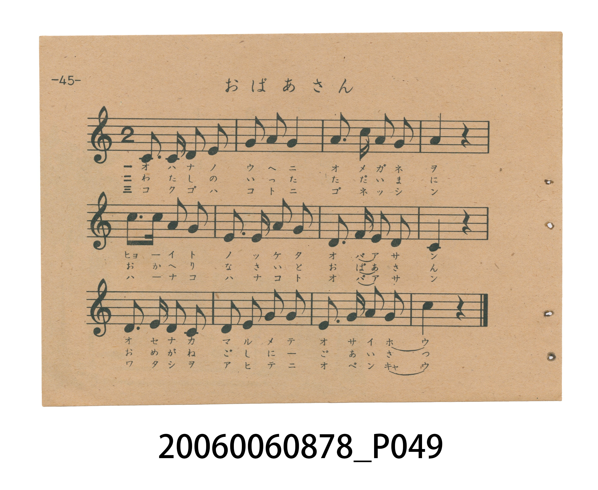
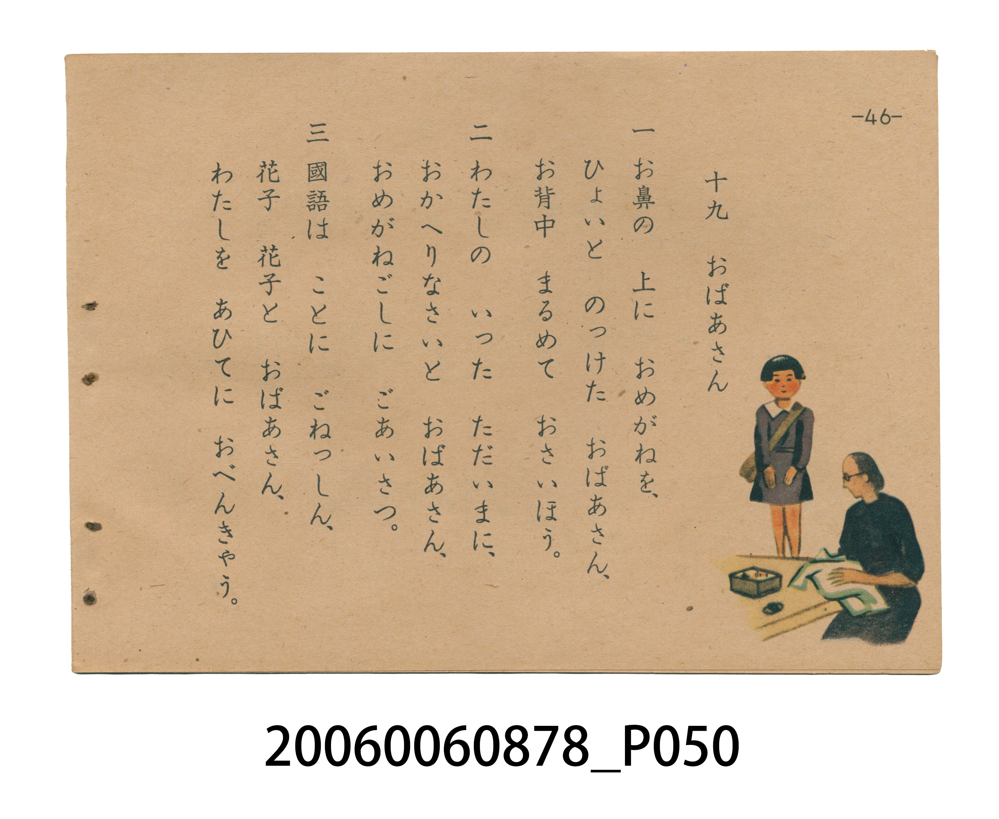

# おばあさん（老奶奶／阿嬤）

> Re:Shōka 使用 AI 協助辨識與重建樂譜，可能會有錯誤。歡迎[回報](https://github.com/TMDLang/reshoka/issues)。

- **鋼琴伴奏版**：<br><audio controls src="obaasan.mp3"></audio>
- **NEUTRINO 歌聲合成版**：<br><audio controls src="obaasan_neutrino.mp3"></audio>

- 日治時期國民學校唱歌（うたのほん 下・第十九課）
- 國立臺灣歷史博物館典藏

## 說明


- 出處：臺灣總督府編《うたのほん 下》（國民學校初等科第二學年用），第十九課〈おばあさん〉（老奶奶／阿嬤），原書第 45–46 頁。
- 調性與拍號：ハ調（C 大調五聲音階，無升降記號，終止於 C5），2/4 拍，速度 != 100。
- 背景與曲風：曲風溫婉親切，共 12 小節。極具歷史意義的是**第三節歌詞與第 46 頁插圖**：第一、二節描寫戴著老花眼鏡彎腰做針線、笑著回應孫女「おかへりなさい」的慈祥祖母，第三節則專為臺灣「國語常用運動」（皇民化時期推廣日語）改編——「國語は ことに ごねっしん、花子 花子と おばあさん、わたしを あひてに おべんきゃう」（阿嬤對學「國語」特別熱心，總是「花子、花子」地叫著我，拿我當練習對象努力學日語），第 46 頁插圖更細膩繪出身穿臺灣傳統大襟衫的阿嬤跪坐裁縫、與背著書包身穿水手領洋裝的孫女「花子」對坐溫習的時代畫面。
- 版本說明：本檔案為原書單聲部五線譜旋律之忠實數位化版本。

### 編曲說明（鋼琴伴奏版）：

1. 前奏 (Intro, 4 小節)：擷取主旋律核心樂句作為導奏，建立調性與拍感。
2. 主歌伴奏 (Obaasan)：右手 (PianoRH) 演奏原書歌唱主旋律；左手 (PianoLH)
依國民學校低學年教材純樸明朗之風格配以和聲伴奏。


## 歌詞

```text
一　お鼻の　上に　おめがねを、
ひょいと　のっけた　おばあさん、
お背中　まるめて　おさいはう。

二　わたしの　いった　ただいまに、
おかへりなさいと　おばあさん、
おめがねごしに　ごあいさつ。

三　國語は　ことに　ごねっしん、
花子　花子と　おばあさん、
わたしを　あひてに　おべんきゃう。
```

## ABC

<div class="abc-score" data-abc-src="obaasan.abc" aria-label="五線譜載入中"></div>

[下載 ABC 原始檔](obaasan.abc)

## TMD 檔案連結

- [主旋律 TMD 檔案](obaasan.tmd) [[在 TMD Studio 編輯](https://tmdlang.github.io/Tmd-TS/#tmd=s7IKdvYPcrWy4qpTUCpJTLdSyC_KTM_MsypJzCxPzIvPT0vLTM5MzFGCyyfn5-SkJpdk5udZlZYk5uVn5OchJMvyc0pzU62MECLF-aVFyalwpfHpqehy8QWJ6alWAQYmlroBBqYGCOmCovyy1LzEPKB2qGvSgQJFeflFQFPyUouQXZValpmSClJZUJSZm1hUGZ-Snwx0SV4JkttSi4pBri7LT0bWmV9UkpGfXpRYkFFplZFZXAL0P1A-PjsxLxGhqCQjFeittMTczJxKJS4tLYXHjV2PGzc8bmx63Dj1cdPk93s6XjQ0Pl26DYje7-l_OWP_0zVL3u_pVNDS4lK0VTA0MOCyt1Vw5rIx0jexA5n6bPrSZ5t2P5vZ9GzO_Kdzup9tmPh07Y5nCxY-nbLx2doeoHGPG9seN85_3LjuceNuoAUKT3Z0P27e_XzNmqe9jU92zn2xahPQeLADgdqfr-5-0b7reePiZ2u3P-3f9LR31vPOlS-XrHjauuPF9H4lLi59LQVbagEuBQWFxw0Tns3e9Hz2uherVj2b0fe4YSJYtHn30_ZdL2ZOfb9nFsQ9z3fsfT538dNdc55vX_G4ARhkmJ5q6Ab6FiUIOuY-X9v5fPlEoGef7OoBCj7dueX5lBVA_77f04McAo8bgMGEEg-PG4BqsEcFUO_TvvnPZu8AmqBgYvqoYbKJmcLLBY2PG5qgbn-xav-zhuUvOtqfdfe-mDkf6InHzf1AQaCJzgpPlywHMp_smvKicdPL-ZtfzuoDOaZl4dPe9pcze1-smAHW0fN8a9OztYueTduj4GwKsRQY4wpAA4Gslw3zn-5apgBJD0jWNvc8m7keZO3sTS8XAb05C8J4tmv105WdL5atetrRDnJ860YFQyOFpxv6n69vAOp-tnTr09btkAh_1tL_fN_K57Nans1Yr6UFCrcdnUBVwJT0YuU8oMlgL4N9-6x_0tM507S0gLaAlQFNagQGMkhxf__T9aufdWx5MXE6MABfdG18PmfPy_6FT_f2vWjd8LRx1sv2uc-3zwKqf75mIlDN09nznrV3Pl27-unSzY8besAR0f24ccfjJiBjFSg6GlseN_SCHNXa8Xzp0udLpz1bDwoGuPOedrY_3dDxvGkXJK0ADQEmgxer5j3dsQMY3S8bu592TwWaAAz-57PaQcmjZxokwzzrW_F092JgFgIqBgbysyk7gcnrUcMUIIIb8rhxPTCTTn7cuOJx42oga8rjxrWPgZY0TgcnE5D_nq6doAChgKrQczRQyeOmfnBqBeqYBJQGSmx63LgMYhxQ7U6Qqsbex03NoGQNdicksT3d0AtMtAiXAAOhc-fTjqXP2zY-3d8MCoEde4ERBVQAtR3mGqDKp3M2PO1fDQzeZx0TgSqfde8HMp5P3fZ8-5bn-ycBTX6xceHTrlVPu2aDMgssBCChihLFz2Zveb5lw4u2lc93rgJlyl2rn6_cDwnop02bn2_dCErQS-e_WLgaGEMQd7_Yvurp3AkvFjc-37Ea5KaOdmDSBDll9o6nPa0QE55t2PKss_vlghnPtnS_WDwXqBeeAhB-APp_7gRg8gW6GBT9M5ue7F78fOrql3MXIVL9886OZ3PWQIoPUJKfs-bZqinPFoKSAySbPp22DpTVmlcA8xww3b1YO-fZ9O6n-7qf7Ox-un_B0_XLnk3d8WRvLzBRQIwCGQ0tmiAGQFL_09YVz6a1A_3yZMdaEGPVvBdrgUEPDNwOtIIAKPKsrxmYDYAOUQBVR0AZUIUEDt9OsNng_NIAjP2Xe3aDSrGGhic7gCkBGFogwcdNjY8bgRlhLTC9AMMP7BhgkmlqB-UEYDoEKQKWfMA0OBGUriB6UJMcRE8XMNyBzgWr2Pe4qRts8DKYBnDGalwPTnTg0ASVeGBvgcKxqwuSbV_smQpEz-ZtezpnBdC1z1ZMBDoVGBvwsvFxwxRItD9uAJbXPaBsDsz4wAhv6Xq2djFQFzzLw1JEEzwYdvWAHAPPHuCQALsK6DeIx4DiC8Ai-8DBA_MYliICGjA4QgIRpqAcDLQKEtZANlApUDPQCKAHMILhRePeF8u6gVkHmMCe7GoDxhswLQHTKFAEWG492dcGFARn2R54eDzZt__lrCnAMICGH7jcBWXH2fOerwWVK8_WLnyxvw_IfboOGHi9yOGxoxPoKni5A3YhtOSBuRal7AHpgeWWBngJhDsYkMohsCJESQTTg1YWYYYHzJeQsgmYMZGLJ2BSgBQlwKRA3aLqxare53PmA0vzp13AdAEOMKDLKG-DQIGClj4Xl39SYmJxYp5VQCawielQY1BTDbJDwcbQTMsOzKpRMFTQBUJDBSMgaQzENQqmQNIMiEE0CNaAeYZxSMIQIRA0gCkCG-djWANKmWARSC2zCsxaB9YDDH8wbweYXA03HqIDmJzB4j1gci1EBli7YLXHCCTXD7VnPhBPR7GnBcxbDJVF2ANiA3MfmISo2QeVgbkGzR5jkNxkqD39oLoS6jOILpAMqIJE9w9EFcgPMFeA3AdyM8QsZHtg8QAKX3AwIwIZFB-gWEGIgGIJFA0gGRAbFn_YIwJUwELd3gJ1J8yFoJCCuA5Y5MLDCTn2NoDqdTBrKk63w-MCrqsbFr9NIBGQDCgFQEyBhTnIHWTZBI4NUNiD1K6CxwzENHRx8uyBxgYknI3BNCiEISKgUAfFA3LsmCLFDjQO8eeK2dAwAYUVxH2gNAisysAkJA8sQ3M5IuxgKQ-UkwjEBdAstNwETZeQvIKeXkFiTXB7oCHUuAS7PaCYwMx_4NwK0gUJ5U1wv0BsQ_bRTmjoQ0pmnJ6q5eLStVOAFmNgq4FcZS4A)]
- [鋼琴伴奏 TMD 檔案](obaasan_piano.tmd) [[在 TMD Studio 編輯](https://tmdlang.github.io/Tmd-TS/#tmd=s7IKdvYPcrWy4qpTUCpJTLdSSM7PyUlNLsnMz7MqLUnMy8_Iz1OCS5bl55TmploZIUSK80uLklPhSuPTU9Hl4gsS01OtAgxMLHUDDEwNENIFRfllqXmJeUDtJYmZ5YlAzUCBorz8IqApealFiTkItallmSmpIJUFRZm5iUWV8Sn5yUCX5JUguS21qBjk6oJMoFPiE4uKEvPSU1GV5BeVZOSnFyUWZFRaZWQWl-QXZSYn5sRnJ-YlIhSVZAB1WaUl5mbmVCpxaWkpPG7sety44XFj0-PGqY-bJr_f0_GiofHp0m1A9H5P_8sZ-5-uWfJ-TydQ_GX3nucTtjzZs-Xp0v7nnR1AQQUtLS5FWwVDAwMue1sFZy4bI30TO5BVz6YvfbZp97OZTc_mzH86p_vZholP1-54tmDh0ykbn63tAZr1uLHtceP8x43rHjfuBtqq8GRH9-Pm3c_XrHna2_hk59wXqzYBjQe7Gqj9-eruF-27njcufrZ2-9P-TU97Zz3vXPlyyYqnrTteTO9X4uLS11KwpRbgUlBQeNww4dnsTc9nr3uxatWzGX2PGyaCRZt3P23f9WLm1Pd7ZkHc83zH3udzFz_dNef59hWPG4DhiOmphm6gb1GCoGPu87Wdz5dPBHr2ya4eoODTnVueT1kBDuMe5BB43AAMJpTIedwAigcc8dPztG_-s9k7gCYomJg-aphsYqbwckHj44YmqNtfrNr_rGH5i472Z929L2bOB3ricXM_UBBoorPC0yXLgcwnu6a8aNz0cv7ml7P6QI5pWfi0t_3lzN4XK2aAdfQ839r0bO2iZ9P2KDibQiwFxrgC0EAg62XD_Ke7lilA0gOStc09z2auB1k7e9PLRUBvzoIwnu1a_XRl54tlq552tIMc37pRwdBI4emG_ufrG4C6ny3d-rR1OyTCn7X0P9-38vmslmcz1mtpgcJtRydQFTAlvVg5D2gy2Mtg3z7rn_R0zjQtLaAtYGVAkxqBgQxS3N__dP3qZx1bXkycDgzAF10bn8_Z87J_4dO9fS9aNzxtnPWyfe7z7bOA6p-vmQhU83T2vGftnU_Xrn66dPPjhh5wRHQ_btzxuAnIWAWKjsaWxw29IEe1djxfuvT50mnP1oOCAe68p53tTzd0PG_aBUkrQEOAyeDFqnlPd-wARvfLxu6n3VOBJgCD__msdlDy6JkGyTDP-lY83b0YmIWAioGB_GzKTmDyetQwBYjghjxuXA_MuZMfN6543LgayJryuHHtY6AljdPByQTkv6drJyhAKKAq9GwOVPK4qR-cWoE6JgGlgRKbHjcugxgHVLsTpKqx93FTMyhZg90JSWxPN_QCEy3CJcBA6Nz5tGPp87aNT_c3g0Jgx15gRAEVQG2HuQao8umcDU_7VwOD91nHRKDKZ937gYznU7c9377l-f5JQJNfbFz4tGvV067ZoMwCCwFIqKJE8bPZW55v2fCibeXznatAmXLX6ucr90MC-mnT5udbN4IS9NL5LxauBsYQxN0vtq96OnfCi8WNz3esBrmpox2YNEFOmb3jaU8rxIRnG7Y86-x-uWDGsy3dLxbPBeqFpwCEH4D-nzsBmHyBLgZF_8ymJ7sXP5-6-uXcRYhUD4wxYDKHFB9Yi05gCgUpVVAw1FN42tkLFFfQ8MwrKcrXUTCB5gJNUF6ZDMwA057s2P1sevfTfd3PFuwAhvGzFU1P-5c-2TsHmLiebugD6gVloN27QOUkUiZ_1jIf6iAFBSM9YGm0G5hjIG5Q0PBPSkwsTswD2fG0fzPQ0woaAaCqJchDU-HZnilANZDiBKgFWGjDHfB-z-yn25chlPt4aEIsAIIn--YiF3RP9vZBCrdnU2c-mzvh-ZYpz1bsAAbHsznTn-zsBpUAC_a8bO19snvp00k9wGIH4jKQi6FFMNwBwFz-tHXFs2ntQH892bEWxFg178VaYBIDJqIOtAIPKPKsrxmY3Z-tmqIAqpeBMqCaGRzmnWCzweVCAzCVv9yzG1RaNzQ82QFM8cBUARJ83NT4uBGY4dcC8wUwnYAdA8waTe2gHA_MbyBFwBIemNcmgvIPRA9q1oLo6QKmL6BzwSr2PW7qBhu8DKYBXIA0rgdnLnAkgUp2sLdA0d7VBSmeXuyZCkTP5m17OmcF0LXPVkwEOhWY6uB1wOOGKZDk_bgBWC_1gIozYAEHTNgtXc_WLgbqghdtsJTfBA-GXT0gx8CLAXBIgF0F9BvEY0DxBWCRfeDggXkMS1EIDRgcIYEIU1BJBbQKEtZANlApUDPQCKAHMILhRePeF8u6gUUEMCM92dUGjDdgOgHmRaAIsHx-sq8NKAgumnrg4fFk3_6Xs6YAwwAafuD6BVTszJ73fC2o_Hy2duGL_X1A7tN1wMDrRQ6PHZ1AV8HLV7ALoSUszLUoZSxID6xUaICXtLiDAam8BStClLgwPWhlLmZ4wHwJKYOBBRByMQxMCpAiE5gUqFskv1jV-3zOfGCt9bQLVKSAAgzoMsrbWlCgoKXPxQUu_KygZZBDjUFNNbhgsTE007IDs2oUjBR0gdAYTBsCMUTEGIhNobgGzAOxzeAihnFgIV0FAyhdw1WLYp0PsnUmcNvM4hWizXJjgSwTOAskZgRmGQNZxiAWyDBoYYrf9SAXg9wNc3MN2H0wd4IdBuaB3YtwPoiF6nqQcT6GNaB8BRaBtAVWgVnrwHqAqQfM2wEmV8ONh-gAZkaweA-YXAuRAbYBsNpjBJLrh9ozH4ino9jTAuYthsoi7AGxgWUHmISo2QeVgbkGzR5jkNxkqD39oBYN1GcQXSAZUDMG3T8QVSA_wFwBch_IzRCzkO2BxQMkPQApRCBDUo0xkggkrZmBZUBsWPxhjwhQ9QB1ewvUnTAXgkIK4jpghQEPJ-TY2wBqfYFZU3G6HR4XcF3dsPhtAomAZEApAGIKLMxB7iDLJnBsgMIepHYVPGYgpqGLk2cPtfM0Zq6YDQ0TUFhB3AdKg8CKGExC8sAyNJcjwg6W8kA5iUBcAM1Cy03QdAnJK-jpFSTWBLcHGkKNS7DbA4oJzPwHzq0gXZBQ3gT3C8Q2ZB_thIY-pF7B6Sn0UoxgoQhigQtAcFEIEUMUigjVkOISW2FqCGQZoirGW94aQJypa6cALrwVgAyok6N9gOYgc41QucZgrjIXAA)]

## 分析

```text
================================================================================
📊 TMD Song Profile: [ おばあさん（老奶奶／阿嬤） ]
================================================================================
⏱  Duration:       0:14 (14.4s), 12 measures total
🎼 Key & Tempo:    首調基準 C, != 100.0 BPM, <2/4>
   - 分析範圍：      由實際發聲的音符與和弦推測調性；播放脈絡另行呈現
🎤 人聲音域:    C4 (MIDI 60) – C5 (MIDI 72) [跨度: 12 個半音 / 1.0 個八度, 難度: easy]
   - 最低音:  C4 in [Obaasan #1 @ m.1, 0:00]
   - 最高音: C5 in [Obaasan #1 @ m.3, 0:02]
   - 適合: soprano, mezzo-soprano, contralto, tenor, baritone, bass
🏛  結構:      Obaasan (14.4s)
⚡ 編曲密度:        Peak 1 軌道同時演奏
🗝  調性診斷：       C 大調（純淨自然大調，未偵測到可信轉調）
   - 風格氣質:    純淨自然大調（陽光明朗、易唱易記，無明顯調外色彩）
   - 轉調歷程:    全曲維持單一推測調性（未偵測到可信轉調）
   - 核心骨幹音:  C, G, A, D, E
   - 調性數值:    C 大調 [相關度: 0.82, 穩定度: Moderate, 自然音純度: 100.0%]
   - 候選調性 (K-S): C 大調 (0.82), G 大調 (0.73), A 小調 (0.71)
   - 五度圈歷程:   +0
   - 各段落調性細節:
     • [Obaasan #1]: C 大調 (r: 0.82, 自然音純度: 100.0%)

  [ 五度圈游移軌跡 ]
              [C ]*
         F            G  
      Bb               D  
      Eb               A  
         Ab           E  
            Db       B  
               F# 
     (* = active key center)

  [ 十二半音累積音高分佈 ]
     C  : ████████████████████████  23.8%
     C# :                            0.0%
     D  : █████████████████         16.7%
     D# :                            0.0%
     E  : █████████████████         16.7%
     F  :                            0.0%
     F# :                            0.0%
     G  : ███████████████████████   22.6%
     G# :                            0.0%
     A  : ████████████████████      20.2%
     A# :                            0.0%
     B  :                            0.0%
--------------------------------------------------------------------------------
Assignment 軌道音域：
  - Piano         : C4 – C5 (12 個半音 / 1.0 個八度, 38 個音符)
================================================================================
```


## 原書掃描頁






