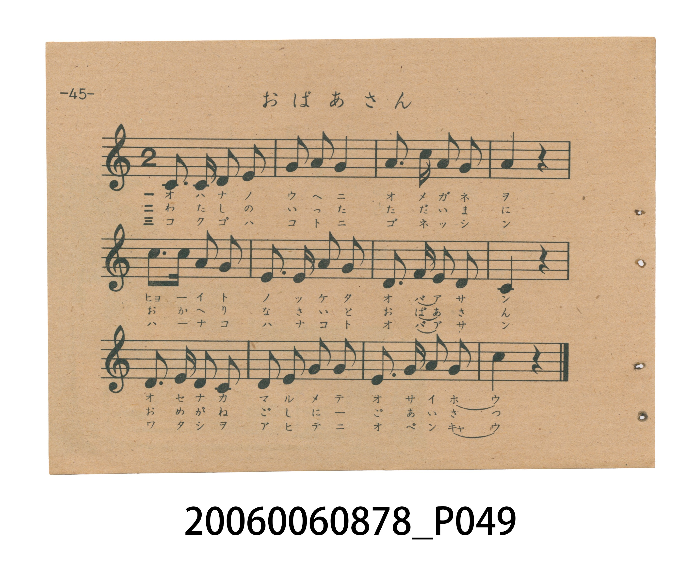
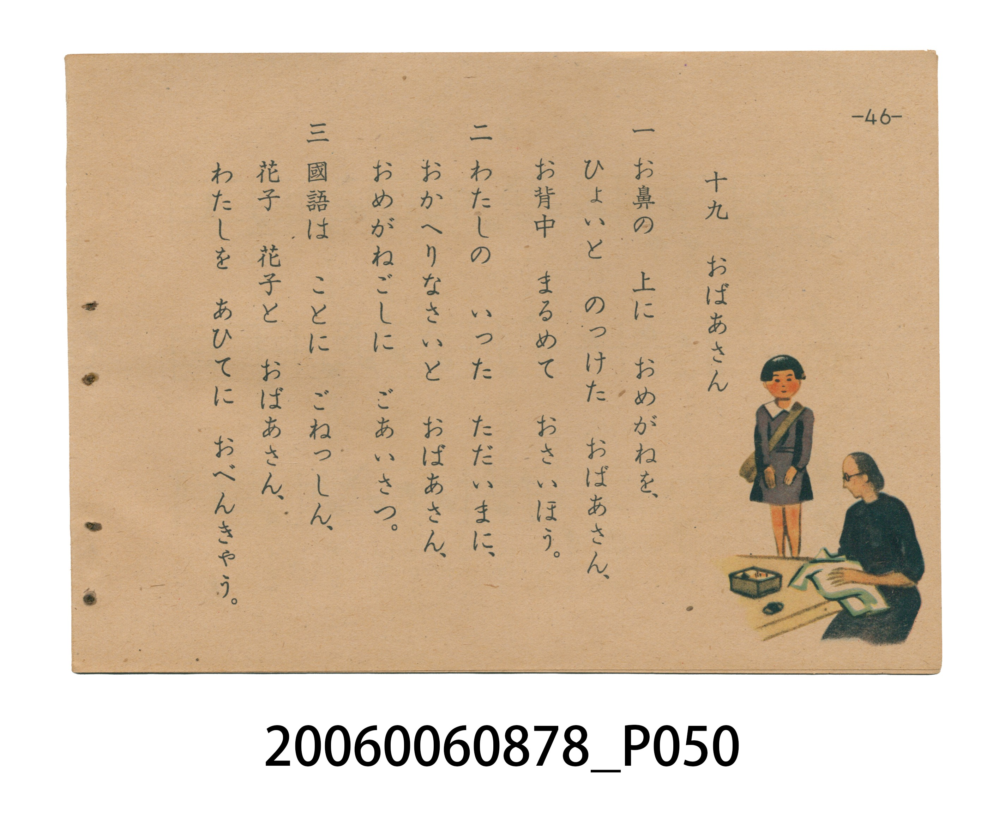

# おばあさん（老奶奶／阿嬤）

> Re:Shoka 使用 AI 協助辨識與重建樂譜，可能會有錯誤。歡迎回報。

<audio controls src="obaasan.mp3"></audio>

- 日治時期國民學校唱歌（うたのほん 下・第十九課）
- 國立臺灣歷史博物館典藏

## 說明

【曲目說明】
・出處：臺灣總督府編《うたのほん 下》（國民學校初等科第二學年用），第十九課〈おばあさん〉（老奶奶／阿嬤），原書第 45–46 頁。
・調性與拍號：ハ調（C 大調五聲音階，無升降記號，終止於 C5），2/4 拍，速度 != 100。
・背景與曲風：曲風溫婉親切，共 12 小節。極具歷史意義的是**第三節歌詞與第 46 頁插圖**：第一、二節描寫戴著老花眼鏡彎腰做針線、笑著回應孫女「おかへりなさい」的慈祥祖母，第三節則專為臺灣「國語常用運動」（皇民化時期推廣日語）改編——「國語は ことに ごねっしん、花子 花子と おばあさん、わたしを あひてに おべんきゃう」（阿嬤對學「國語」特別熱心，總是「花子、花子」地叫著我，拿我當練習對象努力學日語），第 46 頁插圖更細膩繪出身穿臺灣傳統大襟衫的阿嬤跪坐裁縫、與背著書包身穿水手領洋裝的孫女「花子」對坐溫習的時代畫面。
・版本說明：本檔案為原書單聲部五線譜旋律之忠實數位化版本。

・編曲說明（鋼琴伴奏版）：
1. 前奏 (Intro, 4 小節)：擷取主旋律核心樂句作為導奏，建立調性與拍感。
2. 主歌伴奏 (Obaasan)：右手 (PianoRH) 演奏原書歌唱主旋律；左手 (PianoLH)
依國民學校低學年教材純樸明朗之風格配以和聲伴奏。

## 歌詞

```text
一　お鼻の　上に　おめがねを、
ひょいと　のっけた　おばあさん、
お背中　まるめて　おさいはう。

二　わたしの　いった　ただいまに、
おかへりなさいと　おばあさん、
おめがねごしに　ごあいさつ。

三　國語は　ことに　ごねっしん、
花子　花子と　おばあさん、
わたしを　あひてに　おべんきゃう。
```

## ABC

```abc
X:1
T:おばあさん（老奶奶／阿嬤）
M:2/4
L:1/16
Q:1/4=100
K:C
V:V1 name="Piano" snm="Pia"
[V:V1]
C3 C D2 E2 | G2 A2 G4 | A2 c2 A2 G2 | A4 z4 |
c3 c A2 G2 | E3 E A2 G2 | D3 A E2 D2 | C4 z4 |
D3 E D2 C2 | D2 E2 G2 G2 | E3 G A2 G2 | c4 z4 |
```

## TMD 檔案連結

- [主旋律 TMD 檔案](obaasan.tmd) [[在 TMD Studio 編輯](https://tmdlang.github.io/Tmd-TS/#tmd=s7IKdvYPcrWy4tLSUnjc2PW4ccPjxqbHjVMfN01-v6fjRUPj06XbgOj9nv6XM_Y_XbPk_Z5OBS0tLkVbBUMDAy57WwVnLhsjfRM7rjoFpWfTlz7btPvZzKZnc-Y_ndP9bMPEp2t3PFuw8OmUjc_W9gCNe9zY9rhx_uPGdY8bdwMtUHiyo_tx8-7na9Y87W18snPui1WbgMYrgYwCan--uvtF-67njYufrd3-tH_T095ZzztXvlyy4mnrjhfT-5W4uPS1FGypBbgUFBQeN0x4NnvT89nrXqxa9WxG3-OGiWDR5t1P23e9mDn1_Z5ZEPc837H3-dzFT3fNeb59xeMGYJBheqqhG-hblCDomPt8befz5ROBnn2yqwco-HTnludTVgD9-35PD3IIPG4ABhNKPDxuAKrBHhVAvU_75j-bvQNogoKJ6aOGySZmCi8XND5uaIK6_cWq_c8alr_oaH_W3fti5nygJx439wMFgSY6KzxdshzIfLJryovGTS_nb345qw_kmJaFT3vbX87sfbFiBlhHz_OtTc_WLno2bY-CsynEUmCMKwANBLJeNsx_umuZAiQ9IFnb3PNs5nqQtbM3vVwE9OYsCOPZrtVPV3a-WLbqaUc7yPGtGxUMjRSebuh_vr4BqPvZ0q1PW7dDIvxZS__zfSufz2p5NmO9lhYo3HZ0AlUBU9KLlfOAJoO9DPbts_5JT-dM09IC2gJWBjSpERjIIMX9_U_Xr37WseXFxOnAAHzRtfH5nD0v-xc-3dv3onXD08ZZL9vnPt8-C6j--ZqJQDVPZ8971t75dO3qp0s3P27oAUdE9-PGHY-bgIxVoOhobHnc0AtyVGvH86VLny-d9mw9KBjgznva2f50Q8fzpl2QtAI0BJgMXqya93THDmB0v2zsfto9FWgCMPifz2oHJY-eaZAM86xvxdPdi4FZCKgYGMjPpuwEJq9HDVOACG7I48b1wEw6-XHjiseNq4GsKY8b1z4GWtI4HZxMQP57unaCAoQCqkLP0UAlj5v6wakVqGMSUBooselx4zKIcUC1O0GqGnsfNzWDkjXYnZDE9nRDLzDRIlwCDITOnU87lj5v2_h0fzMoBHbsBUYUUAHUdphrgCqfztnwtH81MHifdUwEqnzWvR_IeD512_PtW57vnwQ0-cXGhU-7Vj3tmg3KLLAQgIQqShQ_m73l-ZYNL9pWPt-5CpQpd61-vnI_JKCfNm1-vnUjKEEvnf9i4WpgDEHc_WL7qqdzJ7xY3Ph8x2qQmzragUkT5JTZO572tEJMeLZhy7PO7pcLZjzb0v1i8VygXngKQPgB6P-5E4DJF-hiUPTPbHqye_Hzqatfzl2ESPXPOzuezVkDKT5ASX7OmmerpjxbCEoOkGz6dNo6UFZrXgHMc8B092LtnGfTu5_u636ys_vp_gVP1y97NnXHk729wEQBMQpkNLRoghgASf1PW1c8m9YO9MuTHWtBjFXzXqwFBj0wcDvQCgKgyLO-ZmA2ADpEIcDAxBIoE2BgagAO306w2eD80gCM_Zd7doNKsYaGJzuAKQEYWiDBx02NjxuBGWEtML0Aww_sGGCSaWoH5QRgOgQpApZ8wDQ4EZSuIHpQkxxETxcw3IHOBavY97ipG2zwMpgGcMZqXA9OdODQBJV4YG-BwrGrC5JtX-yZCkTP5m17OmcF0LXPVkwEOhUYG_Cy8XHDFEi0P24Altc9oGwOzPjACG_perZ2MVAXPMvDUkQTPBh29YAcA88e4JAAuwroN4jHgOILwCL7wMED8xiWIgIaMDhCAhGmoBwMtAoS1kA2UClQM9AIoAcwguFF494Xy7qBWQeYwJ7sagPGGzAtAdMoUARYbj3Z1wYUBGfZHnh4PNm3_-WsKcAwgIYfuNwFZcfZ856vBZUrz9YufLG_D8h9ug4YeL3I4bGjE-gqeLkDdiG05IG5FqXsAemB5ZYGeAmEOxiQyiGwIkRJBNODVhZhhgfMl5CyCZgxkYsnYFKAFCXApEDdourFqt7nc-YDS_OnXcB0AQ4woMsob4NAgYKWPheXf1JiYnFinlVAZmJevkONQY1CNcgSBRtDMy07MAvY-gGmACtQegJiUL2wCojXKdQAyTYg3gHEq4HqQHygiqZGIN0DxGtBIsCyHwKAdsEM29UDNKypH6hkPhBPhxvWAsSLwaIQw0CyC6Di-8AiIGvQDNvRCXLZZCAGGTgF7EKQUpAIqFqCuQwksxZqwXSwyyajGlajYKigC4SGCkZA0hiIaxRMgaQZEINoEKwB8wzjkIQhQiBoAFMETtVIwQYqxKDeWAF1zTqoSyaCvQkNucYNoHoSiKciuw894MAquyHh3tQF1guKj6lwG4g1DRJysPiEyIP0IkSINQ0YdKAgAYcMIlxAQQgKSIQIKGBBIQeSAbFhQY4n7EBWz4Y6qBvsmH1A64HeByezZXDnwby_G5oscYcdavoEpwtQEkROJyB_ggwD-7VxCY5Eh5yCgckcpBSkcRPYXSADYW7bCQ4wSAGD5Dx44EGCxRhMgwIEIgIKJFCwIQemKVJgQoMcOexqubh07RSgORrEVObiAgA)]
- [鋼琴伴奏 TMD 檔案](obaasan_piano.tmd) [[在 TMD Studio 編輯](https://tmdlang.github.io/Tmd-TS/#tmd=s7IKdvYPcrWy4tLSUnjc2PW4ccPjxqbHjVMfN01-v6fjRUPj06XbgOj9nv6XM_Y_XbPk_Z5OoPjL7j3PJ2x5smfL06X9zzs7gIIKWlpcirYKhgYGXPa2Cs5cNkb6JnZcdQpKz6YvfbZp97OZTc_mzH86p_vZholP1-54tmDh0ykbn63tAZr1uLHtceP8x43rHjfuBtqq8GRH9-Pm3c_XrHna2_hk59wXqzYBjVcCGQXU_nx194v2Xc8bFz9bu_1p_6anvbOed658uWTF09YdL6b3K3Fx6Wsp2FILcCkoKDxumPBs9qbns9e9WLXq2Yy-xw0TwaLNu5-273oxc-r7PbMg7nm-Y-_zuYuf7przfPuKxw3AcMT0VEM30LcoQdAx9_nazufLJwI9-2RXD1Dw6c4tz6esAIdxD3IIPG4ABhNK5DxuAMUDjvjpedo3_9nsHUATFExMHzVMNjFTeLmg8XFDE9TtL1btf9aw_EVH-7Pu3hcz5wM98bi5HygINNFZ4emS5UDmk11TXjRuejl_88tZfSDHtCx82tv-cmbvixUzwDp6nm9terZ20bNpexScTSGWAmNcAWggkPWyYf7TXcsUIOkBydrmnmcz14Osnb3p5SKgN2dBGM92rX66svPFslVPO9pBjm_dqGBopPB0Q__z9Q1A3c-Wbn3auh0S4c9a-p_vW_l8VsuzGeu1tEDhtqMTqAqYkl6snAc0GexlsG-f9U96OmealhbQFrAyoEmNwEAGKe7vf7p-9bOOLS8mTgcG4Iuujc_n7HnZv_Dp3r4XrRueNs562T73-fZZQPXP10wEqnk6e96z9s6na1c_Xbr5cUMPOCK6HzfueNwEZKwCRUdjy-OGXpCjWjueL136fOm0Z-tBwQB33tPO9qcbOp437YKkFaAhwGTwYtW8pzt2AKP7ZWP30-6pQBOAwf98VjsoefRMg2SYZ30rnu5eDMxCQMXAQH42ZScweT1qmAJEcEMeN64H5tzJjxtXPG5cDWRNedy49jHQksbp4GQC8t_TtRMUIBRQFXo2Byp53NQPTq1AHZOA0kCJTY8bl0GMA6rdCVLV2Pu4qRmUrMHuhCS2pxt6gYkW4RJgIHTufNqx9Hnbxqf7m0EhsGMvMKKACqC2w1wDVPl0zoan_auBwfusYyJQ5bPu_UDG86nbnm_f8nz_JKDJLzYufNq16mnXbFBmgYUAJFRRovjZ7C3Pt2x40bby-c5VoEy5a_XzlfshAf20afPzrRtBCXrp_BcLVwNjCOLuF9tXPZ074cXixuc7VoPc1NEOTJogp8ze8bSnFWLCsw1bnnV2v1ww49mW7heL5wL1wlMAwg9A_8-dAEy-QBeDon9m05Pdi59PXf1y7iJEqgfGGDCZQ4oPrEUnMIWClCooGOopPO3sBYoraHjmlRTl6yiYQHOBJiivTAZmgGlPdux-Nr376b7uZwt2AMP42Yqmp_1Ln-ydA0xcTzf0AfWCMtDuXaByEimTP2uZD3WQgoKRHrA02g3MMRA3KGj4JyUmFifmgex42r8Z6GkFjYDMxLz8IA9NhWd7pgDVQIoToBZgoQ13wPs9s59uX4ZQ7uOhCbEACJ7sm4tc0D3Z2wcp3J5Nnfls7oTnW6Y8W7EDGBzP5kx_srMbVAIs2POytffJ7qVPJ_UAix2Iy0AuhhbBcAcAc_nT1hXPprUD_fVkx1oQY9W8F2uBSQyYiDrQCjygyLO-ZmB2f7ZqikKAgYklUCbAwNQAHOadYLPB5UIDMJW_3LMbVFo3NDzZAUzxwFQBEnzc1Pi4EZjh1wLzBTCdgB0DzBpN7aAcD8xvIEXAEh6Y1yaC8g9ED2rWgujpAqYvoHPBKvY9buoGG7wMpgFcgDSuB2cucCSBSnawt0DR3tUFKZ5e7JkKRM_mbXs6ZwXQtc9WTAQ6FZjq4HXA44YpkOT9uAFYL_WAijNgAQdM2C1dz9YuBuqCF22wlN8ED4ZdPSDHwIsBcEiAXQX0G8RjQPEFYJF94OCBeQxLUQgNGBwhgQhTUEkFtAoS1kA2UClQM9AIoAcwguFF494Xy7qBRQQwIz3Z1QaMN2A6AeZFoAiwfH6yrw0oCC6aeuDh8WTf_pezpgDDABp-4PoFVOzMnvd8Laj8fLZ24Yv9fUDu03XAwOtFDo8dnUBXwctXsAuhJSzMtShlLEgPrFRogJe0uIMBqbwFK0KUuDA9aGUuZnjAfAkpg4EFEHIxDEwKkCITmBSoWyS_WNX7fM58YK31tAtUpIACDOgyyttaUKCgpc_FBS78rKBlkEONQY1CNbhksTE007IDs2oUjBR0gdAYTBsCMUTEGIhNobgGzAOxzeAihnFgIV0FAyhdw1WLYp8Pin0mcOvM4hWizXJjgSwTOAskZgRmGQNZxiAWyDRocYrX_cBWKjAFW4HyAxCD6u9VQLwOaBQwtoF4BxCvBlsMVtHUCKR7gHgtSARYR0MAMKxghu3qARrW1A9UMh-Ip8MNawHixWBRiGEg2QVQ8X1gEZA1aIbt6AS5bDIQgwycAnYhSClIBNR8gLkMJLMWasF0sMsmoxoGDHBwKBvCI6cGHBGwCAHHAJgHjhhEPIFYqNGEFmygQhjqjRVQ16yDumQi2JvQkGvcAGrPAPFUZPehBxxYZTck3Ju6wHpB8TEVbgOxpkFCDhafEHmQXoQIsabB0yqQQoQLJEUbI4lA8oEZWAbEhgU5nrADWT0b6qBusGP2Aa0Heh-czJbBnQfz_m5ossQddqjpE5wuQEkQOZ2A_AkyDOzXxiU4Eh1yCgYmc5BSkMZNYHeBDIS5bSc4wCAFJJLz4IFHzeIBJUMTLiBALHBhAC4WIGKIAgKhGlJ0YCtYDIEsQ1TFeMseA4g7de0UwCWZApABdTNupjIXFwA)]

## 分析

```text
================================================================================
📊 TMD Song Profile: [ おばあさん（老奶奶／阿嬤） ]
================================================================================
⏱  Duration:       0:14 (14.4s), 12 measures total
🎼 Key & Tempo:    首調基準 C, != 100.0 BPM, <2/4>
   - 分析範圍：      由實際發聲的音符與和弦推測調性；播放脈絡另行呈現
🎤 人聲音域:    C4 (MIDI 60) – C5 (MIDI 72) [跨度: 12 個半音 / 1.0 個八度, 難度: easy]
   - 最低音:  C4 in [Obaasan #1 @ m.1, 0:00]
   - 最高音: C5 in [Obaasan #1 @ m.3, 0:02]
   - 適合: soprano, mezzo-soprano, contralto, tenor, baritone, bass
🏛  結構:      Obaasan (14.4s)
⚡ 編曲密度:        Peak 1 軌道同時演奏
🗝  調性診斷：       C 大調（純淨自然大調，未偵測到可信轉調）
   - 風格氣質:    純淨自然大調（陽光明朗、易唱易記，無明顯調外色彩）
   - 轉調歷程:    全曲維持單一推測調性（未偵測到可信轉調）
   - 核心骨幹音:  C, G, A, D, E
   - 調性數值:    C 大調 [相關度: 0.82, 穩定度: Moderate, 自然音純度: 100.0%]
   - 候選調性 (K-S): C 大調 (0.82), G 大調 (0.73), A 小調 (0.71)
   - 五度圈歷程:   +0
   - 各段落調性細節:
     • [Obaasan #1]: C 大調 (r: 0.82, 自然音純度: 100.0%)

  [ 五度圈游移軌跡 ]
              [C ]*
         F            G  
      Bb               D  
      Eb               A  
         Ab           E  
            Db       B  
               F# 
     (* = active key center)

  [ 十二半音累積音高分佈 ]
     C  : ████████████████████████  23.8%
     C# :                            0.0%
     D  : █████████████████         16.7%
     D# :                            0.0%
     E  : █████████████████         16.7%
     F  :                            0.0%
     F# :                            0.0%
     G  : ███████████████████████   22.6%
     G# :                            0.0%
     A  : ████████████████████      20.2%
     A# :                            0.0%
     B  :                            0.0%
--------------------------------------------------------------------------------
Assignment 軌道音域：
  - Piano         : C4 – C5 (12 個半音 / 1.0 個八度, 38 個音符)
================================================================================
```


## 原書掃描頁






