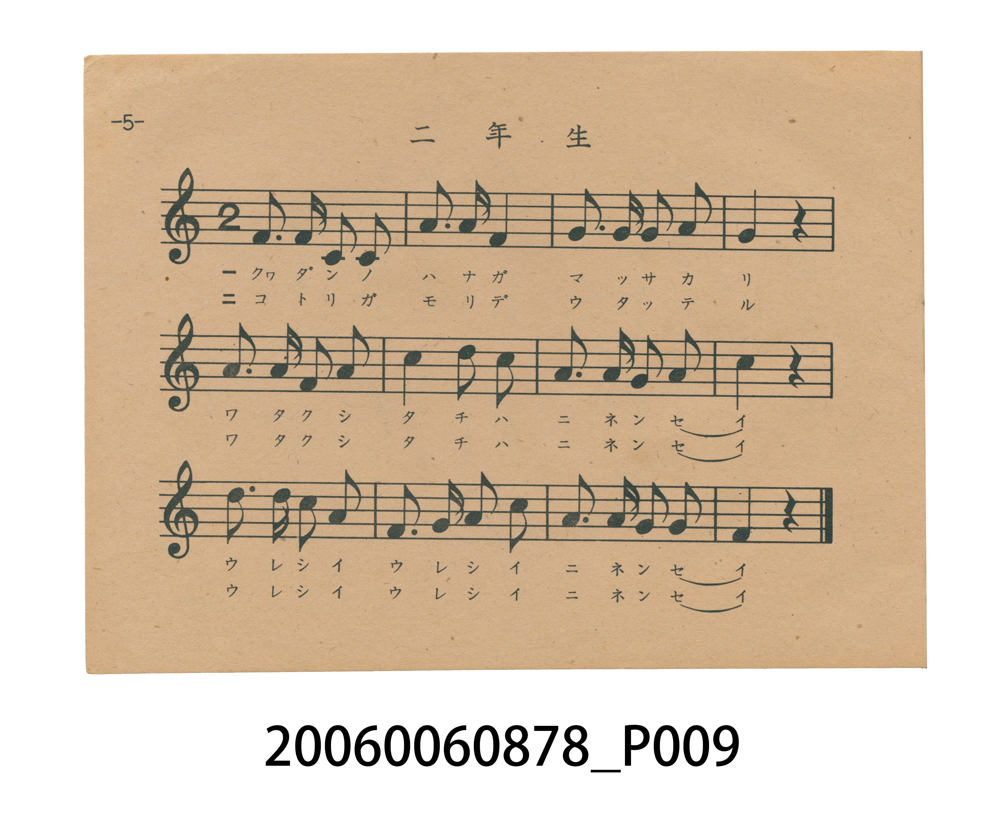
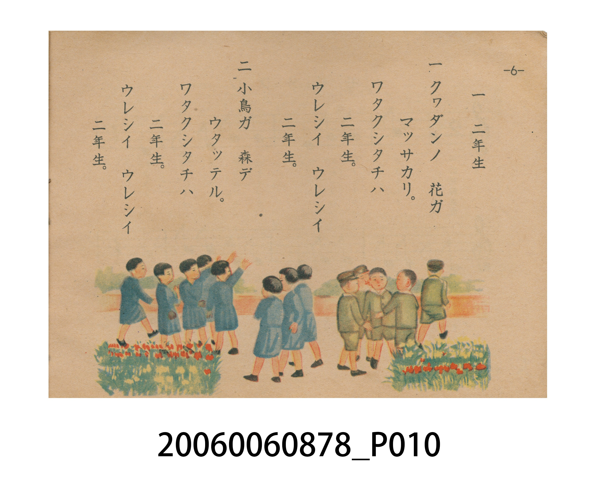

# 二年生

> Re:Shōka 使用 AI 協助辨識與重建樂譜，可能會有錯誤。歡迎回報。

- **鋼琴伴奏版**：<br><audio controls src="ninensei.mp3"></audio>
- **NEUTRINO 歌聲合成版**：<br><audio controls src="ninensei_neutrino.mp3"></audio>

- 日治時期國民學校唱歌（うたのほん 下・第一課）
- 國立臺灣歷史博物館典藏

## 說明


- 出處：臺灣總督府編《うたのほん 下》（國民學校初等科第二學年用，昭和 18 年／1943 年），第一課〈二年生〉，原書第 5–6 頁。
- 調性與拍號：ヘ調（F 大調五聲音階，原書五線譜省略調號，實際音高終止於 F 音），2/4 拍，速度 != 100。
- 背景與曲風：井上武士作曲、小學國語讀本／文部省作詞。作為二年級開學第一首歌曲，第一節描繪花壇繁花盛開的春日校園，第二節描寫森林裡小鳥歡唱，並以反覆呼應的「ワタクシタチハ 二年生、ウレシイ ウレシイ 二年生」展現升上二年級學童的喜悅與朝氣。
- 版本說明：本檔案為原書單聲部五線譜旋律之忠實數位化版本。

### 編曲說明（鋼琴伴奏版）：

1. 前奏 (Intro, 4 小節)：擷取主旋律核心樂句作為導奏，建立調性與拍感。
2. 主歌伴奏 (Ninensei)：右手 (PianoRH) 演奏原書歌唱主旋律；左手 (PianoLH)
依國民學校低學年教材純樸明朗之風格配以和聲伴奏。


## 歌詞

```text
一　クヮダンノ　花ガ
マッサカリ。
ワタクシタチハ　二年生。
ウレシイ　ウレシイ
二年生。

二　小鳥ガ　森デ
ウタッテル。
ワタクシタチハ　二年生。
ウレシイ　ウレシイ
二年生。
```

## ABC

```abc
X:1
T:二年生
M:2/4
L:1/16
Q:1/4=100
K:F
V:V1 name="Piano" snm="Pia"
[V:V1]
F3 F C2 C2 | A3 A F4 | G3 G G2 A2 | G4 z4 |
w: 1.~クヮ ダ ン ノ | ハ ナ ガ | マ ッ サ カ | リ
w: 2.~コ ト リ ガ | モ リ デ | ウ タ ッ テ | ル
A3 A F2 A2 | c4 d2 c2 | A3 A G2 A2 | c4 z4 |
w: 1.~ワ タ ク シ | タ チ ハ | ニ ネ ン セ | イ
w: 2.~ワ タ ク シ | タ チ ハ | ニ ネ ン セ | イ
d3 d c2 A2 | F3 G A2 c2 | A3 A G2 G2 | F4 z4 |
w: 1.~ウ レ シ イ | ウ レ シ イ | ニ ネ ン セ | イ
w: 2.~ウ レ シ イ | ウ レ シ イ | ニ ネ ン セ | イ
```

## TMD 檔案連結

- [主旋律 TMD 檔案](ninensei.tmd) [[在 TMD Studio 編輯](https://tmdlang.github.io/Tmd-TS/#tmd=s7IKdvYPcrWy4qpTUCpJTLdSyC_KTM_MsypJzCzOyI8H4vLE-NzEzLycxLwUJS4tLYUnu3qe7tzyfMp8BS0tLkVbBUMDAy57WwU3LhsjfRM7kDnPpi99tmn3s5lNz-bMfzqn-9mGiU_X7ni2YOHTKRufre15v6fjcWPb48b5jxvXPW7c_bhpssKTHd2Pm3c_X7PmyY6GF6s2vd_TqQQyB6j3-eruF-27njcufrZ2-9P-TU97Zz3vXPlyyYqnrTteTO9X4uLS11KwpRbgUlBQeNww4dnsTc9nr3uxatWzGX2PGyaCRZt3P23f9WLm1Pd7ZkHc83zH3udzFz_dNef59hWPG7qw-aihG-hVFP93zH2-tvP58okgnwJDce0OcECueL-n59mMtU8n9SgYWigAhd7v6Te0NDGGMDuBsvCQedzQAQ_-xw0gqad985_N3gFUoGD6qGGymcLLBY2PG5qgbn6xav-zhuUvOtqfdfe-mDkf6PjHzTOAgkB3uSk8XbIcyHyya8qLxk0v529-OasPbhxQ8Pn2WS_Wznk-p_H51KVAZWDdPU_XL3s5azZI8eoZz7c2PVu76Nm0PQpuCkARiEOBKUABaBeQ9bJh_tNdyxQg6QPJRc09z2auB7lo9qaXi4A-n_Vk19QnO7qerV32dPHqJ3vnAMUfNzQ-3dAPCp053S9WzXuxruHZnDXAMHk2rf1l8wqgk4DKXqycBzQUyHjetAsaIltmvZzWDdQFCayXy6YB0xrQNHjwPV_f8Ky___nOVS-6Nj5d3P58ZyOQ8Xz2bKCu57Nans1YCkq2wEiaMwmqZVcPRMvT9aufLV73bN70F4sXAh32cvPSZ2tBaRmo7MmOZU92L33a3_tiWdvTiXuetXcCjXrc0PO4ef3jpv2Pm4DkdhCjufFxcz8i5wB9-Lhp2ePmNWDpJQooHCRVvU83Tn3ev-9pbzswiODeBPlx9VKgRU-nzXnW1AoKzDlzn21YjAjl550dwCCDpGBgEAPZz1ZNebawAxhYkAh-Om0dKNabV8Bj-tn07qf7up_s7H66fwEwmp9N3fFkb-_TnmkQo0BGQ3MHxABg2AKj4GnrCmCkAB3wZMdaEAMYWWvXA7MMMH2hpEgg_1lfMzAogc5QCDAwsARKBBgYGoATTSfYZGAEPW5oAIVY87rHzQ2Pmzc_bgbmvgZgHD1uWgPx17zHzc2Pm7Y-blr9uHkV3LdYQhqoDykUIeqQghhsEYILth5NOdDFEN-AMjw4vQAjHxjkQPazOVufrV0MSThA1c86Jj5tmPhsxnp4_EBMebp0Lyg97m8GJWcYG2gCmjK4_3f1AJ0FSV5ADwPZwDT3uLkd5naQ15ofN7c9bl5NP59DnPN0zgp4-gfGOzDlU8fbQMsoL7OhQEFLn4vLLzMvNa84NdMqIDMxL9-hxqCmGmSJgo2hmZYdmFWjYKigC4SGCqbxQApM1CgYg8WMoXIgESMwbQSmQbIwEV0FA5gasHk-hjXA8AWlWbAgMOEC8WYwqw-sDZTtITJdQIVr4BYAE7OCLkSiGSixFcRqWg2VWoXdLiOQXSDDQbo6oOoghoJ0LYLKrALidoRFTcugFjXtB1sGUtIG1QKyENUiaCghhwjE_6ZQJWagYEMJNUQYwdRgCaPm9RDXgRzRBGIDEyDUffuhqoEJGEyCAgykoxsq2gsL0qbdUB1LcIcPje2BBg8oEEBBAfIwxOuQpGME5mEGDwjD1GBPQsBIAjtiDdTBEMvxypAXQDS3qZaLS9dOAZYVwRYD-cpcAA)]
- [鋼琴伴奏 TMD 檔案](ninensei_piano.tmd) [[在 TMD Studio 編輯](https://tmdlang.github.io/Tmd-TS/#tmd=s7IKdvYPcrWy4tLSUniyq-fpzi3Pp8x_v6fjZfee5xO2PNmz5enS_uedHe_3dCpoaXEp2ioYGhhw2dsquHHZGOmb2HHVKSg9m7702abdz2Y2PZsz_-mc7mcbJj5du-PZgoVPp2x8trYHaNbjxrbHjfMfN6573Lj7cdNkhSc7uh83736-Zs2THQ0vVm0Cmq0EMgeo9_nq7hftu543Ln62dvvT_k1Pe2c971z5csmKp607XkzvV-Li0tdSsKUW4FJQUHjcMOHZ7E3PZ697sWrVsxl9jxsmgkWbdz9t3_Vi5tT3e2ZB3PN8x97ncxc_3TXn-fYVjxu6sPmooRvoVRT_d8x9vrbz-fKJIJ8Cg3btDnDorni_p-fZjLVPJ_UoGFooAIXe7-k3tDQxhjA7gbLwkHnc0AGPk8cNIKmnffOfzd4BVKBg-qhhspnCywWNjxuaoG5-sWr_s4blLzran3X3vpgJjMVZj5tnAAWB7nJTeLpkOZD5ZNeUF42bXs7f_HJWH9w4oODz7bNerJ3zfE7j86lLgcrAunuerl_2ctZskOLVM55vbXq2dtGzaXsU3BSAIhCHAlOAAtAuIOtlw_ynu5YpQNIHkouae57NXA9y0exNLxcBfT7rya6pT3Z0PVu77Oni1U_2zgGKP25ofLqhHxQ6c7pfrJr3Yl3DszlrgGHybFr7y-YVQCcBlb1YOQ9oKJDxvGkXNES2zHo5rRuoCxJYL5dNA6Y1oGnw4Hu-vuFZf__znatedG18urj9-c5GIOP57NlAXc9ntTybsRSUbIGRNGcSVMuuHoiWp-tXP1u87tm86S8WLwQ67OXmpc_WgtIyUNmTHcue7F76tL_3xbK2pxP3PGvvBBr1uKHncfP6x037HzcBye0gRnPj4-Z-RHYC-vBx07LHzWvA0ksUUDhIqnqfbpz6vH_f0952YBDBvQny4-qlQIueTpvzrKkVFJhz5j7bsBgRysA0CfQ5JAVjzbrAcAcpVVAw1FN42tkLFFfQ8MwrKcrXUTBRAPoR6HFNoJpnk4GZbtqTHbufTe9-uq_72YIdT_c3P1vR9LR_KSTon27oA-oFpYzdu0BZFSm9PWsBegDsIAUFIz1ghtgNjA-IGxQ0_DLzUvOKUzNBljzt3_yss1tBIyAzMS8_yENT4dmeKUBFkJQI1AMMabgL3u-Z_XT7MoRyHw9NiA1A8GTfXOTM9mRvHySDPZs689ncCc-3THm2YgcwPJ7Nmf5kZzcw7T1bsOdlay8o-ib1ALMAxGkgJ0OLAbgDgGntaesKYOoDeuzJjrUgBjBVrl0PLBuAgYuS9YD8Z33NwDTzbNUUhQADA0ugRICBoQE4yDvBJgNT4uOGBlDSaF73uLnhcfPmx83AYqYBmBgfN62BROC8x83Nj5u2Pm5a_bh5FTxasSQpoD6k5AJRh5SWwBYhuGDr0ZQDXQzxDahkA2cMYCoHpi0g-9mcrc_WLobkEKDqZx0TnzZMfDZjPTwhQkx5unQvKOPtbwblWxgbaAKaMrj_d_UAnQXJR0APA9nAzPW4uR3mdpDXmh83tz1uXk0_n0Oc83TOCnhGhyQ86ngbaBnllRMUKGjpc3GBs6oVNMM41BjUVINzgY2hmZYdmFWjYKagC4RmCqZA0hiIaxQMwSJGYB5ItAbMAskagcURanQVDKB0DVctim0-yLaZICyLj1eINsuNBZkAZBmCGKYgMVNkIZBZsIyP3_EQZxgCzQC5FUQgHAtzYg3YySCHg2iIFyEiyM4HmedjWANMG6D8BhYEZjog3gxm9YG1gcpmiEwXUOEauAXAjKigC5FoBkpsBbGaVkOlVmG3ywhkF8hwkK4OqDqIoSBdi6Ayq4C4HWFR0zKoRU37wZaBlLRBtYAsRLUIGkrIIQLxPyhaIdGOLYpR1WAJo-b1ENeBHNEEYgMzD9R9-6GqgZkPTIICDKSjGyraCwvSpt1QHUtwhw-N7aFyDkAkIWAkgR2xBupgiOV4ZcgLIJrbhJETcWRseG7Gkq3hLJxqMTURW14YQNyoa6cALnwUgAyYe6N9gMpR-EZgvjIXAA)]

## 分析

```text
================================================================================
📊 TMD Song Profile: [ 二年生 ]
================================================================================
⏱  Duration:       0:14 (14.4s), 12 measures total
🎼 Key & Tempo:    首調基準 F, != 100.0 BPM, <2/4>
   - 分析範圍：      由實際發聲的音符與和弦推測調性；播放脈絡另行呈現
🎤 人聲音域:    C4 (MIDI 60) – D5 (MIDI 74) [跨度: 14 個半音 / 1.2 個八度, 難度: moderate]
   - 最低音:  C4 in [Ninensei #1 @ m.1, 0:00]
   - 最高音: D5 in [Ninensei #1 @ m.6, 0:06]
   - 適合: soprano, mezzo-soprano, contralto, tenor, baritone, bass
🏛  結構:      Ninensei (14.4s)
⚡ 編曲密度:        Peak 1 軌道同時演奏
🗝  調性診斷：       A 調性不明確（純淨自然大調，未偵測到可信轉調）
   - 風格氣質:    純淨自然大調（陽光明朗、易唱易記，無明顯調外色彩）
   - 轉調歷程:    全曲維持單一推測調性（未偵測到可信轉調）
   - 核心骨幹音:  A, C, F, G, D
   - 調性數值:    A 調性不明確 [相關度: 0.74, 穩定度: Ambiguous, 自然音純度: 100.0%]
   - 候選調性 (K-S): A 小調 (0.74), F 大調 (0.74), C 大調 (0.68)
   - 五度圈歷程:   +3
   - 各段落調性細節:
     • [Ninensei #1]: A 調性不明確 (r: 0.74, 自然音純度: 100.0%)

  [ 五度圈游移軌跡 ]
               C  
         F            G  
      Bb               D  
      Eb              [A ]*
         Ab           E  
            Db       B  
               F# 
     (* = active key center)

  [ 十二半音累積音高分佈 ]
     C  : █████████████████         21.4%
     C# :                            0.0%
     D  : ██████                     7.1%
     D# :                            0.0%
     E  :                            0.0%
     F  : ████████████████          20.2%
     F# :                            0.0%
     G  : ████████████████          20.2%
     G# :                            0.0%
     A  : ████████████████████████  31.0%
     A# :                            0.0%
     B  :                            0.0%
--------------------------------------------------------------------------------
Assignment 軌道音域：
  - Piano         : C4 – D5 (14 個半音 / 1.2 個八度, 37 個音符)
================================================================================
```


## 原書掃描頁






