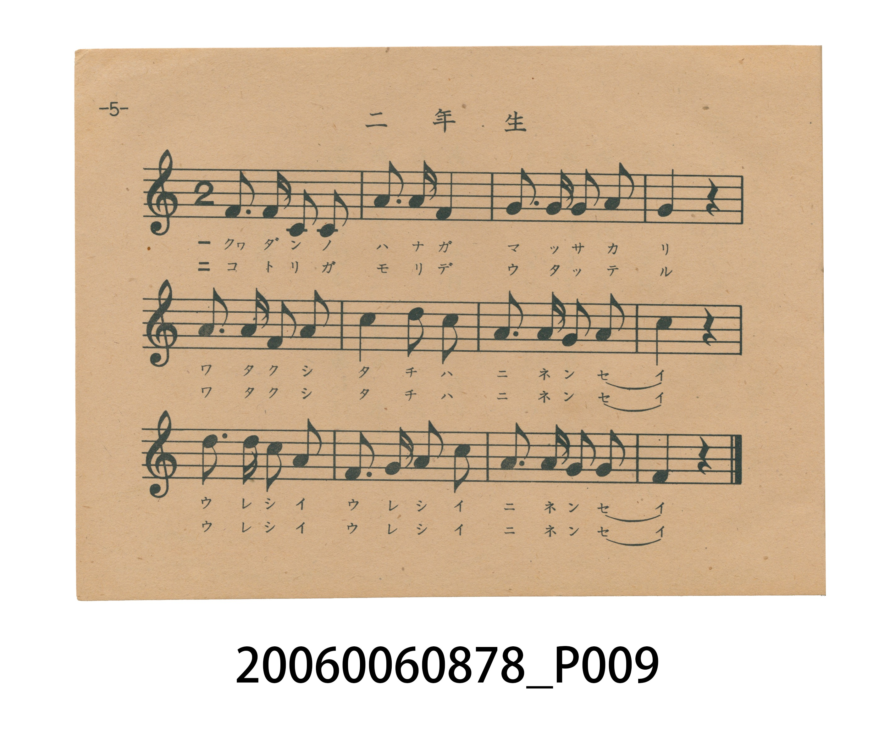
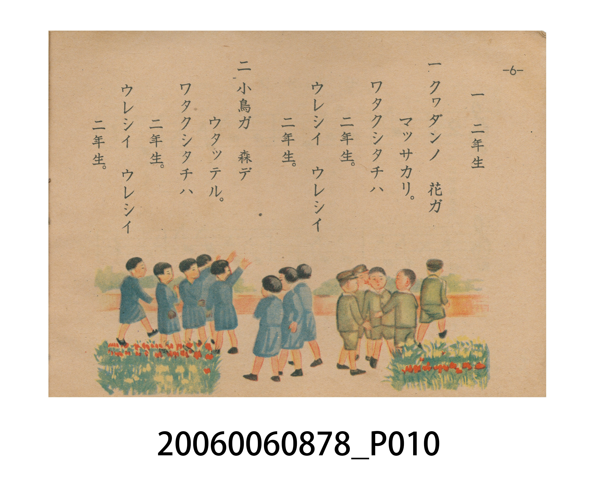

# 二年生

> Re:Shoka 使用 AI 辨識樂譜，可能會有錯誤。歡迎回報。

<audio controls src="ninensei.mp3"></audio>

- 日治時期國民學校唱歌（うたのほん 下・第一課）
- 國立臺灣歷史博物館典藏

## 說明

【曲目說明】
・出處：臺灣總督府編《うたのほん 下》（國民學校初等科第二學年用，昭和 18 年／1943 年），第一課〈二年生〉，原書第 5–6 頁。
・調性與拍號：ヘ調（F 大調，原書五線譜依國民學校低學年視唱教學慣例省略調號，實際音高終止於 F 音），2/4 拍，速度 != 100。
・背景與曲風：井上武士作曲、小學國語讀本／文部省作詞。作為二年級開學第一首歌曲，第一節描繪花壇繁花盛開的春日校園，第二節描寫森林裡小鳥歡唱，並以反覆呼應的「ワタクシタチハ 二年生、ウレシイ ウレシイ 二年生」展現升上二年級學童的喜悅與朝氣。
・版本說明：本檔案為原書單聲部五線譜旋律之忠實數位化版本。

・編曲說明（鋼琴伴奏版）：
1. 前奏 (Intro, 4 小節)：擷取主旋律核心樂句作為導奏，建立調性與拍感。
2. 主歌伴奏 (Ninensei)：右手 (PianoRH) 演奏原書歌唱主旋律；左手 (PianoLH)
依國民學校低學年教材純樸明朗之風格配以和聲伴奏。

## 歌詞

```text
一　クヮダンノ　花ガ
マッサカリ。
ワタクシタチハ　二年生。
ウレシイ　ウレシイ
二年生。

二　小鳥ガ　森デ
ウタッテル。
ワタクシタチハ　二年生。
ウレシイ　ウレシイ
二年生。
```

## ABC

```abc
X:1
T:二年生
M:2/4
L:1/16
Q:1/4=100
K:F
V:V1 name="Piano" snm="Pia"
[V:V1]
F3 F D2 C2 | G3 G F4 | F3 F F2 G2 | A4 z4 |
A3 A F2 A2 | c4 d2 c2 | A3 A G2 A2 | c4 z4 |
d3 d c2 A2 | F2 G2 A2 c2 | G3 G A2 G2 | F4 z4 |
```

## TMD 檔案連結

- [主旋律 TMD 檔案](ninensei.tmd) [[在 TMD Studio 編輯](https://tmdlang.github.io/Tmd-TS/#tmd=s7IKdvYPcrWy4tLSUniyq-fpzi3Pp8xX0NLiUrRVMDQw4LK3VXDjsjHSN7HjqlNQejZ96bNNu5_NbHo2Z_7TOd3PNkx8unbHswULn07Z-Gxtz_s9HY8b2x43zn_cuO5x4-7HTZMVnuzofty8-_maNU92NLxYten9nk4lkDlAvc9Xd79o3_W8cfGztduf9m962jvreefKl0tWPG3d8WJ6vxIXl76Wgi21AJeCgsLjhgnPZm96Pnvdi1Wrns3oe9wwESzavPtp-64XM6e-3zML4p7nO_Y-n7v46a45z7eveNzQhc1HDd1Ar6L4v2Pu87Wdz5dPBPkUGIprd4ADcsX7PT3PZqx9OqlHwdBCASj0fk-_oaWJMYTZCZSFh8zjhg548D9uAEk97Zv_bPYOoAIF00cNk80UXi5ofNzQBHXzi1X7nzUsf9HR_qy798XM-UDHP26eARQEustN4emS5WAm1Ignu6Y83z7rxdo5T_bNRXb0k719EIe-WDYNFIFTZ4LEWxc_2df9fE7j86lLgYaAze55un7Zy1mzX87f_HL1jOdbm56tXfRs2h4FNwWgCMQbwPShAHQJkPWyYf7TXcsUIKkHyb3NPc9mrge5d_aml4uA4TLrya6pT3Z0PVu77Oni1U_2zgGKP25ofLqhH-SkOd0vVs17sa7h2Zw1wBB7Nq39ZfMKoJOAyl6snAc0FMh43rQLGl5bZr2c1g3UBQnKl8umAVMi0DR44D5f3_Csv__5zlUvujY-Xdz-fGcjkPF89mygruezWp7NWApK1MAonDMJqmVXD0TL0_Wrny1e92ze9BeLFwId9nLz0mdrQSkdqOzJjmVPdi992t_7Ylnb04l7nrV3Ao163NDzuHn946b9j5uA5HYQo7nxcXM_Il8Bffi4adnj5jVg6SUKKBwkVb1PN0593r_vaW87MIjg3gT5cfVSoEVPp8151tQKCsw5c59tWIwI5eedHcAgg6RvYBAD2c9WTXm2sAMYWJCk8HTauheNm4ChCU8Tz6Z3P93X_WRn99P9C4DR_Gzqjid7e5_2TIMYBTIamncgBgDDFhgFT1tXACMF6IAnO9aCGMDIWrsemKGAqQ8lvQL5z_qagUEJdIZCgIGBJVAiwMDQAJxoOsEmAyPocUMDKMSa1z1ubnjcvPlxMzBvNgDj6HHTGoi_5j1ubn7ctPVx0-rHzavgvsUS0kB9SKEIUYcUxGCLEFyw9WjKgS6G-AZUHIDTCzDygUEOZD-bs_XZ2sWQhANU_axj4tOGic9mrIfHD8SUp0v3gtLj_mZQcoaxgSagKYP7f1cP0FmQ5AX0MJANTHOPm9thbgd5rflxc9vj5tX08znEOU_nrICnf2C8A1M-dbwNtIzyEh0KFLT0ubj8MvNS84pTM60CMhPz8h1qDGoUqkG2KNhYaNmBGcC6BJjQrIBhAkpnwCAEJTQg1QfE_Qo1QLILKLcGpBTMA6U4oMBWIF4NFlgFllIAWQczb1cPyLzN4BjpACuBmABSvgjCb24Hc5uWgaMDFJNAsTawitXIxtUoaBgq6OoqGGqqaujqaiqYxSuYxoNEjUCiRlBRoBIMlYYKRkAxY6CMAUgWnKQQvm1eD7IW5Gsg3g52CpDX3Aj3dTcQ9wLxZrDcbiBegsWTlBkDdDLQfboKxnAnGwPFTIHONQOS6LJGcFlsHgKGJDARg10BsgMStmgiRHqKcqOATjcDOd0M6nRTsNNBMWIM8RhK7BmDYwoUhxCP1XJx6dopwJIuiK3MBQA)]
- [鋼琴伴奏 TMD 檔案](ninensei_piano.tmd) [[在 TMD Studio 編輯](https://tmdlang.github.io/Tmd-TS/#tmd=s7IKdvYPcrWy4tLSUniyq-fpzi3Pp8x_v6fjZfee5xO2PNmz5enS_uedHe_3dCpoaXEp2ioYGhhw2dsquHHZGOmb2HHVKSg9m7702abdz2Y2PZsz_-mc7mcbJj5du-PZgoVPp2x8trYHaNbjxrbHjfMfN6573Lj7cdNkhSc7uh83736-Zs2THQ0vVm0Cmq0EMgeo9_nq7hftu543Ln62dvvT_k1Pe2c971z5csmKp607XkzvV-Li0tdSsKUW4FJQUHjcMOHZ7E3PZ697sWrVsxl9jxsmgkWbdz9t3_Vi5tT3e2ZB3PN8x97ncxc_3TXn-fYVjxu6sPmooRvoVRT_d8x9vrbz-fKJIJ8Cg3btDnDorni_p-fZjLVPJ_UoGFooAIXe7-k3tDQxhjA7gbLwkHnc0AGPk8cNIKmnffOfzd4BVKBg-qhhspnCywWNjxuaoG5-sWr_s4blLzran3X3vpgJjMVZj5tnAAWB7nJTeLpkOZgJNeLJrinPt896sXbOk31zkR39ZG8fxKEvlk0DReDUmSDx1sVP9nU_n9P4fOpSoCFgs3uerl_2ctbsl_M3v1w94_nWpmdrFz2btkfBTQEoAvEGMH0oAF0CZL1smP901zIFSOpBcm9zz7OZ60Hunb3p5SJguMx6smvqkx1dz9Yue7p49ZO9c4Dijxsan27oBzlpTveLVfNerGt4NmcNMMSeTWt_2bwC6CSgshcr5wENBTKeN-2ChteWWS-ndQN1QYLy5bJpwJQINA0euM_XNzzr73--c9WLro1PF7c_39kIZDyfPRuo6_mslmczloISNTAK50yCatnVA9HydP3qZ4vXPZs3_cXihUCHvdy89NlaUEoHKnuyY9mT3Uuf9ve-WNb2dOKeZ-2dQKMeN_Q8bl7_uGn_4yYguR3EaG583NyPyGxAHz5uWva4eQ1YeokCCgdJVe_TjVOf9-972tsODCK4N0F-XL0UaNHTaXOeNbWCAnPO3GcbFiNCGZhigT6HpG-sGRsY7iClCgqGegpPO3uB4goannklRfk6CiYKQD8CPa4JVPNsMjBLTnuyY_ez6d1P93U_W7Dj6f7mZyuanvYvhQT90w19QL2glLF7FygjI6XGZy1AD4AdpKBgpAfMLruB8QFxg4KGX2Zeal5xaibIkqf9m591ditoBGQm5uUHeWgqPNszBagIkmaBeoAhDXfB-z2zn25fhlDu46EJsQEIcKVqYHp-NnfC8y1Tnq3YAQyPZ3OmP9nZDUx7zxbsednaC4q-ST0vGjdBnAZyMrSQgDsAmNaetq4Apj6gx57sWAtiAFPl2vXAkgMYuCgZE8h_1tcMTDPPVk1RCDAwsARKBBgYGoCDvBNsMjAlPm5oACWN5nWPmxseN29-3AwshBqAifFx0xpIBM573Nz8uGnr46bVj5tXwaMVS5IC6kNKLhB1SGkJbBGCC7YeTTnQxRDfgMo9cMYApnJg2gKyn83Z-mztYkgOAap-1jHxacPEZzPWwxMixJSnS_eCMt7-ZlC-hbGBJqApg_t_Vw_QWZB8BPQwkA3MXI-b22FuB3mt-XFz2-Pm1fTzOcQ5T-esgGd0SMKjjreBllFedUGBgpY-Fxc4q1pBM4xDjUGNQjU4G9hYaNmBGTUKGmYKuroKZpqqGrq6mgqmCsZAMUMFIyBtCpI1AskaQWWNgeIgWV0FAyCu4apFscEHxQYTuA0m8QrRJrEgjUCGIYhhCmSYIouATIJldXzOBVbxwGxhBYxBUK4ARjgoWwCpPiDuB5r3uLkLKLcGnM1BPFD-AApsBeLVYIFV0DIAGDgw83b1gMzbDE4_HWAlEBNAyhdB-M3tYG7TMnDiAaU7oFgbWMVqZOOA4QUMHF0FQ2h4mcWDvIoeiqDwQ1cJCvEaYPjCQhbVt83rQdaCfA3E28FOAfKaG-G-7gbiXiDeDJbbDcRLsHiSMmOATga6T1fBGO5kUFIxBTrXDJJUUGRBCQgii81DwJAEZjmwK0B2QMIWTYRIT1FuFMV5ADXl4soGKKkfzICLwLMBFpUo-QQuQlTWMoA4T9dOAZxLFYAMmFPR2cpcAA)]

## 分析

```text
================================================================================
📊 TMD Song Profile: [ 二年生 ]
================================================================================
⏱  Duration:       0:14 (14.4s), 12 measures total
🎼 Key & Tempo:    首調基準 F, != 100.0 BPM, <2/4>
   - 分析範圍：      由實際發聲的音符與和弦推測調性；播放脈絡另行呈現
🎤 人聲音域:    C4 (MIDI 60) – D5 (MIDI 74) [跨度: 14 個半音 / 1.2 個八度, 難度: moderate]
   - 最低音:  C4 in [Ninensei #1 @ m.1, 0:00]
   - 最高音: D5 in [Ninensei #1 @ m.6, 0:06]
   - 適合: soprano, mezzo-soprano, contralto, tenor, baritone, bass
🏛  結構:      Ninensei (14.4s)
⚡ 編曲密度:        Peak 1 軌道同時演奏
🗝  調性診斷：       F 大調（純淨自然大調，未偵測到可信轉調）
   - 風格氣質:    純淨自然大調（陽光明朗、易唱易記，無明顯調外色彩）
   - 轉調歷程:    全曲維持單一推測調性（未偵測到可信轉調）
   - 核心骨幹音:  F, A, C, G, D
   - 調性數值:    F 大調 [相關度: 0.82, 穩定度: High, 自然音純度: 100.0%]
   - 候選調性 (K-S): F 大調 (0.82), A 小調 (0.67), C 大調 (0.67)
   - 五度圈歷程:   -1
   - 各段落調性細節:
     • [Ninensei #1]: F 大調 (r: 0.82, 自然音純度: 100.0%)

  [ 五度圈游移軌跡 ]
               C  
        [F ]*          G  
      Bb               D  
      Eb               A  
         Ab           E  
            Db       B  
               F# 
     (* = active key center)

  [ 十二半音累積音高分佈 ]
     C  : █████████████████         19.0%
     C# :                            0.0%
     D  : █████████                  9.5%
     D# :                            0.0%
     E  :                            0.0%
     F  : ████████████████████████  26.2%
     F# :                            0.0%
     G  : █████████████████         19.0%
     G# :                            0.0%
     A  : ████████████████████████  26.2%
     A# :                            0.0%
     B  :                            0.0%
--------------------------------------------------------------------------------
Assignment 軌道音域：
  - Piano         : C4 – D5 (14 個半音 / 1.2 個八度, 37 個音符)
================================================================================
```


## 原書掃描頁






