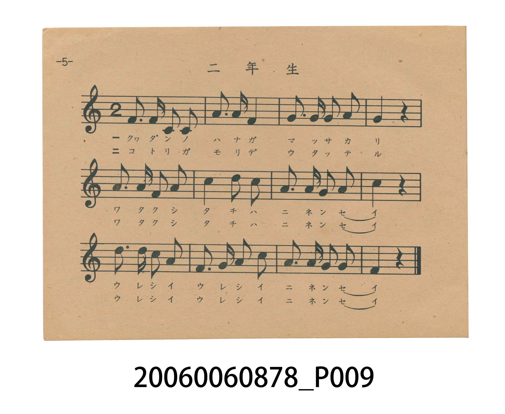
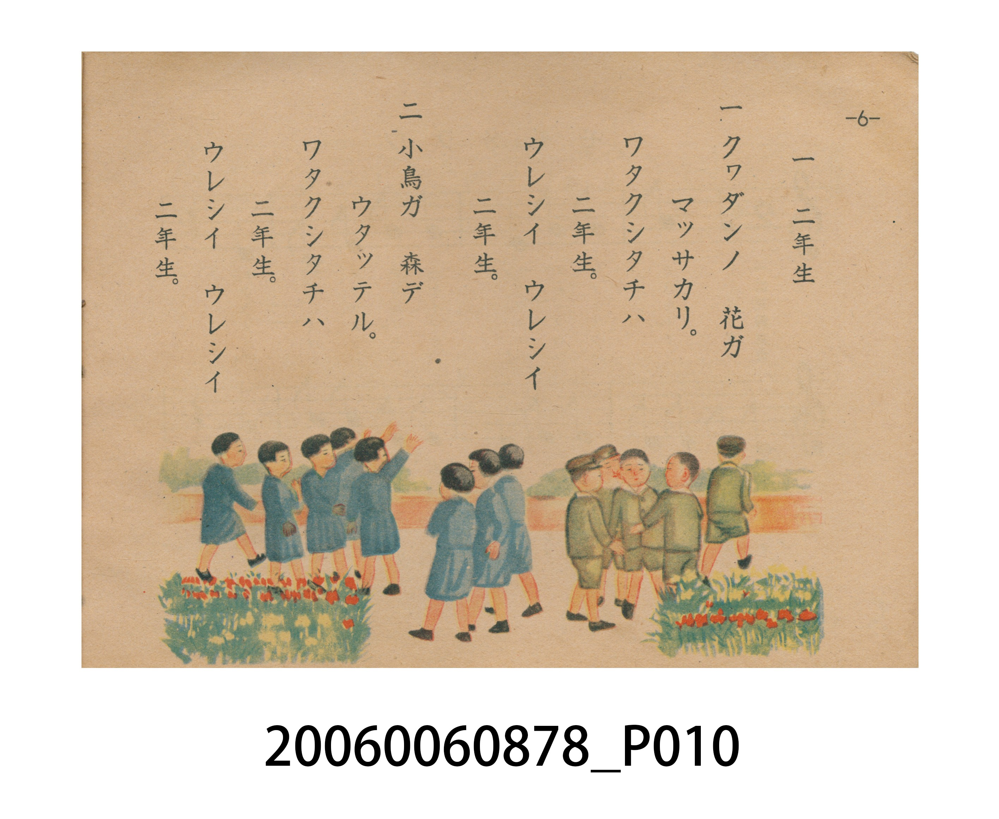

# 二年生

> Re:Shōka 使用 AI 協助辨識與重建樂譜，可能會有錯誤。歡迎回報。

- **鋼琴伴奏版**：<br><audio controls src="ninensei.mp3"></audio>
- **NEUTRINO 歌聲合成版**：<br><audio controls src="ninensei_neutrino.mp3"></audio>

- 日治時期國民學校唱歌（うたのほん 下・第一課）
- 國立臺灣歷史博物館典藏

## 說明


- 出處：臺灣總督府編《うたのほん 下》（國民學校初等科第二學年用，昭和 18 年／1943 年），第一課〈二年生〉，原書第 5–6 頁。
- 調性與拍號：ヘ調（F 大調五聲音階，原書五線譜省略調號，實際音高終止於 F 音），2/4 拍，速度 != 100。
- 背景與曲風：井上武士作曲、小學國語讀本／文部省作詞。作為二年級開學第一首歌曲，第一節描繪花壇繁花盛開的春日校園，第二節描寫森林裡小鳥歡唱，並以反覆呼應的「ワタクシタチハ 二年生、ウレシイ ウレシイ 二年生」展現升上二年級學童的喜悅與朝氣。
- 版本說明：本檔案為原書單聲部五線譜旋律之忠實數位化版本。

### 編曲說明（鋼琴伴奏版）：

1. 前奏 (Intro, 4 小節)：擷取主旋律核心樂句作為導奏，建立調性與拍感。
2. 主歌伴奏 (Ninensei)：右手 (PianoRH) 演奏原書歌唱主旋律；左手 (PianoLH)
依國民學校低學年教材純樸明朗之風格配以和聲伴奏。


## 歌詞

```text
一　クヮダンノ　花ガ
マッサカリ。
ワタクシタチハ　二年生。
ウレシイ　ウレシイ
二年生。

二　小鳥ガ　森デ
ウタッテル。
ワタクシタチハ　二年生。
ウレシイ　ウレシイ
二年生。
```

## ABC

<div class="abc-score" data-abc-src="ninensei.abc" aria-label="五線譜載入中"></div>

[下載 ABC 原始檔](ninensei.abc)

## TMD 檔案連結

- [主旋律 TMD 檔案](ninensei.tmd) [[在 TMD Studio 編輯](https://tmdlang.github.io/Tmd-TS/#tmd=s7IKdvYPcrWy4qpTUCpJTLdSyC_KTM_MsypJzCzOyI8H4vLE-NzEzLycxLwUJbiq5PycnNTkksz8PKvSksS8_Iz8PIRkWX5OaW6qlRFCpDi_tCg5Fa40Pj0VXS6-IDE91SrAwMBSN8DA0AAhXVCUX5aal5gH1A50U3kiUDNQoCgvvwhoSl5qUWIOQm1qWWZKKkhlQVFmbmJRZXxKfjLQJXklSG5LLSoGubosPxlZZ35RSUZ-elFiQUalVUZmcQkwFIDy8dmJeYkIRSUZqUBvFSdn5OcDtWppKTzZ1fN055bnU-YraGlxKdoqGBoYcNnbKrhx2Rjpm9iB9D2bvvTZpt3PZjY9mzP_6ZzuZxsmPl2749mChU-nbHy2tuf9no7HjW2PG-c_blz3uHH346bJCk92dD9u3v18zZonOxperNr0fk8n2H6g3ueru1-073reuPjZ2u1P-zc97Z31vHPlyyUrnrbueDG9X4mLS19LwZZagEtBQeFxw4Rnszc9n73uxapVz2b0PW6YCBZt3v20fdeLmVPf75kFcc_zHXufz138dNec59tXPG7owuajhm6gV1H83zH3-drO58sngnwKDMW1O8ABueL9np5nM9Y-ndSjYGihABR6v6ff0NLEGMLsBMrCQ-ZxQwc8-B83gKSe9s1_NnsHUIGC6aOGyWYKLxc0Pm5ogrr5xar9zxqWv-hof9bd-2LmfKDjHzfPAAoC3eWm8HTJciDzya4pLxo3vZy_-eWsPrhxQMHn22e9WDvn-ZzG51OXApWBdfc8Xb_s5azZIMWrZzzf2vRs7aJn0_YouCkARSAOBaYABaBdQNbLhvlPdy1TgKQPJBc19zybuR7kotmbXi4C-nzWk11Tn-zoerZ22dPFq5_snQMUf9zQ-HRDPyh05nS_WDXvxbqGZ3PWAMPk2bT2l80rgE4CKnuxch7QUCDjedMuaIhsmfVyWjdQFySwXi6bBkxrQNPgwfd8fcOz_v7nO1e96Nr4dHH7852NQMbz2bOBup7Pank2Yyko2QIjac4kqJZdPRAtT9evfrZ43bN5018sXgh02MvNS5-tBaVloLInO5Y92b30aX_vi2VtTyfuedbeCTTqcUPP4-b1j5v2P24CkttBjObGx839iJwD9OHjpmWPm9eApZcooHCQVPU-3Tj1ef--p73twCCCexPkx9VLgRY9nTbnWVMrKDDnzH22YTEilJ93dgCDDJKCgUEMZD9bNeXZwg5gYEEi-Om0daBYb14Bj-ln07uf7ut-srP76f4FwGh-NnXHk729T3umQYwCGQ3NHRADgGELjIKnrSuAkQJ0wJMda0EMYGStXQ_MMsD0hZIigfxnfc3AoAQ6QwFU3AElQAUeONF0gk0GRtDjhgZQiDWve9zc8Lh58-NmYO5rAMbR46Y1EH_Ne9zc_Lhp6-Om1Y-bV8F9iyWkgfqQQhGiDimIwRYhuGDr0ZQDXQzxDSjDg9MLMPKBQQ5kP5uz9dnaxZCEA1T9rGPi04aJz2ash8cPxJSnS_eC0uP-ZlByhrGBJqApg_t_Vw_QWZDkBfQwkA1Mc4-b22FuB3mt-XFz2-Pm1fTzOcQ5T-esgKd_YLwDUz51vA20jPIyGwoUtPS5uPwy81LzilMzrQIygVWuQ41BTTXIEgUbQzMtOzCrRsFQQRcIDRVM44EUmKhRMAaLGUPlQCJGYNoITINkYSK6CgYwNWDzfAxrgOELSrNgQWDCBeLNYFYfWBso20NkuoAK18AtACZmBV2IRDNQYiuI1bQaKrUKu11GILtAhoN0dUDVQQwF6VoElVkFxO0Ii5qWQS1q2g-2DKSkDaoFZCGqRdBQQg4RiP9NoUrMQMGGEmqIMIKpwRJGzeshrgM5ognEBiZAqPv2Q1UDEzCYBAUYSEc3VLQXFqRNu6E6luAOHxrbAw0eUCCAggLkYYjXIUnHCMzDDB4QhqnBnoSAkQR2xBqogyGW45UhL4BoblMtF5eunQIsK4ItBvKVuQA)]
- [鋼琴伴奏 TMD 檔案](ninensei_piano.tmd) [[在 TMD Studio 編輯](https://tmdlang.github.io/Tmd-TS/#tmd=s7IKdvYPcrWy4qpTUCpJTLdSSM7PyUlNLsnMz7MqLUnMy8_Iz1OCS5bl55TmploZIUSK80uLklPhSuPTU9Hl4gsS01OtAgwMLHUDDAwNENIFRfllqXmJeUDtJYmZ5YlAzUCBorz8IqApealFiTkItallmSmpIJUFRZm5iUWV8Sn5yUCX5JUguS21qBjk6oJMoFPiE4uKEvPSU1GV5BeVZOSnFyUWZFRaZWQWl-QXZSYn5sRnJ-YlIhSVZAB1WRUnZ-TnAx2gpaXwZFfP051bnk-Z_35Px8vuPc8nbHmyZ8vTpf3POzve7-lU0NLiUrRVMDQw4LK3VXDjsjHSN7EDGfZs-tJnm3Y_m9n0bM78p3O6n22Y-HTtjmcLFj6dsvHZ2h6gWY8b2x43zn_cuO5x4-7HTZMVnuzofty8-_maNU92NLxYtQloNthRQL3PV3e_aN_1vHHxs7Xbn_Zveto763nnypdLVjxt3fFier8SF5e-loIttQCXgoLC44YJz2Zvej573YtVq57N6HvcMBEs2rz7afuuFzOnvt8zC-Ke5zv2Pp-7-OmuOc-3r3jc0IXNRw3dQK-i-L9j7vO1nc-XTwT5FBi0a3eAQ3fF-z09z2asfTqpR8HQQgEo9H5Pv6GliTGE2QmUhYfM44YOeJw8bgBJPe2b_2z2DqACBdNHDZPNFF4uaHzc0AR184tV-581LH_R0f6su_fFTGAsznrcPAMoCHSXm8LTJcuBzCe7prxo3PRy_uaXs_rgxgEFn2-f9WLtnOdzGp9PXQpUBtbd83T9spezZoMUr57xfGvTs7WLnk3bo-CmABSBOBSYAhSAdgFZLxvmP921TAGSPpBc1NzzbOZ6kItmb3q5COjzWU92TX2yo-vZ2mVPF69-sncOUPxxQ-PTDf2g0JnT_WLVvBfrGp7NWQMMk2fT2l82rwA6Cajsxcp5QEOBjOdNu6AhsmXWy2ndQF2QwHq5bBowrQFNgwff8_UNz_r7n-9c9aJr49PF7c93NgIZz2fPBup6Pqvl2YyloGQLjKQ5k6BadvVAtDxdv_rZ4nXP5k1_sXgh0GEvNy99thaUloHKnuxY9mT30qf9vS-WtT2duOdZeyfQqMcNPY-b1z9u2v-4CUhuBzGaGx839yOyE9CHj5uWPW5eA5ZeooDCQVLV-3Tj1Of9-572tgODCO5NkB9XLwVa9HTanGdNraDAnDP32YbFiFAGpkmgzyEpGGvWBYY7SKmCgqGewtPOXqC4goZnXklRvo6CiQLQj0CPawLVPJsMzHTTnuzY_Wx699N93c8W7Hi6v_nZiqan_UshQf90Qx9QLyhl7N4FyqpI6e1ZC9ADYAcpKBjpATPEbmB8QNygoOGXmZeaV5yaCbLkaf_mZ53dChoBoNIryENT4dmeKUBFkJQI1AMMabgL3u-Z_XT7MoRyHw9NiA1A8GTfXOTM9mRvHySDPZs689ncCc-3THm2YgcwPJ7Nmf5kZzcw7T1bsOdlay8o-ib1ALMAxGkgJ0OLAbgDgGntaesKYOoDeuzJjrUgBjBVrl0PLBuAgYuS9YD8Z33NwDTzbNUUBVDBD5QAFf3gIO8EmwxMiY8bGkBJo3nd4-aGx82bHzcDi5kGYGJ83LQGEoHzHjc3P27a-rhp9ePmVfBoxZKkgPqQkgtEHVJaAluE4IKtR1MOdDHEN6CSDZwxgKkcmLaA7Gdztj5buxiSQ4Cqn3VMfNow8dmM9fCECDHl6dK9oIy3vxmUb2FsoAloyuD-39UDdBYkHwE9DGQDM9fj5naY20Fea37c3Pa4eTX9fA5xztM5K-AZHZLwqONtoGWUV05QoKClz8UFzqpW0AzjUGNQUw3OBTaGZlp2YFaNgpmCLhCaKZgCSWMgrlEwBIsYgXkg0RowCyRrBBZHqNFVMIDSNVy1KLb5INtmgrAsPl4h2iw3FmQCkGUIYpiCxEyRhUBmwTI-fsdDnGEINAPkVhCBcCzMiTVgJ4McDqIhXoSIIDsfZJ6PYQ0wbYDyG1gQmOmAeDOY1QfWBiqbITJdQIVr4BYAM6KCLkSiGSixFcRqWg2VWoXdLiOQXSDDQbo6oOoghoJ0LYLKrALidoRFTcugFjXtB1sGUtIG1QKyENUiaCghhwjE_6BohUQ7tihGVYMljJrXQ1wHckQTiA3MPFD37YeqBmY-MAkKMJCObqhoLyxIm3ZDdSzBHT40tofKOQCRhICRBHbEGqiDIZbjlSEvgGhuE0ZOxJGx4bkZS7aGs3CqxdREbHlhAHGjrp0CuPBRADJg7o32ASpH4RuB-cpcAA)]

## 分析

```text
================================================================================
📊 TMD Song Profile: [ 二年生 ]
================================================================================
⏱  Duration:       0:14 (14.4s), 12 measures total
🎼 Key & Tempo:    首調基準 F, != 100.0 BPM, <2/4>
   - 分析範圍：      由實際發聲的音符與和弦推測調性；播放脈絡另行呈現
🎤 人聲音域:    C4 (MIDI 60) – D5 (MIDI 74) [跨度: 14 個半音 / 1.2 個八度, 難度: moderate]
   - 最低音:  C4 in [Ninensei #1 @ m.1, 0:00]
   - 最高音: D5 in [Ninensei #1 @ m.6, 0:06]
   - 適合: soprano, mezzo-soprano, contralto, tenor, baritone, bass
🏛  結構:      Ninensei (14.4s)
⚡ 編曲密度:        Peak 1 軌道同時演奏
🗝  調性診斷：       A 調性不明確（純淨自然大調，未偵測到可信轉調）
   - 風格氣質:    純淨自然大調（陽光明朗、易唱易記，無明顯調外色彩）
   - 轉調歷程:    全曲維持單一推測調性（未偵測到可信轉調）
   - 核心骨幹音:  A, C, F, G, D
   - 調性數值:    A 調性不明確 [相關度: 0.74, 穩定度: Ambiguous, 自然音純度: 100.0%]
   - 候選調性 (K-S): A 小調 (0.74), F 大調 (0.74), C 大調 (0.68)
   - 五度圈歷程:   +3
   - 各段落調性細節:
     • [Ninensei #1]: A 調性不明確 (r: 0.74, 自然音純度: 100.0%)

  [ 五度圈游移軌跡 ]
               C  
         F            G  
      Bb               D  
      Eb              [A ]*
         Ab           E  
            Db       B  
               F# 
     (* = active key center)

  [ 十二半音累積音高分佈 ]
     C  : █████████████████         21.4%
     C# :                            0.0%
     D  : ██████                     7.1%
     D# :                            0.0%
     E  :                            0.0%
     F  : ████████████████          20.2%
     F# :                            0.0%
     G  : ████████████████          20.2%
     G# :                            0.0%
     A  : ████████████████████████  31.0%
     A# :                            0.0%
     B  :                            0.0%
--------------------------------------------------------------------------------
Assignment 軌道音域：
  - Piano         : C4 – D5 (14 個半音 / 1.2 個八度, 37 個音符)
================================================================================
```


## 原書掃描頁






