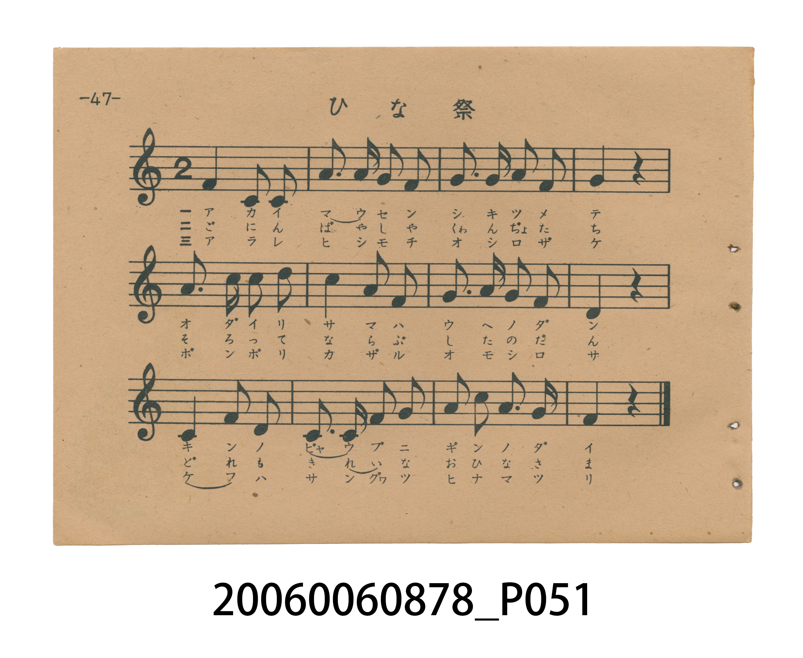
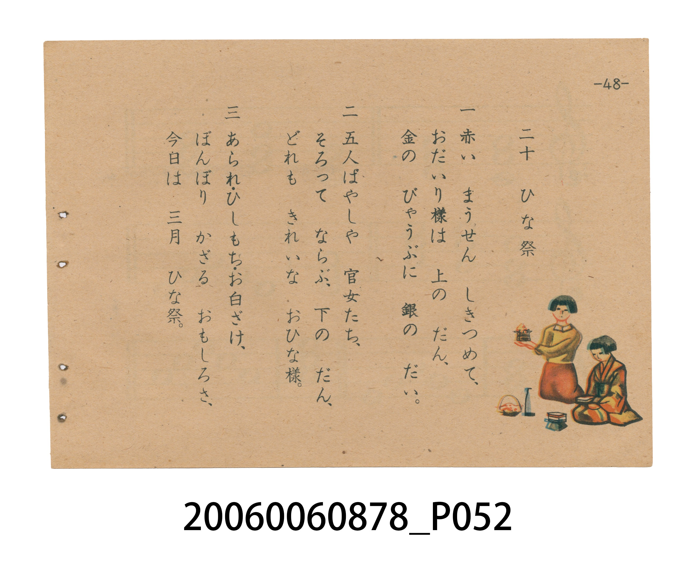

# ひな祭（女兒節／雛祭）

> Re:Shōka 使用 AI 協助辨識與重建樂譜，可能會有錯誤。歡迎回報。

- **鋼琴伴奏版**：<br><audio controls src="hinamatsuri.mp3"></audio>
- **NEUTRINO 歌聲合成版**：<br><audio controls src="hinamatsuri_neutrino.mp3"></audio>

- 日治時期國民學校唱歌（うたのほん 下・第二十課）
- 國立臺灣歷史博物館典藏

## 說明


- 出處：臺灣總督府編《うたのほん 下》（國民學校初等科第二學年用），第二十課壓軸曲〈ひな祭〉（女兒節／雛祭），原書第 47–48 頁。
- 調性與拍號：ヘ調（F 大調五聲音階，原書五線譜省略調號，實際音高終止於 F 音），2/4 拍，速度 != 100。
- 背景與曲風：林柳波作詞、平井康三郎作曲。旋律優雅端莊，透過附點八分音符與十六分音符的細膩起伏，描繪三月三日女兒節鋪上紅氈（赤い毛氈）、上層擺設內裏雛與金屏風銀臺座、下層排列五人囃子與官女，以及供奉霰餅、菱餅、白酒與雪洞燈（ぼんぼり）的華麗節慶景象。
- 版本說明：本檔案為原書單聲部五線譜旋律之忠實數位化版本。

### 編曲說明（鋼琴伴奏版）：

1. 前奏 (Intro, 4 小節)：擷取主旋律核心樂句作為導奏，建立調性與拍感。
2. 主歌伴奏 (Hinamatsuri)：右手 (PianoRH) 演奏原書歌唱主旋律；左手 (PianoLH)
依國民學校低學年教材純樸明朗之風格配以和聲伴奏。


## 歌詞

```text
一　赤い　まうせん　しきつめて、
おだいり様は　上の　だん、
金の　びゃうぶに　銀の　だい。

二　五人ばやしや　官女たち、
そろって　ならぶ、下の　だん、
どれも　きれいな　おひな様。

三　あられ・ひしもち・お白ざけ、
ぼんぼり　かざる　おもしろさ、
今日は　三月　ひな祭。
```

## ABC

<div class="abc-score" data-abc-src="hinamatsuri.abc" aria-label="五線譜載入中"></div>

[下載 ABC 原始檔](hinamatsuri.abc)

## TMD 檔案連結

- [主旋律 TMD 檔案](hinamatsuri.tmd) [[在 TMD Studio 編輯](https://tmdlang.github.io/Tmd-TS/#tmd=s7IKdvYPcrWy4qpTUCpJTLdSyC_KTM_MsypJzCzOyI8H4vLE-NzEzLycxLwUJS4tLYXHjZseN656vnTt-z0dT5dufto66fn6hvd7-l_Ong0W7FTQ0uJStFUwNDDgsrdVcOOyMdI3sQOZ_2z60mebdj-b2fRszvync7qfbZj4dO2OZwsWPp2y8dnaHqBxjxvbHjfOf9y47nHj7sdNkxWe7Oh-3Lz7-Zo1T3b1PO1tfLFqE9B4JZBRQO3PV3e_aN_1vHHxs7Xbn_Zveto763nnypdLVjxt3fFier8SF5e-loIttQCXgoLC44YJz2Zvej573YtVq57N6HvcMBEs2rz7afuuFzOnvt8zC-Ke5zv2Pp-7-OmuOc-3r3jc0IXNUw3doMBDDoKOuc_Xdj5fPhHq2bU7nu7c8nzKCqB_3-_pQQ6Bp4snv9i9A-iQxw3A8IJGxeMGoDLssQHU_rRv_rPZO4CGKJiYP2qYbGKh8HJB4-OGJqjzX6za_6xh-YuO9mfdvS9mzgf643HzDKAg0EQ3hadLlgOZT3ZNedG46eX8zS9n9cENBAo-3z7rxdo5z-c0Pp-6FKgMrLvn6fplL2fNBilePeP51qZnaxc9m7ZHwU0BKAJxDzA9KADtArJeNsx_umuZAiS1ILmouefZzPUgF83e9HIRMBBmPZs3_dn8zc82L3qyd86LlfMeNzQ-3bn5ya6pT3dtf7Kj82VzH1AcHCZNz6Z3P93X_bRl1cvZrc9Xr3_R1wW2p_9lY9_LmS0vd8972rr6aUcb0DHP1ywDWgEM1aeta-Eiz2e1PN-y4UXbyhdbtz_Z0w_U-6y___nOVUBbns3pAJHTl8LD-WU3ULzr-ZbWZxs6gKH1YuuSx40tz9bPBnM7gY4Eyj7duOTZ5F0vVqx92rr8xWJQvAAtfdk-8enGfqDXXnY1ABPN013LwYq7QYr7Jj3tmA4M2ye7dj2d3fx07QSQI9fNAFoKdMyT3Uuf9nc92Tf76dLOl3M2vFzSCtT4on8jhPF85t6XrZNA5s9e9WzLvOftIFc9btwDTHZgEhgUnUAPvuhf_3LXdKD7n7VuA4XzxoWIoH_e2fFszhpICgeF-5w1z1ZNebaw43nTLkisP522DpQUmlfAox8S4k92dj_dvwAY98-m7niyt_dpzzSIUSCjobkHYgAwqwNj8GnrimfT2oFOfbJjLYixat6LteuBWQroYLSEChR51tcMjAWgQxQCDEwNgTJAygicljrBZj_Z0fC4oQES_EDG48Z94Ew3G-RvEHf648bex41LHjc1Pm5cBgwnsHsagTlzAUhDU9ez5TMeNwJtbwDGFyijgvQsAGsGKwXGFkx08-OmZrDZ2x43rgaKAOMPoQFkOTgcQWkB7CFgCALTyLPd-1-uWwdMJi86NwGDH5ZAeuAp4mnjNmAaeTpnxbM5ICcAUwEo3U1Y-7K1F2g3UBcksYAiFpheOjfBkkwTPAB29YBcD040jxs3PG5qAXkaSDY0QJIOuAQCRjPU63MfNwEDZDE4NIBOX_W4qRPkJXAaxBIAjxtXPm7qedzUBJboBbGBfgVqA3GBIQYqhUBhiOl7iJOerWh6OavrcQOQjUjWjxumglP2OlB2AkV8z7OpW17u7YJkAGBgQPIDSHx9PzCGn27oetm899mM9c_39YGS76wWYMiBTNu7CDkkdgDzHdBVTSAvAd3ZvBvsPGBgNIECAMTtAmaTx43THjdOhHsPkUPAmoFhMO1xE7CYBnsPpBOoHxhgU6EanuzuAhYDsCQDKhjASuGFMWYw7JsNjFe0DAv0_fMpcyB5FpQa2npfLJ77cvE-YMnzfMvM53tXAuMYmIWBwQbPzsAwez5n_rM5nS-2LQaXBl1Pl6wEBgnEEfByCRoeQEdQXvNBgYKWPheXR2ZeYm5iSXFpUaZVQGZiXr5DjUFNNcgeBRtDMy07MKtGwVBBFwxN42FUjYIxmGmsYAQkQfI1YJYukATJIIvoKhhA6RqweT6GNcAYaoKKASMHSrcAdQBzOpTXBsSzQSxgDQsyCxhlUJleIF4ClmmEyizDbo8RSG4K3J7VEBpoHkh8A5TXAjUZxIKY1v-4qQ-u9HHjosdN7WD986HyC7HbZoziq6ZOKN0D1rMJ6obpQBGQGogpIJkuJJleMGsaVGYihj3Q6IAEvSkQ6iqYgRWDWJDoAEUAIuiRo8cMEnnYYwPmigXgeAC5GyQCkpkKDz9QzACzCFS8DSq6A4jXQfWCZcDxhSs25kJDBRSHi8G6QHEHklmFEnLAwgsqDov1-cTaA46HPVCzQBEIYiP8A0ltsHAGFgpQcWgIAGMHlh5AsYEcAhjxAM0OkAAGBy9cDEiBBCFxAYoVUAwhYgeWobBFBchamONBzgR5GiQOqqmgLgflDVD4QNI0SBKUYJE1wEMJHJu4YmMl3KoeqN8heiBOAIlCUwM4dmChBEnNEDFI6CDyLfbYgKXkx41bwSQsDUFCFhxLTRseN4Md3gzLhsiWQJIeKNODIh4SVchW1XJx6dopIJVmYMuBQspcAA)]
- [鋼琴伴奏 TMD 檔案](hinamatsuri_piano.tmd) [[在 TMD Studio 編輯](https://tmdlang.github.io/Tmd-TS/#tmd=s7IKdvYPcrWy4tLSUnjcuOlx46rnS9e-39PxdOnmp62Tnq9veL-n_-Xs2WDBTqD4y-49zydsebJny9Ol_c87O4CCClpaXIq2CoYGBlz2tgpuXDZG-iZ2XHUKSs-mL322afezmU3P5sx_Oqf72YaJT9fueLZg4dMpG5-t7QGa9bix7XHj_MeN6x437n7cNFnhyY7ux827n69Z82RXz9PexherNgGNVwIZBdT-fHX3i_ZdzxsXP1u7_Wn_pqe9s553rny5ZMXT1h0vpvcrcXHpaynYUgtwKSgoPG6Y8Gz2puez171YterZjL7HDRPBos27n7bvejFz6vs9syDueb5j7_O5i5_umvN8-4rHDV3YPNXQDQpR5CDomPt8befz5ROhnl274-nOLc-nrACHcQ9yCDxdPPnF7h1AhzxuAIYXNH4eN4CiAkcU9Tztm_9s9g6gIQom5o8aJptYKLxc0Pi4oQnq_Ber9j9rWP6io_1Zd--LmfOB_njcPAMoCDTRTeHpkuVA5pNdU140bno5f_PLWX1wA4GCz7fPerF2zvM5jc-nLgUqA-vuebp-2ctZs0GKV894vrXp2dpFz6btUXBTAIpA3ANMDwpAu4Cslw3zn-5apgBJLUguau55NnM9yEWzN71cBAyEWc_mTX82f_OzzYue7J3zYuW8xw2NT3dufrJr6tNd25_s6HzZ3AcUB4dJ07Pp3U_3dT9tWfVyduvz1etf9HWB7el_2dj3cmbLy93znrauftrRBnTM8zXLgFYAQ_Vp61q4yPNZLc-3bHjRtvLF1u1P9vQD9T7r73--cxXQlmdzOkDk9KXwcH7ZDRTver6l9dkGYMLveLF1yePGlmfrZ4O5nUBHAmWfblzybPKuFyvWPm1d_mIxKF6Alr5sn_h0Yz_Qay-7GoCJ5umu5WDF3SDFfZOedkwHhu2TXbuezm5-unYCyJHrZgAtBTrmye6lT_u7nuyb_XRp58s5G14uaQVqfNG_EcJ4PnPvy9ZJIPNnr3q2Zd7zdpCrHjfuASY7MAkMik6gB1_0r3-5azrQ_c9at4HCeeNCRNAD0ywwHCEpHGvuBkYGSKmCgqGewtPOXqC4goZnXklRvo6CicLTDf1AYzVBETYZmCmnPdmxGxIfzxbseLq_-dmKpqf9S4FR9bxp19MNfUC9oOSyexcoKyMlwmct86EOUlAw0gNmmN3A4gHiBgUNj8y8xNzEkuLSokyQPU_7Nz_r7FbQCMhMzMsP8tBUeLZnClAdJIUCtQHLFrgj3u-Z_XT7MoRyHw9NiCVA8GTfXOT8-GRvHyQPPps689ncCc-3THm2YgcwSJ7Nmf5kZzcw4p4t2POytRcUHZN6gFkD4jqQq6ElBdwBwNT6tHXFs2ntQL892bEWxFg178Xa9cDiAxi-aJkSKPKsrxmY4p6tmqIQYGBqCJQBUkbgcO8Em_1kR8PjhgZIUgMyHjfuAxcws0FxDOJOf9zY-7hxyeOmxseNy4BpAuyeRmAptACkoanr2fIZjxuBtjcA0yaoUALpWQDWDFYKTJkw0c2Pm5rBZm973LgaKAJMqwgNIMvBUQRK92APASMDmB-e7d7_ct06YJZ40bkJmNRgmaEHnvqfNm4D5oenc1Y8mwNyAjDFg_LYhLXA0ATaDdQFyRigRAzMG52bYNmjCR4Au3pArgdnkMeNGx43tYA8DSQbGiDZBFzaApM01OtzHzcBA2QxODSATl_1uKkT5CVwfsMSAI8bVz5u6nnc1ASW6AWxgX4FagNxgSEGKnFBYYjpe4iTgGn85ayuxw1ANiILP26YCs7F60BFByjie55N3fJybxckswMDA5L3QeLr-4Ex_HRD18vmvc9mrH--rw-UVWe1AEMOZNreRcghsQNYxgBd1QTyEtCdzbvBzgMGRhMoAEDcLmCR8Lhx2uPGiXDvIUoDsGZgGEx73ASsksDeA-kE6gcG2FSohie7u4BFHizJgApBsFJ4xYMZDPtmA-MVrXAC-v75lDmQ8gmUGtp6Xyye-3LxPmAp-3zLzOd7VwLjGFhcAYMNXnQBw-z5nPnP5nS-2LYYXPJ1PV2yEhgkEEfAy2BoeAAdQXktDwUKWvpcXOAyzQparDjUGNRUg8sKG0MzLTswq0bBNF5BFwwNgdgMxIGLASmQoBFYzBgkAMQgGiICkgNBAyhdw1WLYqMPso0mSBbGK0QbxoIMQGaYIouATEIqI_H7AOYOhKshrgW5FeRSkHwNmAVyOUgGWQTZ_SDzfAxrgOmrCSoGTFpQugWoA1hOQXltQDwbxAK2hUBmARMcVKYXiJeAZRqhMsuw22MEkpsCt2c1hAaaBxLfAOW1QE0GsSCm9T9u6oMrfdy46HFTO1j_fKj8Quy2GaP4qqkTSveA9WyCumE6UASkBmIKSKYLSaYXzJoGlZmIYQ80OiBBbwpOLGZgxSAWJDpgSQcS9MjRA055uGID5ooF4HgAuRskApKZCg8_UMwAMzhUvA0qugOI10H1gmXA8YUrNuZCQwUUh4vBukBxB5JZhRJywKIXKg6L9fnE2gOOhz1Qs0ARCGIj_ANJbbBwBhZpUHFoCABjB5YeQLGBHAIY8UDNjI2ICpC1MMeDnAnyNEgcVM9CXQ7KG6DwgaRpkCQowSJrgIcSODZxxcZKuFU9UL9D9ECcABKFpgZw7MBCCZKaIWKQ0EHkW-yxAUvJjxu3gklYGoKELDiWmjY8bgY7vBmWDZEtgSQ9UKYHRTwkqtCKRYzCDEfhiFIkghng4hK1cEQoNcuFK0EtSM1AQmBZ4kpdA4gzde0UwAW4ApCB5ORoH6AGdCEjTCFjsJAyFwA)]

## 分析

```text
================================================================================
📊 TMD Song Profile: [ ひな祭（女兒節／雛祭） ]
================================================================================
⏱  Duration:       0:14 (14.4s), 12 measures total
🎼 Key & Tempo:    首調基準 F, != 100.0 BPM, <2/4>
   - 分析範圍：      由實際發聲的音符與和弦推測調性；播放脈絡另行呈現
🎤 人聲音域:    C4 (MIDI 60) – D5 (MIDI 74) [跨度: 14 個半音 / 1.2 個八度, 難度: moderate]
   - 最低音:  C4 in [Hinamatsuri #1 @ m.1, 0:00]
   - 最高音: D5 in [Hinamatsuri #1 @ m.5, 0:05]
   - 適合: soprano, mezzo-soprano, contralto, tenor, baritone, bass
🏛  結構:      Hinamatsuri (14.4s)
⚡ 編曲密度:        Peak 1 軌道同時演奏
🗝  調性診斷：       C 大調（純淨自然大調，未偵測到可信轉調）
   - 風格氣質:    純淨自然大調（陽光明朗、易唱易記，無明顯調外色彩）
   - 轉調歷程:    全曲維持單一推測調性（未偵測到可信轉調）
   - 核心骨幹音:  C, G, F, A, D
   - 調性數值:    C 大調 [相關度: 0.82, 穩定度: Moderate, 自然音純度: 100.0%]
   - 候選調性 (K-S): C 大調 (0.82), F 大調 (0.77), A 小調 (0.59)
   - 五度圈歷程:   +0
   - 各段落調性細節:
     • [Hinamatsuri #1]: C 大調 (r: 0.82, 自然音純度: 100.0%)

  [ 五度圈游移軌跡 ]
              [C ]*
         F            G  
      Bb               D  
      Eb               A  
         Ab           E  
            Db       B  
               F# 
     (* = active key center)

  [ 十二半音累積音高分佈 ]
     C  : ████████████████████████  25.0%
     C# :                            0.0%
     D  : █████████                  9.5%
     D# :                            0.0%
     E  :                            0.0%
     F  : █████████████████████     21.4%
     F# :                            0.0%
     G  : ████████████████████████  25.0%
     G# :                            0.0%
     A  : ██████████████████        19.0%
     A# :                            0.0%
     B  :                            0.0%
--------------------------------------------------------------------------------
Assignment 軌道音域：
  - Piano         : C4 – D5 (14 個半音 / 1.2 個八度, 36 個音符)
================================================================================
```


## 原書掃描頁






