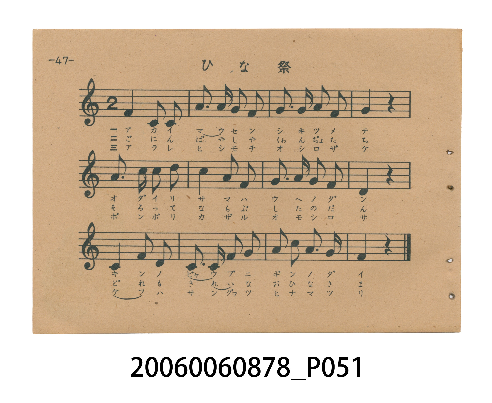
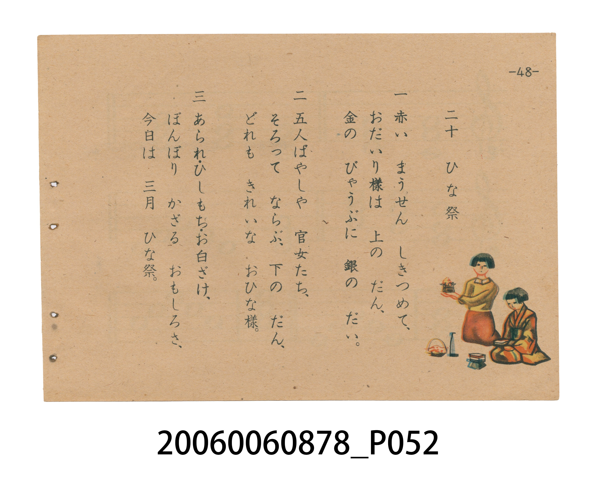

# ひな祭（女兒節／雛祭）

> Re:Shoka 使用 AI 協助辨識與重建樂譜，可能會有錯誤。歡迎回報。

<audio controls src="hinamatsuri.mp3"></audio>

- 日治時期國民學校唱歌（うたのほん 下・第二十課）
- 國立臺灣歷史博物館典藏

## 說明

【曲目說明】
・出處：臺灣總督府編《うたのほん 下》（國民學校初等科第二學年用），第二十課壓軸曲〈ひな祭〉（女兒節／雛祭），原書第 47–48 頁。
・調性與拍號：ハ調（C 大調記譜，原書五線譜無調號，實際音高終止於 F4＝`4`），2/4 拍，速度 != 100。
・背景與曲風：林柳波作詞、平井康三郎作曲。旋律優雅端莊，透過附點八分音符與十六分音符的細膩起伏，描繪三月三日女兒節鋪上紅氈（赤い毛氈）、上層擺設內裏雛與金屏風銀臺座、下層排列五人囃子與官女，以及供奉霰餅、菱餅、白酒與雪洞燈（ぼんぼり）的華麗節慶景象。
・版本說明：本檔案為原書單聲部五線譜旋律之忠實數位化版本。

・編曲說明（鋼琴伴奏版）：
1. 前奏 (Intro, 4 小節)：擷取主旋律核心樂句作為導奏，建立調性與拍感。
2. 主歌伴奏 (Hinamatsuri)：右手 (PianoRH) 演奏原書歌唱主旋律；左手 (PianoLH)
依國民學校低學年教材純樸明朗之風格配以和聲伴奏。

## 歌詞

```text
一　赤い　まうせん　しきつめて、
おだいり様は　上の　だん、
金の　びゃうぶに　銀の　だい。

二　五人ばやしや　官女たち、
そろって　ならぶ、下の　だん、
どれも　きれいな　おひな様。

三　あられ・ひしもち・お白ざけ、
ぼんぼり　かざる　おもしろさ、
今日は　三月　ひな祭。
```

## ABC

```abc
X:1
T:ひな祭（女兒節／雛祭）
M:2/4
L:1/16
Q:1/4=100
K:C
V:V1 name="Piano" snm="Pia"
[V:V1]
F4 C3 C | A3 A G2 F2 | G3 G A2 F2 | G4 z4 |
A3 c c2 d2 | c4 A2 G2 | G3 A G2 F2 | D4 z4 |
C4 F2 D2 | C3 C F2 G2 | A2 c2 A2 G2 | F4 z4 |
```

## TMD 檔案連結

- [主旋律 TMD 檔案](hinamatsuri.tmd) [[在 TMD Studio 編輯](https://tmdlang.github.io/Tmd-TS/#tmd=s7IKdvYPcrWy4tLSUnjcuOlx46rnS9e-39PxdOnmp62Tnq9veL-n_-Xs2WDBTgUtLS5FWwVDAwMue1sFZy4bI30TO646BaVn05c-27T72cymZ3PmP53T_WzDxKdrdzxbsPDplI3P1vYAjXvc2Pa4cf7jxnWPG3c_bpqs8GRH9-Pm3c_XrHmyq-dpb-OLVZuAxiuBjAJqf766-0X7rueNi5-t3f60f9PT3lnPO1e-XLLiaeuOF9P7lbi49LUUbKkFuBQUFB43THg2e9Pz2eterFr1bEbf44aJYNHm3U_bd72YOfX9nlkQ9zzfsff53MVPd815vn3F44YubJ5q6AYFHnIQdMx9vrbz-fKJUM-u3fF055bnU1YA_ft-Tw9yCDxdPPnF7h1AhzxuAIYXNCoeNwCVYY8NoPanffOfzd4BNETBxPxRw2QTC4WXCxofNzRBnf9i1f5nDctfdLQ_6-59MXM-0B-Pm_uBgkATnRWeLlkOZL5YMePF2jlwo57smvJ8-yygyPOWhSBZkKaep-uXvZw1--X8zS9Xz3i-tenZ2kXPpu1RcDN5v2dugkkCxCXAlKAAtAXIetkw_-muZQqQdILkluaeZzPXg9wye9PLRUDvz3o2b_qz-ZufbV70ZO-cFyvnPW5ofLpz85NdU5_u2v5kR-fL5j6gODg0mp5N7366r_tpy6qXs1ufr17_oq8LbE__y8a-lzNbXu6e97R19dOONqALn69ZBrQCGJ5PW9fCRZ7Panm-ZcOLtpUvtm5_sqcfqPdZf__znauAtjyb0wEipy-Fh_DLbqB41_Mtrc82dADD6cXWJY8bW56tnw3mdgIdCZR9unHJs8m7XqxY-7R1-YvFoBgBWvqyfeLTjf1Ar73sagAml6e7loMVd4MU90162jEdGLZPdu16Orv56doJIEeumwG0FOiYJ7uXPu3verJv9tOlnS_nbHi5pBWo8UX_Rgjj-cy9L1sngcyfverZlnnP20Guety4B5jgwCQwKDqBHnzRv_7lrulA9z9r3QYK540LEUH_vLPj2Zw1kLQNCvc5a56tmvJsYcfzpl2QWH86bd2Lxk0vm1fAox8S4k92dj_dvwAY_c-m7niyt_dpzzSIUSCjofkGYgAwkwNj8GnrimfT2oFOfbJjLYixat6LteuBmQnoYLQkChR51tcMjAWgQxQCDEwNgTJAygicljrBZj_Z0fC4oQES_EDG48Z94Ow2G-RvEHf648bex41LHjc1Pm5cBgwnsHsagXlyAUhDU9ez5TMeNwJtbwDGFyiLgvQsAGsGKwXGFkx08-OmZrDZ2x43rgaKAOMPoQFkOTgcQWkB7CFgCALTyLPd-1-uWwdMJi86NwGDH5ZAeuAp4mnjNmAaeTpnxbM5ICcAUwEo3U1Y-7K1F2g3UBcksYAiFpheOjfBkkwTPAB29YBcD040jxs3PG5qAXkaSDY0QJIOuOwBRjPU63MfNwEDZDE4NIBOX_W4qRPkJXAaxBIAjxtXPm7qedzUBJboBbGBfgVqA3GBIQYqf0BhiOl7iJOerWh6OavrcQOQjUjWjxumglP2OlB2AkV8z7OpW17u7YJkAGBgQPIDSHx9PzCGn27oetm899mM9c_39YGS76wWYMiBTNu7CDkkdgDzHdBVTSAvAd3ZvBvsPGBgNIECAMTtAmaTx43THjdOhHsPkUPAmoFhMO1xE7CABnsPpBOoHxhgU6EanuzuAhYDsCQDKhjASuHFMGYw7JsNjFe0DAv0_fMpcyB5FpQa2npfLJ77cvE-YMnzfMvM53tXAuMYmIWBwQbPzsAwez5n_rM5nS-2LQaXBl1Pl6wEBgnEEfByCRoeQEdQXudBgYKWPheXR2ZeYm5iSXFpUaZVQGZiXr5DjUGNQjXIIgUbQzMtOzALWOMCo8sKGKxNQNwNxC1A0RogvQ-I24B4tgKoCgSJTAfiXiBeAhRphKpaBjIEZB_MsF09IMOmAPFqsEaIsg1AdgvECCANEul_3NQHkn_cuOhxUzuQmg8WXohm3I5OqNuaOoG4B2rcJqhRIDcvBIt0QUVA7psGVTUR2W01CiYKumBoCCVrFMzALDMFUyAJkq0Bs3SBJEgGWURXwQBK14BTLlK4gWxeAA43YIoE2zsVGnrroe4AheIOIF4H5QNVgwMGI9TmQj2wGBywIKWrIB5v3AbVCoqC-fiNgoTYHrAEhIa4ChS304C8bqhWoLvB4QcJNYi7UcILEjqGcSCkq2AEImogbEiogcIJEULIoWhEKMyAngS7DuYNaEkN9igo4YDE-tDUQMIYS6itBCcMkGcgCkGGA_mgCAGGHyxxgJIMMDSBnoQkbqzpbCIQb0WKOWBMgtzQtOFx87rHzZCECzMIFMNLQCLA8EUONkjyggQFKCBgIoZgEUiQgQIPHJKIUISlTkSY1XJx6dopIGVjEFeZiwsA)]
- [鋼琴伴奏 TMD 檔案](hinamatsuri_piano.tmd) [[在 TMD Studio 編輯](https://tmdlang.github.io/Tmd-TS/#tmd=s7IKdvYPcrWy4tLSUnjcuOlx46rnS9e-39PxdOnmp62Tnq9veL-n_-Xs2WDBTqD4y-49zydsebJny9Ol_c87O4CCClpaXIq2CoYGBlz2tgrOXDZG-iZ2XHUKSs-mL322afezmU3P5sx_Oqf72YaJT9fueLZg4dMpG5-t7QGa9bix7XHj_MeN6x437n7cNFnhyY7ux827n69Z82RXz9PexherNgGNVwIZBdT-fHX3i_ZdzxsXP1u7_Wn_pqe9s553rny5ZMXT1h0vpvcrcXHpaynYUgtwKSgoPG6Y8Gz2puez171YterZjL7HDRPBos27n7bvejFz6vs9syDueb5j7_O5i5_umvN8-4rHDV3YPNXQDQpR5CDomPt8befz5ROhnl274-nOLc-nrACHcQ9yCDxdPPnF7h1AhzxuAIYXNH4eN4CiAkcU9Tztm_9s9g6gIQom5o8aJptYKLxc0Pi4oQnq_Ber9j9rWP6io_1Zd--LmfOB_njc3A8UBJrorPB0yXIg88WKGS_WzoEb9WTXlOfbZwFFnrcsBMmCNPU8Xb_s5azZL-dvfrl6xvOtTc_WLno2bY-Cm8n7PXMTTBIgLgGmBAWgLUDWy4b5T3ctU4CkEyS3NPc8m7ke5JbZm14uAnp_1rN505_N3_xs86Ine-e8WDnvcUPj052bn-ya-nTX9ic7Ol829wHFwaHR9Gx699N93U9bVr2c3fp89foXfV1ge_pfNva9nNnycve8p62rn3a0AV34fM0yoBXA8HzauhYu8nxWy_MtG160rXyxdfuTPf1Avc_6-5_vXAW05dmcDhA5fSk8hF92A8W7nm9pfbYBmOQ7Xmxd8rix5dn62WBuJ9CRQNmnG5c8m7zrxYq1T1uXv1gMihGgpS_bJz7d2A_02suuBmByebprOVhxN0hx36SnHdOBYftk166ns5ufrp0AcuS6GUBLgY55snvp0_6uJ_tmP13a-XLOhpdLWoEaX_RvhDCez9z7snUSyPzZq55tmfe8HeSqx417gAkOTAKDohPowRf961_umg50_7PWbaBw3rgQEfTA1AoMR0jaxpqvgZEBUqqgYKin8LSzFyiuoOGZV1KUr6NgovB0Qz_QWE1QhE0GZsdpT3bshsTHswU7nu5vfrai6Wn_UmBUPW_a9XRDH1AvKMXs3gXKxEjJ71nLfKiDFBSM9IBZZTewYIC4QUHDIzMvMTexpLi0KBNkz9P-zc86uxU0AjIT8_KDPDQVnu2ZAlQHSaFAbcBSBe6I93tmP92-DKHcx0MTYgkQPNk3FzknPtnbB8l9z6bOfDZ3wvMtU56t2AEMkmdzpj_Z2Q2MuGcL9rxs7QVFx6SeF42bIK4DuRpaRsAdAEytT1tXPJvWDvTbkx1rQYxV816sXQ8sOIDhi5YdgSLP-pqBKe7ZqikKAQamhkAZIGUEDvdOsNlPdjQ8bmiAJDUg43HjPnDRMhsUxyDu9MeNvY8blzxuanzcuAyYJsDuaQSWPwtAGpq6ni2f8bgRaHsDMG2CiiOQngVgzWClwJQJE938uKkZbPa2x42rgSLAtIrQALIcHEWgdA_2EDAygPnh2e79L9etA2aJF52bgEkNlhl64Kn_aeM2YH54OmfFszkgJwBTPCiPTVgLDE2g3UBdkIwBSsTAvNG5CZY9muABsKsH5HpwBnncuOFxUwvI00CyoQGSTcDlLDBJQ70-93ETMEAWg0MD6PRVj5s6QV4C5zcsAfC4ceXjpp7HTU1giV4QG-hXoDYQFxhioLIWFIaYvoc4CZjGX87qetwAZCOy8OOGqeBcvA5UdIAivufZ1C0v93ZBMjswMCB5HyS-vh8Yw083dL1s3vtsxvrn-_pAWXVWCzDkQKbtXYQcEjuAZQzQVU0gLwHd2bwb7DxgYDSBAgDE7QIWCY8bpz1unAj3HqI0AGsGhsG0x03AygjsPZBOoH5ggE2FaniyuwtY5MGSDKgQBCuFVzmYwbBvNjBe0QonoO-fT5kDKZ9AqaGt98XiuS8X7wOWss-3zHy-dyUwjoHFFTDY4EUXMMyez5n_bE7ni22LwSVf19MlK4FBAnEEvAyGhgfQEZTX71CgoKXPxQUu06ygxYpDjUGNQjW4sLAxNNOyA7NqFAwVdMHQBIiNgBgmYqJgCiTNwCIg0jAOygUJ14CVg6ABlK7hqkWxzwfFPhOEdfEK0SaxIAOQGYbIIiCTkEpIvO4HtoyASc0KmCSagLgbiFvA1gCLFCBuA-LZCqCmCkhkOhD3AvESoEgjVNUycMEJDCuYYbt6QIZNAeLVYI0QZRuA7BaIEUAaJNL_uKkPJP-4cdHjpnYgNR8svBDNuB2dULc1dQJxD9S4TVCjQG5eCBbpgoqA3DcNqmoistsQIQ6JHkNotIDiBBQjINkaMAsUQyAZZBHkeEILN5DNC8DhBsxNYHunQkNvPdQdoFDcAcTroHyganDAYITaXKgHFoMDFqR0FcTjjdugWkFRMB-_UZAQ2wOWgNAQV4HidhqQ1w3VCnQ3OPwgoQZxN0p4QUIHmGzBKdcIRACTH4iChBosJUNCCDkUQdkAb5gBPQl2Hcwb0FoG7FFQwgGJ9aGpgYQxllBbCU4YIM9AFIIMB_JBEQIMP1jiACUZYGgCPQlJ3FjT2UQg3ooUc8CYBLmhacPj5nWPmyEJF2YQKIaXgESA4YscbLjKA0OwCCTIiC0PMHIxrlIBpTAAM0DlBGqpgFBplAtTgVqAGMHkiCprDCBu1LVTABdbCkAGknsJc5W5uAA)]

## 分析

```text
================================================================================
📊 TMD Song Profile: [ ひな祭（女兒節／雛祭） ]
================================================================================
⏱  Duration:       0:14 (14.4s), 12 measures total
🎼 Key & Tempo:    首調基準 C, != 100.0 BPM, <2/4>
   - 分析範圍：      由實際發聲的音符與和弦推測調性；播放脈絡另行呈現
🎤 人聲音域:    C4 (MIDI 60) – D5 (MIDI 74) [跨度: 14 個半音 / 1.2 個八度, 難度: moderate]
   - 最低音:  C4 in [Hinamatsuri #1 @ m.1, 0:00]
   - 最高音: D5 in [Hinamatsuri #1 @ m.5, 0:05]
   - 適合: soprano, mezzo-soprano, contralto, tenor, baritone, bass
🏛  結構:      Hinamatsuri (14.4s)
⚡ 編曲密度:        Peak 1 軌道同時演奏
🗝  調性診斷：       C 大調（純淨自然大調，未偵測到可信轉調）
   - 風格氣質:    純淨自然大調（陽光明朗、易唱易記，無明顯調外色彩）
   - 轉調歷程:    全曲維持單一推測調性（未偵測到可信轉調）
   - 核心骨幹音:  C, G, F, A, D
   - 調性數值:    C 大調 [相關度: 0.82, 穩定度: Moderate, 自然音純度: 100.0%]
   - 候選調性 (K-S): C 大調 (0.82), F 大調 (0.77), A 小調 (0.59)
   - 五度圈歷程:   +0
   - 各段落調性細節:
     • [Hinamatsuri #1]: C 大調 (r: 0.82, 自然音純度: 100.0%)

  [ 五度圈游移軌跡 ]
              [C ]*
         F            G  
      Bb               D  
      Eb               A  
         Ab           E  
            Db       B  
               F# 
     (* = active key center)

  [ 十二半音累積音高分佈 ]
     C  : ████████████████████████  25.0%
     C# :                            0.0%
     D  : █████████                  9.5%
     D# :                            0.0%
     E  :                            0.0%
     F  : █████████████████████     21.4%
     F# :                            0.0%
     G  : ████████████████████████  25.0%
     G# :                            0.0%
     A  : ██████████████████        19.0%
     A# :                            0.0%
     B  :                            0.0%
--------------------------------------------------------------------------------
Assignment 軌道音域：
  - Piano         : C4 – D5 (14 個半音 / 1.2 個八度, 36 個音符)
================================================================================
```


## 原書掃描頁






