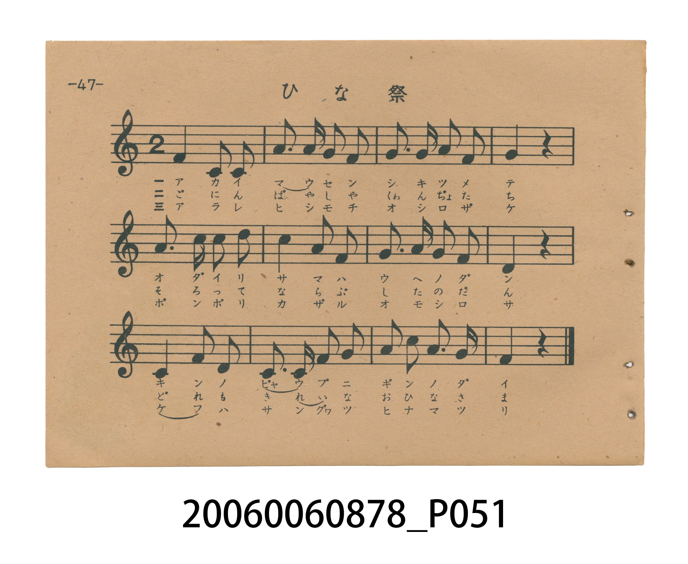
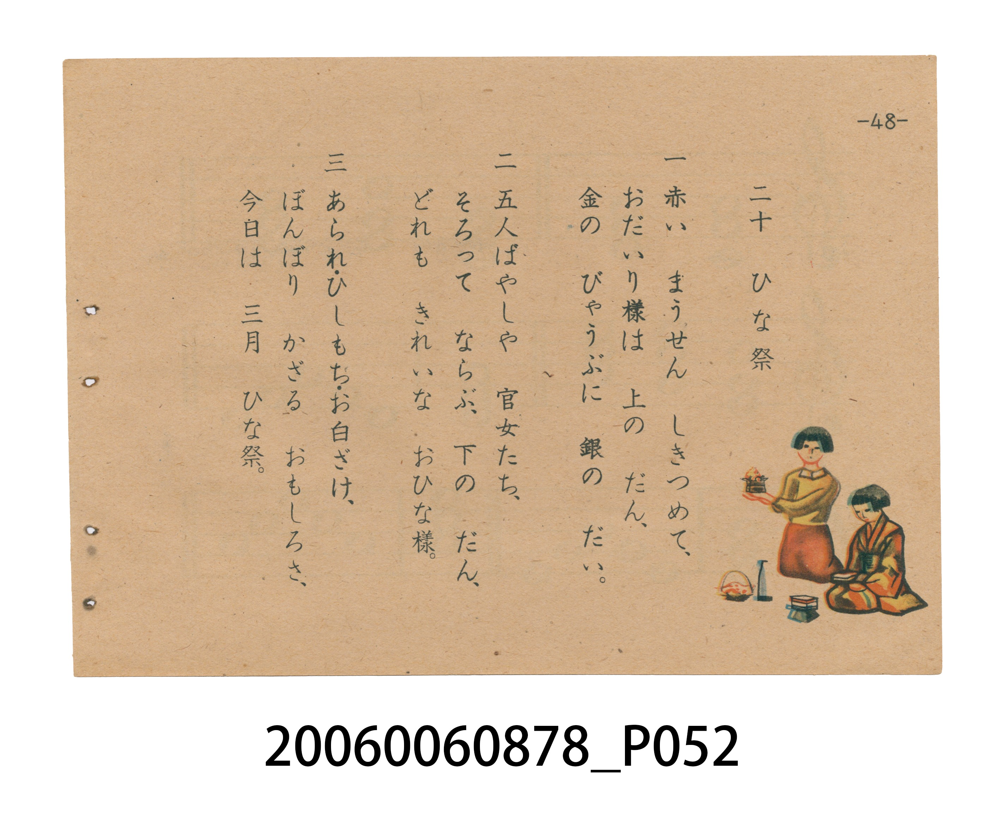

# ひな祭（女兒節／雛祭）

> Re:Shōka 使用 AI 協助辨識與重建樂譜，可能會有錯誤。歡迎[回報](https://github.com/TMDLang/reshoka/issues)。

- **鋼琴伴奏版**：<br><audio controls src="hinamatsuri.mp3"></audio>
- **NEUTRINO 歌聲合成版**：<br><audio controls src="hinamatsuri_neutrino.mp3"></audio>

- 日治時期國民學校唱歌（うたのほん 下・第二十課）
- 國立臺灣歷史博物館典藏

## 說明


- 出處：臺灣總督府編《うたのほん 下》（國民學校初等科第二學年用），第二十課壓軸曲〈ひな祭〉（女兒節／雛祭），原書第 47–48 頁。
- 調性與拍號：ヘ調（F 大調五聲音階，原書五線譜省略調號，實際音高終止於 F 音），2/4 拍，速度 != 100。
- 背景與曲風：林柳波作詞、平井康三郎作曲。旋律優雅端莊，透過附點八分音符與十六分音符的細膩起伏，描繪三月三日女兒節鋪上紅氈（赤い毛氈）、上層擺設內裏雛與金屏風銀臺座、下層排列五人囃子與官女，以及供奉霰餅、菱餅、白酒與雪洞燈（ぼんぼり）的華麗節慶景象。
- 版本說明：本檔案為原書單聲部五線譜旋律之忠實數位化版本。

### 編曲說明（鋼琴伴奏版）：

1. 前奏 (Intro, 4 小節)：擷取主旋律核心樂句作為導奏，建立調性與拍感。
2. 主歌伴奏 (Hinamatsuri)：右手 (PianoRH) 演奏原書歌唱主旋律；左手 (PianoLH)
依國民學校低學年教材純樸明朗之風格配以和聲伴奏。


## 歌詞

```text
一　赤い　まうせん　しきつめて、
おだいり様は　上の　だん、
金の　びゃうぶに　銀の　だい。

二　五人ばやしや　官女たち、
そろって　ならぶ、下の　だん、
どれも　きれいな　おひな様。

三　あられ・ひしもち・お白ざけ、
ぼんぼり　かざる　おもしろさ、
今日は　三月　ひな祭。
```

## ABC

<div class="abc-score" data-abc-src="hinamatsuri.abc" aria-label="五線譜載入中"></div>

[下載 ABC 原始檔](hinamatsuri.abc)

## TMD 檔案連結

- [主旋律 TMD 檔案](hinamatsuri.tmd) [[在 TMD Studio 編輯](https://tmdlang.github.io/Tmd-TS/#tmd=s7IKdvYPcrWy4qpTUCpJTLdSyC_KTM_MsypJzCzOyI8H4vLE-NzEzLycxLwUJbiq5PycnNTkksz8PKvSksS8_Iz8PIRkWX5OaW6qlRFCpDi_tCg5Fa40Pj0VXS6-IDE91SrAwNRQF0ggaS0oyi9LzUvMA2oHuqk8EagZKFCUl18ENCUvtSgxB6E2tSwzJRWksqAoMzexqDI-JT8Z6JK8EiS3pRYVg1xdlp-MrDO_qCQjP70osSCj0iojs7gEGApA-fjsxLxEhKKSjFSgt9JSi0syy0CatbQUHjduety46vnSte_3dDxduvlp66Tn6xve7-l_OXs2WLBTQUuLS9FWwdDAgMveVsGNy8ZI38QOZOKz6Uufbdr9bGbTsznzn87pfrZh4tO1O54tWPh0ysZna3uAxj1ubHvcOP9x47rHjbsfN01WeLKj-3Hz7udr1jzZ1fO0t_HFqk1A48GOA2p_vrr7Rfuu542Ln63d_rR_09PeWc87V75csuJp644X0_uVuLj0tRRsqQW4FBQUHjdMeDZ70_PZ616sWvVsRt_jholg0ebdT9t3vZg59f2eWRD3PN-x9_ncxU93zXm-fcXjhi5snmroBgUechB0zH2-tvP58olQz67d8XTnludTVgD9-35PD3IIPF08-cXuHUCHPG4Ahhc0Kh43AJVhjw2g9qd985_N3gE0RMHE_FHDZBMLhZcLGh83NEGd_2LV_mcNy190tD_r7n0xcz7QH4-bZwAFgSa6KTxdshzIfLJryovGTS_nb345qw9uIFDw-fZZL9bOeT6n8fnUpUBlYN09T9cvezlrNkjx6hnPtzY9W7vo2bQ9Cm4KQBGIe4DpQQFoF5D1smH-013LFCCpBclFzT3PZq4HuWj2ppeLgIEw69m86c_mb362edGTvXNerJz3uKHx6c7NT3ZNfbpr-5MdnS-b-4Di4DBpeja9--m-7qctq17Obn2-ev2Lvi6wPf0vG_tezmx5uXve09bVTzvagI55vmYZ0ApgqD5tXQsXeT6r5fmWDS_aVr7Yuv3Jnn6g3mf9_c93rgLa8mxOB4icvhQezi-7geJdz7e0PtvQAQytF1uXPG5sebZ-NpjbCXQkUPbpxiXPJu96sWLt09blLxaD4gVo6cv2iU839gO99rKrAZhonu5aDlbcDVLcN-lpx3Rg2D7Ztevp7OanayeAHLluBtBSoGOe7F76tL_ryb7ZT5d2vpyz4eWSVqDGF_0bIYznM_e-bJ0EMn_2qmdb5j1vB7nqceMeYLIDk8Cg6AR68EX_-pe7pgPd_6x1GyicNy5EBP3zzo5nc9ZAUjgo3OesebZqyrOFHc-bdkFi_em0daCk0LwCHv2QEH-ys_vp_gXAuH82dceTvb1Pe6ZBjAIZDc09EAOAWR0Yg09bVzyb1g506pMda0GMVfNerF0PzFJAB6MlVKDIs75mYCwAHaIAKi2BMqDyEpyWOsFmP9nR8LihARL8QMbjxn3gTDcb5G8Qd_rjxt7HjUseNzU-blwGDCewexqBOXMBSENT17PlMx43Am1vAMYXKKOC9CwAawYrBcYWTHTz46ZmsNnbHjeuBooA4w-hAWQ5OBxBaQHsIWAIAtPIs937X65bB0wmLzo3AYMflkB64CniaeM2YBp5OmfFszkgJwBTASjdTVj7srUXaDdQFySxgCIWmF46N8GSTBM8AHb1gFwPTjSPGzc8bmoBeRpINjRAkg64BAJGM9Trcx83AQNkMTg0gE5f9bipE-QlcBrEEgCPG1c-bup53NQElugFsYF-BWoDcYEhBiqFQGGI6XuIk56taHo5q-txA5CNSNaPG6aCU_Y6UHYCRXzPs6lbXu7tgmQAYGBA8gNIfH0_MIafbuh62bz32Yz1z_f1gZLvrBZgyIFM27sIOSR2APMd0FVNIC8B3dm8G-w8YGA0gQIAxO0CZpPHjdMeN06Eew-RQ8CagWEw7XETsJgGew-kE6gfGGBToRqe7O4CFgOwJAMqGMBK4YUxZjDsmw2MV7QMC_T98ylzIHkWlBrael8snvty8T5gyfN8y8zne1cC4xiYhYHBBs_OwDB7Pmf-szmdL7YtBpcGXU-XrAQGCcQR8HIJGh5AR1Be80GBgpY-F5dHZl5ibmJJcWlRplVAJrBh41BjUFMNskfBxtBMyw7MqlEwVNAFQ9N4GFWjYAxmGisYAUmQfA2YpQskQTLIIroKBlC6Bmyej2ENMIaaoGLAyIHSLUAdwJwO5bUB8WwQC1jDgswCRhlUpheIl4BlGqEyy7DbYwSSmwK3ZzWEBpoHEt8A5bVATQaxIKb1P27qgyt93LjocVM7WP98qPxC7LYZo_iqqRNK94D1bIK6YTpQBKQGYgpIpgtJphfMmgaVmYhhDzQ6IEFvCoS6CmZgxSAWJDpAEYAIeuToMYNEHvbYgLliATgeQO4GiYBkpsLDDxQzwCwCFW-Diu4A4nVQvWAZcHzhio250FABxeFisC5Q3IFkVqGEHLDwgorDYn0-sfaA42EP1CxQBILYCP9AUhssnIGFAlQcGgLA2IGlB1BsIIcARjxAswMkgMHBCxcDUiBBSFyAYgUUQ4jYgWUobFEBshbmeJAzQZ4GiYNqKqjLQXkDFD6QNA2SBCVYZA3wUALHJq7YWAm3qgfqd4geiBNAotDUAI4dWChBUjNEDBI6iHyLPTZgKflx41YwCUtDkJAFx1LThsfNYIc3w7IhsiWQpAfK9KCIh0QVslW1XFy6dgpIpRnYcqCQMhcA)]
- [鋼琴伴奏 TMD 檔案](hinamatsuri_piano.tmd) [[在 TMD Studio 編輯](https://tmdlang.github.io/Tmd-TS/#tmd=s7IKdvYPcrWy4qpTUCpJTLdSSM7PyUlNLsnMz7MqLUnMy8_Iz1OCS5bl55TmploZIUSK80uLklPhSuPTU9Hl4gsS01OtAgxMDXWBBJLWgqL8stS8xDyg9pLEzPJEoGagQFFefhHQlLzUosQchNrUssyUVJDKgqLM3MSiyviU_GSgS_JKkNyWWlQMcnVBJtAp8YlFRYl56amoSvKLSjLy04sSCzIqrTIyi0vyizKTE3PisxPzEhGKSjKAuqzSUotLMstATtDSUnjcuOlx46rnS9e-39PxdOnmp62Tnq9veL-n_-Xs2WDBTqD4y-49zydsebJny9Ol_c87O4CCClpaXIq2CoYGBlz2tgpuXDZG-iZ2IGueTV_6bNPuZzObns2Z_3RO97MNE5-u3fFswcKnUzY-W9sDNOtxY9vjxvmPG9c9btz9uGmywpMd3Y-bdz9fs-bJrp6nvY0vVm0CGg92MVD789XdL9p3PW9c_Gzt9qf9m572znreufLlkhVPW3e8mN6vxMWlr6VgSy3ApaCg8LhhwrPZm57PXvdi1apnM_oeN0wEizbvftq-68XMqe_3zIK45_mOvc_nLn66a87z7SseN3Rh81RDNyhEkYOgY-7ztZ3Pl0-Eenbtjqc7tzyfsgIcxj3IIfB08eQXu3cAHfK4ARhe0Ph53ACKChxR1PO0b_6z2TuAhiiYmD9qmGxiofByQePjhiao81-s2v-sYfmLjvZn3b0vZs4H-uNx8wygINBEN4WnS5YDmU92TXnRuOnl_M0vZ_XBDQQKPt8-68XaOc_nND6fuhSoDKy75-n6ZS9nzQYpXj3j-damZ2sXPZu2R8FNASgCcQ8wPSgA7QKyXjbMf7prmQIktSC5qLnn2cz1IBfN3vRyETAQZj2bN_3Z_M3PNi96snfOi5XzHjc0Pt25-cmuqU93bX-yo_Nlcx9QHBwmTc-mdz_d1_20ZdXL2a3PV69_0dcFtqf_ZWPfy5ktL3fPe9q6-mlHG9Axz9csA1oBDNWnrWvhIs9ntTzfsuFF28oXW7c_2dMP1Pusv__5zlVAW57N6QCR05fCw_llN1C86_mW1mcbgAm_48XWJY8bW56tnw3mdgIdCZR9unHJs8m7XqxY-7R1-YvFoHgBWvqyfeLTjf1Ar73sagAmmqe7loMVd4MU90162jEdGLZPdu16Orv56doJIEeumwG0FOiYJ7uXPu3verJv9tOlnS_nbHi5pBWo8UX_Rgjj-cy9L1sngcyfverZlnnP20Guety4B5jswCQwKDqBHnzRv_7lrulA9z9r3QYK540LEUEPTLPAcISkcKy5GxgZIKUKCoZ6Ck87e4HiChqeeSVF-ToKJgpPN_QDjdUERdhkYKac9mTHbkh8PFuw4-n-5mcrmp72LwVG1fOmXU839AH1gpLL7l2grIyUCJ-1zIc6SEHBSA-YYXYDiweIGxQ0PDLzEnMTS4pLizJB9jzt3_yss1tBIwBU-gV5aCo82zMFqA6SQoHagGUL3BHv98x-un0ZQrmPhybEEiB4sm8ucn58srcPkgefTZ35bO6E51umPFuxAxgkz-ZMf7KzGxhxzxbsednaC4qOST3ArAFxHcjV0JIC7gBgan3auuLZtHag357sWAtirJr3Yu16YPEBDF-0TAkUedbXDExxz1ZNUQBVHUAZUOUBDvdOsNlPdjQ8bmiAJDUg43HjPnABMxsUxyDu9MeNvY8blzxuanzcuAyYJsDuaQSWQgtAGpq6ni2f8bgRaHsDMG2CCiWQngVgzWClwJQJE938uKkZbPa2x42rgSLAtIrQALIcHEWgdA_2EDAygPnh2e79L9etA2aJF52bgEkNlhl64Kn_aeM2YH54OmfFszkgJwBTPCiPTVgLDE2g3UBdkIwBSsTAvNG5CZY9muABsKsH5HpwBnncuOFxUwvI00CyoQGSTcClLTBJQ70-93ETMEAWg0MD6PRVj5s6QV4C5zcsAfC4ceXjpp7HTU1giV4QG-hXoDYQFxhioBIXFIaYvoc4CZjGX87qetwAZCOy8OOGqeBcvA5UdIAivufZ1C0v93ZBMjswMCB5HyS-vh8Yw083dL1s3vtsxvrn-_pAWXVWCzDkQKbtXYQcEjuAZQzQVU0gLwHd2bwb7DxgYDSBAgDE7QIWCY8bpz1unAj3HqI0AGsGhsG0x03AKgnsPZBOoH5ggE2FaniyuwtY5MGSDKgQBCuFVzyYwbBvNjBe0QonoO-fT5kDKZ9AqaGt98XiuS8X7wOWss-3zHy-dyUwjoHFFTDY4EUXMMyez5n_bE7ni22LwSVf19MlK4FBAnEEvAyGhgfQEZTX8lCgoKXPxQUu06ygxYpDjUFNNbissDE007IDs2oUTOMVdMHQEIjNQBy4GJACCRqBxYxBAkAMoiEiIDkQNIDSNVy1KDb6INtogmRhvEK0YSzIAGSGKbIIyCSkMhK_D2DuQLga4lqQW0EuBcnXgFkgl4NkkEWQ3Q8yz8ewBpi-mqBiwKQFpVuAOoDlFJTXBsSzQSxgWwhkFjDBQWV6gXgJWKYRKrMMuz1GILkpcHtWQ2igeSDxDVBeC9RkEAtiWv_jpj640seNix43tYP1z4fKL8RumzGKr5o6oXQPWM8mqBumA0VAaiCmgGS6kGR6waxpUJmJGPZAowMS9KbgxGIGVgxiQaIDlnQgQY8cPeCUhys2YK5YAI4HkLtBIiCZqfDwA8UMMINDxdugojuAeB1UL1gGHF-4YmMuNFRAcbgYrAsUdyCZVSghByx6oeKwWJ9PrD3geNgDNQsUgSA2wj-Q1AYLZ2CRBhWHhgAwdmDpARQbyCGAEQ_UzNiIqABZC3M8yJkgT4PEQfUs1OWgvAEKH0iaBkmCEiyyBngogWMTV2yshFvVA_U7RA_ECSBRaGoAxw4slCCpGSIGCR1EvsUeG7CU_LhxK5iEpSFIyIJjqWnD42aww5th2RDZEkjSA2V6UMRDogqtWMQozHAUjihFIpgBLi5RC0eEUrNcuBLUgtQMJASWJa7UNYA4U9dOAVyAKwAZSE6O9gFqQBcywhQyBgspcwEA)]

## 分析

```text
================================================================================
📊 TMD Song Profile: [ ひな祭（女兒節／雛祭） ]
================================================================================
⏱  Duration:       0:14 (14.4s), 12 measures total
🎼 Key & Tempo:    首調基準 F, != 100.0 BPM, <2/4>
   - 分析範圍：      由實際發聲的音符與和弦推測調性；播放脈絡另行呈現
🎤 人聲音域:    C4 (MIDI 60) – D5 (MIDI 74) [跨度: 14 個半音 / 1.2 個八度, 難度: moderate]
   - 最低音:  C4 in [Hinamatsuri #1 @ m.1, 0:00]
   - 最高音: D5 in [Hinamatsuri #1 @ m.5, 0:05]
   - 適合: soprano, mezzo-soprano, contralto, tenor, baritone, bass
🏛  結構:      Hinamatsuri (14.4s)
⚡ 編曲密度:        Peak 1 軌道同時演奏
🗝  調性診斷：       C 大調（純淨自然大調，未偵測到可信轉調）
   - 風格氣質:    純淨自然大調（陽光明朗、易唱易記，無明顯調外色彩）
   - 轉調歷程:    全曲維持單一推測調性（未偵測到可信轉調）
   - 核心骨幹音:  C, G, F, A, D
   - 調性數值:    C 大調 [相關度: 0.82, 穩定度: Moderate, 自然音純度: 100.0%]
   - 候選調性 (K-S): C 大調 (0.82), F 大調 (0.77), A 小調 (0.59)
   - 五度圈歷程:   +0
   - 各段落調性細節:
     • [Hinamatsuri #1]: C 大調 (r: 0.82, 自然音純度: 100.0%)

  [ 五度圈游移軌跡 ]
              [C ]*
         F            G  
      Bb               D  
      Eb               A  
         Ab           E  
            Db       B  
               F# 
     (* = active key center)

  [ 十二半音累積音高分佈 ]
     C  : ████████████████████████  25.0%
     C# :                            0.0%
     D  : █████████                  9.5%
     D# :                            0.0%
     E  :                            0.0%
     F  : █████████████████████     21.4%
     F# :                            0.0%
     G  : ████████████████████████  25.0%
     G# :                            0.0%
     A  : ██████████████████        19.0%
     A# :                            0.0%
     B  :                            0.0%
--------------------------------------------------------------------------------
Assignment 軌道音域：
  - Piano         : C4 – D5 (14 個半音 / 1.2 個八度, 36 個音符)
================================================================================
```


## 原書掃描頁






