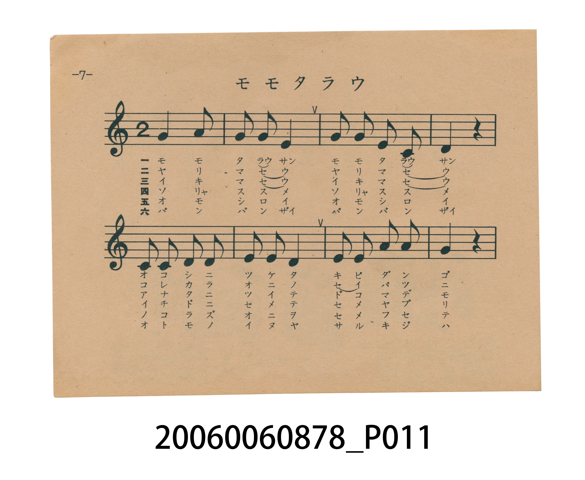
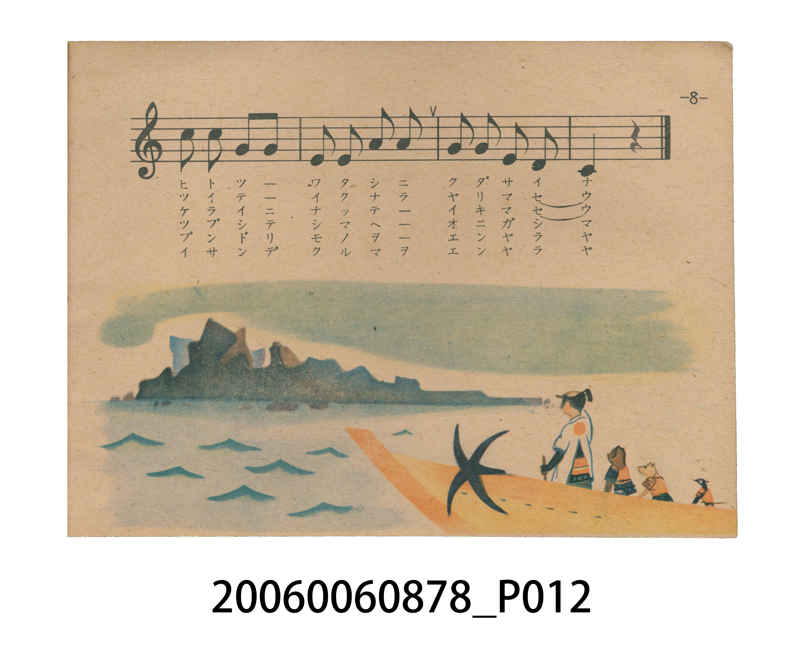
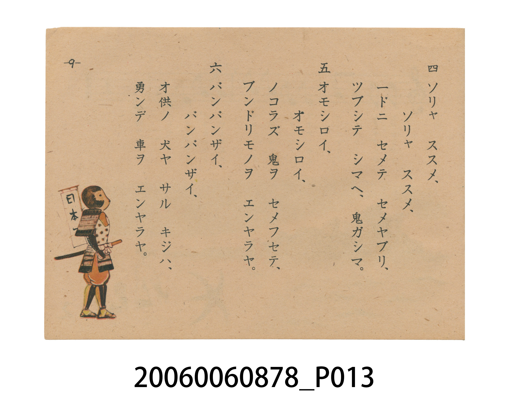
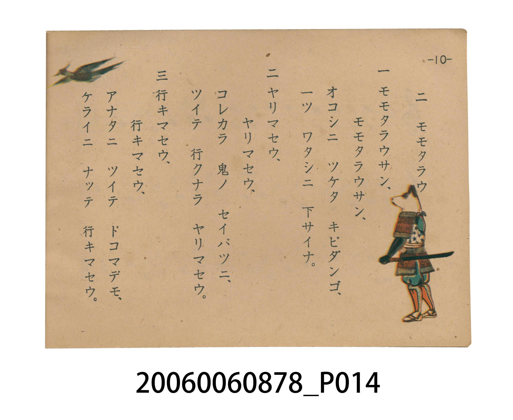

# モモタラウ（桃太郎）

> Re:Shōka 使用 AI 協助辨識與重建樂譜，可能會有錯誤。歡迎回報。

- **鋼琴伴奏版**：<br><audio controls src="momotaro.mp3"></audio>
- **NEUTRINO 歌聲合成版**：<br><audio controls src="momotaro_neutrino.mp3"></audio>

- 日治時期國民學校唱歌（うたのほん 下・第二課）
- 國立臺灣歷史博物館典藏

## 說明


- 出處：臺灣總督府編《うたのほん 下》（國民學校初等科第二學年用），第二課〈モモタラウ〉（桃太郎），原書第 7–10 頁。
- 調性與拍號：ハ調（C 大調五聲音階，無升降記號），2/4 拍，速度 != 108。
- 背景與曲風：岡野貞一作曲，原出自明治 44 年（1911）《尋常小學唱歌（一）》，亦收錄於臺灣總督府昭和 11 年《公學校唱歌集 第一學年用》第十一課。全曲共 12 小節、歌詞六節，完整敘述桃太郎以黍糰子收服犬、猿、雉並征伐鬼島滿載而歸的故事。原書第 8–10 頁配有桃太郎率領動物隨從分賜黍糰子與拉寶車凱旋之全彩插圖。
- 版本說明：本檔案為原書單聲部五線譜旋律之忠實數位化版本。

### 編曲說明（鋼琴伴奏版）：

1. 前奏 (Intro, 4 小節)：擷取主旋律核心樂句作為導奏，建立調性與拍感。
2. 主歌伴奏 (Momotaro)：右手 (PianoRH) 演奏原書歌唱主旋律；左手 (PianoLH)
依國民學校低學年教材純樸明朗之風格配以和聲伴奏。


## 歌詞

```text
一　モモタラウサン、モモタラウサン、
オコシニ　ツケタ　キビダンゴ、
一ツ　ワタシニ　下サイナ。

二　ヤリマセウ、ヤリマセウ、
コレカラ　鬼ノ　セイバツニ、
ツイテ　行クナラ　ヤリマセウ。

三　行キマセウ、行キマセウ、
アナタニ　ツイテ　ドコマデモ、
ケライニ　ナッテ　行キマセウ。

四　ソリャ　ススメ、ソリャ　ススメ、
一ドニ　セメテ　セメヤブリ、
ツブシテ　シマヘ、鬼ガシマ。

五　オモシロイ、オモシロイ、
ノコラズ　鬼ヲ　セメフセテ、
ブンドリモノヲ　エンヤラヤ。

六　バンバンザイ、バンバンザイ、
オ供ノ　犬ヤ　サル　キジハ、
勇ンデ　車ヲ　エンヤラヤ。
```

## ABC

<div class="abc-score" data-abc-src="momotaro.abc" aria-label="五線譜載入中"></div>

[下載 ABC 原始檔](momotaro.abc)

## TMD 檔案連結

- [主旋律 TMD 檔案](momotaro.tmd) [[在 TMD Studio 編輯](https://tmdlang.github.io/Tmd-TS/#tmd=s7IKdvYPcrWy4qpTUCpJTLdSyC_KTM_Ms8rNz0sqLc7IV8KQSM3MyowvSa0oScrPz1bi0tJSeNy8CISa9j9uXvm4adn7PR3PFjY_XbLqZXPf-z2dClpaXIq2CoYGFlz2tgrOXDZG-iZ2IFOfTV_6bNPuZzObns2Z_3RO97MNE5-u3fFswcKnUzY-W9sDNOVxY9vjxvmPG9c9btz9uGmywpMd3Y-bdz9fs-bJrp4XqzYBzQa7Dqj3-eruF-27njcufrZ2-9P-TU97Zz3vXPlyyYqnrTteTO9X4uLS11KwpRbgUlBQeNww4dnsTc9nr3uxatWzGX2PGyaCRZt3P23f9WLm1Pd7ZkHc83zH3udzFz_dNef59hWPG7qw-aihG-hVFP93zH2-tvP58okQnwIFn-7c8nzKCqB_3-_pgXv_cUMHWsA_bgAqQAl7oPqnffOfzd4B1KVg_qhhsqGBwssFjY8bmqDOfbFq_7OG5S862p91976YOR_o7sfN_UBBoDnOCk-XLAcyn-ya8qJx08v5m1_OAhrZ87xl4dPe9pcze1-smAHWAbIEGKUKQBOArJcN85_uWqYAiXAke5p7ns1cD7Jn9qaXi4BemfV008KX7X0vNs17sqPhyd45QHGIY0EB2A4KU2DaUDAxUQD6HegYQ0tDQ6BVwCB8uqH76Y4dTzf0g8IFllKAZoBlgUHZ82TXsmdTtr3saXk2bQ9aJDybsfbppB4FQ0OQqSCzWtcgJ7mXs9sUQMG7owEe5kAjgSJPexuBguAwb3raugLo1qetGxUMjRSAzni-vuFxQyNQ94uV8562rgVyQf5Y1_Ns6pZnU2e82L8BHh9Pdi99ubv3-eYNT9dOALrw2Zze511rgHqf9-wHki9ndz7ZsezpvsYneya8XLPn6eZtz3bvf7Gn80VDz7O1O57Pank2tfXJLmByaULEqAU8Rl-29j6b0wm36nlf-8sFM552TwVlg1krnu6b97Sj7cXmOXD7wTHe-XT9the7u562b3w2vfvJzm6g157uXfmsf9LTOdMQUfe8s-PZnDWQdA6MNyD72aopzxZ2PG_aBXHJ02nrQAmkeQUwpTzfPuvF2jlA457uA5u4f8HT9cueTd3xZG_v055pEKNARkPzEMQAWOCteDatHeiwJzvWghir5r1Yux6YsYDRi5p6QWm8r_lZfz_QHQoBBoaGQBkgZQJOip1go4Gx9bihAT17NG193LwZGNS4xMGOalr1uGnz46btj5uBYQ00ouVx00aQUiC7ae3j5smPm4GCQAXA9APWALIKqAikdD1IHUwnKGsDDW5a8ri5CxqYQIdDfAUKRlhUPW6cCiwJQEkIVQSYip41rXjRuuHltMnP-ma_mDgdmAbg8QeUfbG6Gxipz7cue9YxEZRkG7qfTlgOtAkeBrt6wK4COmDV4-Z5j5uAJQ6wiAD6Hl0E4u_Nj5vXPG5aDQqThgZgCnwMdAnI00BFQA0TQJ4EeQyiGhQsQNE2oIoXC3seN60H-RKsE8N4DK8Dnfxk7wKwYxvhbJB3-5YCA-3JvrYXyxqf9u2GZIVnzQuBbgFlqWVNz-bNASp-uXDGs5b-F9vnAxM20OtPN2xEMhDh-x3A4gDiNmCsIfyKKQLxPTBFdIFTBDzWod573NwJDpt5j5vbQakGpmEjOPEAFUE0AH3fjBQeyDZgBACoLNm6HeRFcBggcyEF7IvV0552bHg6edWLxQtfNu-F-BWYAoAJAhROHROAeQ_IBiaIp-u2vWhfjGogPAyezp4NjsG94AhZDGbvBKHmhaB0gEMcnqg7oX4DegMoAQkMKBvo7WkgzYjUAOSDUj5EEZABDK4ZoFINmI6agMkKLIIZEi8Wzn06tetpZ-_LBmDZCowcBBdUkgO91dEJZD-bshuIni8AlqhbX85cDEoN-3Y-3TX1xY7-pzs3Q0pL9MQ_BewSoP-AGR1o-1pQXIE8jS4C8UAfOI6BEboLlviB7oF7F5gfgQyg36CqgX4HqgaGD9gwoGao6hVgcWDgrASRWFL-nPnPp89-un81KOXD2KAY7eqCpHNgGQiM76cd257s6QeJd3eCYh2YFDpWPp3c-HRiw9MZ-59O2Q4hkWO6dS04FQJzKdABYLJpG9TH2AShJd2TfbMhuRxUEYFcDPQDsCwEOg9c2DXtADYGoKqfdgNTP9CYdlAK3w1M7cT5-MWENUD0bC04dmFsUDMBXCmBEjCwBu2eDq4Ft0DqJWBF-HL2PFBG2LTv-dJ5z7qmPZu8--mcDZDAANVXaydgDwmg3ZS37qBAQUufi8s3Pze_JLEo3yogMzEv36HGoKYaZImCjYWWHZhRo2CqoKtgBsQglqmCMRLLEMgyAvINQGJg1T6GNaC2MpAPIYG8pv1ANqgSAjJBtRBEFCgLxghZkFKoPJJ5RiC1S8DmrYLqnAdUuBuIl0H5S8ByMHGQMSAZJDOMQWJgM5rWYjcDKAuSw2OGCUhsL8QdwAIFqm0nBDcvhPL3wqRhUiC7QJJIJpmCFIL8ggih7UA20HawGyGykLCBiMNcj2SGGcjcCWAzYOE5AcyGJH9UISgNMgYqCTEJGr2GQGgEhDXACDUGRyeEZQaEkMhHi16Q85pAVoGc1w22qQVUW4AjE-IBUFBOBuIGuM1bMKMVZEbzGiC9GpQE4B7vBpVVUHNAUQSKXpAPWsA2dWOJWlBS6oImJYR7QPraoCHRCbUNGL3N7dDkhxm9IB2NENUQc0D2A6MPbg6cD1I5DWwOKCLRIhfoeohtK4H0LhR_bUIzZyosuYFtQItgsK4OaFbpgyXT5h5ohgDnFyAbGHqg8G7aATanHyN640AIlF9RoxWUf0GRbogl_06CWtwCDb71kMBFRHgTUAQUuSAHAB0FUtOFJd-iRQM4l4F0AiMLEuFE5l1g0gIHJkg1JIJBJjSjmUww_4LcA4w2iD_a4DkPlChmIOU8YEQ1gZLldmhJgRnBQDPAGQuUUFbBSzNgtMMjeAVUBcjFMJ9iRjDI1aAoBKkEJ0tw6ICyA8hNmwiaVMvFpWunACvCwQYD-cpcAA)]
- [鋼琴伴奏 TMD 檔案](momotaro_piano.tmd) [[在 TMD Studio 編輯](https://tmdlang.github.io/Tmd-TS/#tmd=s7IKdvYPcrWy4tLSUnjcvAiEmvY_bl75uGnZ-z0dzxY2P12y6mVz3_s9nUDuy-49zydsebJny9Ol_c87O4CCClpaXIq2CoYGFlz2tgrOXDZG-iZ2XHUKSs-mL322afezmU3P5sx_Oqf72YaJT9fueLZg4dMpG5-t7QGa9bix7XHj_MeN6x437n7cNFnhyY7ux827n69Z82RXz4tVm4BmK4HMAep9vrr7Rfuu542Ln63d_rR_09PeWc87V75csuJp644X0_uVuLj0tRRsqQW4FBQUHjdMeDZ70_PZ616sWvVsRt_jholg0ebdT9t3vZg59f2eWRD3PN-x9_ncxU93zXm-fcXjhi5sPmroBnoVxf8dc5-v7Xy-fCLEp0DBpzu3PJ-yAhzAPXDvP27oQIuNxw2gGECNkJ6nffOfzd4B1KVg_qhhsqGBwssFjY8bmqDOfbFq_7OG5S862p91976YOR_o7sfN_UBBoDnOCk-XLAcyn-ya8qJx08v5m1_OAhrZ87xl4dPe9pcze1-smAHWAbIEGKUKQBOArJcN85_uWqYAiXAke5p7ns1cD7Jn9qaXi4BemfV008KX7X0vNs17sqPhyd45QHGIY0EB2A4KU2DaUDAxUQD6HegYQ0tDQ6BVwCB8uqH76Y4dTzf0g8IFllKAZoBlgUHZ82TXsmdTtr3saXk2bQ9aJDybsfbppB4FQ0OQqSCzWtcgJ7mXs9sUQMG7owEe5kAjgSJPexuBguAwb3raugLo1qetGxUMjRSAzni-vuFxQyNQ94uV8562rgVyQf5Y1_Ns6pZnU2e82L8BHh9Pdi99ubv3-eYNT9dOALrw2Zze511rgHqf9-wHki9ndz7ZsezpvsYneya8XLPn6eZtz3bvf7Gn80VDz7O1O57Pank2tfXJLmByaULEqAU8Rl-29j6b0wm36nlf-8sFM552TwVlg1krnu6b97Sj7cXmOXD7wTHe-XT9the7u562b3w2vfvJzm6g157uXfmsf9LTOdMQUQdMuUAPQ9I51gwOjEyQUgUFQz2Fp529QHEFDc-8kqJ8HQVg9IFDSBOo5tlkYNac9mTHbqBlT_d1P1uw4-n-5mcrmp72LwXG__OmXU839AH1gkJv9y5QhkZKms9a5kMdpKBgpAfMNruBAQ5xg4KGb35ufkliUT7Ikqf9m591ditoBGQm5uUHeWgqPNszBagIEmRAPcCIhrvg_Z7ZT7cvQyj38dCE2AAET_bNRc6ST_b2QZLEs6kzn82d8HzLlGcrdoDS6JzpwHADJuhnC_YAowAYw8D0BcwtEKeBnAwtLOAOAKeSFc-mtQM99mTHWhBj1bwXa9cDSxBg4KJmU1Bm7mt-1t__bNUUhQADQ0OgDJAyAYd5J9hoYLJ83NCAXg40bX3cvBmYpnCJgx3VtOpx0-bHTdsfNwMTFdCIlsdNG0FKgeymtY-bJz9uBgoCFQAzClgDyCqgIpDS9SB1MJ2gMgxocNOSx81d0EgCOhziK1C0w9Lk48apwCIPlFdQRYAR_qxpxYvWDS-nTX7WN_vFxOnAxA5PqEDZF6u7gan3-dZlzzomgvJmQ_fTCcuBNsHDYFcP2FVAB6x63DzvcROwaAWWhUDfo4tA_L35cfOax02rQWHS0ADMao-BLgF5GqgIqGECyJMgj0FUg4IFKNoGVPFiYc_jpvUgX4J1YhiP4XWgk5_sXQB2bCOcDfJu31JgoD3Z1_ZiWePTvt2QPP-seSHQLaDUv6zp2bw5QMUvF8541tL_Yvt8YA4Gev3pho1IBiJ8vwNY7kHcBow1hF8xRSC-B6aILnCKgMc61HuPmzvBYTPvcXM7KNXANGwEJx6gIogGoO-bkcID2QaMAAAVmlu3g7wIDgNkLqQmebF62tOODU8nr3qxeOHL5r0QvwJTADBBgMKpYwKwWACygQni6bptL9oXoxoID4Ons2eDY3AvOEIWg9k7Qah5ISgd4BCHJ-pOqN-A3gBKQAIDygZ6expIMyI1APmglA9RBGQAg2sGqPgGpqMmYLICi2CGxIuFc59O7QKWji8bgJUIMHIQXFCVBfRWRyeQ_WzKbiB6vgBYzmx9OXMxKDXs2_l019QXO_qf7twMqRbQE_8UsEuA_gNmdKDta0FxBfI0ugjEA33gOAZG6C5Y4ge6B-5dYH4EMoB-g6oG-h2oGhg-YMOAmqGqV4DFgYGzEkRiSflz5j-fPvvp_tWglA9jg2K0qwuSzoFlIDC-n3Zse7IHVOID6yJQrAOTQsfKp5Mbn05seDpj_9Mp2yEkcky3rgWnQmAuBToATDZtg_oYmyC0pHuybzYkl4NqXJCLgX4AloVA54ELu6YdwFYPVPXTbmDqBxrTDkrhu4GpnTgfv5iwBoierQXHLowNag-Ba19QAgZWhN3TwdX9FkgFDKzxX86eB8oIm_Y9XzrvWde0Z5N3P52zARIYoIp57QTsIQG0m_JmLBQoaOlzcYGraytopelQY1BTDa4JbSy07MCMGgVTIDQGwhoFIwVDOAvENosHMg0VdBUMgLiGqxbFNB9k00zgphnGK0QbxoKMRWaYghgwKZBBsJqdgMt0FcxAVkPdiGAZgt0IcxhItY9hDagLA-RDSCCvaT-QDaodgUxQ9QgRBcqCMUIWpBQqj2SeEUjtErB5q6A65wEV7gbiZVD-ErAcTBxkDEgGyQxjkBjYjKa12M0AyoLk8JhhAhLbC3EHsKSDatsJwc0Lofy9MGmYFMgukCSSSaYghSC_IEJoO5ANtB3sRogsJGwg4jDXI5lhBjJ3AtgMWHhOALMh-RJVCEqDjIFKQkyCJRUgBCW0GnCiA0UnhGUGhJDIR4tekPOaQFaBnNcNtqkFVI2BIxPiAVBQTgbiBrjNWzCjFWRG8xogvRqUBOAe7wYVolBzQFEEil6QD1rANnVjiVpQUuqCJiWEe0D62qAh0Qm1DRi9ze3Q5IcZvSAdjRDVEHNA9gOjD24OnA9SOQ1sDigi0SIX6HqIbSuB9C4Uf21CM2cqLLmBbUCLYLCuDmhW6YMl0-YeaIYA5xcgGxh6oPBu2gE2px8jeuNACJRfUaMVlH9BkY4oWBD5dxLU4hZo8K2HBC4iwpuAIqDIBTkA6CiQmi4s-RYtGsC5DKQTGFmQCCcy7wKTFjgwQaohEQwyoRnNZIL5F-QeYLRB_NEGz3mgRDEDKecBI6oJlCy3Q0sKzAgGmgHOWKCEsgpemgGjHR7BK6AqQC6G-RQzgkGuBkUhSCU4WYJDB5QdQG7aRNAkjBKcUG0AYpjlorKA1QuEBVUM4qNWHSiVCagOIaqSMYA4UNdOAVxdKQAZMMdG-wBVo_CN0PjGaHwTND7QEhS-GZivzAUA)]

## 分析

```text
================================================================================
📊 TMD Song Profile: [ モモタラウ（桃太郎） ]
================================================================================
⏱  Duration:       0:13 (13.3s), 12 measures total
🎼 Key & Tempo:    首調基準 C, != 108.0 BPM, <2/4>
   - 分析範圍：      由實際發聲的音符與和弦推測調性；播放脈絡另行呈現
🎤 人聲音域:    C4 (MIDI 60) – C5 (MIDI 72) [跨度: 12 個半音 / 1.0 個八度, 難度: easy]
   - 最低音:  C4 in [Momotaro #1 @ m.3, 0:03]
   - 最高音: C5 in [Momotaro #1 @ m.9, 0:08]
   - 適合: soprano, mezzo-soprano, contralto, tenor, baritone, bass
🏛  結構:      Momotaro (13.3s)
⚡ 編曲密度:        Peak 1 軌道同時演奏
🗝  調性診斷：       G 調性不明確（純淨自然大調，未偵測到可信轉調）
   - 風格氣質:    純淨自然大調（陽光明朗、易唱易記，無明顯調外色彩）
   - 轉調歷程:    全曲維持單一推測調性（未偵測到可信轉調）
   - 核心骨幹音:  G, E, C, D, A
   - 調性數值:    G 調性不明確 [相關度: 0.79, 穩定度: Ambiguous, 自然音純度: 100.0%]
   - 候選調性 (K-S): G 大調 (0.79), C 大調 (0.76), E 小調 (0.73)
   - 五度圈歷程:   +1
   - 各段落調性細節:
     • [Momotaro #1]: G 調性不明確 (r: 0.79, 自然音純度: 100.0%)

  [ 五度圈游移軌跡 ]
               C  
         F           [G ]*
      Bb               D  
      Eb               A  
         Ab           E  
            Db       B  
               F# 
     (* = active key center)

  [ 十二半音累積音高分佈 ]
     C  : ██████████████            16.7%
     C# :                            0.0%
     D  : ██████████████            16.7%
     D# :                            0.0%
     E  : ████████████████████      23.8%
     F  :                            0.0%
     F# :                            0.0%
     G  : ████████████████████████  28.6%
     G# :                            0.0%
     A  : ████████████              14.3%
     A# :                            0.0%
     B  :                            0.0%
--------------------------------------------------------------------------------
Assignment 軌道音域：
  - Piano         : C4 – C5 (12 個半音 / 1.0 個八度, 35 個音符)
================================================================================
```


## 原書掃描頁










