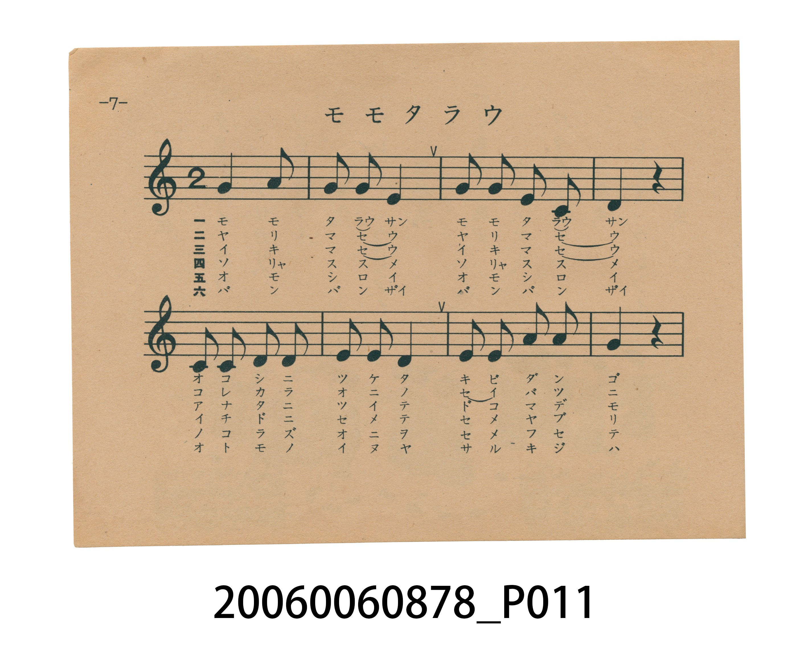
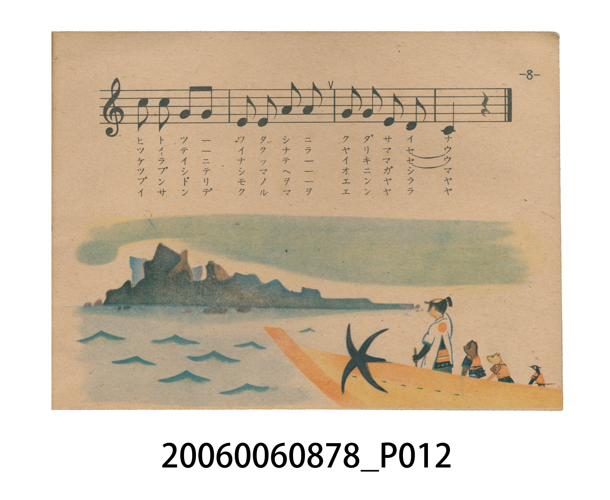
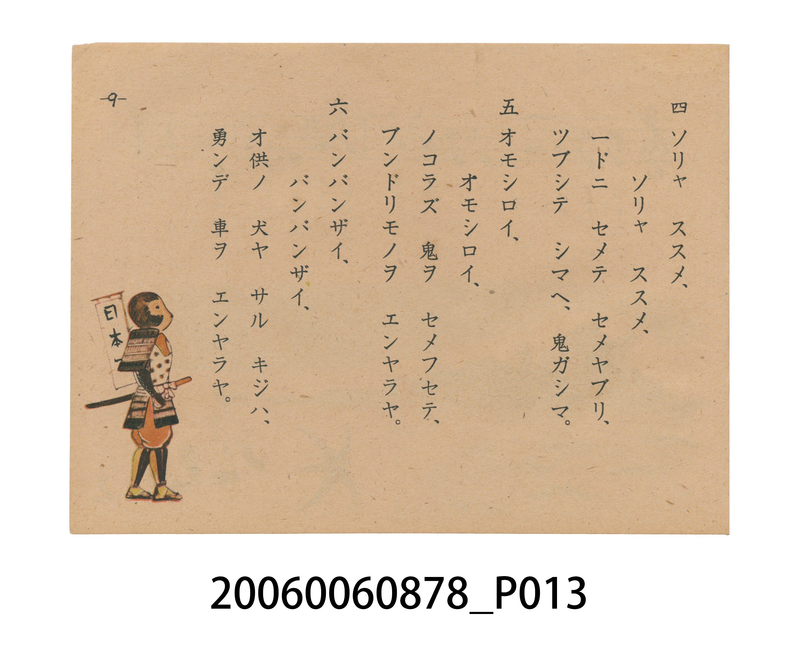
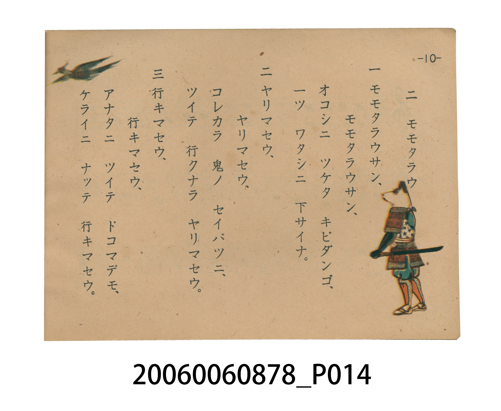

# モモタラウ（桃太郎）

> Re:Shoka 使用 AI 協助辨識與重建樂譜，可能會有錯誤。歡迎回報。

<audio controls src="momotaro.mp3"></audio>

- 日治時期國民學校唱歌（うたのほん 下・第二課）
- 國立臺灣歷史博物館典藏

## 說明

【曲目說明】
・出處：臺灣總督府編《うたのほん 下》（國民學校初等科第二學年用），第二課〈モモタラウ〉（桃太郎），原書第 7–10 頁。
・調性與拍號：ト調（G 大調，原書五線譜省略調號，實際音高終止於 G 音），2/4 拍，速度 != 108。
・背景與曲風：岡野貞一作曲，原出自明治 44 年（1911）《尋常小學唱歌（一）》，亦收錄於臺灣總督府昭和 11 年《公學校唱歌集 第一學年用》第十一課。全曲共 12 小節、歌詞六節，完整敘述桃太郎以黍糰子收服犬、猿、雉並征伐鬼島滿載而歸的故事。原書第 8–10 頁配有桃太郎率領動物隨從分賜黍糰子與拉寶車凱旋之全彩插圖。
・版本說明：本檔案為原書單聲部五線譜旋律之忠實數位化版本。

・編曲說明（鋼琴伴奏版）：
1. 前奏 (Intro, 4 小節)：擷取主旋律核心樂句作為導奏，建立調性與拍感。
2. 主歌伴奏 (Momotaro)：右手 (PianoRH) 演奏原書歌唱主旋律；左手 (PianoLH)
依國民學校低學年教材純樸明朗之風格配以和聲伴奏。

## 跨冊／重複收錄參照

> 同名異曲（《新定兒童唱歌》第二學年為田邊友三郎詞・田村虎藏曲『幼年唱歌』「桃から生れた桃太郎…」版；《うたのほん》下卷為文部省詞・岡野貞一曲『尋常小學唱歌』「モモタラウサン、モモタラウサン…」版）

- **[同名異曲]** 《新定兒童唱歌》尋常科第二學年用（2020.006.0847.0002）：[**〈ももたらう〉**](../../../shintei_jido_shoka/grade_2_2020.006.0847.0002/2_04_momotaro/index.md)（`D` / `2/4` — [原始 TMD](../../../shintei_jido_shoka/grade_2_2020.006.0847.0002/2_04_momotaro/momotaro.tmd)）
- 總表：[跨冊重複與同名歌曲總索引](../../../duplicate_songs.md)

## 歌詞

```text
一　モモタラウサン、モモタラウサン、
オコシニ　ツケタ　キビダンゴ、
一ツ　ワタシニ　下サイナ。

二　ヤリマセウ、ヤリマセウ、
コレカラ　鬼ノ　セイバツニ、
ツイテ　行クナラ　ヤリマセウ。

三　行キマセウ、行キマセウ、
アナタニ　ツイテ　ドコマデモ、
ケライニ　ナッテ　行キマセウ。

四　ソリャ　ススメ、ソリャ　ススメ、
一ドニ　セメテ　セメヤブリ、
ツブシテ　シマヘ、鬼ガシマ。

五　オモシロイ、オモシロイ、
ノコラズ　鬼ヲ　セメフセテ、
ブンドリモノヲ　エンヤラヤ。

六　バンバンザイ、バンバンザイ、
オ供ノ　犬ヤ　サル　キジハ、
勇ンデ　車ヲ　エンヤラヤ。
```

## ABC

```abc
X:1
T:モモタラウ（桃太郎）
M:2/4
L:1/16
Q:1/4=108
K:C
V:V1 name="Piano" snm="Pia"
[V:V1]
G4 A4 | G2 G2 E4 | G2 G2 E2 C2 | D4 z4 |
C2 C2 D2 D2 | E2 E2 D4 | E2 E2 A2 A2 | G4 z4 |
c2 c2 G2 G2 | E2 E2 A2 A2 | G2 G2 E2 D2 | C4 z4 |
```

## TMD 檔案連結

- [主旋律 TMD 檔案](momotaro.tmd) [[在 TMD Studio 編輯](https://tmdlang.github.io/Tmd-TS/#tmd=s7IKdvYPcrWy4tLSUnjcvAiEmvY_bl75uGnZ-z0dzxY2P12y6mVz3_s9nQpaWlyKtgqGBhZc9rYKzlw2Rvomdlx1CkrPpi99tmn3s5lNz-bMfzqn-9mGiU_X7ni2YOHTKRufre0BmvK4se1x4_zHjeseN-5-3DRZ4cmO7sfNu5-vWfNkV8-LVZuAZiuBzAHqfb66-0X7rueNi5-t3f60f9PT3lnPO1e-XLLiaeuOF9P7lbi49LUUbKkFuBQUFB43THg2e9Pz2eterFr1bEbf44aJYNHm3U_bd72YOfX9nlkQ9zzfsff53MVPd815vn3F44YubD5q6AZ6FcX_HXOfr-18vnwixKdAwac7tzyfsgLo3_d7euDef9zQgRbwjxuAClDCHqj-ad_8Z7N3AHUpmD9qmGxooPByQePjhiaoc1-s2v-sYfmLjvZn3b0vZs4HuvtxcwdQEGiOu8LTJcvBTKgZT3ZNeb591ou1c57PaXw-dSlQCqyj5-n6ZS9nzX45f_PL1TOeb216tnbRs2l7FNwVgCIQJwAjXAFoPpD1smH-013LFCDJAckVzT3PZq4HuWL2ppeLgB6d9XTTwpftfS82zXuyo-HJ3jlAcYgzQMHbDgpxYMpRMDFRAIYM0KmGloaGQKuAAfx0Q_fTHTuebugHhRosHQHNAMsCA7rnya5lz6Zse9nTAnQjWhQ9m7H26aQeBUNDkKkgs1rXICfIl7PbFECBv6MBHiNAI4EiT3sbgYLgGGl62roC6NanrRsVDI0UgM54vr7hcUMjUPeLlfOetq4FckH-WNfzbOqWZ1NnvNi_AR5bT3Yvfbm79_nmDU_XTgC68Nmc3udda4B6n_fsB5IvZ3c-2bHs6b7GJ3smvFyz5-nmbc9273-xp_NFQ8-ztTuez2p5NrX1yS5gYmpCxLcFPL5ftvY-m9MJt-p5X_vLBTOedk8FZZJZK57um_e0o-3F5jlw-8HpofPp-m0vdnc9bd_4bHr3k53dQK893bvyWf-kp3OmIaLueWfHszlrILkAGG9A9rNVU54t7HjetAvikqfT1r1o3PSyeQU8-QCNe7oPbOL-BcC082zqjid7e5_2TIMYBTIamsMgBsACb8Wzae1Ahz3ZsRbEWDXvxdr1wGwHjF7UtA3KAX3Nz_r7ge5QCDAwNATKACkTcFLsBBsNjK3HDQ3omadp6-PmzcCgxiUOdlTTqsdNmx83bX_cDAxroBEtj5s2gpQC2U1rHzdPftwMFAQqAKYfsAaQVUBFIKXrQepgOkEZH2hw05LHzV3QwAQ6HOIrUDDCoupx41RgOQFKQqgiwFT0rGnFi9YNL6dNftY3-8XE6cA0AI8_oOyL1d3ASH2-ddmzjomgJNvQ_XTCcqBN8DDY1QN2FdABqx43z3vcBCyPgAUI0PfoIhB_b37cvOZx02pQmDQ0AFPgY6BLQJ4GKgJqmADyJMhjENWgYAGKtgFVvFjY87hpPciXYJ0YxmN4HejkJ3sXgB3bCGeDvNu3FBhoT_a1vVjW-LRvNyQrPGteCHQLKEsta3o2bw5Q8cuFM5619L_YPh-YsIFef7phI5KBCN_vABYHELcBYw3hV0wRiO-BKaILnCLgsQ713uPmTnDYzHvc3A5KNTANG8GJB6gIogHo-2ak8EC2ASMAQGXJ1u0gL4LDAJkLKv5bFr5YPe1px4ank1e9WLzwZfNeiF-BKQCYIEDh1DEBmPeAbGCCeLpu24v2xagGwsPg6ezZ4BjcC46QxWD2ThBqXghKBzjE4Ym6E-o3oDeAEpDAgLKB3p4G0oxIDUA-KOVDFAEZwOCaASrVgOmoCZiswCKYIfFi4dynU7uedva-bACWrcDIQXBBJTnQWx2dQPazKbuB6PkCYIm69eXMxaDUsG_n011TX-zof7pzM6S0RE_8U8AuAfoPmNGBtq8FxRXI0-giEA_0geMYGKG7YIkf6B64d4H5EcgA-g2qGuh3oGpg-IANA2qGql4BFgcGzkoQiSXlz5n_fPrsp_tXg1I-jA2K0a4uSDoHloHA-H7ase3Jnn6QeHcnKNaBSaFj5dPJjU8nNjydsf_plO0QEjmmW9eCUyEwlwIdACabtkF9jE0QWtI92TcbkstBFRHIxUA_AMtCoPPAhV3TjsfN_VDVT7uBqR9oTDsohe8GpnbifPxiwhogerYWHLswNqiZAK6UQAkYWIN2TwfXglsg9RKwInw5ex4oI2za93zpvGdd055N3v10zgZIYIDqq7UTsIcE0G7K235QoKClz8Xlm5-bX5JYlG8VkJmYl-9QY1CjUA2yRcHGQssOzAC2OoGp1ArUQIbgpv1AGlSrAJmgakWhBr9c0ypQ0QvE24Fy3WDVLaDSBawa6AaYJbt6QJYsAWKghuZ5QOndQLwMJA3WhFMGZHjzGiC9GmQ5zEqgVcCYR7ZgRyfQgiagMU1rsRqDWwbkuy6o7xA-ADmoDckCYGEEsmAvyJ3AQgfI3AnBzQuh5uCRAhnWCMSdMCtATgDKoloBzPQgK0DeA4U2KESBLgZqhrkUpwwwKCABtRJI70IJpE3IfmhdC4qFCUAMUgylwZkKag5uKbCBHdDE0Af3VQ847qBW1CiYKugqmAExiGWqYIzEMgSyjIB8A5AYONMjEh84YiYDcQPYWpDZW8BegzhqEtTmFih_PSSyoEkOPZGBYxfkNJAfWsAaupEMQ8QtIl0ADQSlAGDooScoUIyBAxaYbJrboZkBbhgomYODHGQgJOmA6lGo6ZiJBxbpIOXTwMpXoboMKArxVhvYeBALZPEMFMOgyQRm2FQwG2QA2FKoYUCDwBEJSnGr4JkYmEyACQLFZeAk0bQVKAHMYKCIaNoBVt6P5E1QGIFUgAwEBwKovQTKjyDHwRNYDTCODYFxbARkGQMhKLYhLDMghKQNrLEPCn5gzIOsAFoFDkWo5QQKEJBLIPkYRSm2ogC7Umi8QPNKE6iY2Q52wDwsDgCH-gpoMIAcAi6NgCwMUyFhSlApMMDiQAiUQVADCpRhQMFoCA-yWi4uXTsFWIEOYitzcQEA)]
- [鋼琴伴奏 TMD 檔案](momotaro_piano.tmd) [[在 TMD Studio 編輯](https://tmdlang.github.io/Tmd-TS/#tmd=s7IKdvYPcrWy4tLSUnjcvAiEmvY_bl75uGnZ-z0dzxY2P12y6mVz3_s9nUDuy-49zydsebJny9Ol_c87O4CCClpaXIq2CoYGFlz2tgruXDZG-iZ2XHUKSs-mL322afezmU3P5sx_Oqf72YaJT9fueLZg4dMpG5-t7QGa9bix7XHj_MeN6x437n7cNFnhyY7ux827n69Z82RXz4tVm4BmK4HMAep9vrr7Rfuu542Ln63d_rR_09PeWc87V75csuJp644X0_uVuLj0tRRsqQW4FBQUHjdMeDZ70_PZ616sWvVsRt_jholg0ebdT9t3vZg59f2eWRD3PN-x9_ncxU93zXm-fcXjhi5sPmroBnoVxf8dc5-v7Xy-fCLEp0DBpzu3PJ-yAhzAPXDvP27oQIuNxw2gGECNkJ6nffOfzd4B1KVg_qhhsqGBwssFjY8bmqDOfbFq_7OG5S862p91976YOR_o7sfNHUBBoDnuCk-XLAczoWY82TXl-fZZL9bOeT6n8fnUpUApsI6ep-uXvZw1--X8zS9Xz3i-tenZ2kXPpu1RcFcAikCcAIxwBaD5QNbLhvlPdy1TgCQHJFc09zybuR7kitmbXi4CenTW000LX7b3vdg078mOhid75wDFIc4ABW87KMSBKUfBxEQBGDJApxpaGhoCrQIG8NMN3U937Hi6oR8UarB0BDQDLAsM6J4nu5Y9m7LtZU8L0I1oUfRsxtqnk3oUDA1BpoLMal2DnCBfzm5TAAX-jgZ4jACNBIo87W0ECoJjpOlp6wqgW5-2blQwNFIAOuP5-obHDY1A3S9WznvauhbIBfljXc-zqVueTZ3xYv8GeGw92b305e7e55s3PF07AejCZ3N6n3etAep93rMfSL6c3flkx7Kn-xqf7Jnwcs2ep5u3Pdu9_8WezhcNPc_W7ng-q-XZ1NYnu4CJqQkR3xbw-H7Z2vtsTifcqud97S8XzHjaPRWUSWateLpv3tOOtheb58DtB6eHzqfrt73Y3fW0feOz6d1PdnYDvfZ078pn_ZOezpmGiDpgugZ6GJILsGZ_YGSClCooGOopPO3sBYoraHjmlRTl6ygAow8cQppANc8mAzPutCc7dgMte7qv-9mCHU_3Nz9b0fS0fykw_p837Xq6oQ-oFxR6u3eBsjtSwn3WMh_qIAUFIz1gptoNDHCIGxQ0fPNz80sSi_JBljzt3_yss1tBIyAzMS8_yENT4dmeKUBFkCAD6gFGNNwF7_fMfrp9GUK5j4cmxAYgeLJvLnKGfbK3D5Iknk2d-WzuhOdbpjxbsQOURudMB4YbMEE_W7AHGAXAGAamrxeNmyBOAzkZWpTAHQBOJSueTWsHeuzJjrUgxqp5L9auB5YvwMBFzcSgrN7X_Ky__9mqKQoBBoaGQBkgZQIO806w0cBk-bihAb2UaNr6uHkzME3hEgc7qmnV46bNj5u2P24GJiqgES2PmzaClALZTWsfN09-3AwUBCoAZhSwBpBVQEUgpetB6mA6QSUc0OCmJY-bu6CRBHQ4xFegaIelyceNU4EFIiivoIoAI_xZ04oXrRteTpv8rG_2i4nTgYkdnlCBsi9WdwNT7_Oty551TATlzYbupxOWA22Ch8GuHrCrgA5Y9bh53uMmYMELLCmBvkcXgfh78-PmNY-bVoPCpKEBmNUeA10C8jRQEVDDBJAnQR6DqAYFC1C0DajixcKex03rQb4E68QwHsPrQCc_2bsA7NhGOBvk3b6lwEB7sq_txbLGp327IXn-WfNCoFtAqX9Z07N5c4CKXy6c8ayl_8X2-cAcDPT60w0bkQxE-H4HsNyDuA0Yawi_YopAfA9MEV3gFAGPdaj3Hjd3gsNm3uPmdlCqgWnYCE48QEUQDUDfNyOFB7INGAEAKjS3bgd5ERwGyFxQPdey8MXqaU87NjydvOrF4oUvm_dC_ApMAcAEAQqnjgnAYgHIBiaIp-u2vWhfjGogPAyezp4NjsG94AhZDGbvBKHmhaB0gEMcnqg7oX4DegMoAQkMKBvo7WkgzYjUAOSDUj5EEZABDK4ZoOIbmI6agMkKLIIZEi8Wzn06tQtYOr5sAFYiwMhBcEFVFtBbHZ1A9rMpu4Ho-QJgObP15czFoNSwb-fTXVNf7Oh_unMzpFpAT_xTwC4B-g-Y0YG2rwXFFcjT6CIQD_SB4xgYobtgiR_oHrh3gfkRyAD6Daoa6HegamD4gA0DaoaqXgEWBwbOShCJJeXPmf98-uyn-1eDUj6MDYrRri5IOgeWgcD4ftqx7ckeUIkPrItAsQ5MCh0rn05ufDqx4emM_U-nbIeQyDHduhacCoG5FOgAMNm0DepjbILQku7JvtmQXA6qcUEuBvoBWBYCnQcu7Jp2PG4GltZg1U-7gakfaEw7KIXvBqZ24nz8YsIaIHq2Fhy7MDaoPQSufUEJGFgRdk8HV_dbIBUwsMZ_OXseKCNs2vd86bxnXdOeTd79dM4GSGCAKua1E7CHBNBuyhu5UKCgpc_FBa6uraCVpkONQY1CNbgqtLHQsgMzahRMgdAYCGsUjBQM4SwQ2yweyDRU0FUwAOIarloU43xQjDOBG2cYrxBtGAsyF5lhCmLApEAmwep2fG4DtvyBGcgK1HOB4Kb9QBpU4QGZoBoPaCZeuaZVoFoBiLcD5brBqltABR9YNTB4YJbs6gFZsgSIgRqa5wGldwPxMnCDAaQJpwzI8OY1QHo1yHKYlUCrgIkS2YIdnUALmoDGNK3FagxuGZDvuqC-Q_gA5KA2JAuA5STIgr0gdwLLQyBzJwQ3L4Sag0cKZFgjEHfCrAA5ASiLagWwPAJZAfIeKLRBIQp0MVAzzKU4ZYBBAQmolUB6F0ogbUL2Q-taUCxMAGKQYigNzu9Qc3BLgQ3sgCaGPrivesBxB7UClNJ1FcxASRma5hEsQ3CahyV01MQHjpjJQNwAthZk9haw1yCOmgS1uQXKXw-JLGiSQ09k4NgFOQ3khxawhm4kwxBxi0gXQANBKQAYeugJChRj4IAFJpvmdmhmgBsGSubgIAcZCEk6oCoeajpm4oFFOkj5NLDyVaguA4pCvNUGNh7EAlk8A8UwaDKBGTYVzAYZALYUahjQIHBEglLcKngmBiYTYIJAcRk4STRtBUoAMxgoIpp2gJX3I3kTFEYgFSADwYEAasqB8iPIcfAEBirIDMHlWg24jAPFNoRlBoSQtIE19kHBD4x5kBVAq8ChCLWcQAECcgkkH6MoxVYUYFcKjRdoXmkCFTPbwQ6Yh8UB4FBfAQ0GkEPApRGQhWEqJEwJKgUGWBwIgTIIakCBMgwoGFFqBtTynGDlAGKY5aKygNUNhAVVDOKj1iQodQuoSiGqzjGAuFDXTgFcfSkAGTDX4mMrc3EBAA)]

## 分析

```text
================================================================================
📊 TMD Song Profile: [ モモタラウ（桃太郎） ]
================================================================================
⏱  Duration:       0:13 (13.3s), 12 measures total
🎼 Key & Tempo:    首調基準 C, != 108.0 BPM, <2/4>
   - 分析範圍：      由實際發聲的音符與和弦推測調性；播放脈絡另行呈現
🎤 人聲音域:    C4 (MIDI 60) – C5 (MIDI 72) [跨度: 12 個半音 / 1.0 個八度, 難度: easy]
   - 最低音:  C4 in [Momotaro #1 @ m.3, 0:03]
   - 最高音: C5 in [Momotaro #1 @ m.9, 0:08]
   - 適合: soprano, mezzo-soprano, contralto, tenor, baritone, bass
🏛  結構:      Momotaro (13.3s)
⚡ 編曲密度:        Peak 1 軌道同時演奏
🗝  調性診斷：       G 調性不明確（純淨自然大調，未偵測到可信轉調）
   - 風格氣質:    純淨自然大調（陽光明朗、易唱易記，無明顯調外色彩）
   - 轉調歷程:    全曲維持單一推測調性（未偵測到可信轉調）
   - 核心骨幹音:  G, E, C, D, A
   - 調性數值:    G 調性不明確 [相關度: 0.79, 穩定度: Ambiguous, 自然音純度: 100.0%]
   - 候選調性 (K-S): G 大調 (0.79), C 大調 (0.76), E 小調 (0.73)
   - 五度圈歷程:   +1
   - 各段落調性細節:
     • [Momotaro #1]: G 調性不明確 (r: 0.79, 自然音純度: 100.0%)

  [ 五度圈游移軌跡 ]
               C  
         F           [G ]*
      Bb               D  
      Eb               A  
         Ab           E  
            Db       B  
               F# 
     (* = active key center)

  [ 十二半音累積音高分佈 ]
     C  : ██████████████            16.7%
     C# :                            0.0%
     D  : ██████████████            16.7%
     D# :                            0.0%
     E  : ████████████████████      23.8%
     F  :                            0.0%
     F# :                            0.0%
     G  : ████████████████████████  28.6%
     G# :                            0.0%
     A  : ████████████              14.3%
     A# :                            0.0%
     B  :                            0.0%
--------------------------------------------------------------------------------
Assignment 軌道音域：
  - Piano         : C4 – C5 (12 個半音 / 1.0 個八度, 35 個音符)
================================================================================
```


## 原書掃描頁










