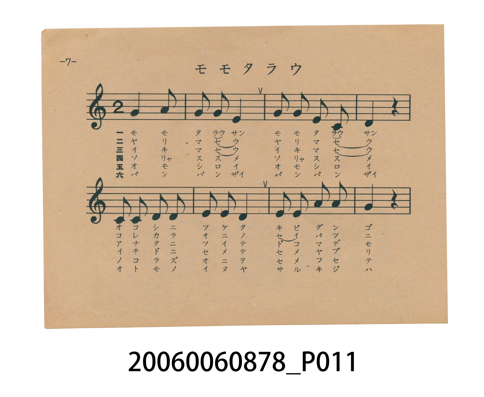
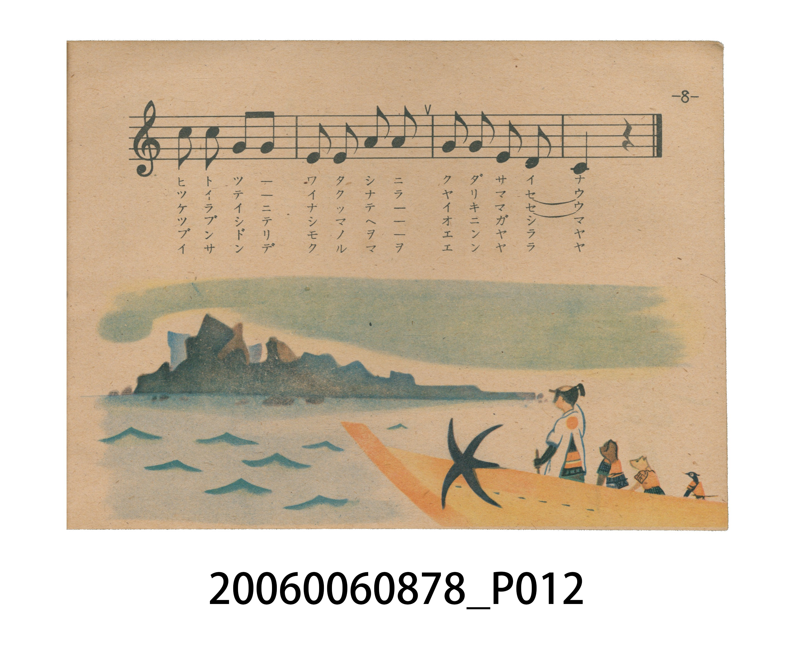
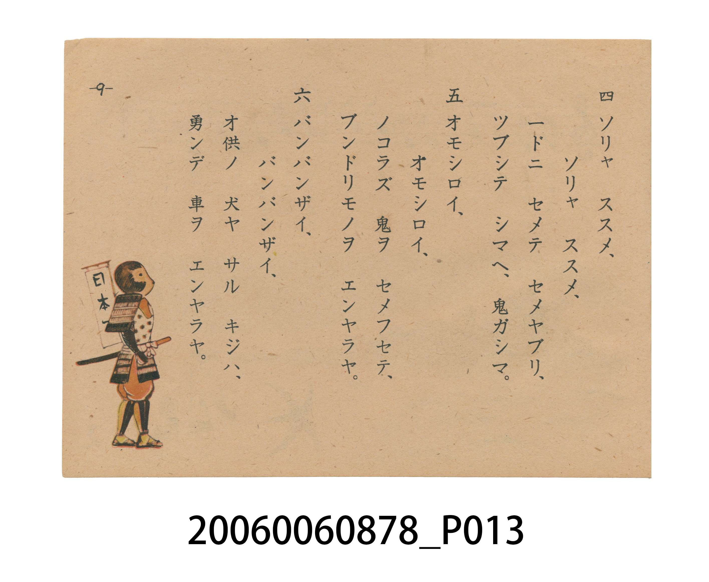
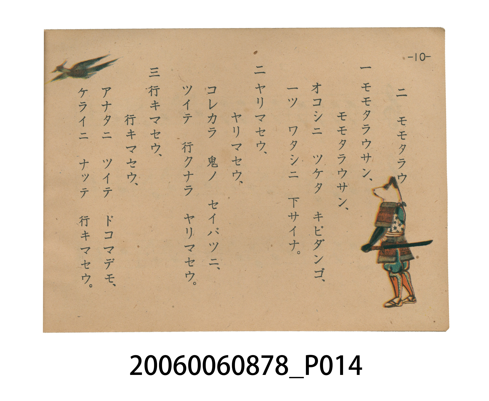

# モモタラウ（桃太郎）

> Re:Shōka 使用 AI 協助辨識與重建樂譜，可能會有錯誤。歡迎回報。

- **鋼琴伴奏版**：<br><audio controls src="momotaro.mp3"></audio>
- **NEUTRINO 歌聲合成版**：<br><audio controls src="momotaro_neutrino.mp3"></audio>

- 日治時期國民學校唱歌（うたのほん 下・第二課）
- 國立臺灣歷史博物館典藏

## 說明


- 出處：臺灣總督府編《うたのほん 下》（國民學校初等科第二學年用），第二課〈モモタラウ〉（桃太郎），原書第 7–10 頁。
- 調性與拍號：ハ調（C 大調五聲音階，無升降記號），2/4 拍，速度 != 108。
- 背景與曲風：岡野貞一作曲，原出自明治 44 年（1911）《尋常小學唱歌（一）》，亦收錄於臺灣總督府昭和 11 年《公學校唱歌集 第一學年用》第十一課。全曲共 12 小節、歌詞六節，完整敘述桃太郎以黍糰子收服犬、猿、雉並征伐鬼島滿載而歸的故事。原書第 8–10 頁配有桃太郎率領動物隨從分賜黍糰子與拉寶車凱旋之全彩插圖。
- 版本說明：本檔案為原書單聲部五線譜旋律之忠實數位化版本。

### 編曲說明（鋼琴伴奏版）：

1. 前奏 (Intro, 4 小節)：擷取主旋律核心樂句作為導奏，建立調性與拍感。
2. 主歌伴奏 (Momotaro)：右手 (PianoRH) 演奏原書歌唱主旋律；左手 (PianoLH)
依國民學校低學年教材純樸明朗之風格配以和聲伴奏。


## 歌詞

```text
一　モモタラウサン、モモタラウサン、
オコシニ　ツケタ　キビダンゴ、
一ツ　ワタシニ　下サイナ。

二　ヤリマセウ、ヤリマセウ、
コレカラ　鬼ノ　セイバツニ、
ツイテ　行クナラ　ヤリマセウ。

三　行キマセウ、行キマセウ、
アナタニ　ツイテ　ドコマデモ、
ケライニ　ナッテ　行キマセウ。

四　ソリャ　ススメ、ソリャ　ススメ、
一ドニ　セメテ　セメヤブリ、
ツブシテ　シマヘ、鬼ガシマ。

五　オモシロイ、オモシロイ、
ノコラズ　鬼ヲ　セメフセテ、
ブンドリモノヲ　エンヤラヤ。

六　バンバンザイ、バンバンザイ、
オ供ノ　犬ヤ　サル　キジハ、
勇ンデ　車ヲ　エンヤラヤ。
```

## ABC

<div class="abc-score" data-abc-src="momotaro.abc" aria-label="五線譜載入中"></div>

[下載 ABC 原始檔](momotaro.abc)

## TMD 檔案連結

- [主旋律 TMD 檔案](momotaro.tmd) [[在 TMD Studio 編輯](https://tmdlang.github.io/Tmd-TS/#tmd=s7IKdvYPcrWy4qpTUCpJTLdSyC_KTM_Ms8rNz0sqLc7IV8KQSM3MyowvSa0oScrPz0ZIJ-fn5KQml2Tm51mVliTm5Wfk5yEky_JzSnNTrYwQIsX5pUXJqXCl8emp6HLxBYnpqVYBBoaGukDCBCFdUJRflpqXmAfUXpKYWZ4I1AwUKMrLLwKakpdalJiDUJtalpmSClJZUJSZm1hUGZ-Snwx0SV4JkttSi4pBri7LT0bWmV9UkpGfXpRYkFFplZFZXAL0PlA-PjsxLxGhqCQjFeitnFSgvSlKXFpaCo-bF4FQ0_7HzSsfNy17v6fj2cLmp0tWvWzue7-nU0FLi0vRVsHQwILL3lbBmcvGSN_EDmTYs-lLn23a_Wxm07M585_O6X62YeLTtTueLVj4dMrGZ2t7gKY8bmx73Dj_ceO6x427HzdNVniyo_tx8-7na9Y82dXzYtUmoNlgRwH1Pl_d_aJ91_PGxc_Wbn_av-lp76znnStfLlnxtHXHi-n9Slxc-loKttQCXAoKCo8bJjybven57HUvVq16NqPvccNEsGjz7qftu17MnPp-zyyIe57v2Pt87uKnu-Y8377icUMXNh81dAO9iuL_jrnP13Y-Xz4R4lOg4NOdW55PWQH07_s9PXDvP27oQAv4xw1ABShhD1T_tG_-s9k7gLoUzB81TDY0UHi5oPFxQxPUuS9W7X_WsPxFR_uz7t4XM-cD3f24uR8oCDTHWeHpkuVA5pNdU140bno5f_PLWUAje563LHza2_5yZu-LFTPAOkCWAKNUAWgCkPWyYf7TXcsUIBGOZE9zz7OZ60H2zN70chHQK7Oeblr4sr3vxaZ5T3Y0PNk7BygOcSwoANtBYQpMGwomJgpAvwMdY2hpaAi0ChiETzd0P92x4-mGflC4wFIK0AywLDAoe57sWvZsyraXPS3Ppu1Bi4RnM9Y-ndSjYGgIMhVkVusa5CT3cnabAih4dzTAwxxoJFDkaW8jUBAc5k1PW1cA3fq0daOCoZEC0BnP1zc8bmgE6n6xct7T1rVALsgf63qeTd3ybOqMF_s3wOPjye6lL3f3Pt-84enaCUAXPpvT-7xrDVDv8579QPLl7M4nO5Y93df4ZM-El2v2PN287dnu_S_2dL5o6Hm2dsfzWS3PprY-2QVMLk2IGLWAx-jL1t5nczrhVj3va3-5YMbT7qmgbDBrxdN98552tL3YPAduPzjGO5-u3_Zid9fT9o3Ppnc_2dkN9NrTvSuf9U96OmcaIuqed3Y8m7MGks6B8QZkP1s15dnCjudNuyAueTptHSiBNK8AppTn22e9WDsHaNzTfWAT9y94un7Zs6k7nuztfdozDWIUyGhoHoIYAAu8Fc-mtQMd9mTHWhBj1bwXa9cDMxYwelFTLyiN9zU_6-8HukMBVFQCZUCFJTgpdoKNBsbW44YG9OzRtPVx82ZgUOMSBzuqadXjps2Pm7Y_bgaGNdCIlsdNG0FKgeymtY-bJz9uBgoCFQDTD1gDyCqgIpDS9SB1MJ2grA00uGnJ4-YuaGACHQ7xFSgYYVH1uHEqsCQAJSFUEWAqeta04kXrhpfTJj_rm_1i4nRgGoDHH1D2xepuYKQ-37rsWcdEUJJt6H46YTnQJngY7OoBuwrogFWPm-c9bgKWOMAiAuh7dBGIvzc_bl7zuGk1KEwaGoAp8DHQJSBPAxUBNUwAeRLkMYhqULAARduAKl4s7HnctB7kS7BODOMxvA508pO9C8CObYSzQd7tWwoMtCf72l4sa3zatxuSFZ41LwS6BZSlljU9mzcHqPjlwhnPWvpfbJ8PTNhArz_dsBHJQITvdwCLA4jbgLGG8CumCMT3wBTRBU4R8FiHeu9xcyc4bOY9bm4HpRqYho3gxANUBNEA9H0zUngg24ARAKCyZOt2kBfBYYDMhRSwL1ZPe9qx4enkVS8WL3zZvBfiV2AKACYIUDh1TADmPSAbmCCertv2on0xqoHwMHg6ezY4BveCI2QxmL0ThJoXgtIBDnF4ou6E-g3oDaAEJDCgbKC3p4E0I1IDkA9K-RBFQAYwuGaASjVgOmoCJiuwCGZIvFg49-nUrqedvS8bgGUrMHIQXFBJDvRWRyeQ_WzKbiB6vgBYom59OXMxKDXs2_l019QXO_qf7twMKS3RE_8UsEuA_gNmdKDta0FxBfI0ugjEA33gOAZG6C5Y4ge6B-5dYH4EMoB-g6oG-h2oGhg-YMOAmqGqV4DFgYGzEkRiSflz5j-fPvvp_tWglA9jg2K0qwuSzoFlIDC-n3Zse7KnHyTe3QmKdWBS6Fj5dHLj04kNT2fsfzplO4REjunWteBUCMylQAeAyaZtUB9jE4SWdE_2zYbkclBFBHIx0A_AshDoPHBh17QD2BiAqn7aDUz9QGPaQSl8NzC1E-fjFxPWANGzteDYhbFBzQRwpQRKwMAatHs6uBbcAqmXgBXhy9nzQBlh077nS-c965r2bPLup3M2QAIDVF-tnYA9JIB2U966gwIFLX0uLt_83PySxKJ8q4BMYIvdocagphpkiYKNhZYdmFGjYKqgq2AGxCCWqYIxEssQyDIC8g1AYmDVPoY1oLYykA8hgbym_UA2qBICMkG1EEQUKAvGCFmQUqg8knlGILVLwOatguqcB1S4G4iXQflLwHIwcZAxIBkkM4xBYmAzmtZiNwMoC5LDY4YJSGwvxB3AAgWqbScENy-E8vfCpGFSILtAkkgmmYIUgvyCCKHtQDbQdrAbIbKQsIGIw1yPZIYZyNwJYDNg4TkBzIYkf1QhKA0yBioJMQkavYZAaASENcAINQZHJ4RlBoSQyEeLXpDzmkBWgZzXDbapBVRbgCMT4gFQUE4G4ga4zVswoxVkRvMaIL0alATgHu8GlVVQc0BRBIpekA9awDZ1Y4laUFLqgiYlhHtA-tqgIdEJtQ0Yvc3t0OSHGb0gHY0Q1RBzQPYDow9uDpwPUjkNbA4oItEiF-h6iG0rgfQuFH9tQjNnKiy5gW1Ai2Cwrg5oVumDJdPmHmiGAOcXIBsYeqDwbtoBNqcfI3rjQAiUX1GjFZR_QZFuiCX_ToJa3AINvvWQwEVEeBNQBBS5IAcAHQVS04Ul36JFAziXgXQCIwsS4UTmXWDSAgcmSDUkgkEmNKOZTDD_gtwDjDaIP9rgOQ-UKGYg5TxgRDWBkuV2aEmBGcFAM8AZC5RQVsFLM2C0wyN4BVQFyMUwn2JGMMjVoCgEqQQnS3DogLIDyE2bCJpUy8Wla6cAK8LBBgP5ylwA)]
- [鋼琴伴奏 TMD 檔案](momotaro_piano.tmd) [[在 TMD Studio 編輯](https://tmdlang.github.io/Tmd-TS/#tmd=s7IKdvYPcrWy4qpTUCpJTLdSSM7PyUlNLsnMz7MqLUnMy8_Iz1OCS5bl55TmploZIUSK80uLklPhSuPTU9Hl4gsS01OtAgwMDXWBhAlCuqAovyw1LzEPqL0kMbM8EagZKFCUl18ENCUvtSgxB6E2tSwzJRWksqAoMzexqDI-JT8Z6JK8EiS3pRYVg1xdkAl0SnxiUVFiXnoqqpL8opKM_PSixIKMSquMzOKS_KLM5MSc-OzEvESEopIMoC6rnFSgG1KUuLS0FB43LwKhpv2Pm1c-blr2fk_Hs4XNT5esetnc935PJ5D7snvP8wlbnuzZ8nRp__PODqCggpYWl6KtgqGBBZe9rYIzl42RvokdyIZn05c-27T72cymZ3PmP53T_WzDxKdrdzxbsPDplI3P1vYAzXrc2Pa4cf7jxnWPG3c_bpqs8GRH9-Pm3c_XrHmyq-fFqk1As8EuBep9vrr7Rfuu542Ln63d_rR_09PeWc87V75csuJp644X0_uVuLj0tRRsqQW4FBQUHjdMeDZ70_PZ616sWvVsRt_jholg0ebdT9t3vZg59f2eWRD3PN-x9_ncxU93zXm-fcXjhi5sPmroBnoVxf8dc5-v7Xy-fCLEp0DBpzu3PJ-yAhzAPXDvP27oQIuNxw2gGECNkJ6nffOfzd4B1KVg_qhhsqGBwssFjY8bmqDOfbFq_7OG5S862p91976YOR_o7sfN_UBBoDnOCk-XLAcyn-ya8qJx08v5m1_OAhrZ87xl4dPe9pcze1-smAHWAbIEGKUKQBOArJcN85_uWqYAiXAke5p7ns1cD7Jn9qaXi4BemfV008KX7X0vNs17sqPhyd45QHGIY0EB2A4KU2DaUDAxUQD6HegYQ0tDQ6BVwCB8uqH76Y4dTzf0g8IFllKAZoBlgUHZ82TXsmdTtr3saXk2bQ9aJDybsfbppB4FQ0OQqSCzWtcgJ7mXs9sUQMG7owEe5kAjgSJPexuBguAwb3raugLo1qetGxUMjRSAzni-vuFxQyNQ94uV8562rgVyQf5Y1_Ns6pZnU2e82L8BHh9Pdi99ubv3-eYNT9dOALrw2Zze511rgHqf9-wHki9ndz7ZsezpvsYneya8XLPn6eZtz3bvf7Gn80VDz7O1O57Pank2tfXJLmByaULEqAU8Rl-29j6b0wm36nlf-8sFM552TwVlg1krnu6b97Sj7cXmOXD7wTHe-XT9the7u562b3w2vfvJzm6g157uXfmsf9LTOdMQUQdMuUAPQ9I51gwOjEyQUgUFQz2Fp529QHEFDc-8kqJ8HQVg9IFDSBOo5tlkYNac9mTHbqBlT_d1P1uw4-n-5mcrmp72LwXG__OmXU839AH1gkJv9y5QhkZKms9a5kMdpKBgpAfMNruBAQ5xg4KGb35ufkliUT7Ikqf9m591ditoBIAKviAPTYVne6YAFUGCDKgHGNFwF7zfM_vp9mUI5T4emhAbgODJvrnIWfLJ3j5Ikng2deazuROeb5nybMUOUBqdMx0YbsAE_WzBHmAUAGMYmL6AuQXiNJCToYUF3AHgVLLi2bR2oMee7FgLYqya92LtemAJAgxc1GwKysx9zc_6-5-tmqIAqjSAMqBqAxzmnWCjgcnycUMDejnQtPVx82ZgmsIlDnZU06rHTZsfN21_3AxMVEAjWh43bQQpBbKb1j5unvy4GSgIVADMKGANIKuAikBK14PUwXSCyjCgwU1LHjd3QSMJ6HCIr0DRDkuTjxunAos8UF5BFQFG-LOmFS9aN7ycNvlZ3-wXE6cDEzs8oQJlX6zuBqbe51uXPeuYCMqbDd1PJywH2gQPg109YFcBHbDqcfO8x03AohVYFgJ9jy4C8ffmx81rHjetBoVJQwMwqz0GugTkaaAioIYJIE-CPAZRDQoWoGgbUMWLhT2Pm9aDfAnWiWE8hteBTn6ydwHYsY1wNsi7fUuBgfZkX9uLZY1P-3ZD8vyz5oVAt4BS_7KmZ_PmABW_XDjjWUv_i-3zgTkY6PWnGzYiGYjw_Q5guQdxGzDWEH7FFIH4HpgiusApAh7rUO89bu4Eh828x83toFQD07ARnHiAiiAagL5vRgoPZBswAgBUaG7dDvIiOAyQuZCa5MXqaU87NjydvOrF4oUvm_dC_ApMAcAEAQqnjgnAYgHIBiaIp-u2vWhfjGogPAyezp4NjsG94AhZDGbvBKHmhaB0gEMcnqg7oX4DegMoAQkMKBvo7WkgzYjUAOSDUj5EEZABDK4ZoOIbmI6agMkKLIIZEi8Wzn06tQtYOr5sAFYiwMhBcEFVFtBbHZ1A9rMpu4Ho-QJgObP15czFoNSwb-fTXVNf7Oh_unMzpFpAT_xTwC4B-g-Y0YG2rwXFFcjT6CIQD_SB4xgYobtgiR_oHrh3gfkRyAD6Daoa6HegamD4gA0DaoaqXgEWBwbOShCJJeXPmf98-uyn-1eDUj6MDYrRri5IOgeWgcD4ftqx7ckeUIkPrItAsQ5MCh0rn05ufDqx4emM_U-nbIeQyDHduhacCoG5FOgAMNm0DepjbILQku7JvtmQXA6qcUEuBvoBWBYCnQcu7Jp2AFs9UNVPu4GpH2hMOyiF7wamduJ8_GLCGiB6thYcuzA2qD0Ern1BCRhYEXZPB1f3WyAVMLDGfzl7HigjbNr3fOm8Z13Tnk3e_XTOBkhggCrmtROwhwTQbsqbsVCgoKXPxQWurq2glaZDjUFNNbgmtLHQsgMzahRMgdAYCGsUjBQM4SwQ2yweyDRU0FUwAOIarloU03yQTTOBm2YYrxBtGAsyFplhCmLApEAGwWp2Ai7TVTADWQ11I4JlCHYjzGEg1T6GNaAuDJAPIYG8pv1ANqh2BDJB1SNEFCgLxghZkFKoPJJ5RiC1S8DmrYLqnAdUuBuIl0H5S8ByMHGQMSAZJDOMQWJgM5rWYjcDKAuSw2OGCUhsL8QdwJIOqm0nBDcvhPL3wqRhUiC7QJJIJpmCFIL8ggih7UA20HawGyGykLCBiMNcj2SGGcjcCWAzYOE5AcyG5EtUISgNMgYqCTEJllSAEJTQasCJDhSdEJYZEEIiHy16Qc5rAlkFcl432KYWUDUGjkyIB0BBORmIG-A2b8GMVpAZzWuA9GpQEoB7vBtUiELNAUURKHpBPmgB29SNJWpBSakLmpQQ7gHpa4OGRCfUNmD0NrdDkx9m9IJ0NEJUQ8wB2Q-MPrg5cD5I5TSwOaCIRItcoOshtq0E0rtQ_LUJzZypsOQGtgEtgsG6OqBZpQ-WTJt7oBkCnF-AbGDogcK7aQfYnH6M6I0DIVB-RY1WUP4FRTqiYEHk30lQi1ugwbceEriICG8CioAiF-QAoKNAarqw5Fu0aADnMpBOYGRBIpzIvAtMWuDABKmGRDDIhGY0kwnmX5B7gNEG8UcbPOeBEsUMpJwHjKgmULLcDi0pMCMYaAY4Y4ESyip4aQaMdngEr4CqALkY5lPMCAa5GhSFIJXgZAkOHVB2ALlpE0GTMEpwQrUBiGGWi8oCVi8QFlQxiI9adaBUJqA6hKhKxgDiQF07BXB1pQBkwBwb7QNUjcI3QuMbo_FN0PhAS1D4ZmC-MhcA)]

## 分析

```text
================================================================================
📊 TMD Song Profile: [ モモタラウ（桃太郎） ]
================================================================================
⏱  Duration:       0:13 (13.3s), 12 measures total
🎼 Key & Tempo:    首調基準 C, != 108.0 BPM, <2/4>
   - 分析範圍：      由實際發聲的音符與和弦推測調性；播放脈絡另行呈現
🎤 人聲音域:    C4 (MIDI 60) – C5 (MIDI 72) [跨度: 12 個半音 / 1.0 個八度, 難度: easy]
   - 最低音:  C4 in [Momotaro #1 @ m.3, 0:03]
   - 最高音: C5 in [Momotaro #1 @ m.9, 0:08]
   - 適合: soprano, mezzo-soprano, contralto, tenor, baritone, bass
🏛  結構:      Momotaro (13.3s)
⚡ 編曲密度:        Peak 1 軌道同時演奏
🗝  調性診斷：       G 調性不明確（純淨自然大調，未偵測到可信轉調）
   - 風格氣質:    純淨自然大調（陽光明朗、易唱易記，無明顯調外色彩）
   - 轉調歷程:    全曲維持單一推測調性（未偵測到可信轉調）
   - 核心骨幹音:  G, E, C, D, A
   - 調性數值:    G 調性不明確 [相關度: 0.79, 穩定度: Ambiguous, 自然音純度: 100.0%]
   - 候選調性 (K-S): G 大調 (0.79), C 大調 (0.76), E 小調 (0.73)
   - 五度圈歷程:   +1
   - 各段落調性細節:
     • [Momotaro #1]: G 調性不明確 (r: 0.79, 自然音純度: 100.0%)

  [ 五度圈游移軌跡 ]
               C  
         F           [G ]*
      Bb               D  
      Eb               A  
         Ab           E  
            Db       B  
               F# 
     (* = active key center)

  [ 十二半音累積音高分佈 ]
     C  : ██████████████            16.7%
     C# :                            0.0%
     D  : ██████████████            16.7%
     D# :                            0.0%
     E  : ████████████████████      23.8%
     F  :                            0.0%
     F# :                            0.0%
     G  : ████████████████████████  28.6%
     G# :                            0.0%
     A  : ████████████              14.3%
     A# :                            0.0%
     B  :                            0.0%
--------------------------------------------------------------------------------
Assignment 軌道音域：
  - Piano         : C4 – C5 (12 個半音 / 1.0 個八度, 35 個音符)
================================================================================
```


## 原書掃描頁










