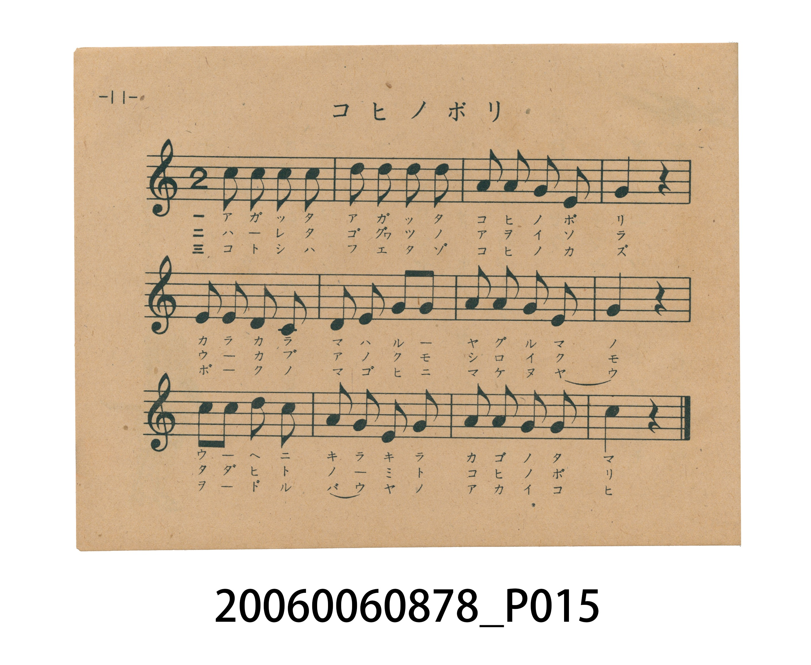
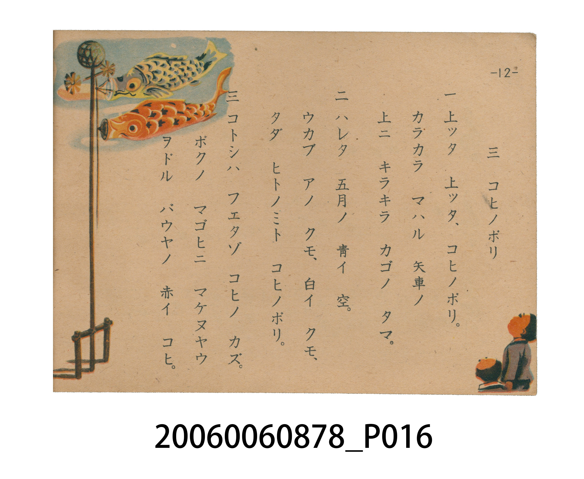

# コヒノボリ（鯉魚旗）

> Re:Shōka 使用 AI 協助辨識與重建樂譜，可能會有錯誤。歡迎[回報](https://github.com/TMDLang/reshoka/issues)。

- **鋼琴伴奏版**：<br><audio controls src="koinobori.mp3"></audio>
- **NEUTRINO 歌聲合成版**：<br><audio controls src="koinobori_neutrino.mp3"></audio>

- 日治時期國民學校唱歌（うたのほん 下・第三課）
- 國立臺灣歷史博物館典藏

## 說明


- 出處：臺灣總督府編《うたのほん 下》（國民學校初等科第二學年用），第三課〈コヒノボリ〉（鯉魚旗），原書第 11–12 頁。
- 調性與拍號：C 大調（?= C，無升降記號），2/4 拍，速度 != 108。
- 背景與曲風：描寫五月端午節高高升起的鯉魚旗。第一節刻畫頂端咔啦咔啦旋轉的矢車與閃閃發光的籠球；第二節描繪晴朗藍天中鯉魚旗彷彿要一口吞下白雲的豪邁氣勢；第三節則寫家中添了小弟弟（バウヤ），今年多了一面不輸給黑鯉（マゴヒ）的紅色小鯉魚旗，洋溢家庭添丁的歡欣。
- 版本說明：本檔案為原書單聲部五線譜旋律之忠實數位化版本。

### 編曲說明（鋼琴伴奏版）：

1. 前奏 (Intro, 4 小節)：擷取主旋律核心樂句作為導奏，建立調性與拍感。
2. 主歌伴奏 (Koinobori)：右手 (PianoRH) 演奏原書歌唱主旋律；左手 (PianoLH)
依國民學校低學年教材純樸明朗之風格配以和聲伴奏。


## 歌詞

```text
一　上ッタ　上ッタ、コヒノボリ。
カラカラ　マハル　矢車ノ
上ニ　キラキラ　カゴノ　タマ。

二　ハレタ　五月ノ　青イ　空。
ウカブ　アノ　クモ、白イ　クモ、
タダ　ヒトノミト　コヒノボリ。

三　コトシハ　フエタゾ　コヒノ　カズ。
ボクノ　マゴヒニ　マケヌヤウ
ヲドル　バウヤノ　アカイ　コヒ。
```

## ABC

<div class="abc-score" data-abc-src="koinobori.abc" aria-label="五線譜載入中"></div>

[下載 ABC 原始檔](koinobori.abc)

## TMD 檔案連結

- [主旋律 TMD 檔案](koinobori.tmd) [[在 TMD Studio 編輯](https://tmdlang.github.io/Tmd-TS/#tmd=s7IKdvYPcrWy4qpTUCpJTLdSyC_KTM_Ms8rNz0sqLc7IV4JLJOfn5KQml2Tm51mVliTm5Wfk5yEky_JzSnNTrYwQIsX5pUXJqXCl8emp6HLxBYnpqVYBBoamukDCDCFdUJRflpqXmAfUXpKYWZ4I1AwUKMrLLwKakpdalJiDUJtalpmSClJZUJSZm1hUGZ-Snwx0SV4JkttSi4pBri7LT0bWmV9UkpGfXpRYkFFplZFZXAL0OFA-PjsxLxGhqCQjFeittNTikswykGYtLYXHTZsfN0963Nz3uHnO4-ZV7_d0vFzf-XLtrGfTp7_f06mgpcWlaKtgaGDBZW-r4MxlY6RvYgcy7tn0pc827X42s-nZnPlP53Q_2zDx6dodzxYsfDpl47O1PUBTHje2PW6c_7hx3ePG3Y-bJis82dH9uHn38zVrnuzofLFqE9BssLOAep-v7n7Rvut54-Jna7c_7d_0tHfW886VL5eseNq648X0fiUuLn0tBVtqAS4FBYXHDROezd70fPa6F6tWPZvR97hhIli0effT9l0vZk59v2cWxD3Pd-x9Pnfx011znm9f8bihC5uPGrqBXkXxf8fc52s7ny-fCPLprh6g4NOdW55PWQH07_s9PXDvP27oQAv4xw1ABShhD1T_tG_-s9k7gLoUDA0fNUw2NFJ4uaDxcUMT1L0vVu1_1rD8RUf7s-7eFzPnAx3urPB0yXKgMNAoUHyBrGxZ-LS3_eXM3hcrZoDVgMwFxqICUA-Q9bJh_tNdyxQgcYxkcnPPs5nrQSbP3vRyEdD1s5719z9dv_rJrinP5nQ8X73-aW_H8_UNL1fPACKg-S-2bn8-qwXueqBBYK82ANU87dj9fOrqlwuaQLomTXk6dRmEfDa9-8XeTqCu5_MXvdjdBbTr5bRmIHo-c8_TVrD4xgXPJzS_3zMbEpRAo4BueL5z1bOZW57Nmf5ieu_TJSuf7FgLt_Tp3u1P9-5_sawRaO_T_sVPJ8wDxtDzmXtfAuN6VsuLjateNjU-27D4afciqJk7OkHO62wH-uvpum1Ao55t3_1kV9vTDf1P98wHIlAqbp7wuGnZ4-YlkHB7srsLGJ1Pl8wCKgPa8nLuoic7el_s2fF867KXuycCXQLWMu9x0xZg1AK1gHyxpfVF5yagmUhR2_NsS_ezXYuAlj7dBbZ0RyNQ5bO1C5-tWYyIg-edHc_mrIGkUVAEzFnzbNWUZws7njftgqSLp9PWvWjc9LJ5BTBWnm-f9WLtHGCYPt3X_WRn99P9C56uX_Zs6o4ne3uf9kyDGAUyGpr-IQYAc-qLlfOetq54Nq0dGP6gEAAyVs17sXY9MFMA_YKW8oAiz_qagbEAdIgCqKQDyoDKOnDgdILNBobK44aGJzu6Hjc3P27aj8puxEjzEL82rX7cvBJKNjSAArC5_3HzaiAbkjaAGiBmA1nAPNfwuGktWAOYBHFXg0McmJOB7P0g_RCDge6F-AYYfJBE-mRfGzDqgC5B5oKyAVLKfTpnBZ50CnTEs2k7QRkLnDyR0yxQLzwYdvWAfQL0xhpoMIBzDsSRL-dOety0BOS9lbvgYbAMHADTwH5YBPPM-sfNi4CuBaZiiAa4CEQP0K-g4AaHKdjs5vkgBkgdtoBGDg9ILoLmZ2D2mDILkqMgTnq2p-nZ1nWgLN20-NmcrcAsBLTz2d4pQIeABGcDy29EmMEz3tMN7U_XNSNnP-Qg2QEMIIjDgGXfdlDYgFw-9XHTCpBHmvahOBsaq_DgAXoD5HWwBCyDQRMDiLvxcXMPMJcCQxGietPj5k5ICoLnYJipi8AGQwITbBtm2ECyOdx_oLw5dcfL9v6ni-Y97VoAKiKmTQEVcU27wOUAtAR41jERqBJY_sKKgh54SQIpB-AGPtkJrDNXAEMamONe7Op92j0VGk5Ad1BexUGBgpY-F5d3fmZefhKwLWAVkAlsuTjUGNRUg2xRsLHQsgMzahQM4xCoRsEoDoFqFMyA0FTBBMgyVdBVMADiGrAuH8MaYPJbBMRrgKHdDEqKQDXYRDYDeZOAuA8UhyCR5lWoJhmBxPqBfGBWgevaAsQbHjevAwq2gDVDDW_eBKSXAPFesFErUY0yhlnYAaS3g40FqZoK5K0AGw1MZeiOaloNFtkFNwkaKsZAaKRgCAoRoP9NgRAWGsY4QmM12EEwGmTxPLATgOkQpBJIgxy-AcwHyYFE-jDDomkZKCzApkyDexvk0PVAehFYBOS1tdCAWA82ZxFmQABDG2QOSBc4-ECuAYUr2OPdcJGNQLoH7DaY3SjBAEkWwLQAThwQ7yOCAsQCSmCGBdgPzTNgNjUBXQsOGwgNDS2wa0A-A8c50DWYYQGMsuYGqJs74CEGLOZgfMLpCxwWm8C6OsFhD-JPALsRHCOIxAV2EyhMN4PVTIKbU8vFpWunAM9LYHOBAspcAA)]
- [鋼琴伴奏 TMD 檔案](koinobori_piano.tmd) [[在 TMD Studio 編輯](https://tmdlang.github.io/Tmd-TS/#tmd=s7IKdvYPcrWy4qpTUCpJTLdSSM7PyUlNLsnMz7MqLUnMy8_Iz1OCS5bl55TmploZIUSK80uLklPhSuPTU9Hl4gsS01OtAgwMTXWBhBlCuqAovyw1LzEPqL0kMbM8EagZKFCUl18ENCUvtSgxB6E2tSwzJRWksqAoMzexqDI-JT8Z6JK8EiS3pRYVg1xdkAl0SnxiUVFiXnoqqpL8opKM_PSixIKMSquMzOKS_KLM5MSc-OzEvESEopIMoC6rtNTikswykBO0tBQeN21-3DzpcXPf4-Y5j5tXvd_T8XJ958u1s55Nn_5-TyeI273n-YQtT_Zsebq0_3lnB1BQQUuLS9FWwdDAgsveVsGZy8ZI38QOZMez6Uufbdr9bGbTsznzn87pfrZh4tO1O54tWPh0ysZna3uAZj1ubHvcOP9x47rHjbsfN01WeLKj-3Hz7udr1jzZ0fli1Sag2WC3AvU-X939on3X88bFz9Zuf9q_6WnvrOedK18uWfG0dceL6f1KXFz6Wgq21AJcCgoKjxsmPJu96fnsdS9WrXo2o-9xw0SwaPPup-27Xsyc-n7PLIh7nu_Y-3zu4qe75jzfvuJxQxc2HzV0A72K4v-Ouc_Xdj5fPhHk0109QMGnO7c8n7ICHMA9cO8_buhAi43HDeAYQImQnqd985_N3gHUpWBo-KhhsqGRwssFjY8bmqDufbFq_7OG5S862p91976YOR_ocGeFp0uWA4WBRoHiC2Rly8Knve0vZ_a-WDEDrAZkLjAWFYB6gKyXDfOf7lqmAIljJJObe57NXA8yefaml4uArp_1rL__6frVT3ZNeTan4_nq9U97O56vb3i5egYQAc1_sXX781ktcNcDDQJ7tQGo5mnH7udTV79c0ATSNWnK06nLIOSz6d0v9nYCdT2fv-jF7i6gXS-nNQPR85l7nraCxTcueD6h-f2e2ZCgBBoFdMPznauezdzybM70F9N7ny5Z-WTHWrilT_duf7p3_4tljUB7n_YvfjphHjCGns_c-xIY17NaXmxc9bKp8dmGxU-7F0HN3NEJcl5nO9BfT9dtAxr1bPvuJ7vanm7of7pnPhCBUnHzhMdNyx43L4GE25PdXcDofLpkFlAZ0JaXcxc92dH7Ys-O51uXvdw9EegSsJZ5j5u2AKMWqAXkiy2tLzo3Ac1EitqeZ1u6n-1aBLT06S6wpTsagSqfrV34bM1iRBwAUx0w9CFpFGvmBMYKSKmCgqGewtPOXqC4goZnXklRvo6CiQLQRqDvNEExNxmYraY92bEbGOJP93U_W7Dj6f7mZyuanvYvfbJ3zvOmXU839AH1gpLb7l2gzIiUqp61zIc6SEHBSA-Y5HcDczfEDQoa3vmZeflJwNIHZMvT_s3POrsVNAJA5VaQh6bCsz1TgKogKRioCVgwwJ0ADP-n25chlPt4aEKsAIIn--Yi56cne_sgeejZ1JnP5k54vmXKsxU7gAECTAFPdnYDk-azBXtetvY-2b306aSeF42bIG4DuRma0-EOeLFy3tPWFc-mtQN9BoprIGPVvBdr1wOzPzB00fIYUORZXzMwvT1bNUUBVOgDZUDFPjjUO8FmA-P_cUPDkx1dj5ubHzftR2U3YuRuSKw2rX7cvBJKNjSAkkpz_-Pm1UA2JBcANUDMBrKApUvD46a1YA1gEsRdDU5bwDILyN4P0g8xGOheiG9AMQHOjk_2tQETKdAlyFxQhkfKo0_nrMCTI4GOeDZtJ6gIAWdE5NwJ1AsPhl09YJ8AvbEGGgzgMgLiyJdzJz1uWgLy3spd8DBYBg6AaWA_LIJ5Zv3j5kVA1wLzK0QDXASiB-hXUHCDwxRsdvN8EAOkDltAI4cHpLyAllzAgmDKLEjZAXHSsz1Nz7auAxVeTYufzdkKLCyAdj7bOwXoEJDgbGBNhQgzeBHzdEP703XNyAUNcpDsAAYQxGHAUn47KGxALp_6uGkFyCNN-1CcDY1VePAAvQHyOlgCVpRAEwOIu_Fxcw-wPAKGIkT1psfNnZAUBC-rYKYuAhsMCUywbZhhAynQ4P4DlUJTd7xs73-6aN7TrgWgwnDaFFBh3rQLXOJBy7pnHROBKoE1DazQ64GXmZASD27gk53A1sEKYEgDc9yLXb1Pu6dCwwnoDsorcyhQ0NLn4gIXfFbQ0sehxqCmGlyk2Fho2YEZNQqGcSBkBCZrFMwUTIGlpCmYBRQAccFKdBUMgLiGqxbFSB9kI00QRsYrRBvGAhkmQIYJiGEKZJiCGDApkEHwgpII90FQDcidcARyI8S9QAvgLgTp8jGsAWaORUC8BpgWmkEZBagGm8hmIG8SEPeBUhhIpHkVqklGILF-IB-YkeG6tgDxhsfN64CCLWDNUMObNwHpJUC8F2zUSlSjjGEWdgDp7WBjQaqmAnkrwEYD8wC6o5pWg0V2wU2ChooxEBopGIJCBBxfkBgDhYYxjtBYDXYQjAZZPA_sBGAuAakE0iCHbwDzQXIgkT7MsGhaBgoLsCnT4N4GOXQ9kF4EFgF5bS00INaDzVmEGRDA0AaZA9IFDj6Qa0DhCvZ4N1xkI5DuAbsNZjdKMGAmXmOkoEBLu4iwAPuheQbMpiaga8FhA6GhoQV2Dchn4DgHugYzLIBR1twAdXMHPMSAhTCMTzh9gcNiE1hXJzjsQfwJYDeCYwSRuMBuAoXpZrCaSch5Ei0rEcqX8OyIkUGhKjEzLi6VmHkdxIDldQOI83TtFMClhgKQAXdqtA9QH6qAEbqAMVhAmQsA)]

## 分析

```text
================================================================================
📊 TMD Song Profile: [ コヒノボリ（鯉魚旗） ]
================================================================================
⏱  Duration:       0:13 (13.3s), 12 measures total
🎼 Key & Tempo:    首調基準 C, != 108.0 BPM, <2/4>
   - 分析範圍：      由實際發聲的音符與和弦推測調性；播放脈絡另行呈現
🎤 人聲音域:    C4 (MIDI 60) – D5 (MIDI 74) [跨度: 14 個半音 / 1.2 個八度, 難度: moderate]
   - 最低音:  C4 in [Koinobori #1 @ m.5, 0:05]
   - 最高音: D5 in [Koinobori #1 @ m.2, 0:01]
   - 適合: soprano, mezzo-soprano, contralto, tenor, baritone, bass
🏛  結構:      Koinobori (13.3s)
⚡ 編曲密度:        Peak 1 軌道同時演奏
🗝  調性診斷：       C 大調（純淨自然大調，未偵測到可信轉調）
   - 風格氣質:    純淨自然大調（陽光明朗、易唱易記，無明顯調外色彩）
   - 轉調歷程:    全曲維持單一推測調性（未偵測到可信轉調）
   - 核心骨幹音:  G, C, D, A, E
   - 調性數值:    C 大調 [相關度: 0.86, 穩定度: Moderate, 自然音純度: 100.0%]
   - 候選調性 (K-S): C 大調 (0.86), G 大調 (0.79), A 小調 (0.58)
   - 五度圈歷程:   +0
   - 各段落調性細節:
     • [Koinobori #1]: C 大調 (r: 0.86, 自然音純度: 100.0%)

  [ 五度圈游移軌跡 ]
              [C ]*
         F            G  
      Bb               D  
      Eb               A  
         Ab           E  
            Db       B  
               F# 
     (* = active key center)

  [ 十二半音累積音高分佈 ]
     C  : ████████████████████      23.8%
     C# :                            0.0%
     D  : ██████████████            16.7%
     D# :                            0.0%
     E  : ████████                   9.5%
     F  : ████                       4.8%
     F# :                            0.0%
     G  : ████████████████████████  28.6%
     G# :                            0.0%
     A  : ██████████████            16.7%
     A# :                            0.0%
     B  :                            0.0%
--------------------------------------------------------------------------------
Assignment 軌道音域：
  - Piano         : C4 – D5 (14 個半音 / 1.2 個八度, 39 個音符)
================================================================================
```


## 原書掃描頁






