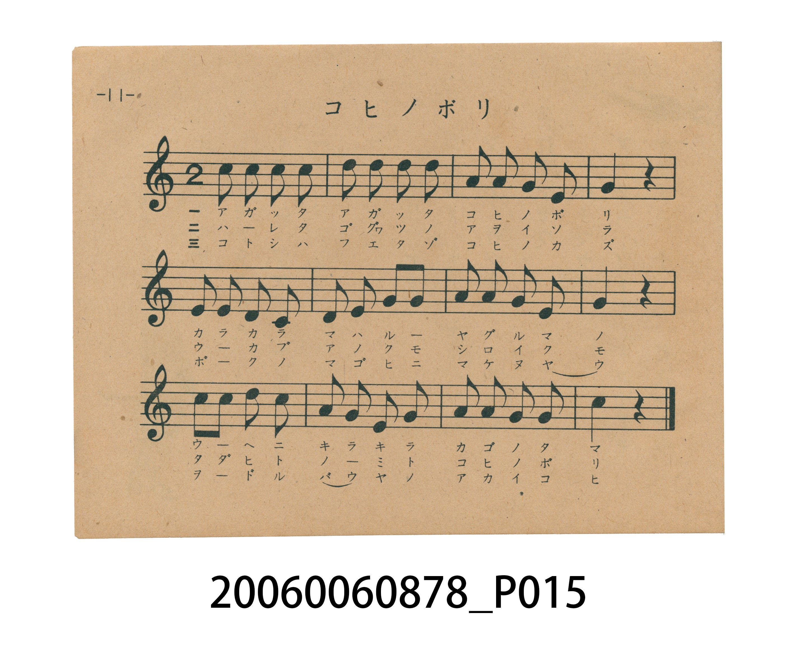
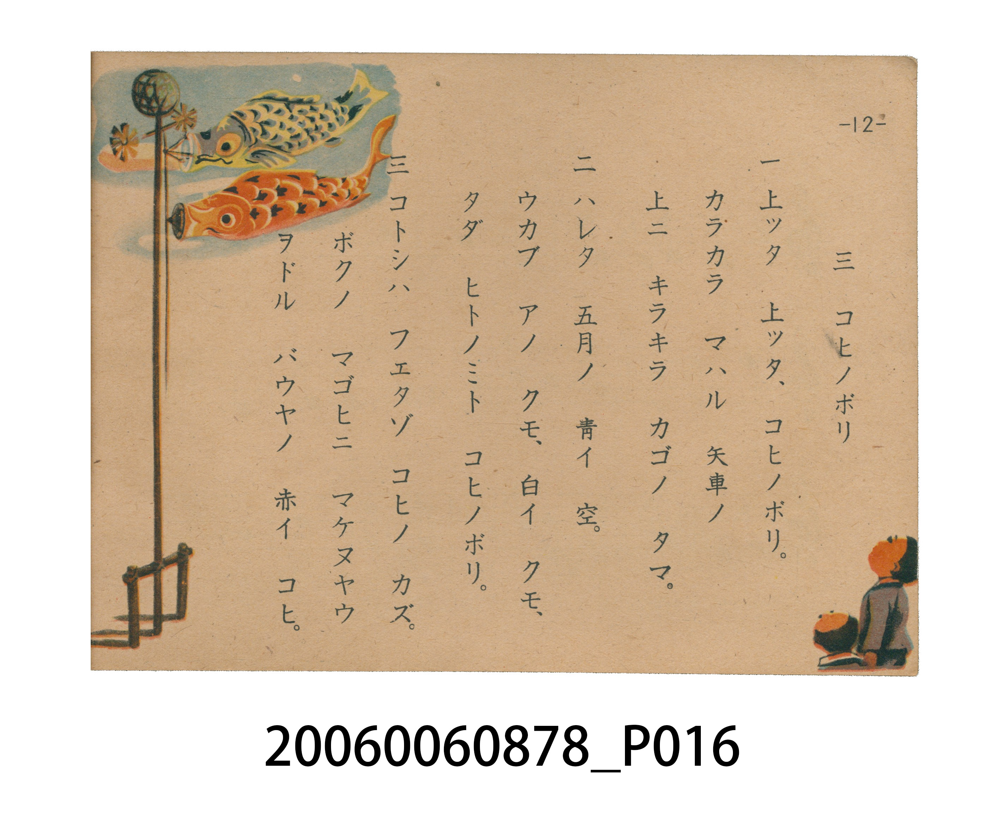

# コヒノボリ（鯉魚旗）

> Re:Shōka 使用 AI 協助辨識與重建樂譜，可能會有錯誤。歡迎回報。

- **鋼琴伴奏版**：<br><audio controls src="koinobori.mp3"></audio>
- **NEUTRINO 歌聲合成版**：<br><audio controls src="koinobori_neutrino.mp3"></audio>

- 日治時期國民學校唱歌（うたのほん 下・第三課）
- 國立臺灣歷史博物館典藏

## 說明


- 出處：臺灣總督府編《うたのほん 下》（國民學校初等科第二學年用），第三課〈コヒノボリ〉（鯉魚旗），原書第 11–12 頁。
- 調性與拍號：C 大調（?= C，無升降記號），2/4 拍，速度 != 108。
- 背景與曲風：描寫五月端午節高高升起的鯉魚旗。第一節刻畫頂端咔啦咔啦旋轉的矢車與閃閃發光的籠球；第二節描繪晴朗藍天中鯉魚旗彷彿要一口吞下白雲的豪邁氣勢；第三節則寫家中添了小弟弟（バウヤ），今年多了一面不輸給黑鯉（マゴヒ）的紅色小鯉魚旗，洋溢家庭添丁的歡欣。
- 版本說明：本檔案為原書單聲部五線譜旋律之忠實數位化版本。

### 編曲說明（鋼琴伴奏版）：

1. 前奏 (Intro, 4 小節)：擷取主旋律核心樂句作為導奏，建立調性與拍感。
2. 主歌伴奏 (Koinobori)：右手 (PianoRH) 演奏原書歌唱主旋律；左手 (PianoLH)
依國民學校低學年教材純樸明朗之風格配以和聲伴奏。


## 歌詞

```text
一　上ッタ　上ッタ、コヒノボリ。
カラカラ　マハル　矢車ノ
上ニ　キラキラ　カゴノ　タマ。

二　ハレタ　五月ノ　青イ　空。
ウカブ　アノ　クモ、白イ　クモ、
タダ　ヒトノミト　コヒノボリ。

三　コトシハ　フエタゾ　コヒノ　カズ。
ボクノ　マゴヒニ　マケヌヤウ
ヲドル　バウヤノ　アカイ　コヒ。
```

## ABC

```abc
X:1
T:コヒノボリ（鯉魚旗）
M:2/4
L:1/16
Q:1/4=108
K:C
V:V1 name="Piano" snm="Pia"
[V:V1]
c2 c2 c2 c2 | d2 d2 d2 d2 | A2 A2 G2 F2 | G4 z4 |
w: 1.~ア ガ ッ タ | ア ガ ッ タ | コ ヒ ノ ボ | リ
w: 2.~ハ _ レ タ | ゴ グヮ ツ ノ | ア ヲ イ ソ | ラ
w: 3.~コ ト シ ハ | フ エ タ ゾ | コ ヒ ノ カ | ズ
E2 E2 D2 C2 | D2 F2 G2 G2 | A2 A2 G2 E2 | G4 z4 |
w: 1.~カ ラ カ ラ | マ ハ ル _ | ヤ グ ル マ | ノ
w: 2.~ウ _ カ ブ | ア ノ ク モ | シ ロ イ ク | モ
w: 3.~ボ _ ク ノ | マ ゴ ヒ ニ | マ ケ ヌ ヤ | ウ
c2 c2 d2 c2 | A2 G2 E2 G2 | A2 A2 G2 G2 | c4 z4 |
w: 1.~ウ _ ヘ ニ | キ ラ キ ラ | カ ゴ ノ タ | マ
w: 2.~タ ダ ヒ ト | ノ _ ミ ト | コ ヒ ノ ボ | リ
w: 3.~ヲ _ ド ル | バ ウ ヤ ノ | ア カ イ コ | ヒ
```

## TMD 檔案連結

- [主旋律 TMD 檔案](koinobori.tmd) [[在 TMD Studio 編輯](https://tmdlang.github.io/Tmd-TS/#tmd=s7IKdvYPcrWy4qpTUCpJTLdSyC_KTM_Ms8rNz0sqLc7IV-LS0lJ43LT5cfOkx819j5vnPG5e9X5Px8v1nS_Xzno2ffr7PZ0KWlpcirYKhgYWXPa2Cs5cNkb6JnYg855NX_ps0-5nM5uezZn_dE73sw0Tn67d8WzBwqdTNj5b2wM05XFj2-PG-Y8b1z1u3P24abLCkx3dj5t3P1-z5smOzherNgHNVgKZA9T7fHX3i_ZdzxsXP1u7_Wn_pqe9s553rny5ZMXT1h0vpvcrcXHpaynYUgtwKSgoPG6Y8Gz2puez171YterZjL7HDRPBos27n7bvejFz6vs9syDueb5j7_O5i5_umvN8-4rHDV3YfNTQDfQqiv875j5f2_l8-USQT3f1AAWf7tzyfMoKoH_f7-mBe_9xQwdawD9uACpACXug-qd985_N3gHUpWBo-KhhsqGRwssFjY8bmqDufbFq_7OG5S862p91976YOR_ocGeFp0uWA4WBRoHiC2Rly8Knve0vZ_a-WDEDrAZkLjAWFYB6gKyXDfOf7lqmAIljJJObe57NXA8yefaml4uArp_1rL__6frVT3ZNeTan4_nq9U97O56vb3i5egYQAc1_sXX781ktcNcDDQJ7tQGo5mnH7udTV79c0ATSNWnK06nLIOSz6d0v9nYCdT2fv-jF7i6gXS-nNQPR85l7nraCxTcueD6h-f2e2ZCgBBoFdMPznauezdzybM70F9N7ny5Z-WTHWrilT_duf7p3_4tljUB7n_YvfjphHjCGns_c-xIY17NaXmxc9bKp8dmGxU-7F0HN3NEJcl5nO9BfT9dtAxr1bPvuJ7vanm7of7pnPhCBUnHzhMdNyx43L4GE25PdXcDofLpkFlAZ0JaXcxc92dH7Ys-O51uXvdw9EegSsJZ5j5u2AKMWqAXkiy2tLzo3Ac1EitqeZ1u6n-1aBLT06S6wpTsagSqfrV34bM1iRBw87-x4NmcNJI2CImDOmmerpjxb2PG8aRckXTydtu5F46aXzSuAsfJ8-6wXa-cAw_Tpvu4nO7uf7l_wdP2yZ1N3PNnb-7RnGsQokNHQ9A8xAJhTX6yc97R1xbNp7cDwB4UAkLFq3ou164GZAugXtJQHFHnW1wyMBaBDFAIMDE2BMkDKDBw4nWCzgaHyuKHhyY6ux83Nj5v2o7IbMdI8xK9Nqx83r4SSDQ2gAGzuf9y8GsiGpA2gBojZQBYwzzU8bloL1gAmQdzV4BAH5mQgez9IP8RgoHshvgEGHySRPtnXBow6oEuQuaBsgJRyn85ZgSedAh3xbNpOUMYCJ0_kNAvUCw-GXT1gnwC9sQYaDOCcA3Hky7mTHjctAXlv5S54GCwDB8A0sB8WwTyz_nHzIqBrgakYogEuAtED9CsouMFhCja7eT6IAVKHLaCRwwOSi6D5GZg9psyC5CiIk57taXq2dR0oSzctfjZnKzALAe18tncK0CEgwdnA8hsRZvCM93RD-9N1zcjZDzlIdgADCOIwYNm3HRQ2IJdPfdy0AuSRpn0ozobGKjx4gN4AeR0sActg0MQA4m583NwDzKXAUISo3vS4uROSguA5GGbqIrDBkMAE24YZNpBsDvcfKG9O3fGyvf_ponlPuxaAiohpU0BFXNMucDkALQGedUwEqgSWv7CioAdekkDKAbiBT3YC68wVwJAG5rgXu3qfdk-FhhPQHZRXcVCgoKXPxeWdn5mXnwSs960CMhPz8h1qDGqqQbYo2Fho2YEZNQqGcQhUo2AUh0A1CmZAaKpgAmSZKugqGABxDViXj2ENMPktAuI1wNBuBiVFoBpsIpuBvElA3AeKQ5BI8ypUk4xAYv1APjCrwHVtAeINj5vXAQVbwJqhhjdvAtJLgHgv2KiVqEYZwyzsANLbwcaCVE0F8laAjQamMnRHNa0Gi-yCmwQNFWMgNFIwBIUI0P-mQAgLDWMcobEa7CAYDbJ4HtgJwHQIUgmkQQ7fAOaD5EAifZhh0bQMFBZgU6bBvQ1y6HogvQgsAvLaWmhArAebswgzIIChDTIHpAscfCDXgMIV7PFuuMhGIN0DdhvMbpRggCQLYFoAJw6I9xFBAWIBJTDDAuyH5hkwm5qArgWHDYSGhhbYNSCfgeMc6BrMsABGWXMD1M0d8BADFnMwPuH0BQ6LTWBdneCwB_EngN0IjhFE4gK7CRSmm8FqJsHNqeXi0rVTgOclsLlAAWUuAA)]
- [鋼琴伴奏 TMD 檔案](koinobori_piano.tmd) [[在 TMD Studio 編輯](https://tmdlang.github.io/Tmd-TS/#tmd=s7IKdvYPcrWy4tLSUnjctPlx86THzX2Pm-c8bl71fk_Hy_WdL9fOejZ9-vs9nSBu957nE7Y82bPl6dL-550dQEEFLS0uRVsFQwMLLntbBWcuGyN9EzuuOgWlZ9OXPtu0-9nMpmdz5j-d0_1sw8Sna3c8W7Dw6ZSNz9b2AM163Nj2uHH-48Z1jxt3P26arPBkR_fj5t3P16x5sqPzxapNQLOVQOYA9T5f3f2ifdfzxsXP1m5_2r_pae-s550rXy5Z8bR1x4vp_UpcXPpaCrbUAlwKCgqPGyY8m73p-ex1L1atejaj73HDRLBo8-6n7btezJz6fs8siHue79j7fO7ip7vmPN--4nFDFzYfNXQDvYri_465z9d2Pl8-EeTTXT1Awac7tzyfsgIcwD1w7z9u6ECLjccN4BhAiZCep33zn83eAdSlYGj4qGGyoZHCywWNjxuaoO59sWr_s4blLzran3X3vpg5H-hwZ4WnS5YDhYFGgeILZGXLwqe97S9n9r5YMQOsBmQuMBYVgHqArJcN85_uWqYAiWMkk5t7ns1cDzJ59qaXi4Cun_Wsv__p-tVPdk15Nqfj-er1T3s7nq9veLl6BhABzX-xdfvzWS1w1wMNAnu1Aajmacfu51NXv1zQBNI1acrTqcsg5LPp3S_2dgJ1PZ-_6MXuLqBdL6c1A9HzmXuetoLFNy54PqH5_Z7ZkKAEGgV0w_Odq57N3PJszvQX03ufLln5ZMdauKVP925_unf_i2WNQHuf9i9-OmEeMIaez9z7EhjXs1pebFz1sqnx2YbFT7sXQc3c0QlyXmc70F9P120DGvVs--4nu9qebuh_umc-EIFScfOEx03LHjcvgYTbk91dwOh8umQWUBnQlpdzFz3Z0ftiz47nW5e93D0R6BKwlnmPm7YAoxaoBeSLLa0vOjcBzUSK2p5nW7qf7VoEtPTpLrClOxqBKp-tXfhszWJEHABTHTD0IWkUa-YExgpIqYKCoZ7C085eoLiChmdeSVG-joKJAtBGoO80QTE3GZitpj3ZsRsY4k_3dT9bsOPp_uZnK5qe9i99snfO86ZdTzf0AfWCktvuXaDMiJSqnrXMhzpIQcFID5jkdwNzN8QNChre-Zl5-Un5RZkgW572b37W2a2gEZCZmJcf5KGp8GzPFKAqSAoGagIWDHAnAMP_6fZlCOU-HpoQK4Dgyb65yPnpyd4-SB56NnXms7kTnm-Z8mzFDmCAAFPAk53dwKT5bMGel629T3YvfTqp50XjJojbQG6G5nS4A16snPe0dcWzae1An4HiGshYNe_F2vXA7A8MXbQ8BhR51tcMTG_PVk1RCDAwNAXKACkzcKh3gs0Gxv_jhoYnO7oeNzc_btqPym7EyN2QWG1a_bh5JZRsaAAlleb-x82rgWxILgBqgJgNZAFLl4bHTWvBGsAkiLsanLaAZRaQvR-kH2Iw0L0Q34BiApwdn-xrAyZSoEuQuaAMj5RHn85ZgSdHAh3xbNpOUBECzojIuROoFx4Mu3rAPgF6Yw00GMBlBMSRL-dOety0BOS9lbvgYbAMHADTwH5YBPPM-sfNi4CuBeZXiAa4CEQP0K-g4AaHKdjs5vkgBkgdtoBGDg9IeQEtuYAFwZRZkLID4qRne5qebV0HKryaFj-bsxVYWADtfLZ3CtAhIMHZwJoKEWbwIubphvan65qRCxrkINkBDCCIw4Cl_HZQ2IBcPvVx0wqQR5r2oTgbGqvw4AF6A-R1sASsKIEmBhB34-PmHmB5BAxFiOpNj5s7ISkIXlbBTF0ENhgSmGDbMMMGUqDB_QcqhabueNne_3TRvKddC0CF4bQpoMK8aRe4xIOWdc86JgJVAmsaWKHXAy8zISUe3MAnO4GtgxXAkAbmuBe7ep92T4WGE9AdlFfmUKCgpc_FBS74rKClj0ONQU01uEixsdCyAzNqFAzjQMgITNYomCmYAktJUzALKADigpXoKhgAcQ1XLYqRPshGmiCMjFeINowFMkyADBMQwxTIMAUxYFIgg-AFJRHug6AakDvhCORGiHuBFsBdCNLlY1gDzByLgHgNMC00gzIKUA02kc1A3iQg7gOlMJBI8ypUk4xAYv1APjAjw3VtAeINj5vXAQVbwJqhhjdvAtJLgHgv2KiVqEYZwyzsANLbwcaCVE0F8laAjQbmAXRHNa0Gi-yCmwQNFWMgNFIwBIUIOL4gMQYKDWMcobEa7CAYDbJ4HtgJwFwCUgmkQQ7fAOaD5EAifZhh0bQMFBZgU6bBvQ1y6HogvQgsAvLaWmhArAebswgzIIChDTIHpAscfCDXgMIV7PFuuMhGIN0DdhvMbpRgwEy8xkhBgZZ2EWEB9kPzDJhNTUDXgsMGQkNDC-wakM_AcQ50DWZYAKOsuQHq5g54iAELYRifcPoCh8UmsK5OcNiD-BPAbgTHCCJxgd0ECtPNYDWTkPMkWlYilC_h2REjg0JVYmZcXCox8zqIAcvrBhDn6dopgEsNBSAD7tRoH6A-VAEjdAFjsIAyFwA)]

## 分析

```text
================================================================================
📊 TMD Song Profile: [ コヒノボリ（鯉魚旗） ]
================================================================================
⏱  Duration:       0:13 (13.3s), 12 measures total
🎼 Key & Tempo:    首調基準 C, != 108.0 BPM, <2/4>
   - 分析範圍：      由實際發聲的音符與和弦推測調性；播放脈絡另行呈現
🎤 人聲音域:    C4 (MIDI 60) – D5 (MIDI 74) [跨度: 14 個半音 / 1.2 個八度, 難度: moderate]
   - 最低音:  C4 in [Koinobori #1 @ m.5, 0:05]
   - 最高音: D5 in [Koinobori #1 @ m.2, 0:01]
   - 適合: soprano, mezzo-soprano, contralto, tenor, baritone, bass
🏛  結構:      Koinobori (13.3s)
⚡ 編曲密度:        Peak 1 軌道同時演奏
🗝  調性診斷：       C 大調（純淨自然大調，未偵測到可信轉調）
   - 風格氣質:    純淨自然大調（陽光明朗、易唱易記，無明顯調外色彩）
   - 轉調歷程:    全曲維持單一推測調性（未偵測到可信轉調）
   - 核心骨幹音:  G, C, D, A, E
   - 調性數值:    C 大調 [相關度: 0.86, 穩定度: Moderate, 自然音純度: 100.0%]
   - 候選調性 (K-S): C 大調 (0.86), G 大調 (0.79), A 小調 (0.58)
   - 五度圈歷程:   +0
   - 各段落調性細節:
     • [Koinobori #1]: C 大調 (r: 0.86, 自然音純度: 100.0%)

  [ 五度圈游移軌跡 ]
              [C ]*
         F            G  
      Bb               D  
      Eb               A  
         Ab           E  
            Db       B  
               F# 
     (* = active key center)

  [ 十二半音累積音高分佈 ]
     C  : ████████████████████      23.8%
     C# :                            0.0%
     D  : ██████████████            16.7%
     D# :                            0.0%
     E  : ████████                   9.5%
     F  : ████                       4.8%
     F# :                            0.0%
     G  : ████████████████████████  28.6%
     G# :                            0.0%
     A  : ██████████████            16.7%
     A# :                            0.0%
     B  :                            0.0%
--------------------------------------------------------------------------------
Assignment 軌道音域：
  - Piano         : C4 – D5 (14 個半音 / 1.2 個八度, 39 個音符)
================================================================================
```


## 原書掃描頁






