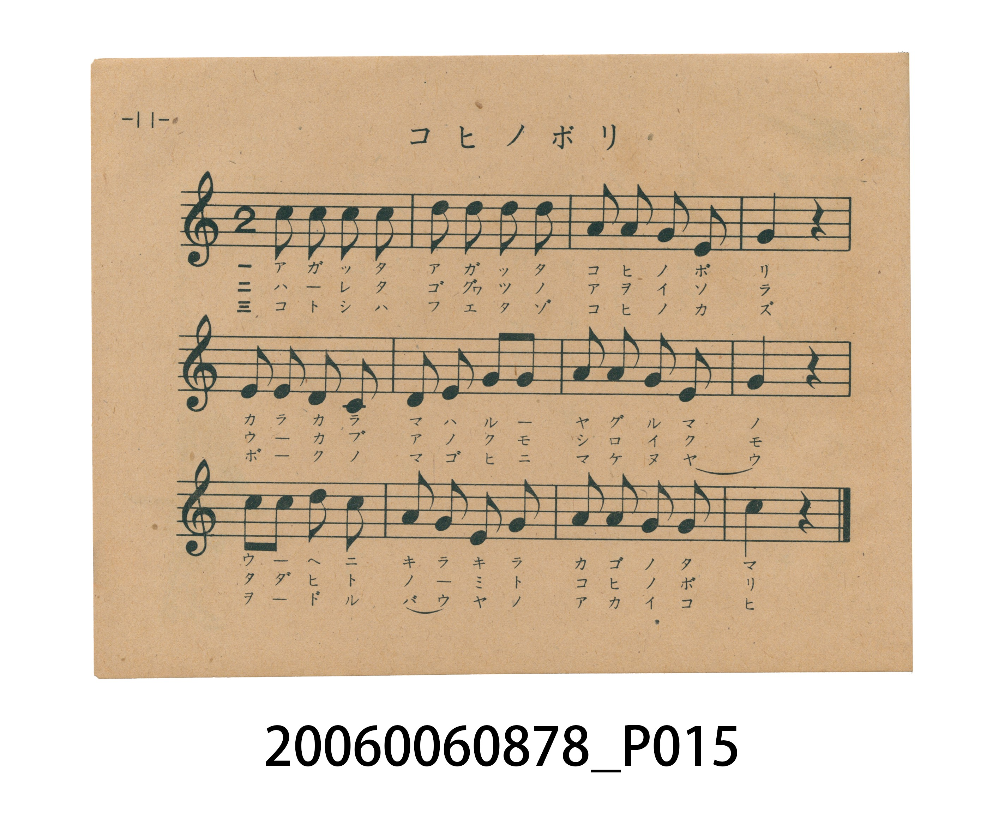
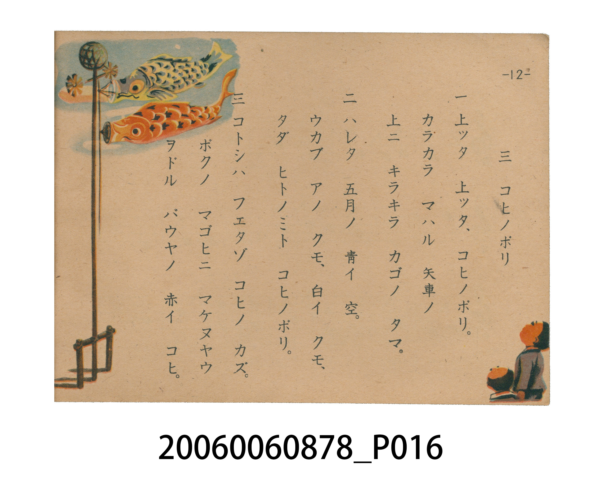

# コヒノボリ（鯉魚旗）

<audio controls src="koinobori.mp3"></audio>

- 日治時期國民學校唱歌（うたのほん 下・第三課）
- 國立臺灣歷史博物館典藏

## 說明

【曲目說明】
・出處：臺灣總督府編《うたのほん 下》（國民學校初等科第二學年用），第三課〈コヒノボリ〉（鯉魚旗），原書第 11–12 頁。
・調性與拍號：ヘ調（F 大調，原書五線譜省略調號，實際音高終止於 F 音），2/4 拍，速度 != 108。
・背景與曲風：描寫五月端午節高高升起的鯉魚旗。第一節刻畫頂端咔啦咔啦旋轉的矢車與閃閃發光的籠球；第二節描繪晴朗藍天中鯉魚旗彷彿要一口吞下白雲的豪邁氣勢；第三節則寫家中添了小弟弟（バウヤ），今年多了一面不輸給黑鯉（マゴヒ）的紅色小鯉魚旗，洋溢家庭添丁的歡欣。
・版本說明：本檔案為原書單聲部五線譜旋律之忠實數位化版本。

・編曲說明（鋼琴伴奏版）：
1. 前奏 (Intro, 4 小節)：擷取主旋律核心樂句作為導奏，建立調性與拍感。
2. 主歌伴奏 (Koinobori)：右手 (PianoRH) 演奏原書歌唱主旋律；左手 (PianoLH)
依國民學校低學年教材純樸明朗之風格配以和聲伴奏。

## 跨冊／重複收錄參照

> 同名異曲（《新定兒童唱歌》第三學年為『尋常小學唱歌』「甍の波と雲の波…」版，《うたのほん》下卷為國民學校「大キイ マゴヒハ オトウサン…」版）

- **[同名異曲]** 《新定兒童唱歌》尋常科第三學年用（2020.006.0847.0003）：[**〈鯉のぼり〉**](../../../shintei_jido_shoka/grade_3_2020.006.0847.0003/1_06_koinobori/index.md)（`D` / `2/4` — [原始 TMD](../../../shintei_jido_shoka/grade_3_2020.006.0847.0003/1_06_koinobori/koinobori.tmd)）
- 總表：[跨冊重複與同名歌曲總索引](../../../duplicate_songs.md)

## 歌詞

```text
一　上ッタ　上ッタ、コヒノボリ。
カラカラ　マハル　矢車ノ
上ニ　キラキラ　カゴノ　タマ。

二　ハレタ　五月ノ　青イ　空。
ウカブ　アノ　クモ、白イ　クモ、
タダ　ヒトノミト　コヒノボリ。

三　コトシハ　フエタゾ　コヒノ　カズ。
ボクノ　マゴヒニ　マケヌヤウ
ヲドル　バウヤノ　アカイ　コヒ。
```

## ABC

```abc
X:1
T:コヒノボリ（鯉魚旗）
M:2/4
L:1/16
Q:1/4=108
K:F
V:V1 name="Piano" snm="Pia"
[V:V1]
c2 c2 c2 c2 | d2 d2 d2 d2 | c2 A2 G2 F2 | G4 z4 |
A2 A2 G2 F2 | G2 A2 c2 c2 | d2 d2 c2 A2 | c4 z4 |
d2 d2 c2 A2 | c2 A2 G2 c2 | A2 A2 G2 G2 | F4 z4 |
```

## TMD 檔案連結

- [主旋律 TMD 檔案](koinobori.tmd) [[在 TMD Studio 編輯](https://tmdlang.github.io/Tmd-TS/#tmd=s7IKdvYPcrWy4tLSUnjctPlx86THzX2Pm-c8bl71fk_Hy_WdL9fOejZ9-vs9nQpaWlyKtgqGBhZc9rYKblw2Rvomdlx1CkrPpi99tmn3s5lNz-bMfzqn-9mGiU_X7ni2YOHTKRufre0BmvK4se1x4_zHjeseN-5-3DRZ4cmO7sfNu5-vWfNkR-eLVZuAZiuBzAHqfb66-0X7rueNi5-t3f60f9PT3lnPO1e-XLLiaeuOF9P7lbi49LUUbKkFuBQUFB43THg2e9Pz2eterFr1bEbf44aJYNHm3U_bd72YOfX9nlkQ9zzfsff53MVPd815vn3F44YubD5q6AZ6FcX_HXOfr-18vnwiyKe7eoCCT3dueT5lBdC_7_f0wL3_uKEDLeAfNwAVoIQ9UP3TvvnPZu8A6lIwNHzUMNnQSOHlgsbHDU1Q975Ytf9Zw_IXHe3PuntfzJwPdPjj5hlAQaBBbgpPlywHM6GGPNk15fn2WS_Wznk-p_H51KVAKbCOnqfrl72cNfvl_M0vV894vrXp2dpFz6btUXBTAIpA3ACMcQWg-UDWy4b5T3ctU4CkByRXNPc8m7ke5IrZm14uAvp01rP-_qfrVwNtfDan4_nq9U97O56vbwCaD0RPe9tfbN3-fFYL3KdAg8DB0gBU87Rj9_Opq18uaALpmjTl6dRlEPLZ9O4XezuBup7PX_RidxfQrpfTmoHo-cw9T1vB4hsXPJ_Q_H7PbEiwA40CuuH5zlXPZm55Nmf6i-m9T5esfLJjLdzSp3u3P927_8WyRqC9T_sXP50wDxibz2fufQlMF7NaXmxc9bKp8dmGxU-7F0HN3NEJcl5nO9BfT9dtAxr1bPvuJ7vanm7of7pnPhCBUnzzhMdNyx43L4GE25PdXcCof7pkFlAZ0JaXcxc92dH7Ys-O51uXvdw9EegSsJZ5j5u2AJMBUAvIF1taX3RuApqJlAx6nm3pfrZrEdDSp7vAlu5oBKp8tnbhszWLEXHwvLPj2Zw1kPQMioA5a56tmvJsYcfzpl2Q6H86bd2Lxk0vm1fA0wEwTJ_u636ys_vp_gXARPBs6o4ne3uf9kyDGAUyGppXIAYAc_WLlfOetq54Nq0dGP6gEAAyVs17sXY9MAMB_YKWSoEiz_qagbEAdIhCgIGhKVAGSJmBA6cTbDYwVB43NDzZ0fW4uflx035UdiNG_oD4tWn14-aVULKhARSAzf2Pm1cD2ZC0AdQAMRvIAubPhsdNa8EawCSIuxoc4sBcD2TvB-mHGAx0L8Q3wOCDJNIn-9qAUQd0CTIXlA2QUu7TOSvwpFOgI55N2wnK9-DkiZxmgXrhwbCrB-wToDfWQIMBnHMgjnw5d9LjpiUg763cBQ-DZeAAmAb2wyKYZ9Y_bl4EdC0wFUM0wEUgeoB-BQU3OEzBZjfPBzFA6rAFNHJ4QHIRND8Ds8eUWZAcBXHSsz1Nz7auA2XppsXP5mwFZiGgnc_2TgE6BCQ4G1jWI8IMnvGebmh_uq4ZOfshB8kOYABBHAYsJ7eDwgbk8qmPm1aAPNK0D8XZ0FiFBw_QGyCvgyVgGQyaGEDcjY-be4C5FBiKENWbHjd3QlIQPAfDTF0ENhgSmGDbMMMGks3h_gPlzak7Xrb3P10072nXAlARMW0KqIhr2gUuB6AlwLOOiUCVwCIaVhT0wEsSSDkAN_DJTmD9ugIY0sAc92JX79PuqdBwArqD8uoQChS09Lm4vPMz8_KT8osyrQIyE_PyHWoMahSqQdYo2Fho2YEZwJoYGGNWwNS0CIjXAPMqKGEp1GAT2AwM2klA3AeKEJBI8yqQEUAAtAxm2K4eoGHN_UC8BqxRAax1CxBveNy87nFzC9gAmPmrgHgJEO8FG7cS3bAdnSCXgeztANLbwQaDFE4F8laAjQemHHS3Na0Gi-xCNqxGwRQKaxTMoBAkZqxgpGAIZBkp6CoYAHENOLEihcpqsLNgNMjueVDvrYZ4rRnkfKDXQArmgQX6cARK0zKoOdOggQIMALB71wPpRWARkA_XQoNkPdiwRRhmgcMEGP4QfSDLoK4CBTI4DLrhIhuBdA_MnSAHoASJMZL3jZECBxQsoMDBESRAbzTPAFsD8QbQweAggtAgEaAnwY4BeQ6cdICOwREmwBhsboC6uwMafMByDMyDGE9UqoMEyiYg7kSKGlDeh8QQKJxgaQ7kOlAAbwarmYRqGGoIgMIHFCqQkDICsgzhoVLLxaVrpwDPYiCOMhcA)]
- [鋼琴伴奏 TMD 檔案](koinobori_piano.tmd) [[在 TMD Studio 編輯](https://tmdlang.github.io/Tmd-TS/#tmd=s7IKdvYPcrWy4tLSUnjctPlx86THzX2Pm-c8bl71fk_Hy_WdL9fOejZ9-vs9nSBu957nE7Y82bPl6dL-550dQEEFLS0uRVsFQwMLLntbBTcuGyN9EzuuOgWlZ9OXPtu0-9nMpmdz5j-d0_1sw8Sna3c8W7Dw6ZSNz9b2AM163Nj2uHH-48Z1jxt3P26arPBkR_fj5t3P16x5sqPzxapNQLOVQOYA9T5f3f2ifdfzxsXP1m5_2r_pae-s550rXy5Z8bR1x4vp_UpcXPpaCrbUAlwKCgqPGyY8m73p-ex1L1atejaj73HDRLBo8-6n7btezJz6fs8siHue79j7fO7ip7vmPN--4nFDFzYfNXQDvYri_465z9d2Pl8-EeTTXT1Awac7tzyfsgIcwD1w7z9u6ECLjccN4BhAiZCep33zn83eAdSlYGj4qGGyoZHCywWNjxuaoO59sWr_s4blLzran3X3vpg5H-jwx80zgIJAg9wUni5ZDmZCDXmya8rz7bNerJ3zfE7j86lLgVJgHT1P1y97OWv2y_mbX66e8Xxr07O1i55N26PgpgAUgbgBGOMKQPOBrJcN85_uWqYASQ9IrmjueTZzPcgVsze9XAT06axn_f1P168G2vhsTsfz1euf9nY8X98ANB-Inva2v9i6_fmsFrhPgQaBg6UBqOZpx-7nU1e_XNAE0jVpytOpyyDks-ndL_Z2AnU9n7_oxe4uoF0vpzUD0fOZe562gsU3Lng-ofn9ntmQYAcaBXTD852rns3c8mzO9BfTe58uWflkx1q4pU_3bn-6d_-LZY1Ae5_2L346YR4wNp_P3PsSmC5mtbzYuOplU-OzDYufdi-CmrmjE-S8znagv56u2wY06tn23U92tT3d0P90z3wgAqX45gmPm5Y9bl4CCbcnu7uAUf90ySygMqAtL-cuerKj98WeHc-3Lnu5eyLQJWAt8x43bQEmA6AWkC-2tL7o3AQ0EykZ9Dzb0v1s1yKgpU93gS3d0QhU-WztwmdrFiPiAJhCgaEPSc9YMzIwVkBKFRQM9RSedvYCxRU0PPNKivJ1FEwUgDYCfacJirnJwCw47cmO3cAQf7qv-9mCHU_3Nz9b0fS0f-mTvXOeN-16uqEPqBeUbnbvAmVcpBT4rGU-1EEKCkZ6wOyxG1gSQNygoOGdn5mXn5RflAmy5Wn_5med3QoaAZmJeflBHpoKz_ZMAaqCJFSgJmAhAncCMPyfbl-GUO7joQmxAgie7JuLnPee7O2D5LdnU2c-mzvh-ZYpz1bsAAYIMAU82dkNTJrPFux52dr7ZPfSp5N6XjRugrgN5GZoqQB3wIuV8562rng2rR3oM1BcAxmr5r1Yux5YVABDFy0_AkWe9TUD09uzVVMUAgwMTYEyQMoMHOqdYLOB8f-4oeHJjq7Hzc2Pm_ajshsxSgJIrDatfty8Eko2NICSSnP_4-bVQDYkFwA1QMwGsoAlUcPjprVgDWASxF0NTlvA8g3I3g_SDzEY6F6Ib0AxAc6OT_a1ARMp0CXIXFCGR8qjT-eswJMjgY54Nm0nqIQDZ0Tk3AnUCw-GXT1gnwC9sQYaDOAyAuLIl3MnPW5aAvLeyl3wMFgGDoBpYD8sgnlm_ePmRUDXAvMrRANcBKIH6FdQcIPDFGx283wQA6QOW0AjhwekvICWXMCCYMosSNkBcdKzPU3Ptq4DFV5Ni5_N2QosLIB2Pts7BegQkOBsYK2GCDN4EfN0Q_vTdc3IBQ1ykOwABhDEYcAaYTsobEAun_q4aQXII037UJwNjVV48AC9AfI6WAJWlEATA4i78XFzD7A8AoYiRPWmx82dkBQEL6tgpi4CGwwJTLBtmGEDKdDg_gOVQlN3vGzvf7po3tOuBaDCcNoUUGHetAtc4kHLumcdE4EqgZURrNDrgZeZkBIPbuCTncCWxApgSANz3ItdvU-7p0LDCegOyit-KFDQ0ufiAhd8VtDSx6HGoEahGlym2Fho2YEZNQqmUFijYAaFIDFjBSMgrFEwVNBVMADiGq5aFNN8UEwzgZtmGK8QbRgLZJgAGSYghimQYQpiwKRAJsELSXxuA7aGgGnJCpjOFwHxGmApAkryQJOwCGwGRvokIO4DJRWQSPMqaNEJDAaYYbt6gIY19wPxGrBGkIOBSQmINzxuXve4uQVsAMz8VUC8BIj3go1biW7Yjk6Qy0D2dgDp7WCDQQqnAnkrwMYD0zS625pWg0V2IRuGLwoMgSwjeBSghcpqsLNgNMjueVDvrYZ4rRnkfKDXQArmgQX6cARK0zKoOdOggQIMALB71wPpRWARkA_XQoNkPdiwRRhmgcMEGP4QfSDLoK4CBTI4DLrhIhuBdA_MnSAHoASJMZL3jZECBxQsoMDBESRAbzTPAFsD8QbQweAggtAgEaAnwY4BeQ6cdICOwREmwBhsboC6uwMafMASFsyDGE9UqoMEyiYg7kSKGlCpBIkhUDjB0hzIdaAA3gxWMwnVMNQQAIUPKFQgIYWRV9FyGPH5FS4Cy7joKuEZGqQFm0oUo-BZH8YwgLhP104BXJwoABlwt-LnKHMBAA)]

## 分析

```text
================================================================================
📊 TMD Song Profile: [ コヒノボリ（鯉魚旗） ]
================================================================================
⏱  Duration:       0:13 (13.3s), 12 measures total
🎼 Key & Tempo:    首調基準 F, != 108.0 BPM, <2/4>
   - 分析範圍：      由實際發聲的音符與和弦推測調性；播放脈絡另行呈現
🎤 人聲音域:    F4 (MIDI 65) – D5 (MIDI 74) [跨度: 9 個半音 / 0.8 個八度, 難度: easy]
   - 最低音:  F4 in [Koinobori #1 @ m.3, 0:03]
   - 最高音: D5 in [Koinobori #1 @ m.2, 0:01]
   - 適合: soprano, mezzo-soprano, contralto, tenor, baritone, bass
🏛  結構:      Koinobori (13.3s)
⚡ 編曲密度:        Peak 1 軌道同時演奏
🗝  調性診斷：       C 大調（純淨自然大調，未偵測到可信轉調）
   - 風格氣質:    純淨自然大調（陽光明朗、易唱易記，無明顯調外色彩）
   - 轉調歷程:    全曲維持單一推測調性（未偵測到可信轉調）
   - 核心骨幹音:  C, A, D, G, F
   - 調性數值:    C 大調 [相關度: 0.80, 穩定度: Moderate, 自然音純度: 100.0%]
   - 候選調性 (K-S): C 大調 (0.80), A 小調 (0.67), F 大調 (0.63)
   - 五度圈歷程:   +0
   - 各段落調性細節:
     • [Koinobori #1]: C 大調 (r: 0.80, 自然音純度: 100.0%)

  [ 五度圈游移軌跡 ]
              [C ]*
         F            G  
      Bb               D  
      Eb               A  
         Ab           E  
            Db       B  
               F# 
     (* = active key center)

  [ 十二半音累積音高分佈 ]
     C  : ████████████████████████  31.0%
     C# :                            0.0%
     D  : ███████████████           19.0%
     D# :                            0.0%
     E  :                            0.0%
     F  : ███████                    9.5%
     F# :                            0.0%
     G  : ███████████████           19.0%
     G# :                            0.0%
     A  : █████████████████         21.4%
     A# :                            0.0%
     B  :                            0.0%
--------------------------------------------------------------------------------
Assignment 軌道音域：
  - Piano         : F4 – D5 (9 個半音 / 0.8 個八度, 39 個音符)
================================================================================
```


## 原書掃描頁






