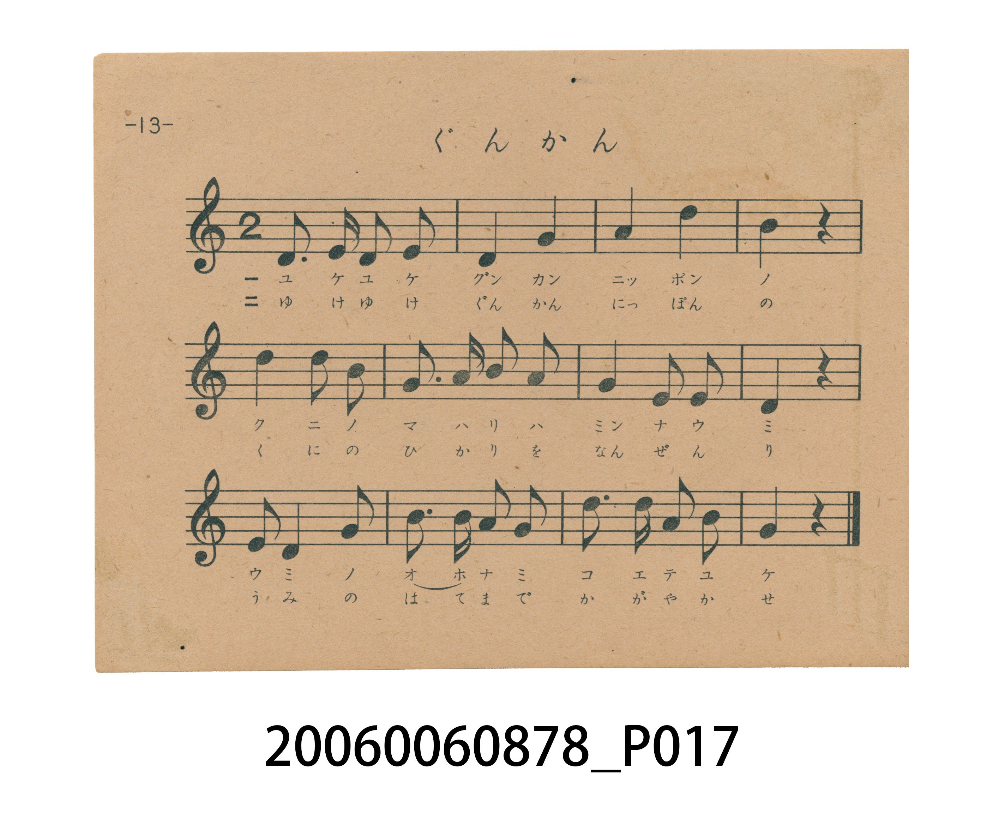
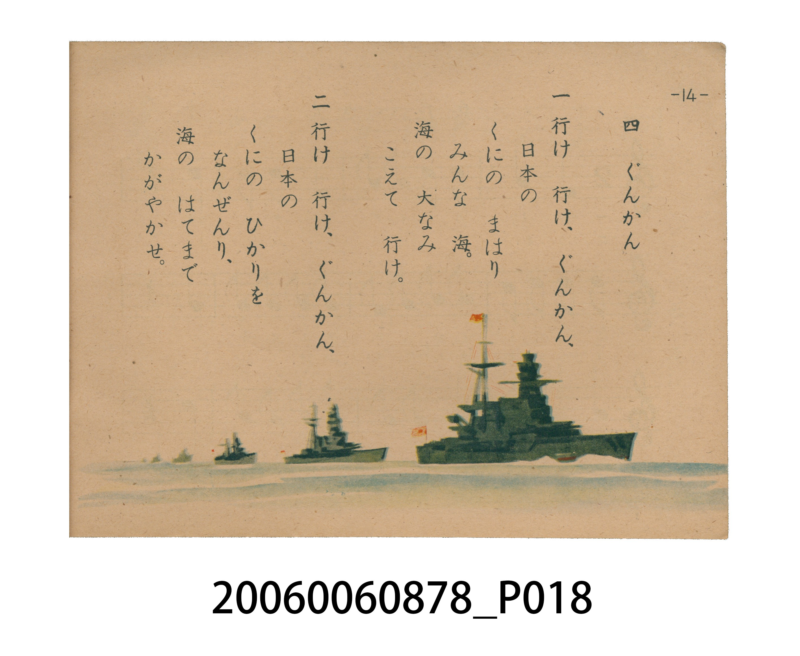

# ぐんかん（軍艦）

> Re:Shōka 使用 AI 協助辨識與重建樂譜，可能會有錯誤。歡迎回報。

- **鋼琴伴奏版**：<br><audio controls src="gunkan.mp3"></audio>
- **NEUTRINO 歌聲合成版**：<br><audio controls src="gunkan_neutrino.mp3"></audio>

- 日治時期國民學校唱歌（うたのほん 下・第四課）
- 國立臺灣歷史博物館典藏

## 說明


- 出處：臺灣總督府編《うたのほん 下》（國民學校初等科第二學年用），第四課〈ぐんかん〉（軍艦），原書第 13–14 頁。
- 調性與拍號：ト調（G 大調五聲音階，原書五線譜省略調號，實際音高終止於 G 音），2/4 拍，速度 != 108。
- 背景與曲風：下總皖一作曲。曲中大量運用附點八分音符搭配十六分音符的破浪節奏，描繪軍艦乘風破浪航向大洋的景象，體現昭和 16–18 年戰時國民學校音樂教材的海防與海洋意識。
- 版本說明：本檔案為原書單聲部五線譜旋律之忠實數位化版本。

### 編曲說明（鋼琴伴奏版）：

1. 前奏 (Intro, 4 小節)：擷取主旋律核心樂句作為導奏，建立調性與拍感。
2. 主歌伴奏 (Gunkan)：右手 (PianoRH) 演奏原書歌唱主旋律；左手 (PianoLH)
依國民學校低學年教材純樸明朗之風格配以和聲伴奏。


## 歌詞

```text
一　行け　行け、ぐんかん、
日本の　くにの
まはり　みんな　海。
海の　大なみ　こえて　行け。

二　行け　行け、ぐんかん、
日本の　くにの
ひかりを　なんぜんり、
海の　はてまで　かがやかせ。
```

## ABC

<div class="abc-score" data-abc-src="gunkan.abc" aria-label="五線譜載入中"></div>

[下載 ABC 原始檔](gunkan.abc)

## TMD 檔案連結

- [主旋律 TMD 檔案](gunkan.tmd) [[在 TMD Studio 編輯](https://tmdlang.github.io/Tmd-TS/#tmd=s7IKdvYPcrWy4qpTUCpJTLdSyC_KTM_Ms8rNz0sqLc7IV4JLJOfn5KQml2Tm51mVliTm5Wfk5yEky_JzSnNTrYwQIsX5pUXJqXCl8emp6HLxBYnpqVYBBobmukDCAiFdUJRflpqXmAfUXpKYWZ4I1AwUKMrLLwKakpdalJiDUJtalpmSClJZUJSZm1hUGZ-Snwx0SV4JkttSi4pBri7LT0bWmV9UkpGfXpRYkFFplZFZXAL0OFA-PjsxLxGhqCQjFeit3MyczBKg4UpcWloKjxsnPG6a_LixG0i-39PxYnfvi85l7_d0KmhpcSnaKhgaWHDZ2yq4c9kY6ZvYgQx6Nn3ps027n81sejZn_tM53c82THy6dsezBQufTtn4bG0P0IjHjW2PG-c_blz3uHE30FCFJzu6Hzfvfr5mzdPZs1-s2gQ0G-wgoN7nq7tftO963rj42drtT_s3Pe2d9bxz5cslK5627ngxvV-Ji0tfS8GWWoBLQUHhccOEZ7M3PZ-97sWqVc9m9D1umAgWbd79tH3Xi5lT3--ZBXHP8x17n89d_HTXnOfbVzxu6MLmo4ZuoFdR_N8x9_nazufLJwJ9-mRXD1Dw6c4tz6esAPr3_Z4euPcfNwADCBHkjxuAsohQB6p82jf_2ewdQPUKhsaPGiYbmii8XND4uKEJ6tIXq_Y_a1j-oqP9WXfvi5nzgU5-3NwBFASa4q7wdMlyIPPJrikvGje9nL_55aw-uIFAwefbZ71YO-f5nMbnU5cClYF19zxdv-zlrNkgxatnPN_a9GztomfT9ii4KwBFIO4BxrsC0C4g62XD_Ke7lilAUgWSi5p7ns1cD3LR7E0vFwH9OwsYPqAQnDXtyY6GJ3vnAMWBqoHkkx1rgS582d7_srEbGDIvZ7a83D3vaevqpx1tQOuer1n2bMLal629T3sbn7auhQs-n9XyfMGWZ1tXPV_f8HRpP9Ahz_r7n-9cBQm0JztnAC2FKHjRserphIlAK55t6QbqArlq40KQw1dPed6_79mMtU8n9SgYmoFC1UIBGDvPOjYA0zFyJAJtfLai6dnUmc_mTgCZsHX7yxmbQF7buh1o5rOW_hdrZyB8_ryz49mcNZC0BPQ2kP1s1ZRnCzueN-2CBPrTaetAMdG8Ah76z6Z3P93X_WRn99P9C4BB_2zqjid7e5_2TIMYBTIamk4hBgBz1IuVwCBa8WxaO9AZwAAEMVbNe7F2PTDxAuMcLZ0ARZ71NQPDB-gQBVBZBJQBlUbgqOwEmw2Mk8cNDS8W9jxunIjEaERNlY0gpaCsDnQUMN03NDxu7H_cuBrIBruvcd_jxvWPm7rAEvvB-lYB2cBggoYOiAXWB4wNkBxQEUgpUB0w-S9DshesGpQFwJ4ChuLTzt6XDcAE0whhAKMPljt6IO4BFRyzWoC56elEYEmx4mXz3mcz1kMiCGjci21dLxv7QGlg63aQsu0rgAkDYtTTCcuBCuDhsKuHCuGwCayw63HTJLDcKrDWOSASFDgQ3bCgAAUZ0O-gsAM6BMjtftzY87ipBcyYTVpQPN3QjhIarZ0vuiY93b3tyZ4dwDT1tLf5ZTuwLO553rr8BTAOOjbAA-T57IUvF6xFBAXQSsrLVihQ0NLn4nIvzQNWOlYBmcCa0qHGoKYaZIWCjaGZlh2YVaNgGq-gC4Rm8RAWkNZFiOoqGELpGgUjKMsULmIMZRnARMBG-hjWALPjMrDI46aNUDaIBdLzuGnD4-bNUA2Pm1YjOCBdwLqpGSbXPBdVrg-7bUYgM9sgWhonQtkgFlgXOPnATASnIoSJoISzGC63F1VuHYZtsPBCCgZQANRAg8gIzAMFEkwEGpjoIYoltJrWwz3dDSZBfgX5eR5UtB-IV0FZEJn5SKHY3AUim0DBDJbCHVCNIO0Q_64GkyBvgsQ3wUIIaA7EtElQGVAmgmuaA5YC8UGuBinEGkZgL6MkIVhiMQaHEEQEEpKmYBHkkMQeROBEBPcbPIiaQMEC4s-GhQNYDUgGEj6Pm1YAxcCJApwQQTKgpIgrhCDJZz_cy7AQgkQRsMgAlbdg1nKoDCjKQPweoMkt0FCEyMzGsKeWi0vXTgGSK8GWAnnKXAA)]
- [鋼琴伴奏 TMD 檔案](gunkan_piano.tmd) [[在 TMD Studio 編輯](https://tmdlang.github.io/Tmd-TS/#tmd=s7IKdvYPcrWy4qpTUCpJTLdSSM7PyUlNLsnMz7MqLUnMy8_Iz1OCS5bl55TmploZIUSK80uLklPhSuPTU9Hl4gsS01OtAgwMzXWBhAVCuqAovyw1LzEPqL0kMbM8EagZKFCUl18ENCUvtSgxB6E2tSwzJRWksqAoMzexqDI-JT8Z6JK8EiS3pRYVg1xdkAl0SnxiUVFiXnoqqpL8opKM_PSixIKMSquMzOKS_KLM5MSc-OzEvESEopIMoC6r3MyczBKgRUpcWloKjxsnPG6a_LixG0i-39PxYnfvi85l7_d0Atkvu_c8n7DlyZ4tT5f2P-_sAAoqaGlxKdoqGBpYcNnbKrhz2Rjpm9iBTH82femzTbufzWx6Nmf-0zndzzZMfLp2x7MFC59O2fhsbQ_QrMeNbY8b5z9uXPe4cTfQJoUnO7ofN-9-vmbN09mzX6zaBDQb7Eqg3ueru1-073reuPjZ2u1P-zc97Z31vHPlyyUrnrbueDG9X4mLS19LwZZagEtBQeFxw4Rnszc9n73uxapVz2b0PW6YCBZt3v20fdeLmVPf75kFcc_zHXufz138dNec59tXPG7owuajhm6gV1H83zH3-drO58snAn36ZFcPUPDpzi3Pp6wAB3AP3PuPG4ABhIiHxw2g4EeKip6nffOfzd4BVK9gaPyoYbKhicLLBY2PG5qgLn2xav-zhuUvOtqfdfe-mDkf6OTHzR1AQaAp7gpPlywHMp_smvKicdPL-ZtfzuqDGwgUfL591ou1c57PaXw-dSlQGVh3z9P1y17Omg1SvHrG861Nz9YuejZtj4K7AlAE4h5gvCsA7QKyXjbMf7prmQIkVSC5qLnn2cz1IBfN3vRyEdC_s4DhAwrBWdOe7Gh4sncOUByoGkg-2bEW6MKX7f0vG7uBIfNyZsvL3fOetq5-2tEGtO75mmXPJqx92dr7tLfxaetauODzWS3PF2x5tnXV8_UNwOQJdMiz_v7nO1dBAu3JzhlASyEKXnSsejphItCKZ1u6gbpArtq4EOTw1VOe9-97NmPt00k9CoZmoFC1UADGzrOODcB0jByJQBufrWh6NnXms7kTQCZs3f5yxiaQ17ZuB5r5rKX_xdoZCJ8DUwfQV5C0hDUTAcMCpFRBwVBP4WlnL1BcQcMzr6QoX0fBROHphn6gjzSBap5NBiZ_YGDtfja9--m-7mcLdjzd3wx0x9P-pcDge9606-mGPojPn-7eBco0SGngWct8qIMUFIz0gElzNzAXQtygoOFemgcsFUBWPO3f_KyzW0EjAFSsBHloKjzbMwWoBJI2gDqAuRdu__s9s59uX4ZQ7uOhCTEfCJ7sm4scXk_29kESOjTItkx5tmIHMDSezZn-ZGc3MGKeLdgDjNEnu5cCgx6YKCEOAzkYmh3hDnixEpgSVjyb1g70FjCdgBir5r1Yux6YR4FBi5YdgCLP-pqByeDZqikKoDIZKAMqlcFB3gk2G5j0Hjc0vFjY87hxIhKjETXzNYKUgkq0OWtA2buh4XFj_-PG1UA22H2N-x43rn_c1AWW2A_WtwrIBqYGaJiDWGB9wEQHkgMqAikFqgPm8mVI9oJVg3I62FOgCOnsfdkAzBeNEAYwbmGFQA_EPaDycVYLsNB4OhFYIK542bz32Yz1kHQINO7Ftq6XjX2gpL51O0gZMCVuXQUx6umE5UAF8HDY1UOFcNgEVtj1uGkSWG4VWOscEAkKHIhuWFCAggzod1DYAR0C5HY_bux53NQCZswmLSiebmhHCY3Wzhddk57u3vZkz45nU3c87W1-2Q6scnqety5_AYyDjg3wAHk-e-HLBWsRQQG0kvIqBAoUtPS5uMDZ2AqanRxqDGqqwXnExtBMyw7MqlEwi1fQVTAFESBoCMQ1CsZgtrGCEVzEFCxiChYBydaAxUHQAErXcNWi2OeDbJ8J3DrDeIVow1i8DJBBkDIBv8uhjgZ6AMwCewQuCnE42GFgR0OcDxOBeBDZ8SAjfQxrgAXmMrDI46aNUDaIBdLzuGnD4-bNUA2Pm1YjOCBdwNZDM0yueS6qXB9224xAZrZBtDROhLJBLLAucMqHmQjOAAgTQWl-MVxuL6rcOgzbYOGFFAzIcWgE5oECCRGr4MBED1EsodW0Hu7pbjAJ8ivIz_Ogov1AvArKgsjMRwrF5i4Q2QQKZrAU7oBqBGmH-Hc1mAR5EyS-CRZCQHMgpk2CyoDyP1zTHLAUiA9yNUgh1jCiXm5ABBE4EcH9Bg-iJlCwgPizYeEAVgOSgYTP46YVQDFwogAnRJAMKCniCiFI8tkP9zIshCBRBCztQFUFmLUcKgOKMhC_B2hyCzQUITKzMexBy5SEsrdJPJBlAmKZglimuSg5HKIYoQaLNjMQywykjaiSwwDiRF07BXAZpABkQJwb7QNUgsQzAvOUuQA)]

## 分析

```text
================================================================================
📊 TMD Song Profile: [ ぐんかん（軍艦） ]
================================================================================
⏱  Duration:       0:13 (13.3s), 12 measures total
🎼 Key & Tempo:    首調基準 G, != 108.0 BPM, <2/4>
   - 分析範圍：      由實際發聲的音符與和弦推測調性；播放脈絡另行呈現
🎤 人聲音域:    D4 (MIDI 62) – D5 (MIDI 74) [跨度: 12 個半音 / 1.0 個八度, 難度: easy]
   - 最低音:  D4 in [Gunkan #1 @ m.1, 0:00]
   - 最高音: D5 in [Gunkan #1 @ m.3, 0:02]
   - 適合: soprano, mezzo-soprano, contralto, tenor, baritone, bass
🏛  結構:      Gunkan (13.3s)
⚡ 編曲密度:        Peak 1 軌道同時演奏
🗝  調性診斷：       D 調性不明確（純淨自然大調，未偵測到可信轉調）
   - 風格氣質:    純淨自然大調（陽光明朗、易唱易記，無明顯調外色彩）
   - 轉調歷程:    全曲維持單一推測調性（未偵測到可信轉調）
   - 核心骨幹音:  D, G, B, A, E
   - 調性數值:    D 調性不明確 [相關度: 0.83, 穩定度: Ambiguous, 自然音純度: 100.0%]
   - 候選調性 (K-S): D 大調 (0.83), G 大調 (0.83), B 小調 (0.65)
   - 五度圈歷程:   +2
   - 各段落調性細節:
     • [Gunkan #1]: D 調性不明確 (r: 0.83, 自然音純度: 100.0%)

  [ 五度圈游移軌跡 ]
               C  
         F            G  
      Bb              [D ]*
      Eb               A  
         Ab           E  
            Db       B  
               F# 
     (* = active key center)

  [ 十二半音累積音高分佈 ]
     C  :                            0.0%
     C# :                            0.0%
     D  : ████████████████████████  36.9%
     D# :                            0.0%
     E  : ███████                   10.7%
     F  :                            0.0%
     F# :                            0.0%
     G  : ███████████████           22.6%
     G# :                            0.0%
     A  : █████████                 13.1%
     A# :                            0.0%
     B  : ███████████               16.7%
--------------------------------------------------------------------------------
Assignment 軌道音域：
  - Piano         : D4 – D5 (12 個半音 / 1.0 個八度, 32 個音符)
================================================================================
```


## 原書掃描頁






