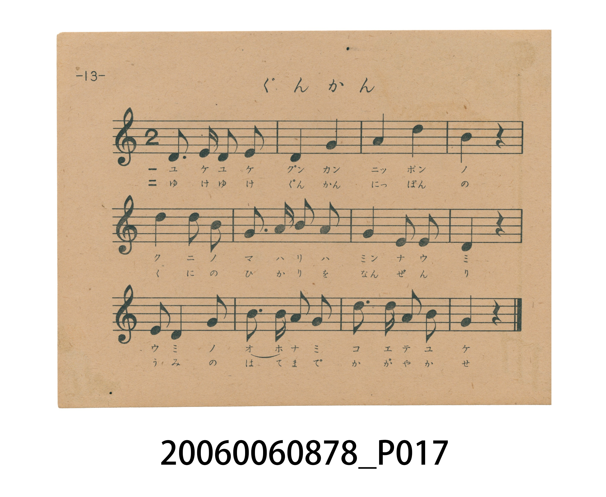
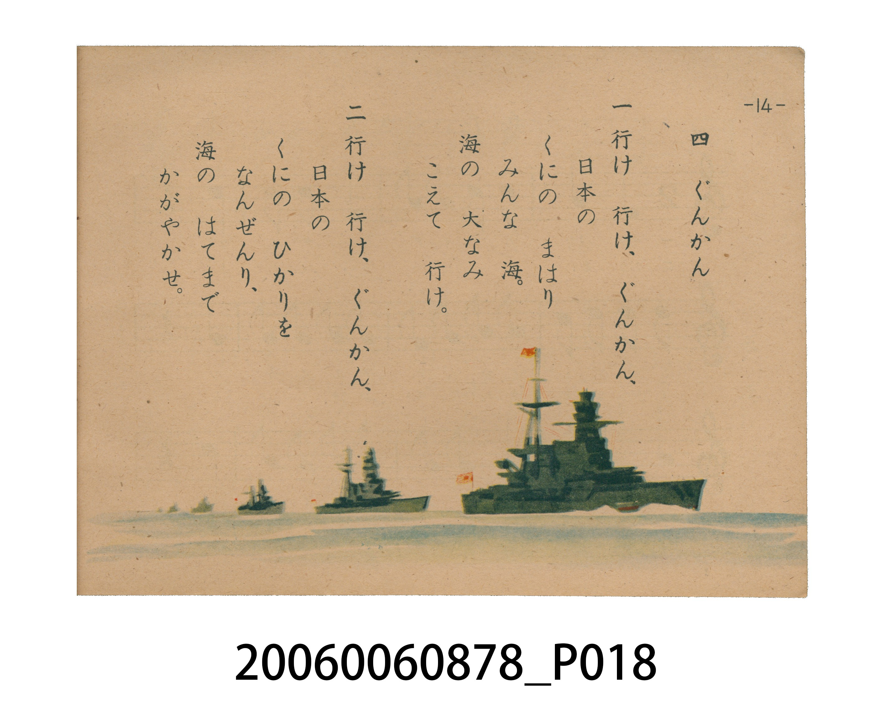

# ぐんかん（軍艦）

> Re:Shoka 使用 AI 辨識樂譜，可能會有錯誤。歡迎回報。

<audio controls src="gunkan.mp3"></audio>

- 日治時期國民學校唱歌（うたのほん 下・第四課）
- 國立臺灣歷史博物館典藏

## 說明

【曲目說明】
・出處：臺灣總督府編《うたのほん 下》（國民學校初等科第二學年用），第四課〈ぐんかん〉（軍艦），原書第 13–14 頁。
・調性與拍號：ト調（G 大調，原書五線譜省略調號，實際音高終止於 G 音），2/4 拍，速度 != 108。
・背景與曲風：下總皖一作曲。曲中大量運用附點四分音符搭配八分音符（如第 1、9、10、11 小節）的破浪節奏，描繪軍艦乘風破浪航向大洋的景象，體現昭和 16–18 年戰時國民學校音樂教材的海防與海洋意識。
・版本說明：本檔案為原書單聲部五線譜旋律之忠實數位化版本。

・編曲說明（鋼琴伴奏版）：
1. 前奏 (Intro, 4 小節)：擷取主旋律核心樂句作為導奏，建立調性與拍感。
2. 主歌伴奏 (Gunkan)：右手 (PianoRH) 演奏原書歌唱主旋律；左手 (PianoLH)
依國民學校低學年教材純樸明朗之風格配以和聲伴奏。

## 跨冊／重複收錄參照

> 同名異曲（各冊收錄之不同詞曲版本）

- **[同名異曲]** 《新定兒童唱歌》尋常科第五學年用（2020.006.0847.0005）：[**〈軍艦〉**](../../../shintei_jido_shoka/grade_5_2020.006.0847.0005/3_04_gunkan/index.md)（`G` / `3/4` — [原始 TMD](../../../shintei_jido_shoka/grade_5_2020.006.0847.0005/3_04_gunkan/gunkan.tmd)）
- **[同名異曲]** 楊金土手抄《唱歌帖》第 8 冊・VIII（2020.006.0843）：[**〈軍艦〉**](../../../shokacho/vol_08/p012_gunkan/index.md)（`G` / `3/4` — [原始 TMD](../../../shokacho/vol_08/p012_gunkan/gunkan.tmd)）
- **[同名異曲]** 楊金土手抄《唱歌帖》第 2 冊・II（2020.006.0843）：[**〈軍艦〉**](../../../shokacho/vol_02/p074_gunkan/index.md)（`G` / `4/4` — [原始 TMD](../../../shokacho/vol_02/p074_gunkan/gunkan.tmd)）
- 總表：[跨冊重複與同名歌曲總索引](../../../duplicate_songs.md)

## 歌詞

```text
一　行け　行け、ぐんかん、
日本の　くにの
まはり　みんな　海。
海の　大なみ　こえて　行け。

二　行け　行け、ぐんかん、
日本の　くにの
ひかりを　なんぜんり、
海の　はてまで　かがやかせ。
```

## ABC

```abc
X:1
T:ぐんかん（軍艦）
M:2/4
L:1/16
Q:1/4=108
K:G
V:V1 name="Piano" snm="Pia"
[V:V1]
G3 G G2 A2 | E4 G4 | A4 d4 | B4 z4 |
B4 B2 A2 | G3 A B2 A2 | G4 E2 D2 | E4 z4 |
E2 D4 G2 | B3 B A2 B2 | d3 d e2 B2 | G4 z4 |
```

## TMD 檔案連結

- [主旋律 TMD 檔案](gunkan.tmd) [[在 TMD Studio 編輯](https://tmdlang.github.io/Tmd-TS/#tmd=s7IKdvYPcrWy4tLSUnjcOOFx0-THjd1A8v2ejhe7e190Lnu_p1NBS4tL0VbB0MCCy95WwZ3LxkjfxI6rTkHp2fSlzzbtfjaz6dmc-U_ndD_bMPHp2h3PFix8OmXjs7U9QCMeN7Y9bpz_uHHd48bdQEMVnuzofty8-_maNU9nz36xahPQbCWQOUC9z1d3v2jf9bxx8bO125_2b3raO-t558qXS1Y8bd3xYnq_EheXvpaCLbUAl4KCwuOGCc9mb3o-e92LVauezeh73DARLNq8-2n7rhczp77fMwvinuc79j6fu_jprjnPt6943NCFzUcN3UCvovi_Y-7ztZ3Pl08E-vTJrh6g4NOdW55PWQH07_s9PXDvP24ABhAiyB83AGURoQ5U-bRv_rPZO4DqFQyNHzVMNjRReLmg8XFDE9SlL1btf9aw_EVH-7Pu3hcz5wOd_Li5AygINMVd4emS5WAm1JAnu6Y83z7rxdo5z-c0Pp-6FCgF1tHzdP2yl7Nmv5y_-eXqGc-3Nj1bu-jZtD0K7gpAEYgbgHGtADQfyHrZMP_prmUKkJSA5Irmnmcz14NcMXvTy0VAP84Chgko1GZNe7Kj4cneOUBxoGog-WTHWqCrXrb3v2zsBobGy5ktL3fPAwbF0442oHXP1yx7NmHty9bep62r4SKggF3WBA6Bxw2NlkBsaAAiDBWebuh_vr4B6Mbns1qeL9jybOsqIPfp0n6gQ5_19z_fuQoSkE92zgA6CqLgRceqpxMmAp3wbEs3UBfI1RsXgjy2esrz_n3PZqx9OqlHwdAMFNIWCsAYe9axAZi2kSMW6KhnK5qeTZ35bO4EkAlbt7-csQnk9a3bgWY-a-l_sXYGImSed3Y8m7MGkr6AwQJkP1s15dnCjudNuyCR8nTauheNm142r4DHzrPp3U_3dT_Z2f10_wJg1DybuuPJ3t6nPdMgRoGMhqZdiAHAXPZi5bynrSueTWsHOgMYwCDGqnkv1q4HJmhg4KGlHaDIs75mYPgAHaIQYGBoDpQBUhbgqO4Emw2Ms8cNDS8W9jxunIjEaERNqY0gpaDsD3QUMC80NDxu7H_cuBrIBruvcd_jxvWPm7rAEvvB-lYB2cBggoYOiAXWB4wNkBxQEUgpUB0wSyxDshesGpQtwJ4ChuLTzt6XDcAE1QhhAKMPlmN6IO4BFSazWkDJaiKw9FjxsnnvsxnrIREENO7Ftq6XjX2gNLB1O0jZ9hXAhAEx6umE5UAF8HDY1UOFcNgEVtj1uGkSWG4VWOscEAkKHIhuWFCAggzod1DYAR0C5HY_bux53NQCZswmLSiebmhHCY3Wzhddk57u3vZkzw5gmnra2_yyHVg-9zxvXf4CGAcdG-AB8nz2wpcL1iKCAmgl5eUtFCho6XNxuZfmZSfmWQVkJublO9QY1ChUg-xQsLHQsgMzgOU8MAlaKTxuagOG30Q4XQOqnoC8yUA1IHY3nA0DQNNhBuzqocCAGgUNQwVdXQVDTVUNXV1NBUMFI6CYWbwCUAiIa4BcXQVTMMsYSBqAWOAkg3A7KAUsBlJ7wXaAbFsHxP0gCTAbJLIPiNcD5buANCiLgAVXATHIufsxfEOMkZug3gIa2TQJ6k1QkgNSoDQHloF7EuR2Y7DXIN41gnoXIgbyKdDLpvEwr2P1JsSpIOshlgGrx91QX-wHC4Cs7gDiZeBoAIlMxBFbGGYBwwakDRxOy2Ex1tgDNKgFzAaJzEaLOIiLQfEE9BXQg0AfQn1lBPQXUAwYbcC4g4qZgcVAPoV4rpaLS9dOAZJAQSxlLgA)]
- [鋼琴伴奏 TMD 檔案](gunkan_piano.tmd) [[在 TMD Studio 編輯](https://tmdlang.github.io/Tmd-TS/#tmd=s7IKdvYPcrWy4tLSUnjcOOFx0-THjd1A8v2ejhe7e190Lnu_pxPIftm95_mELU_2bHm6tP95ZwdQUEFLi0vRVsHQwILL3lbBncvGSN_EjqtOQenZ9KXPNu1-NrPp2Zz5T-d0P9sw8enaHc8WLHw6ZeOztT1Asx43tj1unP-4cd3jxt1AmxSe7Oh-3Lz7-Zo1T2fPfrFqE9BsJZA5QL3PV3e_aN_1vHHxs7Xbn_Zveto763nnypdLVjxt3fFier8SF5e-loIttQCXgoLC44YJz2Zvej573YtVq57N6HvcMBEs2rz7afuuFzOnvt8zC-Ke5zv2Pp-7-OmuOc-3r3jc0IXNRw3dQK-i-L9j7vO1nc-XTwT69MmuHqDg051bnk9ZAQ7gHrj3HzcAAwgRD48bQMGPFBU9T_vmP5u9A6hewdD4UcNkQxOFlwsaHzc0QV36YtX-Zw3LX3S0P-vufTFzPtDJj5s7gIJAU9wVni5ZDmZCDXmya8rz7bNerJ3zfE7j86lLgVJgHT1P1y97OWv2y_mbX66e8Xxr07O1i55N26PgrgAUgbgBGNcKQPOBrJcN85_uWqYASQlIrmjueTZzPcgVsze9XAT04yxgmIBCbda0JzsanuydAxQHqgaST3asBbrqZXv_y8ZuYGi8nNnycvc8YFA87WgDWvd8zbJnE9a-bO192roaLgIK2GVN4BB43NBoCcSGBiDCUOHphv7n6xuAbnw-q-X5gi3Ptq4CcoFJFujQZ_39z3euggTkk50zgI6CKHjRserphIlAJzzb0g3UBXL1xoUgj62e8rx_37MZa59O6lEwNAOFtIUCMMaedWwApm3kiAU66tmKpmdTZz6bOwFkwtbtL2dsAnl963agmc9a-l-snYEIGWCKAfoakr6wZixgWIGUKigY6ik87ewFiitoeOaVFOXrKJhAPagJVPNsMjBLAANz97Pp3U_3dT9bsOPp_magO572LwUG7_OmXU839EF8_nT3LlBGQkoXz1rmQx2koGCkB0yuu4E5E-IGBQ330rzsxDyQFU_7Nz_r7FbQCMhMzMsP8tBUeLZnClAJJO0AdQBzNNz-93tmP92-DKHcx0MTYj4QPNk3Fzm8nuztgyR-aJBtmfJsxQ5gaDybM_3Jzm5gxDxbsAcY4092LwUG_YvGTRCHgRwMzaJwB7xYOe9p64pn09qB3gKmIxBj1bwXa9cD8y0waNGyCFDkWV8zMBk8WzVFIcDA0BwoA6QswEHeCTYbmDQfNzS8WNjzuHEiEqMRNUM2gpSCSrk5a0BZvqHhcWP_48bVQDbYfY37Hjeuf9zUBZbYD9a3CsgGpgZomINYYH3ARAeSAyoCKQWqA-b8ZUj2glWDcj_YU6AI6ex92QDMN40QBjBuYQVDD8Q9oDJzVgso90wEFpIrXjbvfTZjPSQdAo17sa3rZWMfKKlv3Q5SBkyJW1dBjHo6YTlQATwcdvVQIRw2gRV2PW6aBJZbBdY6B0SCAgeiGxYUoCAD-h0UdkCHALndjxt7Hje1gBmzSQuKpxvaUUKjtfNF16Snu7c92bPj2dQdT3ubX7YDq6Ge563LXwDjoGMDPECez174csFaRFAAraS8WoECBS19Li5wNraCZieHGoMahWpwJrGx0LIDM2oUNAwVdHUVDDVVNXR1NRUMFYyAYmbxCkAhIK4BcnUVTMEsEN8AxOKqRTHYB8VgE7jBhvEK0YaxENMgDFMgwxTEgEmBTILkfnxuBNa5wHxipfC4qQ0YyRPhdA2o_QDkTQZbB4w4OBsGgEEAM2BXDwUGkBBKxvBQQnU7KJkuBlJ7wXaAbFsHxP0gCTAbJLIPiNcD5buANCgfgwVXATHIufsxfEOMkZug3gIa2TQJ6k1QvgBSoIwBloF7EuR2Y7DXIN41gnoXIgbyKdDLwEiEeh2rNyFOBVkPsQzYVNkN9cV-sADI6g4gXgaOBpDIRByxhWEWMGxA2sDhtBwWY409QINawGyQyGy0iIO4GBRPQF8BPQj0IdRXRkB_AcWA0QaMO6iYGVgMJaUjp09KkjqaShADrgDMAOk1y0UoBfFRjAAzwCpALAOI83TtFMB5UQHIgDgVlaXMBQA)]

## 分析

```text
================================================================================
📊 TMD Song Profile: [ ぐんかん（軍艦） ]
================================================================================
⏱  Duration:       0:13 (13.3s), 12 measures total
🎼 Key & Tempo:    首調基準 G, != 108.0 BPM, <2/4>
   - 分析範圍：      由實際發聲的音符與和弦推測調性；播放脈絡另行呈現
🎤 人聲音域:    D4 (MIDI 62) – E5 (MIDI 76) [跨度: 14 個半音 / 1.2 個八度, 難度: moderate]
   - 最低音:  D4 in [Gunkan #1 @ m.7, 0:07]
   - 最高音: E5 in [Gunkan #1 @ m.11, 0:11]
   - 適合: soprano, mezzo-soprano, contralto, tenor, baritone, bass
🏛  結構:      Gunkan (13.3s)
⚡ 編曲密度:        Peak 1 軌道同時演奏
🗝  調性診斷：       G 大調（純淨自然大調，未偵測到可信轉調）
   - 風格氣質:    純淨自然大調（陽光明朗、易唱易記，無明顯調外色彩）
   - 轉調歷程:    全曲維持單一推測調性（未偵測到可信轉調）
   - 核心骨幹音:  G, B, D, E, A
   - 調性數值:    G 大調 [相關度: 0.84, 穩定度: Moderate, 自然音純度: 100.0%]
   - 候選調性 (K-S): G 大調 (0.84), E 小調 (0.74), B 小調 (0.62)
   - 五度圈歷程:   +1
   - 各段落調性細節:
     • [Gunkan #1]: G 大調 (r: 0.84, 自然音純度: 100.0%)

  [ 五度圈游移軌跡 ]
               C  
         F           [G ]*
      Bb               D  
      Eb               A  
         Ab           E  
            Db       B  
               F# 
     (* = active key center)

  [ 十二半音累積音高分佈 ]
     C  :                            0.0%
     C# :                            0.0%
     D  : ███████████████           16.7%
     D# :                            0.0%
     E  : ███████████████           16.7%
     F  :                            0.0%
     F# :                            0.0%
     G  : ████████████████████████  27.4%
     G# :                            0.0%
     A  : ██████████████            15.5%
     A# :                            0.0%
     B  : █████████████████████     23.8%
--------------------------------------------------------------------------------
Assignment 軌道音域：
  - Piano         : D4 – E5 (14 個半音 / 1.2 個八度, 32 個音符)
================================================================================
```


## 原書掃描頁






