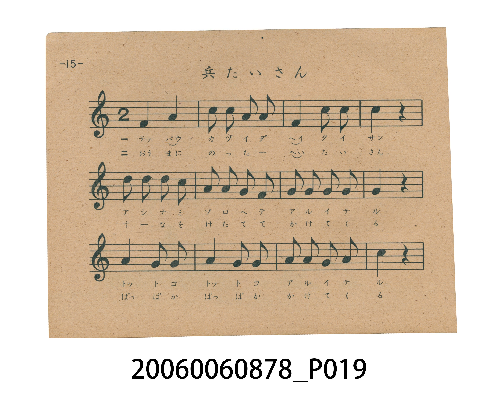
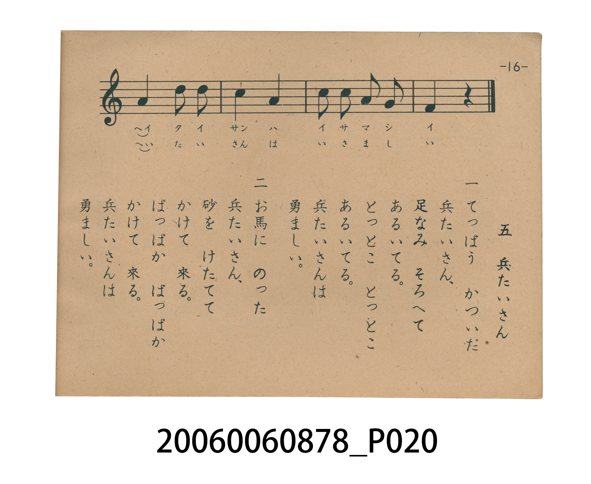

# 兵たいさん（士兵先生）

> Re:Shoka 使用 AI 協助辨識與重建樂譜，可能會有錯誤。歡迎回報。

<audio controls src="heitaisan.mp3"></audio>

- 日治時期國民學校唱歌（うたのほん 下・第五課）
- 國立臺灣歷史博物館典藏

## 說明

【曲目說明】
・出處：臺灣總督府編《うたのほん 下》（國民學校初等科第二學年用），第五課〈兵たいさん〉（士兵先生），原書第 15–16 頁。
・調性與拍號：ト調（G 大調，原書五線譜省略調號，主音為 G，並於第 12、14 小節引入第四級音 Fa＝C5），2/4 拍，速度 != 112。
・背景與曲風：第一節描寫扛著步槍整齊行軍（「とっとこ とっとこ」）的步兵，第二節描寫策馬揚塵疾馳而來（「ぱっぱか ぱっぱか」）的騎兵，充滿輕快活潑的進行曲節奏感。
・版本說明：本檔案為原書單聲部五線譜旋律之忠實數位化版本。

・編曲說明（鋼琴伴奏版）：
1. 前奏 (Intro, 4 小節)：擷取主旋律核心樂句作為導奏，建立調性與拍感。
2. 主歌伴奏 (Heitaisan)：右手 (PianoRH) 演奏原書歌唱主旋律；左手 (PianoLH)
依國民學校低學年教材純樸明朗之風格配以和聲伴奏。

## 歌詞

```text
一　てっぱう　かついだ　兵たいさん、
足なみ　そろへて　あるいてる。
とっとこ　とっとこ　あるいてる。
兵たいさんは　勇ましい。

二　お馬に　のった　兵たいさん、
砂を　けたてて　かけて　來る。
ぱっぱか　ぱっぱか　かけて　來る。
兵たいさんは　勇ましい。
```

## ABC

```abc
X:1
T:兵たいさん（士兵先生）
M:2/4
L:1/16
Q:1/4=112
K:G
V:V1 name="Piano" snm="Pia"
[V:V1]
G4 A4 | B2 B2 A2 B2 | G4 B2 B2 | B4 z4 |
d2 d2 d2 B2 | A2 A2 G2 E2 | G2 A2 G2 A2 | G4 z4 |
A4 G2 A2 | A4 G2 A2 | B2 B2 A2 B2 | c4 z4 |
A4 d2 d2 | c4 A4 | B2 B2 A2 G2 | G4 z4 |
```

## TMD 檔案連結

- [主旋律 TMD 檔案](heitaisan.tmd) [[在 TMD Studio 編輯](https://tmdlang.github.io/Tmd-TS/#tmd=s7IKdvYPcrWy4tLSUnjauvVx4_zHjS2PG6c-bpr8fk_H08WrgYJPWzueT5n_fk-ngpYWl6KtgqGhEZe9rYI7l42RvokdV52C0rPpS59t2v1sZtOzOfOfzul-tmHi07U7ni1Y-HTKxmdre4AGPW5sAxu97nHjbqDRCk92dD9u3v18zZonu6a8WLUJaLYSyByg3ueru1-073reuPjZ2u1P-zc97Z31vHPlyyUrnrbueDG9X4mLS19LwZZagEtBQeFxw4Rnszc9n73uxapVz2b0PW6YCBZt3v20fdeLmVPf75kFcc_zHXufz138dNec59tXPG7owuajhm5QmCH7v2Pu87Wdz5dPBPu0Byj4dOeW51NWAP37fk8P3PuPGzrQwv5xA1ABevADtTztm_9s9g6gRgVD00cNkw3NFF4uaHzc0AR18otV-581LH_R0f6su_fFTKCeWY-bO4CCQLPcFZ4uWQ5mQg0BWv18-6wXa-c8n9P4fOpSoBRYR8-THbtfzt_8vGmXgjuYt-zZtD1gC40eNzQamig83dD_fH3D0z1Tn7YuBYo_nT37-ZZZQB0Kbonv98x1NoU4FJgyFICOALJeNsx_umuZAiTdIDm1uefZzPUgp87e9HIRMERmgYJjRwPQ7Gf9_U_Xr37WOfvFxOnP1i59trz32dQtL_d2vVjY82I30MiOxw09jxtXPG5cDCYnKyBzHjcAVXQ-n9UC1AkMPFgw98DNfb522stla571z3q6cOvzafteLtv8oqHnyb42mLkbwUYByW6guQgO3NyXK_og5j5tbX22e_8LYEDsX_1sy-5neyeCZBs2AZ0JSlDAMFra_6xlPsLLzzs7ns1ZA0lmQP8C2c9WTXm2sAMY1pAoeTpt3YvGTS-bV8Dj5tn07qf7up_s7H66f8HT9cueTd3xZG_v055pEKNARkOTMMQAYGZ7sXLe09YVz6a1A4P2yY61IMaqeS_Wrgema6AP0VIOUORZXzMwXIAOUQgwMLQEygQYGBmA47ATbDYwSh43NDxuXAYLiTYwt_tx4xJwal0A5GIk3kaQzhfbNj9uXPW4cT9Yw9zHTb2PG3eADAJxmx43AY0AalgGYkCDCCUagYrQuNj0oFvdCPRow9Pu9seN-x43TgeJQ9QBfQoJB1DAI6UsYJSh5rIeoPiTPRMgKe7pnA0vtm4AKgaa8nTmAggCeg_ORlGAZM7zOfNfdG8EuaOhCR6Su3rA3ugCJr_HjavBbGDpAfQhMI3gCMPnC4CengRWOhEsDYwGSAACQwIoAmID0y5yGCInWaA6NC4ObeQEIygjzFkB9MyTHV2Ywfhix6IXW7c_2zQTmM2eLp0Cz2aggJq66un0SRASFJhIXGB4oivGE6pAB1FeB0CBgpY-F5dHamZJYmZxYp5VQGZiXr5DjUGNQjXIGgUbCy07MANY_QCzhBUwoEE5AhLebQo1QAaovFgCxC1AvAAsAkztIA4oXMH8qQqgmkIBZBXMqF09IKO6gLgNiPcB8WqwUlDCAGkFqSPCqBoFQwVdBSMgrlEwBkIjIIaIgXggMV0FA5AsOCUieaIJiKcD8Sog3g82eS7Q5F6QjSAvgkWAappAngM5ACwC5EEAhkdmQoxqmgR19kSwH0DaYIaBDAKJgkT6sRlWo2AKhiBnGwGhoYJZPNgvIKYR1FdY_QIqLkAUEE8G24UhQIJPQPkGRIGdDNKLIUCET0ARAnE0goWIHhNcHsEe2cBMCQ1VkCRQDJxcpkNFcHiDYqMgTgdFCMTByGnMECU2arm4dO0U4FkIxFHmAgA)]
- [鋼琴伴奏 TMD 檔案](heitaisan_piano.tmd) [[在 TMD Studio 編輯](https://tmdlang.github.io/Tmd-TS/#tmd=s7IKdvYPcrWy4tLSUnjauvVx4_zHjS2PG6c-bpr8fk_H08WrgYJPWzueT5n_fk8nUORl957nE7Y82bPl6dL-550dQEEFLS0uRVsFQ0MjLntbBXcuGyN9EzuuOgWlZ9OXPtu0-9nMpmdz5j-d0_1sw8Sna3c8W7Dw6ZSNz9b2AM163NgGtm_d48bdQPsUnuzofty8-_maNU92TXmxahPQbCWQOUC9z1d3v2jf9bxx8bO125_2b3raO-t558qXS1Y8bd3xYnq_EheXvpaCLbUAl4KCwuOGCc9mb3o-e92LVauezeh73DARLNq8-2n7rhczp77fMwvinuc79j6fu_jprjnPt6943NCFzUcN3aCARPZ_x9znazufL58I9mkPUPDpzi3Pp6wAB3AP3PuPGzrQIuRxAygGMOKk52nf_GezdwA1KhiaPmqYbGim8HJB4-OGJqiTX6za_6xh-YuO9mfdvS9mAvXMetzcARQEmuWu8HTJcjATagjQ6ufbZ71YO-f5nMbnU5cCpcA6ep7s2P1y_ubnTbsU3MG8Zc-m7QFbaPS4odHQROHphv7n6xue7pn6tHUpUPzp7NnPt8wC6lBwS3y_Z66zKcShwJShAHQEkPWyYf7TXcsUIOkGyanNPc9mrgc5dfaml4uAITILFBw7GoBmP-vvf7p-9bPO2S8mTn-2dumz5b3Ppm55ubfrxcKeF7uBRnY8buh53LjiceNiMDlZAZnzuAGoovP5rBagTmDgwYK5B27u87XTXi5b86x_1tOFW59P2_dy2eYXDT1P9rXBzN0INgpIdgPNRXDg5r5c0Qcx92lr67Pd-18AA2L_6mdbdj_bOxEk27AJ6ExQggKG0dL-Zy3zEV4GJhygBCSZYc1fwEAAKVVQMNRTeNrZCxRX0PDMKynK11GAhbsmUM2zycCcMQ0YT8-mdz_d1_1swY6n-5ufrWh62r_0yd45wJh7uqEPqBfkxN27QPkJKVUgHKSgYKQHTLW7gRkU4gYFDY_UzJLEzOLEPJAtT_s3P-vsVtAIyEzMyw_y0FR4tmcKUBUk8QA1AfM23Anv98x-un0ZQrmPhybECiB4sm8ucpZ4srcPkg2eTZ35bO6E51umPFuxAxggz-ZMf7KzG5gSni3Y87K198nupU8n9bxo3ARxG8jN0MwKd8CLlfOetq54Nq0d6LMnO9aCGKvmvVi7HpiDgaGLlkeAIs_6moEp4NmqKQoBBoaWQJkAAyMDcKh3gs0GJr7HDQ2PG5fB4rwNzO1-3LgEnC8XALkY2bQRpPPFts2PG1c9btwP1jD3cVPv48YdIINA3KbHTUAjgBqWgRjQxICSYIGK0LjY9KBb3Qj0aMPT7vbHjfseN04HiUPUAX0KCQdQSkHKQ8DEiVqe9ADFn-yZAMlbT-dseLF1A1Ax0JSnMxdAENB7cDaKAiRzns-Z_6J7I8gdDU3wkNzVA_ZGFzCjPW5cDWYDy0mgD4GJD0cYPl8A9PQksNKJYGlgNEACEBgSQBEQG5hLkcMQOXMC1aFxcWgjJxhBWX7OCqBnnuzowgzGFzsWvdi6_dmmmcAC5enSKfACBRRQU1c9nT4JQoICE4kLDE90xXhCFeggyms7KFDQ0ufiAhcrVtC87VBjUKNQDc6xNhZadmBGjYKRgq6CKRDWAAsfXTCvRsEYCI0UDIEsQyDfACTGVYtimg-KaSZw00zjFaJNY0GGwRiGyAxDIANkErwIwuc2YBMAmFmtgEkAlFchKaENaBCkzF4CxC1AvAAsAsyHIA4oxsH8qQqg2loBFAgwo3b1gIzqAuI2IN4HxKvBSkFJFqQV4gGCRkHCBDmcjKFiIB5IDBZiaJ5oAuLpQLwKiPeDTZ4LNLkXZCPIi2ARoJomkOdADgCLAHkQgOGRmRCjmiZBnT0R7AeQNphhIINAoiCRfmyGAaMLDEHONgJHuFk82C8gphFK7KP5BVSQgSggngy2C0OABJ-AcjSIAjsZpBdDgAifgCIE4mgECxE9oKSN1SPYIxtYXEBDFSQJFAMnl-lQERzeoNgokvIiWg7ClR8xch8mA0klWByUhc1ysWddaKqBicMZcM2gbG-CqhIujlEcGEC8omunAC5ZFIAMuLcwOMpcAA)]

## 分析

```text
================================================================================
📊 TMD Song Profile: [ 兵たいさん（士兵先生） ]
================================================================================
⏱  Duration:       0:17 (17.1s), 16 measures total
🎼 Key & Tempo:    首調基準 G, != 112.0 BPM, <2/4>
   - 分析範圍：      由實際發聲的音符與和弦推測調性；播放脈絡另行呈現
🎤 人聲音域:    E4 (MIDI 64) – D5 (MIDI 74) [跨度: 10 個半音 / 0.8 個八度, 難度: easy]
   - 最低音:  E4 in [Heitaisan #1 @ m.6, 0:06]
   - 最高音: D5 in [Heitaisan #1 @ m.5, 0:04]
   - 適合: soprano, mezzo-soprano, contralto, tenor, baritone, bass
🏛  結構:      Heitaisan (17.1s)
⚡ 編曲密度:        Peak 1 軌道同時演奏
🗝  調性診斷：       G 大調（純淨自然大調，未偵測到可信轉調）
   - 風格氣質:    純淨自然大調（陽光明朗、易唱易記，無明顯調外色彩）
   - 轉調歷程:    全曲維持單一推測調性（未偵測到可信轉調）
   - 核心骨幹音:  A, G, B, D, C
   - 調性數值:    G 大調 [相關度: 0.64, 穩定度: Moderate, 自然音純度: 100.0%]
   - 候選調性 (K-S): G 大調 (0.64), A 小調 (0.54), D 大調 (0.54)
   - 五度圈歷程:   +1
   - 各段落調性細節:
     • [Heitaisan #1]: G 大調 (r: 0.64, 自然音純度: 100.0%)

  [ 五度圈游移軌跡 ]
               C  
         F           [G ]*
      Bb               D  
      Eb               A  
         Ab           E  
            Db       B  
               F# 
     (* = active key center)

  [ 十二半音累積音高分佈 ]
     C  : █████                      7.1%
     C# :                            0.0%
     D  : ██████                     8.9%
     D# :                            0.0%
     E  : █                          1.8%
     F  :                            0.0%
     F# :                            0.0%
     G  : ██████████████████        25.0%
     G# :                            0.0%
     A  : ████████████████████████  33.9%
     A# :                            0.0%
     B  : ████████████████          23.2%
--------------------------------------------------------------------------------
Assignment 軌道音域：
  - Piano         : E4 – D5 (10 個半音 / 0.8 個八度, 44 個音符)
================================================================================
```


## 原書掃描頁






