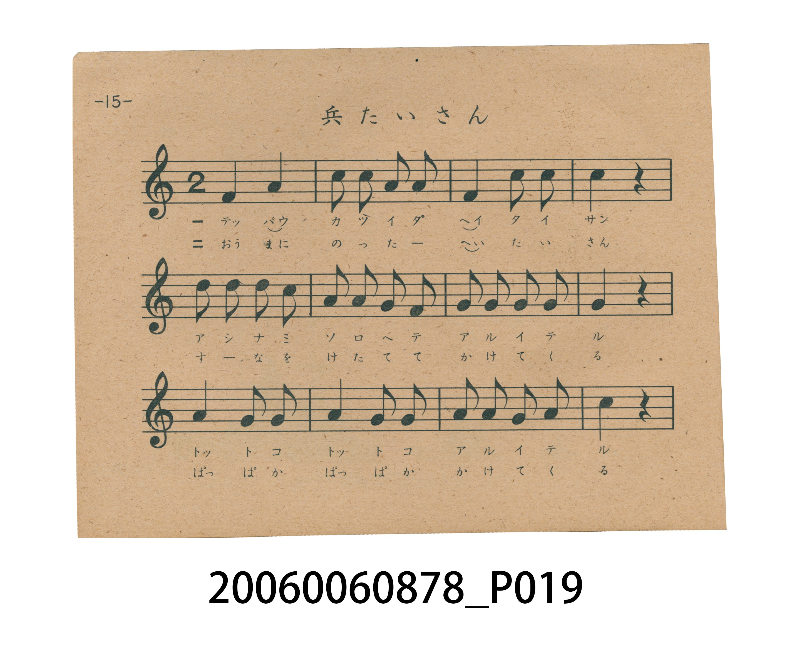
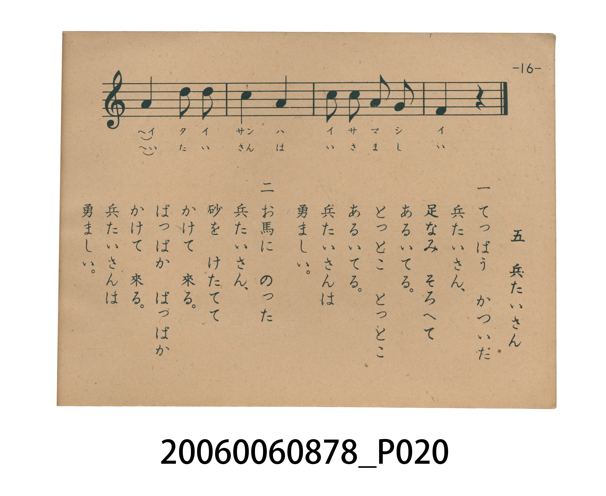

# 兵たいさん（士兵先生）

> Re:Shōka 使用 AI 協助辨識與重建樂譜，可能會有錯誤。歡迎回報。

- **鋼琴伴奏版**：<br><audio controls src="heitaisan.mp3"></audio>
- **NEUTRINO 歌聲合成版**：<br><audio controls src="heitaisan_neutrino.mp3"></audio>

- 日治時期國民學校唱歌（うたのほん 下・第五課）
- 國立臺灣歷史博物館典藏

## 說明


- 出處：臺灣總督府編《うたのほん 下》（國民學校初等科第二學年用），第五課〈兵たいさん〉（士兵先生），原書第 15–16 頁。
- 調性與拍號：ヘ調（F 大調五聲音階，原書五線譜省略調號，實際音高終止於 F 音），2/4 拍，速度 != 112。
- 背景與曲風：第一節描寫扛著步槍整齊行軍（「とっとこ とっとこ」）的步兵，第二節描寫策馬揚塵疾馳而來（「ぱっぱか ぱっぱか」）的騎兵，充滿輕快活潑的進行曲節奏感。
- 版本說明：本檔案為原書單聲部五線譜旋律之忠實數位化版本。

### 編曲說明（鋼琴伴奏版）：

1. 前奏 (Intro, 4 小節)：擷取主旋律核心樂句作為導奏，建立調性與拍感。
2. 主歌伴奏 (Heitaisan)：右手 (PianoRH) 演奏原書歌唱主旋律；左手 (PianoLH)
依國民學校低學年教材純樸明朗之風格配以和聲伴奏。


## 歌詞

```text
一　てっぱう　かついだ　兵たいさん、
足なみ　そろへて　あるいてる。
とっとこ　とっとこ　あるいてる。
兵たいさんは　勇ましい。

二　お馬に　のった　兵たいさん、
砂を　けたてて　かけて　來る。
ぱっぱか　ぱっぱか　かけて　來る。
兵たいさんは　勇ましい。
```

## ABC

<div class="abc-score" data-abc-src="heitaisan.abc" aria-label="五線譜載入中"></div>

[下載 ABC 原始檔](heitaisan.abc)

## TMD 檔案連結

- [主旋律 TMD 檔案](heitaisan.tmd) [[在 TMD Studio 編輯](https://tmdlang.github.io/Tmd-TS/#tmd=s7IKdvYPcrWy4qpTUCpJTLdSyC_KTM_Ms8rNz0sqLc7IV4JLJOfn5KQml2Tm51mVliTm5Wfk5yEky_JzSnNTrYwQIsX5pUXJqXCl8emp6HLxBYnpqVYBBoaWugEGRgYI6YKi_LLUvMQ8oPaSxMzyRKBmoEBRXn4R0JS81KLEHITa1LLMlFSQyoKizNzEosr4lPxkoEvySpDcllpUDHJ1WX4yss78opKM_PSixIKMSquMzOISoMeB8vHZiXmJCEUlGalAb-Vm5mSWAA1X4tLSUnjauvVx4_zHjS2PG6c-bpr8fk_H08WrgYJPWzueT5n_fk-ngpYWl6KtgqGhEZe9rYIbl42RvokdyMRn05c-27T72cymZ3PmP53T_WzDxKdrdzxbsPDplI3P1vYADXrc2AY2et3jxt1AoxWe7Oh-3Lz7-Zo1T3ZNebFqE9BssMuAep-v7n7Rvut54-Jna7c_7d_0tHfW886VL5eseNq648X0fiUuLn0tBVtqAS4FBYXHDROezd70fPa6F6tWPZvR97hhIli0effT9l0vZk59v2cWxD3Pd-x9Pnfx011znm9f8bihC5uPGrpBYYbs_465z9d2Pl8-EezTHqDg051bnk9ZAfTv-z09cO8_buhAC_vHDUAF6MEP1PK0b_6z2TuAGhUMTR81TDY0U3i5oPFxQxPUyS9W7X_WsPxFR_uz7t4XM4F6Zj1ungEUBJrlpvB0yXIgE2Rj46aX8ze_nNUHNxAo-Hz7rBdr5zyf0_h86lKgMrDunqfrl72cNRukePWM51ubnq1d9GzaHgU3BaAIxD3ABKAAtAvIetkw_-muZQqQ5IHkouaeZzPXg1w0e9PLRUCPzwL5ekfD8_UNz_r7n65f_axz9ouJ05-tXfpsee-zqVte7u16sbDnxW6gkR2PG3oeN6543LgYTE5WQOY8bgCq6Hw-qwWoExhGsNDsgZv7fO20l8vWPOuf9XTh1ufT9r1ctvlFQ8-TfW0wczeCjQKS3UBzERy4uS9X9EHMfdra-mz3_hd7pj7dv_rZlt3P9k4EyTZsAjoTlG7WNzxd2v-sZT7Cy887O57NWQNJTUD_AtnPVk15trDjedMuSGg_nbYOFAXNK-DB_mx699N93U92dj_dvwAY5s-m7niyt_dpzzSIUSCjoSkVYgAwT71YOe9p64pn09qBQftkx1oQY9W8F2vXA5Mv0IdoCQQo8qyvGRguQIcogIoloAyoYALHYSfYbGCUPG5oeNy4DBYSbWBu9-PGJeBEuQDIxUijjSCdL7Ztfty46nHjfrCGuY-beh837gAZBOI2PW4CGgHUsAzEgAYRSjQCFaFxselBt7oR6NGGp93tjxv3PW6cDhKHqAP6FBIOoIBHSlnAKEPNTD1A8Sd7JkBS3NM5G15s3QBUDDTl6cwFEAT0HpyNogDJnOdz5r_o3ghyR0MTPCR39YC90QVMfo8bV4PZwEIC6ENgGsERhs8XAD09Cax0IlgaGA2QAASGBFAExAamXeQwRE6yQHVoXBzayAlGUEaYswLomSc7ujCD8cWORS-2bn-2aSYwmz1dOgWezUABNXXV0-mTICQoMJG4wPBEV4wnVIEOoryohwIFLX0uLo9UYKWXWZyYZxWQCazEHWoMaqpBtijYWGjZgRk1CoYKugrGQFyjYAqExkAIEQPxQGK6CgYgWbBqH8MaYMZve9zcDBR63DzxcdMysM7HTauB3FYgvQRIN4BEmmeAOEBVTfvBwiBFWx83b0Y1zwgo3AiqYkAqQXGzGmJe4zogXgzE86F8YEZrAauZD8QtYCFQxMJNg3rGDAxBDgd5xAjokRogCYEgFoZnmhYB8Xagc7uAeD7YlXuBrLUgD4C8ChYBqmkGehDsObAIkIfpjZlg960CqpsEdt9EqGuXgTFIBFQCg0RBIv1gk7vRPQCKCYhjkVkgr4DiBVtsdMBiowNo3maw6zCFiPQCKHOBfbER7FocQkR6AxQTECcjJy-Qh0DJC90buJPL4-Z-aCIDOr5pK5A_DxxnEBFMT-BOKsBiAJqcWkCCoBQHxNOhIjCTarm4dO0U4FkHbDJQQJkLAA)]
- [鋼琴伴奏 TMD 檔案](heitaisan_piano.tmd) [[在 TMD Studio 編輯](https://tmdlang.github.io/Tmd-TS/#tmd=s7IKdvYPcrWy4qpTUCpJTLdSSM7PyUlNLsnMz7MqLUnMy8_Iz1OCS5bl55TmploZIUSK80uLklPhSuPTU9Hl4gsS01OtAgwMLXUDDIwMENIFRfllqXmJeUDtJYmZ5YlAzUCBorz8IqApealFiTkItallmSmpIJUFRZm5iUWV8Sn5yUCX5JUguS21qBjk6oJMoFPiE4uKEvPSU1GV5BeVZOSnFyUWZFRaZWQWl-QXZSYn5sRnJ-YlIhSVZAB1WeVm5mSWAC1S4tLSUnjauvVx4_zHjS2PG6c-bpr8fk_H08WrgYJPWzueT5n_fk8nUORl957nE7Y82bPl6dL-550dQEEFLS0uRVsFQ0MjLntbBTcuGyN9EzuQNc-mL322afezmU3P5sx_Oqf72YaJT9fueLZg4dMpG5-t7QGa9bixDWzfuseNu4H2KTzZ0f24effzNWue7JryYtUmoNlg5wL1Pl_d_aJ91_PGxc_Wbn_av-lp76znnStfLlnxtHXHi-n9Slxc-loKttQCXAoKCo8bJjybven57HUvVq16NqPvccNEsGjz7qftu17MnPp-zyyIe57v2Pt87uKnu-Y8377icUMXNh81dIMCEtn_HXOfr-18vnwi2Kc9QMGnO7c8n7ICHMA9cO8_buhAi5DHDaAYwIiTnqd985_N3gHUqGBo-qhhsqGZwssFjY8bmqBOfrFq_7OG5S862p91976YCdQz63HzDKAg0Cw3hadLlgOZIBsbN72cv_nlrD64gUDB59tnvVg75_mcxudTlwKVgXX3PF2_7OWs2SDFq2c839r0bO2iZ9P2KLgpAEUg7gEmAAWgXUDWy4b5T3ctU4AkDyQXNfc8m7ke5KLZm14uAnp8FsjXOxqer2941t__dP3qZ52zX0yc_mzt0mfLe59N3fJyb9eLhT0vdgON7Hjc0PO4ccXjxsVgcrICMudxA1BF5_NZLUCdwDCChWYP3Nzna6e9XLbmWf-spwu3Pp-27-WyzS8aep7sa4OZuxFsFJDsBpqL4MDNfbmiD2Lu09bWZ7v3v9gz9en-1c-27H62dyJItmET0JmgdLO-AZg9nrXMR3gZmD6AEpDUhDUbAQMBpFRBwVBP4WlnL1BcQcMzr6QoX0fBROHphn6gmZpANc8mAzPAtCc7dj-b3v10X_ezBTue7m9-tqLpaf_SJ3vnPG_a9XRDH1AvyIm7d4GyDVLkIxykoGCkB0ycu4H5EOIGBQ2PVGBBkFmcmAey5Wn_5med3QoaAaBCJshDU-HZnilAVZB0AdQEzMJwJ7zfM_vp9mUI5T4emhArgODJvrnIKf_J3j5Ian82deazuROeb5nybMUOYIA8mzP9yc5uYEp4tmDPy9beJ7uXPp3UA0yQELeB3AzNk3AHvFg572nrimfT2oE-e7JjLYixat6LteuBGRUYumhZASjyrK8ZmAKerZqiACqhgTKgMhoc6p1gs4GJ73FDw-PGZbA4bwNzux83LgFnvwVALkZubATpfLFt8-PGVY8b94M1zH3c1Pu4cQfIIBC36XET0AighmUgBjQxoCRYoCI0LjY96FY3Aj3a8LS7_XHjvseN00HiEHVAn0LCAZRSkPIQMHGiFhs9QPEneyZA8tbTORtebN0AVAw05enMBRAE9B6cjaIAyZznc-a_6N4IckdDEzwkd_WAvdEFzGiPG1eD2cDiEOhDYOLDEYbPFwA9PQmsdCJYGhgNkAAEhgRQBMQG5lLkMETOnEB1aFwc2sgJRlCWn7MC6JknO7owg_HFjkUvtm5_tmkmsEB5unQKvEABBdTUVU-nT4KQoMBE4gLDE10xnlAFOojySg0KFLT0ubjAxYoVNG871BjUVIMzrI2Flh2YUaNgrKCrYAaENQqmQBaIB2KZAllGQJYhkG8AEuOqRTHMB9kwE7hhZvHxCtFmubEgnUCWIYhhChIzRRYCmQUvg_A6DmQ9spOMoWIgHsTBEMeBVPsY1gBL37bHzc1AocfNEx83LQPrfNy0GshtBdJLgHQDSKR5BogDVNW0HywMUrT1cfNmVPOMgMKNoHoepBKUbFZDzGtcB8SLgXg-lA8sA1rAauYDcQtYCJTm4KbBAgcMQQ4HecQI6JEaIAmBIBaGZ5oWAfF2oHO7gHg-2JV7gay1IA-AvAoWAappBnoQ7DmwCJCH6Y2ZYPetAqqbBHbfRKhrl4ExSARUDYJEQSL9YJO70T0AigmIY5FZIK-A4gVbbHTAYqMDaN5msOswhYj0Aijfg32xEexaHEJEeoOYFI_wBu7k8ri5H5rIgI5v2grkzwPHGUQE0xO4kwqwhIImpxaQICjFAfF0qAhSLkTLOThyImauQxKCszCzLRZFGMrhJmIy8JiMvUAwgHhK104BXLooABlwD0b7ANWjChiBBZS5AA)]

## 分析

```text
================================================================================
📊 TMD Song Profile: [ 兵たいさん（士兵先生） ]
================================================================================
⏱  Duration:       0:17 (17.1s), 16 measures total
🎼 Key & Tempo:    首調基準 F, != 112.0 BPM, <2/4>
   - 分析範圍：      由實際發聲的音符與和弦推測調性；播放脈絡另行呈現
🎤 人聲音域:    F4 (MIDI 65) – D5 (MIDI 74) [跨度: 9 個半音 / 0.8 個八度, 難度: easy]
   - 最低音:  F4 in [Heitaisan #1 @ m.1, 0:00]
   - 最高音: D5 in [Heitaisan #1 @ m.5, 0:04]
   - 適合: soprano, mezzo-soprano, contralto, tenor, baritone, bass
🏛  結構:      Heitaisan (17.1s)
⚡ 編曲密度:        Peak 1 軌道同時演奏
🗝  調性診斷：       A 小調（純淨自然小調，未偵測到可信轉調）
   - 風格氣質:    純淨自然小調（陰鬱抒情、旋律集中，無明顯調外色彩）
   - 轉調歷程:    全曲維持單一推測調性（未偵測到可信轉調）
   - 核心骨幹音:  A, C, G, F, D
   - 調性數值:    A 小調 [相關度: 0.75, 穩定度: Moderate, 自然音純度: 100.0%]
   - 候選調性 (K-S): A 小調 (0.75), C 大調 (0.70), F 大調 (0.62)
   - 五度圈歷程:   +3
   - 各段落調性細節:
     • [Heitaisan #1]: A 小調 (r: 0.75, 自然音純度: 100.0%)

  [ 五度圈游移軌跡 ]
               C  
         F            G  
      Bb               D  
      Eb              [A ]*
         Ab           E  
            Db       B  
               F# 
     (* = active key center)

  [ 十二半音累積音高分佈 ]
     C  : █████████████████         23.2%
     C# :                            0.0%
     D  : ███████                    8.9%
     D# :                            0.0%
     E  :                            0.0%
     F  : █████████                 12.5%
     F# :                            0.0%
     G  : █████████████████         23.2%
     G# :                            0.0%
     A  : ████████████████████████  32.1%
     A# :                            0.0%
     B  :                            0.0%
--------------------------------------------------------------------------------
Assignment 軌道音域：
  - Piano         : F4 – D5 (9 個半音 / 0.8 個八度, 44 個音符)
================================================================================
```


## 原書掃描頁






