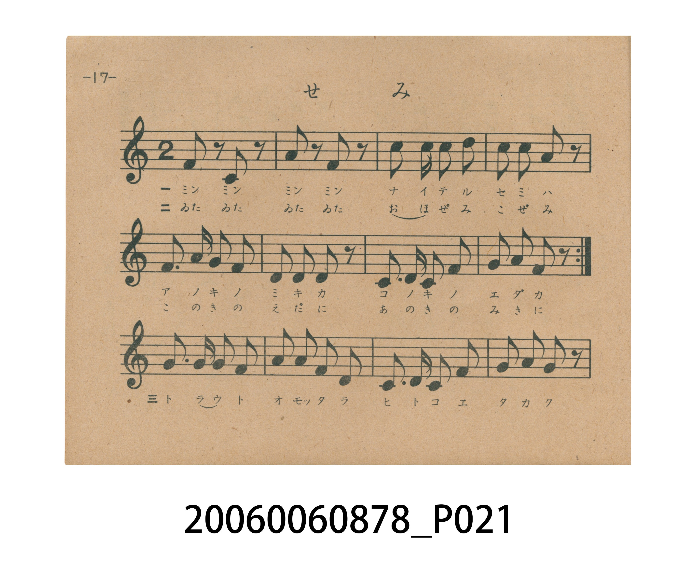
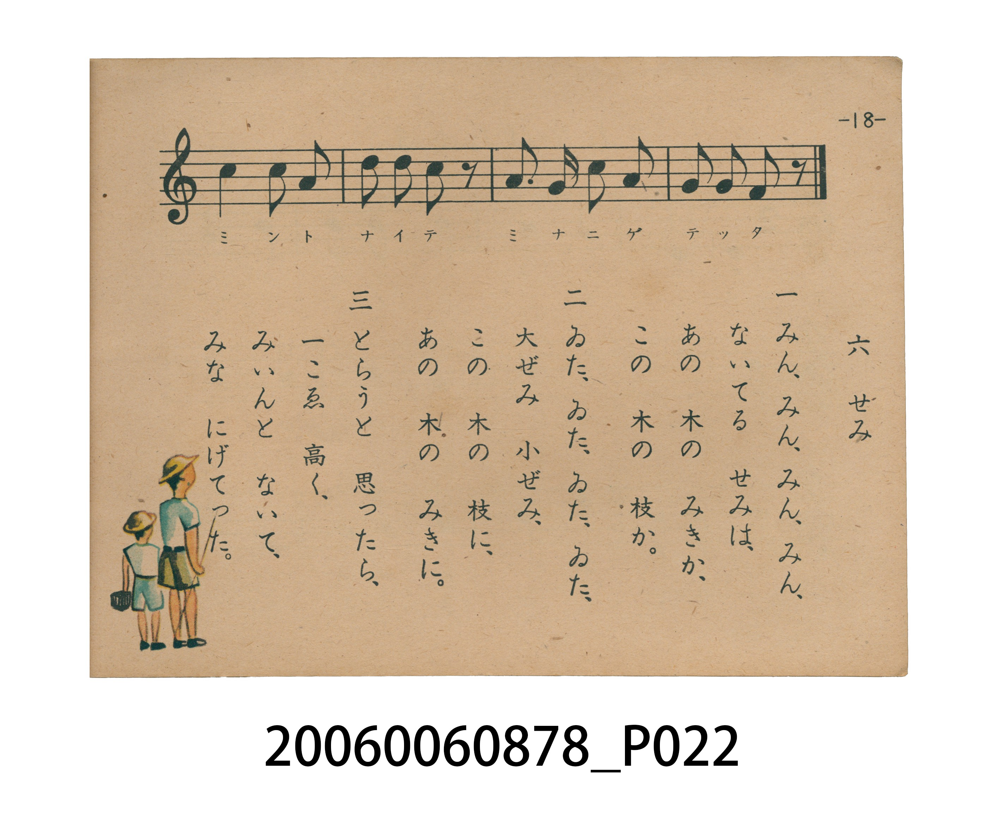

# せみ（蟬）

> Re:Shōka 使用 AI 協助辨識與重建樂譜，可能會有錯誤。歡迎回報。

- **NEUTRINO 歌聲合成版**：<br><audio controls src="semi_neutrino.mp3"></audio>
- **鋼琴伴奏版**：<br><audio controls src="semi.mp3"></audio>


- 日治時期國民學校唱歌（うたのほん 下・第六課）
- 國立臺灣歷史博物館典藏

## 說明


- 出處：臺灣總督府編《うたのほん 下》（國民學校初等科第二學年用），第六課〈せみ〉（蟬），原書第 17–18 頁。
- 調性與拍號：ヘ調（F 大調五聲音階，原書五線譜省略調號，實際音高終止於 F 音），2/4 拍，速度 != 104。
- 背景與曲風：曲式結構極富巧思——前 8 小節（原書第 17 頁第 1–2 行）末尾設有反覆記號，由第一節（尋找蟬鳴在哪棵樹幹或樹枝）與第二節（發現大蟬小蟬停在樹枝與樹幹上）反覆演唱；後 8 小節（第 17 頁第 3 行至第 18 頁第 1 行）則專門供第三節演唱，生動模仿剛要伸手捕捉時，群蟬高鳴一聲「みいん」瞬間飛逃的童趣畫面。
- 版本說明：本檔案為原書單聲部五線譜旋律之忠實數位化版本。

### 編曲說明（鋼琴伴奏版）：

1. 前奏 (Intro, 4 小節)：擷取主旋律核心樂句作為導奏，建立調性與拍感。
2. 主歌伴奏 (SemiA, SemiB)：右手 (PianoRH) 演奏原書歌唱主旋律；左手 (PianoLH)
依國民學校低學年教材純樸明朗之風格配以和聲伴奏。


## 歌詞

```text
一　みん、みん、みん、みん、
ないてる　せみは、
あの　木の　みきか、
この　木の　枝か。

二　ゐた、ゐた、ゐた、ゐた、
大ぜみ　小ぜみ、
この　木の　枝に、
あの　木の　みきに。

三　とらうと　思ったら、
一こゑ　高く、
みいんと　ないて、
みな　にげてった。
```

## ABC

```abc
X:1
T:せみ（蟬）
M:2/4
L:1/16
Q:1/4=104
K:F
V:V1 name="Piano" snm="Pia"
[V:V1]
F2 z2 C2 z2 | G2 z2 F2 z2 | c2 c2 c2 d2 | c2 c2 A2 z2 |
w: 1.~ミン ミン | ミン ミン | ナ イ テ ル | セ ミ ハ
w: 2.~ゐた ゐた | ゐた ゐた | お ほ ぜ み | こ ぜ み
F3 A G2 F2 | D2 D2 D2 z2 | C3 D C2 F2 | G2 A2 F2 z2 |
w: 1.~ア ノ キ ノ | ミ キ カ | コ ノ キ ノ | エ ダ カ
w: 2.~こ の き の | え だ に | あ の き の | み き に
A3 A G2 F2 | A2 G2 F2 D2 | C3 D C2 F2 | G2 A2 G2 z2 |
w: ト ラ ウ ト | オ モッ タ ラ | ヒ ト コ エ | タ カ ク
c4 c2 A2 | d2 d2 c2 z2 | A3 G c2 A2 | G2 G2 F2 z2 |
w: ミ ン ト | ナ イ テ | ミ ナ ニ ゲ | テ ッ タ
```

## TMD 檔案連結

- [主旋律 TMD 檔案](semi.tmd) [[在 TMD Studio 編輯](https://tmdlang.github.io/Tmd-TS/#tmd=s7IKdvYPcrWy4qpTUCpJTLdSyC_KTM_MsypJzCxPzIvPT0vLTM5MzFHi0tJSeNw4-3Hj_vd7Ol7MX_N-T6eClhaXoq2CoYEJl72tghuXjZG-iR3InGfTlz7btPvZzKZnc-Y_ndP9bMPEp2t3PFuw8OmUjc_W9gD1P25se9w4_3HjuseNux83TVZ4sqP7cfPu52vWPG1d-2LVJqDZSiBzgHqfr-5-0b7reePiZ2u3P-3f9LR31vPOlS-XrHjauuPF9H4lLi59LQVbagEuBQWFxw0Tns3e9Hz2uherVj2b0fe4YSJYtHn30_ZdL2ZOfb9nFsQ9z3fsfT538dNdc55vX_G4oQubjxq6gV5F8X_H3OdrO58vnwj06ZNdPUDBpzu3PJ-yAujf93t64N5_3AAMIFBIP24AikMDG6jgad_8Z7N3AJUpGJo_aphsaKHwckHj44YmqANfrNr_rGH5i472Z929L2bOB7r0cfMMoCDQCDeFp0uWA5lPdk150bjp5fzNL2f1wQ0ECj7fPuvF2jnP5zQ-n7oUqAysu-fp-mUvZ80GKV494_nWpmdrFz2btkfBTQEoAnEPMLoVgHYBWS8b5j_dtUwBkhiQXNTc82zmepCLZm96uQjozVlAxtM9_c-3Tni2vPvZ0q1P1_c83b78WcPcRw1TgOhpZ6-ChcLTDf3P1zeAgg7JvyCvgllAjxspvFgITEWdz-asfrph34sVa5_N6Xza3_tiWduLFTMgbn8-ZSMojHc0QE3a0P2scx8wIF9u3vJ0zoqnk1c9W7z12YqdT3fufNYxDch4Nm8u0ECgSyExA9H1fOae5_37QCE3fw3QUSCycQ5QO0Q9yFtgE57s6ALqhTjg2Z4pwET-fs_sp_t6kL2C6gljkAdetG8Gi4JjEcyCeutpZ_vTDR0vpzU82Tcb7IlOoBkwg4E-m_-0e-qzFQuf7N7_tHP2i2WNT_bseNbZ_ax36rPeTmCeA6nZtwTk19UzgN4FhgEwyh839IDSU2MLMG0-buh9Pm_Ny2mTXy6e_bKh-fmsluerl77Ytvj51NUv5y5CxN7zzo5nc9ZAsgEo6uasebZqyrOFHc-bdkFi5um0daDU1LwCnoKeTe9-uq_7yc7up_sXAJPPs6k7nuztfdozDWIUyGhoFoMYACwMXqyc97R1xbNp7cDgfLJjLYixat6LteuB-Q4ebPC0DhR51tf8rL8f6BCFAAMjUGIAUkbg5NgJNhvo3ccNDSC_gjzaiIcBdknjKlCYNC573ATMrkBt4FzXCLQdKt0EytENDc_mrIAwwNK9jxuBqqEqJqOpAKYMsDQ4FEG5F-wdYPg9nbIcqAmNfNq_-sXE6cAoACWu1knAuHs2Yz0wib1sWgxJoUApeCp7OnERKK81tUDVNMxEVgO0GKYGmAOgobGrB-Topgmgsgnod9wMkGpgSn_cOAdc7jQAUy6Mjc-jqwmGFFAFRlAA8-LTjg1PdrUBdRNkg0oicBYEphBILgSJbNiIKwQQstjCEOgaRFLpBLtzxeOmTnDxDSzHG4Bl0ePGxaAwAQpC_AZKUkDfN00ESgPz1OPGfrinYTkKrBWRmJCkV4ElVj9unASSgJiMJUDWLn7WvBmel5_27X7WNRnk7JlNTxtmgnJ054KnDROBtoMy3NTtoHy9qw2etYEJCVKAArM2yPutK14274Xk7hdbIeEJ9jXQVsorSShQ0NLn4gpOzc10tArITMzLd6gxqKkG2aBgY2imZQdm1QDLNF0FAyA2jYcyahSMoCyYVI2CKUgBFJuhiBjD1ICN8zGsAZZL8x83b4YKo3AIyXWBBJuWgKXawORqiEzTbohyMNmPaqMRSB6URWCmInMIyDWCbWwEm944B0zuh8pMRhOD2IgUZiCvgwIKxK5RMAOFHoKAhhqICRYBsyAqQXpAgQYPXETANS0Cq3_c3Adkr4WyoMEGdj1YrAkUKDDPgYIPq46mFWBeA6oORJCBPQjy3Dog7oWyIF7vAPMWgEkkuxqbcOoABRBMDGFXLST1OeFLfaCQQA1JkAiMBw5LAuEIS6xQv4ECC-QBkOdXAr2-DMwCiYACZRWYt-hxczM4XMDuBiqDhPEkqLYOaLhCwhCkDawOHIqPm9bD7YN6AZQLQBCWG4CJAeRYqAgk8CDeNEJSA3I2zJtozgfFNcQlYFfAHI-RPeBZCqq6C4i7wWo2QWUgmQjhV3i86NopgAsGBSjDCcRQ5gIA)]
- [鋼琴伴奏 TMD 檔案](semi_piano.tmd) [[在 TMD Studio 編輯](https://tmdlang.github.io/Tmd-TS/#tmd=s7IKdvYPcrWy4tLSUnjcOPtx4_73ezpezF_zfk8nkPGye8_zCVue7NnydGn_884OoKCClhaXoq2CoYEJl72tghuXjZG-iR1XnYLSs-lLn23a_Wxm07M585_O6X62YeLTtTueLVj4dMrGZ2t7gGY9bmx73Dj_ceO6x427HzdNVniyo_tx8-7na9Y8bV37YtUmoNlKIHOAep-v7n7Rvut54-Jna7c_7d_0tHfW886VL5eseNq648X0fiUuLn0tBVtqAS4FBYXHDROezd70fPa6F6tWPZvR97hhIli0effT9l0vZk59v2cWxD3Pd-x9Pnfx011znm9f8bihC5uPGrqBXkXxf8fc52s7ny-fCPTpk109QMGnO7c8n7ICHMA9cO8_bgAGECj4HzeAAh4WAz1P--Y_m70DqEzB0PxRw2RDC4WXCxofNzRBHfhi1f5nDctfdLQ_6-59MXM-0KWPm2cABYFGuCk8XbIcyHyya8qLxk0v529-OasPbiBQ8Pn2WS_Wznk-p_H51KVAZWDdPU_XL3s5azZI8eoZz7c2PVu76Nm0PQpuCkARiHuA0a0AtAvIetkw_-muZQqQxIDkouaeZzPXg1w0e9PLRUBvzgIynu7pf751wrPl3c-Wbn26vufp9uXPGuY-apgCRE87exUsFJ5u6H--vgEUdEj-BXkVzAJ63EjhxUJgKup8Nmf10w37XqxY-2xO59P-3hfL2l6smAFx-_MpG0FhvKMBatKG7med-4AB-XLzlqdzVjydvOrZ4q3PVux8unPns45pQMazeXOBBgJdCokZiK7nM_c8798HCrn5a4COApGNc4DaIepB3gKb8GRHF1AvxAHP9kwBJvL3e2Y_3deD7BVUTxiDPPCifTNYFByLYBbUW087259u6Hg5reHJvtlgT3QCzYAZDPTZ_KfdU5-tWPhk9_6nnbNfLGt8smfHs87uZ71Tn_V2AvMcSM2-JSC_rp4B9C4wDIBR_rihB5SeGluAafNxQ-_zeWteTpv8cvHslw3Nz2e1PF-99MW2xc-nrn45dxEi9oAJGxhdkGyANf8D4xOkVEHBUE8BGHVAcQUNz7ySonwdBROo1zVBcT4ZmHOnPdmx-9n07qf7up8t2PF0f_OzFU1P-5c-2TvnedOupxv6gHpBKW73LlB-R0rHz1rmQx2koGCkB8xVu4EFCMQNChrBqbmZjjoKIMoJZNHT_s3AgFDQCMhMzMsP8tBUAAXa0n5IMgLqAwYg3BWgKNq-DKHcx0MTYgsQPNk3FznXPtnbB8mpz6bOfDZ3wvMtU56t2AEMk2dzpj_Z2Q1M188W7HnZ2vtk99Knk3qAYQ1xHsjZ0PIE7oAXK-c9bV3xbFo70HNPdqwFMVbNe7F2PbCQgacReMYGijzra37W3_9s1RSFAAMjUMoHUkbggO8Emw2M28cNDaCIBcVqIx4G2CWNq0AJoHHZ4yZg2QTUBi5iGoG2Q6WbQMVXQ8OzOSsgDLB07-NGoGqoisloKoDZACwNjiFQUQX2DigqpiwHakIjn_avfjFxOjC9gXJS6yRghD-bsR6Yn142LYZkR6AUPEs9nbgIVLA0tUDVNMxEVgO0GKYGmN2hobGrB-Topgmgghjod9wMkGpgtn7cOAdcyDYA0yqMjc-jqwmGFFAFRlAAC56nHRue7GoD6ibIBmUCcHkDTCGQIgcksmEjrhBAyGILQ6BrEEmlE-zOFY-bOsF1FbDSagAWvI8bF4PCBCgI8RsoSQF93zQRKA0sQB43AhMy1NOw4gOsFZGYkKRXgSVWP26cBJKAmIwlQNYufta8GV5wPe3b_axrMsjZM5ueNswEFV-dC542TATaDqqrpm4HFWK72uDlGDAhQWoLYDkG8n7ripfNeyFF2YutkPAE-xpoK-UtAihQ0NLn4gIXbVbQwsWhxqCmGlxi2BiaadmBWTUKpgq6YAiijYG4RsEMSIIwSMQALAIS11UwQlJjBObrAisAqBquWhTbfJBtM4FbZhivYBofD7IVSAI5YJFow1gkEZBB4FISv7NhFpvGw10Jcg-IBXcT2L0wDPIRQgTkC4i7Qcb5GNYAa4_5j5s3Q4VROITkukCCTUvAUm1gcjVEpmk3RDmY7Ee10QgkD8rbMFOROQTkGsE2NoJNb5wDJvdDZSajiUFsRAozkNdhEQeMalDoIQhoqIGYYBEwC6ISpAcUaIgIhwdc0yKw-sfNfUD2WigLGmxg14PFmkCBAvMcKPiw6mhaAeY1oOpABBnYgyDPrQPiXigL4vUOMG8BmESyq7EJpw5QAMHEEHahpj_SEzKMgVAJETcDqow2y4Wldeyp3gl_qodkROQYBInAeOA4JBB_sEwCDVNQJIECDhToK4FBvgzMAomAImMVmLfocXMzOD7A4QVUBonbSVBtHdD4hMQdSBtYHTj2Hjeth9tH5fIG7nxQGoO4BOwKmOMxsiU8K0NVdwFxN1jNJqgMJPMi_IqSHqAxgzs9EIjlaFNcaQIl1aCkCF07BXCZqgBkgNNktA9QDYJjBOc4gRjKXAA)]

## 分析

```text
================================================================================
📊 TMD Song Profile: [ せみ（蟬） ]
================================================================================
⏱  Duration:       0:18 (18.5s), 16 measures total
🎼 Key & Tempo:    首調基準 F, != 104.0 BPM, <2/4>
   - 分析範圍：      由實際發聲的音符與和弦推測調性；播放脈絡另行呈現
🎤 人聲音域:    C4 (MIDI 60) – D5 (MIDI 74) [跨度: 14 個半音 / 1.2 個八度, 難度: moderate]
   - 最低音:  C4 in [SemiA #1 @ m.1, 0:00]
   - 最高音: D5 in [SemiA #1 @ m.3, 0:03]
   - 適合: soprano, mezzo-soprano, contralto, tenor, baritone, bass
🏛  結構:      SemiA (9.2s) -> SemiB (9.2s)
⚡ 編曲密度:        Peak 1 軌道同時演奏
🗝  調性診斷：       C 調性不明確（推測轉調經歷 1 次）
   - 風格氣質:    純淨自然大調（陽光明朗、易唱易記，無明顯調外色彩）
   - 轉調歷程:    C 調性不明確起奏 ➔ [SemiB] 轉至 C 大調 (-5 半音 / 五度圈 +1 步)
   - 核心骨幹音:  C, F, A, G, D
   - 調性數值:    C 調性不明確 [相關度: 0.83, 穩定度: Ambiguous, 自然音純度: 100.0%]
   - 候選調性 (K-S): C 大調 (0.83), F 大調 (0.80), A 小調 (0.65)
   - 五度圈歷程:   -1 -> +0
   - 各段落調性細節:
     • [SemiA #1]: F 大調 (r: 0.84, 自然音純度: 100.0%)
     • [SemiB #1]: C 大調 (r: 0.78, 自然音純度: 100.0%)

  [ 五度圈游移軌跡 ]
              [C ]*
        [F ]*          G  
      Bb               D  
      Eb               A  
         Ab           E  
            Db       B  
               F# 
     (* = active key center)

  [ 十二半音累積音高分佈 ]
     C  : ████████████████████████  29.6%
     C# :                            0.0%
     D  : ████████████              14.8%
     D# :                            0.0%
     E  :                            0.0%
     F  : ████████████████          19.4%
     F# :                            0.0%
     G  : ██████████████            17.6%
     G# :                            0.0%
     A  : ███████████████           18.5%
     A# :                            0.0%
     B  :                            0.0%
--------------------------------------------------------------------------------
Assignment 軌道音域：
  - Piano         : C4 – D5 (14 個半音 / 1.2 個八度, 53 個音符)
================================================================================
```


## 原書掃描頁






