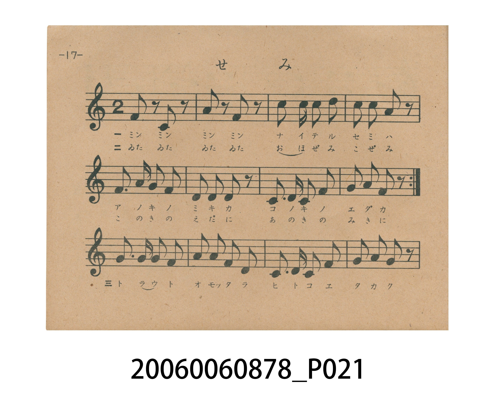
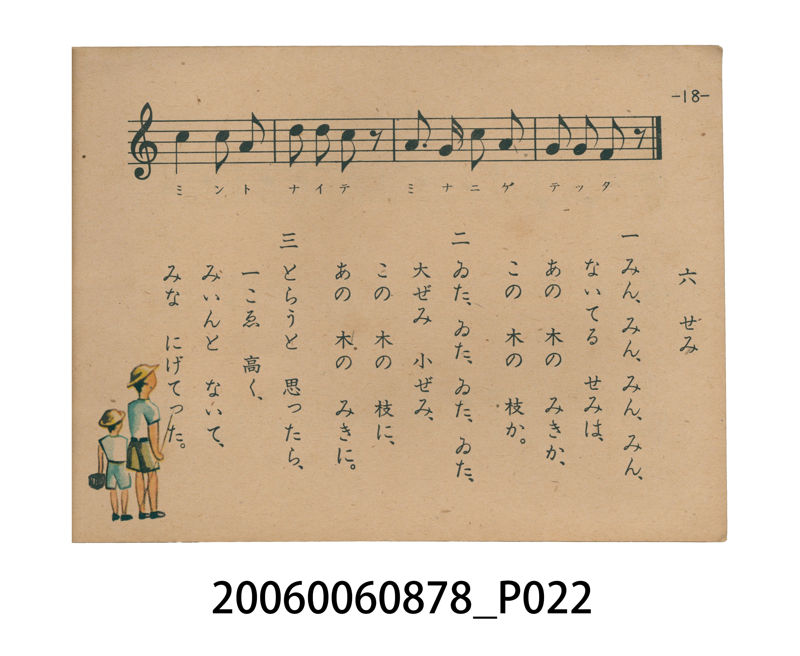

# せみ（蟬）

> Re:Shōka 使用 AI 協助辨識與重建樂譜，可能會有錯誤。歡迎回報。

- **鋼琴伴奏版**：<br><audio controls src="semi.mp3"></audio>
- **NEUTRINO 歌聲合成版**：<br><audio controls src="semi_neutrino.mp3"></audio>

- 日治時期國民學校唱歌（うたのほん 下・第六課）
- 國立臺灣歷史博物館典藏

## 說明


- 出處：臺灣總督府編《うたのほん 下》（國民學校初等科第二學年用），第六課〈せみ〉（蟬），原書第 17–18 頁。
- 調性與拍號：ヘ調（F 大調五聲音階，原書五線譜省略調號，實際音高終止於 F 音），2/4 拍，速度 != 104。
- 背景與曲風：曲式結構極富巧思——前 8 小節（原書第 17 頁第 1–2 行）末尾設有反覆記號，由第一節（尋找蟬鳴在哪棵樹幹或樹枝）與第二節（發現大蟬小蟬停在樹枝與樹幹上）反覆演唱；後 8 小節（第 17 頁第 3 行至第 18 頁第 1 行）則專門供第三節演唱，生動模仿剛要伸手捕捉時，群蟬高鳴一聲「みいん」瞬間飛逃的童趣畫面。
- 版本說明：本檔案為原書單聲部五線譜旋律之忠實數位化版本。

### 編曲說明（鋼琴伴奏版）：

1. 前奏 (Intro, 4 小節)：擷取主旋律核心樂句作為導奏，建立調性與拍感。
2. 主歌伴奏 (SemiA, SemiB)：右手 (PianoRH) 演奏原書歌唱主旋律；左手 (PianoLH)
依國民學校低學年教材純樸明朗之風格配以和聲伴奏。


## 歌詞

```text
一　みん、みん、みん、みん、
ないてる　せみは、
あの　木の　みきか、
この　木の　枝か。

二　ゐた、ゐた、ゐた、ゐた、
大ぜみ　小ぜみ、
この　木の　枝に、
あの　木の　みきに。

三　とらうと　思ったら、
一こゑ　高く、
みいんと　ないて、
みな　にげてった。
```

## ABC

<div class="abc-score" data-abc-src="semi.abc" aria-label="五線譜載入中"></div>

[下載 ABC 原始檔](semi.abc)

## TMD 檔案連結

- [主旋律 TMD 檔案](semi.tmd) [[在 TMD Studio 編輯](https://tmdlang.github.io/Tmd-TS/#tmd=s7IKdvYPcrWy4qpTUCpJTLdSyC_KTM_MsypJzCxPzIvPT0vLTM5MzFGCyyfn5-SkJpdk5udZlZYk5uVn5OchJMvyc0pzU62MECLF-aVFyalwpfHpqehy8QWJ6alWAQZGhrpAAklrQVF-WWpeYh5QO9Q16UCBorz8IqApealFyK5KLctMSQWpLCjKzE0sqoxPyU8GuiSvBMltqUXFIFeX5Scj68wvKsnITy9KLMiotMrILC4B-h8oH5-dmJeIUFSSkQr0Vl5iSWkR0P1aWgqPG2c_btz_fk_Hi_lr3u_pVNDS4lK0VTA0MOGyt1Vw47Ix0jexA-l-Nn3ps027n81sejZn_tM53c82THy6dsezBQufTtn4bG0PUP_jxrbHjfMfN6573Lj7cdNkhSc7uh83736-Zs3T1rUvVm0Cmg12BVDv89XdL9p3PW9c_Gzt9qf9m572znreufLlkhVPW3e8mN6vxMWlr6VgSy3ApaCg8LhhwrPZm57PXvdi1apnM_oeN0wEizbvftq-68XMqe_3zIK45_mOvc_nLn66a87z7SseN3Rh81FDN9CrKP7vmPt8befz5ROBPn2yqwco-HTnludTVgD9-35PD9z7jxuAAQQK6ccNQHFoYAMVPO2b_2z2DqAyBUPzRw2TDS0UXi5ofNzQBHXgi1X7nzUsf9HR_qy798XM-UCXPm6eARQEGuGm8HTJciDzya4pLxo3vZy_-eWsPriBQMHn22e9WDvn-ZzG51OXApWBdfc8Xb_s5azZIMWrZzzf2vRs7aJn0_YouCkARSDuAUa3AtAuIOtlw_ynu5YpQBIDkouae57NXA9y0exNLxcBvTkLyHi6p__51gnPlnc_W7r16fqep9uXP2uY-6hhChA97exVsFB4uqH_-foGUNAh-RfkVTAL6HEjhRcLgamo89mc1U837HuxYu2zOZ1P-3tfLGt7sWIGxO3Pp2wEhfGOBqhJG7qfde4DBuTLzVuezlnxdPKqZ4u3Plux8-nOnc86pgEZz-bNBRoIdCkkZiC6ns_c87x_Hyjk5q8BOgpENs4BaoeoB3kLbMKTHV1AvRAHPNszBZjI3--Z_XRfD7JXUD1hDPLAi_bNYFFwLIJZUG897Wx_uqHj5bSGJ_tmgz3RCTQDZjDQZ_Ofdk99tmLhk937n3bOfrGs8cmeHc86u5_1Tn3W2wnMcyA1-5aA_Lp6BtC7wDAARvnjhh5QempsAabNxw29z-eteTlt8svFs182ND-f1fJ89dIX2xY_n7r65dxFiNh73tnxbM4aSDYARd2cNc9WTXm2sON50y5IzDydtg6UmppXwFPQs-ndT_d1P9nZ_XT_AmDyeTZ1x5O9vU97pkGMAhkNzWIQA4CFwYuV8562rng2rR0YnE92rAUxVs17sXY9MN_Bgw2e1oEiz_qan_X3Ax2iACo7gTKg0hOcHDvBZgO9-7ihAeRXkEcb8TDALmlcBQqTxmWPm4DZFagNnOsagbZDpZtAObqh4dmcFRAGWLr3cSNQNVTFZDQVwJQBlgaHIij3gr0DDL-nU5YDNaGRT_tXv5g4HRgFoMTVOgkYd89mrAcmsZdNiyEpFCgFT2VPJy4C5bWmFqiahpnIaoAWw9QAcwA0NHb1gBzdNAFUNgH9jpsBUg1M6Y8b54DLnQZgyoWx8Xl0NcGQAqrACApgXnzaseHJrjagboJsUEkEzoLAFALJhSCRDRtxhQBCFlsYAl2DSCqdYHeueNzUCS6-geV4A7Asety4GBQmQEGI30BJCuj7polAaWCeetzYD_c0LEeBtSISE5L0KrDE6seNk0ASEJOxBMjaxc-aN8Pz8tO-3c-6JoOcPbPpacNMUI7uXPC0YSLQdlCGm7odlK93tcGzNjAhQQpQYNYGeb91xcvmvZDc_WIrJDzBvgbaSnklCQUKWvpcXMGpuZmOVgGZwGaOQ41BTTXIBgUbQzMtOzCrBlim6SoYALFpPJRRo2AEZcGkahRMQQqg2AxFxBimBmycj2ENsFya_7h5M1QYhUNIrgsk2LQELNUGJldDZJp2Q5SDyX5UG41A8qAsAjMVmUNArhFsYyPY9MY5YHI_VGYymhjERqQwA3kdFFAgdo2CGSj0EAQ01EBMsAiYBVEJ0gMKNHjgIgKuaRFY_ePmPiB7LZQFDTaw68FiTaBAgXkOFHxYdTStAPMaUHUgggzsQZDn1gFxL5QF8XoHmLcATCLZ1diEUwcogGBiCLtqIanPCV_qA4UEakiCRGA8cFgSCEdYYoX6DRRYIA-APL8S6PVlYBZIBBQoq8C8RY-bm8HhAnY3UBkkjCdBtXVAwxUShiBtYHXgUHzctB5uH9QLoFwAgrDcAEwMIMdCRSCBB_GmEZIakLNh3kRzPiiuIS4BuwLmeIzsAc9SUNVdQNwNVrMJKgPJRAi_wuNF104BXDAoQBlOIIYyFwA)]
- [鋼琴伴奏 TMD 檔案](semi_piano.tmd) [[在 TMD Studio 編輯](https://tmdlang.github.io/Tmd-TS/#tmd=s7IKdvYPcrWy4qpTUCpJTLdSSM7PyUlNLsnMz7MqLUnMy8_Iz1OCS5bl55TmploZIUSK80uLklPhSuPTU9Hl4gsS01OtAgyMDHWBBJLWgqL8stS8xDyg9pLEzPJEoGagQFFefhHQlLzUosQchNrUssyUVJDKgqLM3MSiyviU_GSgS_JKkNyWWlQMcnVBJtAp8YlFRYl56amoSvKLSjLy04sSCzIqrTIyi0vyizKTE3PisxPzEhGKSjKAuqzyEktKi4B-0dJSeNw4-3Hj_vd7Ol7MX_N-TyeQ8bJ7z_MJW57s2fJ0af_zzg6goIKWFpeirYKhgQmXva2CG5eNkb6JHcjIZ9OXPtu0-9nMpmdz5j-d0_1sw8Sna3c8W7Dw6ZSNz9b2AM163Nj2uHH-48Z1jxt3P26arPBkR_fj5t3P16x52rr2xapNQLPBTgPqfb66-0X7rueNi5-t3f60f9PT3lnPO1e-XLLiaeuOF9P7lbi49LUUbKkFuBQUFB43THg2e9Pz2eterFr1bEbf44aJYNHm3U_bd72YOfX9nlkQ9zzfsff53MVPd815vn3F44YubD5q6AZ6FcX_HXOfr-18vnwi0KdPdvUABZ_u3PJ8ygpwAPfAvf-4ARhAoOB_3AAKeFgM9Dztm_9s9g6gMgVD80cNkw0tFF4uaHzc0AR14ItV-581LH_R0f6su_fFzPlAlz5ungEUBBrhpvB0yXIg88muKS8aN72cv_nlrD64gUDB59tnvVg75_mcxudTlwKVgXX3PF2_7OWs2SDFq2c839r0bO2iZ9P2KLgpAEUg7gFGtwLQLiDrZcP8p7uWKUASA5KLmnuezVwPctHsTS8XAb05C8h4uqf_-dYJz5Z3P1u69en6nqfblz9rmPuoYQoQPe3sVbBQeLqh__n6BlDQIfkX5FUwC-hxI4UXC4GpqPPZnNVPN-x7sWLtszmdT_t7Xyxre7FiBsTtz6dsBIXxjgaoSRu6n3XuAwbky81bns5Z8XTyqmeLtz5bsfPpzp3POqYBGc_mzQUaCHQpJGYgup7P3PO8fx8o5OavAToKRDbOAWqHqAd5C2zCkx1dQL0QBzzbMwWYyN_vmf10Xw-yV1A9YQzywIv2zWBRcCyCWVBvPe1sf7qh4-W0hif7ZoM90Qk0A2Yw0Gfzn3ZPfbZi4ZPd-592zn6xrPHJnh3POruf9U591tsJzHMgNfuWgPy6egbQu8AwAEb544YeUHpqbAGmzccNvc_nrXk5bfLLxbNfNjQ_n9XyfPXSF9sWP5-6-uXcRYjYAyZsYHRBsgHW_A-MT5BSBQVDPQVg1AHFFTQ880qK8nUUTKBe1wTF-WRgzp32ZMfuZ9O7n-7rfrZgx9P9zc9WND3tX_pk75znTbuebugD6gWluN27QPkdKR0_a5kPdZCCgpEeMFftBhYgEDcoaASn5mY66iiAKCeQRU_7NwMDQkEjAFQYBnloKoACbWk_JBkB9QEDEO4KUBRtX4ZQ7uOhCbEFCJ7sm4uca5_s7YPk1GdTZz6bO-H5linPVuwAhsmzOdOf7OwGputnC_a8bO19snvp00k9wLCGOA_kbGh5AnfAi5XznraueDatHei5JzvWghir5r1Yux5YyMDTCDxjA0We9TU_6-9_tmqKAqgmAcqA6hJwwHeCzQbG7eOGBlDEgmK1EQ8D7JLGVaAE0LjscROwbAJqAxcxjUDbodJNoOKroeHZnBUQBli693EjUDVUxWQ0FcBsAJYGxxCoqAJ7BxQVU5YDNaGRT_tXv5g4HZjeQDmpdRIwwp_NWA_MTy-bFkOyI1AKnqWeTlwEKliaWqBqGmYiqwFaDFMDzO7Q0NjVA3J00wRQQQz0O24GSDUwWz9unAMuZBuAaRXGxufR1QRDCqgCIyiABc_Tjg1PdrUBdRNkgzIBuLwBphBIkQMS2bARVwggZLGFIdA1iKTSCXbnisdNneC6ClhpNQAL3seNi0FhAhSE-A2UpIC-b5oIlAYWII8bgQkZ6mlY8QHWikhMSNKrwBKrHzdOAklATMYSIGsXP2veDC-4nvbtftY1GeTsmU1PG2aCiq_OBU8bJgJtB9VVU7eDCrFdbfByDJiQILUFsBwDeb91xcvmvZCi7MVWSHiCfQ20lfIWARQoaOlzcYGLNito4eJQY1BTDS4xbAzNtOzArBoFUwVdMATRxkBco2AGJEEYJGIAFgGJ6yoYIakxAvN1gRUAVA1XLYptPsi2mcAtM4xXMI2PB9kKJIEcsEi0YSySCMggcCmJ39kwi03j4a4EuQfEgrsJ7F4YBvkIIQLyBcTdION8DGuAtcf8x82bocIoHEJyXSDBpiVgqTYwuRoi07QbohxM9qPaaASSB-VtmKnIHAJyjWAbG8GmN84Bk_uhMpPRxCA2IoUZyOuwiANGNSj0EAQ01EBMsAiYBVEJ0gMKNESEwwOuaRFY_ePmPiB7LZQFDTaw68FiTaBAgXkOFHxYdTStAPMaUHUgggzsQZDn1gFxL5QF8XoHmLcATCLZ1diEUwcogGBiCLtQ0x_pCRnGQKiEiJsBVUab5cLSOvZU74Q_1UMyInIMgkRgPHAcEog_WCaBhikokkABBwr0lcAgXwZmgURAkbEKzFv0uLkZHB_g8AIqg8TtJKi2Dmh8QuIOpA2sDhx7j5vWw-2jcnkDdz4ojUFcAnYFzPEY2RKelaGqu4C4G6xmE1QGknkRfkVJD9CYwZ0eCMRytCmuNIGSalBShK6dArhMVQAywGky2geoBsExgnOcQAxlLgA)]

## 分析

```text
================================================================================
📊 TMD Song Profile: [ せみ（蟬） ]
================================================================================
⏱  Duration:       0:18 (18.5s), 16 measures total
🎼 Key & Tempo:    首調基準 F, != 104.0 BPM, <2/4>
   - 分析範圍：      由實際發聲的音符與和弦推測調性；播放脈絡另行呈現
🎤 人聲音域:    C4 (MIDI 60) – D5 (MIDI 74) [跨度: 14 個半音 / 1.2 個八度, 難度: moderate]
   - 最低音:  C4 in [SemiA #1 @ m.1, 0:00]
   - 最高音: D5 in [SemiA #1 @ m.3, 0:03]
   - 適合: soprano, mezzo-soprano, contralto, tenor, baritone, bass
🏛  結構:      SemiA (9.2s) -> SemiB (9.2s)
⚡ 編曲密度:        Peak 1 軌道同時演奏
🗝  調性診斷：       C 調性不明確（推測轉調經歷 1 次）
   - 風格氣質:    純淨自然大調（陽光明朗、易唱易記，無明顯調外色彩）
   - 轉調歷程:    C 調性不明確起奏 ➔ [SemiB] 轉至 C 大調 (-5 半音 / 五度圈 +1 步)
   - 核心骨幹音:  C, F, A, G, D
   - 調性數值:    C 調性不明確 [相關度: 0.83, 穩定度: Ambiguous, 自然音純度: 100.0%]
   - 候選調性 (K-S): C 大調 (0.83), F 大調 (0.80), A 小調 (0.65)
   - 五度圈歷程:   -1 -> +0
   - 各段落調性細節:
     • [SemiA #1]: F 大調 (r: 0.84, 自然音純度: 100.0%)
     • [SemiB #1]: C 大調 (r: 0.78, 自然音純度: 100.0%)

  [ 五度圈游移軌跡 ]
              [C ]*
        [F ]*          G  
      Bb               D  
      Eb               A  
         Ab           E  
            Db       B  
               F# 
     (* = active key center)

  [ 十二半音累積音高分佈 ]
     C  : ████████████████████████  29.6%
     C# :                            0.0%
     D  : ████████████              14.8%
     D# :                            0.0%
     E  :                            0.0%
     F  : ████████████████          19.4%
     F# :                            0.0%
     G  : ██████████████            17.6%
     G# :                            0.0%
     A  : ███████████████           18.5%
     A# :                            0.0%
     B  :                            0.0%
--------------------------------------------------------------------------------
Assignment 軌道音域：
  - Piano         : C4 – D5 (14 個半音 / 1.2 個八度, 53 個音符)
================================================================================
```


## 原書掃描頁






