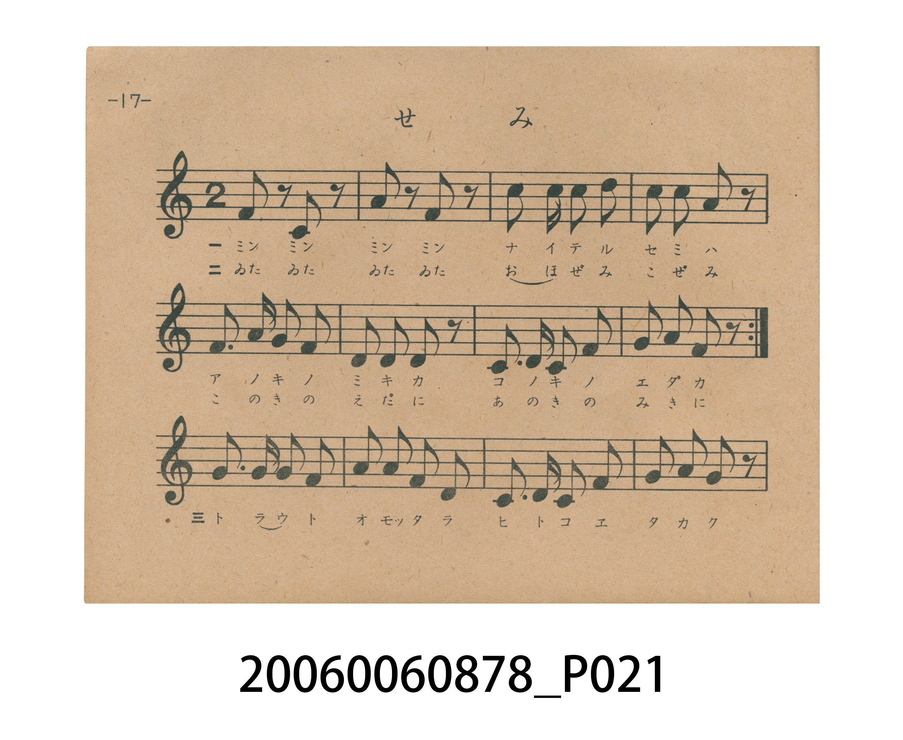
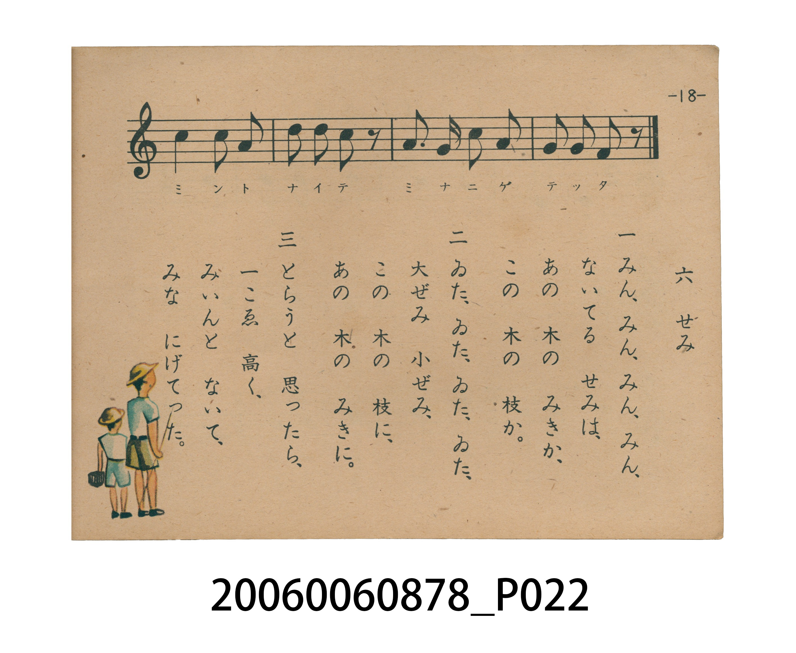

# せみ（蟬）

> Re:Shoka 使用 AI 辨識樂譜，可能會有錯誤。歡迎回報。

<audio controls src="semi.mp3"></audio>

- 日治時期國民學校唱歌（うたのほん 下・第六課）
- 國立臺灣歷史博物館典藏

## 說明

【曲目說明】
・出處：臺灣總督府編《うたのほん 下》（國民學校初等科第二學年用），第六課〈せみ〉（蟬），原書第 17–18 頁。
・調性與拍號：ヘ調（F 大調，原書五線譜省略調號，實際音高終止於 F 音），2/4 拍，速度 != 104。
・背景與曲風：曲式結構極富巧思——前 8 小節（原書第 17 頁第 1–2 行）末尾設有反覆記號，由第一節（尋找蟬鳴在哪棵樹幹或樹枝）與第二節（發現大蟬小蟬停在樹枝與樹幹上）反覆演唱；後 8 小節（第 17 頁第 3 行至第 18 頁第 1 行）則專門供第三節演唱，以高音 `5 - 5 3 | 6 6 5 0` 生動模仿剛要伸手捕捉時，群蟬高鳴一聲「みいん」瞬間飛逃的童趣畫面。
・版本說明：本檔案為原書單聲部五線譜旋律之忠實數位化版本。

・編曲說明（鋼琴伴奏版）：
1. 前奏 (Intro, 4 小節)：擷取主旋律核心樂句作為導奏，建立調性與拍感。
2. 主歌伴奏 (Semi)：右手 (PianoRH) 演奏原書歌唱主旋律；左手 (PianoLH)
依國民學校低學年教材純樸明朗之風格配以和聲伴奏。

## 跨冊／重複收錄參照

> 同名異曲（臺灣總督府 1934 年《公學校唱歌》第三學年〈せみ〉與 1943 年《うたのほん》下卷〈せみ〉為不同詞曲版本）

- **[同名異曲]** 《公學校唱歌》第三學年（昭和10年／1935）：[**〈せみ（蟬）〉**](../../../kogakko_shoka/grade_3/6_semi/index.md)（`C` / `4/4` — [原始 TMD](../../../kogakko_shoka/grade_3/6_semi/semi.tmd)）
- 總表：[跨冊重複與同名歌曲總索引](../../../duplicate_songs.md)

## 歌詞

```text
一　みん、みん、みん、みん、
ないてる　せみは、
あの　木の　みきか、
この　木の　枝か。

二　ゐた、ゐた、ゐた、ゐた、
大ぜみ　小ぜみ、
この　木の　枝に、
あの　木の　みきに。

三　とらうと　思ったら、
一こゑ　高く、
みいんと　ないて、
みな　にげてった。
```

## ABC

```abc
X:1
T:せみ（蟬）
M:2/4
L:1/16
Q:1/4=104
K:F
V:V1 name="Piano" snm="Pia"
[V:V1]
F2 z2 C2 z2 | G2 z2 F2 z2 | d2 d2 d2 c2 | c2 c2 A2 z2 |
F3 G A2 F2 | G2 G2 F2 z2 | D3 F D2 F2 | G2 A2 F2 z2 |
A3 A G2 A2 | c2 c2 A2 F2 | D3 D D2 F2 | G2 G2 G2 z2 |
c4 c2 A2 | d2 d2 c2 z2 | A3 G c2 A2 | G2 G2 F2 z2 |
```

## TMD 檔案連結

- [主旋律 TMD 檔案](semi.tmd) [[在 TMD Studio 編輯](https://tmdlang.github.io/Tmd-TS/#tmd=s7IKdvYPcrWy4tLSUnjcOPtx4_73ezpezF_zfk-ngpYWl6KtgqGBCZe9rYIbl42RvokdV52C0rPpS59t2v1sZtOzOfOfzul-tmHi07U7ni1Y-HTKxmdre4D6Hze2PW6c_7hx3ePG3Y-bJis82dH9uHn38zVrnraufbFqE9BsJZA5QL3PV3e_aN_1vHHxs7Xbn_Zveto763nnypdLVjxt3fFier8SF5e-loIttQCXgoLC44YJz2Zvej573YtVq57N6HvcMBEs2rz7afuuFzOnvt8zC-Ke5zv2Pp-7-OmuOc-3r3jc0IXNRw3dQK-i-L9j7vO1nc-XTwT69MmuHqDg051bnk9ZAfTv-z09cO8_bgAGECikHzcAxaGBDVTwtG_-s9k7gMoUDM0fNUw2tFB4uaDxcUMT1IEvVu1_1rD8RUf7s-7eFzPnA136uHkGUBBohJvC0yXLwUyoIU92TXm-fdaLtXOez2l8PnUpUAqso-fp-mUvZ81-OX_zy9Uznm9terZ20bNpexTcFIAiEDcAo1gBaD6Q9bJh_tNdyxQgCQDJFc09z2auB7li9qaXi4BemwVkPN3T_3zrhGfLu58t3fp0fc_T7cufNcx91DAFiJ529ipYKDzd0P98fQMouJD8CPIemAX0rJHCi4XAlNP5bM7qpxv2vVix9tmczqf9vS-Wtb1YMQPi9udTNoLCdUcD1KQN3c869wED7-XmLU_nrHg6edWzxVufrdj5dOfOZx3TgIxn8-YCDQS6FBIbEF3PZ-553r8PFFrz1wAdBSIb5wC1Q9SDvAU24cmOLqBeiAOe7ZkCTNjv98x-uq8H2SuonjAGeeBF-2awKDjmwCyot552tj_d0PFyWsOTfbPBnugEmgEzuOfJ7qXA-ADGgUKCqYKuginQsBoFMyA0VTBIUHg-Zf7T7qnPVix8snv_087ZL5Y1Ptmz41ln97Peqc96O4G5EBQ2-5aAQgJoyOYtwBB60QhMZD2gFNbYAkytjxt6n89b83La5JeLZ79saH4-q-X56qUvti1-PnX1y7mLEHH7vLPj2Zw1kIwBitg5a56tmvJsYcfzpl2QeHs6bR3Q6JfNK-Dp69n07qf7up_s7H66fwEwcT2buuPJ3t6nPdMgRoGMhmY6iAHA4uHFynlPW1c8m9YODOwnO9aCGKvmvVi7HpgT4YEKT_1AkWd9zc_6-4EOUQgwMAIlFSBlBE6snWCzgd593NAA8ivIo414GGCXNK4ChUnjssdNwAwM1AbOh41A26HSTaA83tDwbM4KCAMs3fu4EagaqmIymgpgugFLg0MRlJ_B3gGG39Mpy4Ga0Min_atfTJwOjAJQ0mudBIy7ZzPWAxPgy6bFkPQLlIKnwacTF4FyYlMLVE3DTGQ1QIthaoD5Axoau3pAjm6aACqtgH7HzQCpBuaDx41zwCVRAzBdw9j4PLqaYEgBVWAEBTCnPu3Y8GRXG1A3QTaonAJnUGAKgeRRkMiGjbhCACGLLQyBrkEklU6wO1c8buoEF-jAkr0BWFI9blwMChOgIMRvoCQF9H3TRKA0ME89buyHexqWo8BaEYkJSXoVWGL148ZJIAmIyVgCZO3iZ82b4Xn5ad_uZ12TQc6e2fS0YSYoR3cueNowEWg7KMNN3Q7K17va4FkbmJAgxSswa4O837riZfNeSO5-sRUSnmBfA22lvNqEAgUtfS6u4NTcTKuAzMS8fIcagxqFapANCjYWWnZgBrCyBjrRChQQCqBaEkbXYBVZBcQtQLwMKNINFpkNkW9cD7ILZuCuHqCBTROAwvPhNFAxpkgjsJbeDaTmgE1RAAuBbITwoSbWAMtkAwXTeCBRo2AEJEFcSGkLKm9rgBhU_gLFwEkGyUtNQLwOiHvBNNRLYF43kmWoKjqAeAFYBbqH8CheDTUOt4WrEb7RMFTQ1VUw0lTV0NXVBDrcEOwtI6i3NMziQdKGUGkgDyIPUofqxU6Qm1YAgxOUM8BMcIgCBYD5fDE0qDvBgpsgKsE5BCwAlAL6EJhNkJxlDLLXGGovyEJYyIIcAHWWWTy6u0AQi7tA_gZlO7i7EEkHElQgBSCx1UA8CSwCynpgpykgHIVRucIdCgs_iCw8_Lhqubh07RRAiR5EK3MBAA)]
- [鋼琴伴奏 TMD 檔案](semi_piano.tmd) [[在 TMD Studio 編輯](https://tmdlang.github.io/Tmd-TS/#tmd=s7IKdvYPcrWy4tLSUnjcOPtx4_73ezpezF_zfk8nkPGye8_zCVue7NnydGn_884OoKCClhaXoq2CoYEJl72tghuXjZG-iR1XnYLSs-lLn23a_Wxm07M585_O6X62YeLTtTueLVj4dMrGZ2t7gGY9bmx73Dj_ceO6x427HzdNVniyo_tx8-7na9Y8bV37YtUmoNlKIHOAep-v7n7Rvut54-Jna7c_7d_0tHfW886VL5eseNq648X0fiUuLn0tBVtqAS4FBYXHDROezd70fPa6F6tWPZvR97hhIli0effT9l0vZk59v2cWxD3Pd-x9Pnfx011znm9f8bihC5uPGrqBXkXxf8fc52s7ny-fCPTpk109QMGnO7c8n7ICHMA9cO8_bgAGECj4HzeAAh4WAz1P--Y_m70DqEzB0PxRw2RDC4WXCxofNzRBHfhi1f5nDctfdLQ_6-59MXM-0KWPm2cABYFGuCk8XbIczIQa8mTXlOfbZ71YO-f5nMbnU5cCpcA6ep6uX_Zy1uyX8ze_XD3j-damZ2sXPZu2R8FNASgCcQMwihWA5gNZLxvmP921TAGSAJBc0dzzbOZ6kCtmb3q5COi1WUDG0z39z7dOeLa8-9nSrU_X9zzdvvxZw9xHDVOA6Glnr4KFwtMN_c_XN4CCC8mPIO-BWUDPGim8WAhMOZ3P5qx-umHfixVrn83pfNrf-2JZ24sVMyBufz5lIyhcdzRATdrQ_axzHzDwXm7e8nTOiqeTVz1bvPXZip1Pd-581jENyHg2by7QQKBLIbEB0fV85p7n_ftAoTV_DdBRILJxDlA7RD3IW2ATnuzoAuqFOODZninAhP1-z-yn-3qQvYLqCWOQB160bwaLgmMOzIJ662ln-9MNHS-nNTzZNxvsiU6gGTCDe57sXgqMD2AcKCSYKugqmAINq1EwA0JTBYMEhedT5j_tnvpsxcInu_c_7Zz9Ylnjkz07nnV2P-ud-qy3E5gLQWGzbwkoJICGbN4CDKEXjcBE1gNKYY0twNT6uKH3-bw1L6dNfrl49suG5uezWp6vXvpi2-LnU1e_nLsIEbfApA6MTEjGwFoiAGMbpFRBwVBPARixQHEFDc-8kqJ8HQUTaMBoglLEZGBenvZkx-5n07uf7ut-tmDH0_3Nz1Y0Pe1f-mTvnOdNu55u6APqBaXH3btAJQBSyn7WMh_qIAUFIz1gPtsNLFIgblDQCE7NzQRZ8LR_MzAAFDQCMhPz8oM8NBVAQbm0H5K4gOqBwQq3HRRx25chlPt4aEJMB4In--Yi598ne_sgefbZ1JnP5k54vmXKsxU7gGHxbM70Jzu7gan92YI9L1t7gdH1dFIPMIwhzgI5F1qywB3wYuW8p60rnk1rB3rqyY61IMaqeS_WrgcWN_CUA8_iQJFnfc3P-vufrZqiEGBgBMoPQMoIHOCdYLOBcfq4oQEUoaDYbMTDALukcRUo4huXPW4CllJAbeDCphFoO1S6CVSQNTQ8m7MCwgBL9z5uBKqGqpiMpgKYOcDS4JgBFVpg74CiYspyoCY08mn_6hcTpwPTGSh_tU4CRvSzGeuBuexl02JIJgVKwTPa04mLQMVNUwtUTcNMZDVAi2FqgIUANDR29YAc3TQBVCQD_Y6bAVINzOyPG-eAi9sGYBqFsfF5dDXBkAKqwAgKYHH0tGPDk11tQN0E2aDEDy6FgCkEUhCBRDZsxBUCCFlsYQh0DSKpdILdueJxUye41gJWXw3A4vhx42JQmAAFIX4DJSmg75smAqWBBcfjRmBChnoaVmyAtSISE5L0KrDE6seNk0ASEJOxBMjaxc-aN8MLrKd9u591TQY5e2bT04aZoGKrc8HTholA24GZ6eXU7aDCa1cbvPwCJiRIHQIsv0Deb13xsnkvpAh7sRUSnmBfA22lvG0ABQpa-lxc4CLNClq4ONQY1ChUg4sMGwstOzCjBliwGyiYxgOJGgUjIAni1ihomMUr6OoqGGqqaujqaioAeYZgeWOIPFctitE-KEabIIyOB5lcAyKAzBoFk3iFaJNYhADIGFBBiM-BwFYTMBitQJGlAGquwOgarCKrgLgFiJcBRbrBIrMh8o3rQeEBM3BXD9DApglA4flwGqgYU6QR2FzaDaTmgE0B-QmY0uB8qIk4whBU7YEqPqB3wRUhKNzQvNQExOuAuBdMQ70E5nUjWYaqogOIF4BVoHsIj-LVUONwW7ga4RsNQ1DcG0HjHhTlIG8ZEZk0EF7sBLlpBTA4QbkXzASHKFAAWBYthgZ1J1hwE0QlOBeDBYBSQB8CszKSs4xB9hpD7QVZCAtZkAOgzjKLR3cXCGJxF8jfoKIB7i5E0oEEFUgBSGw1EE8Ci4CKB7DTFBCOwmjlwB0KCz-ILDz8UNM8yTkHyIs2BDIQ6sBckEIIA6QSJgLOY7gUAgMo2iwXJmSKxUy4UciaYflW104BXAIoABkg_4BoZS4A)]

## 分析

```text
================================================================================
📊 TMD Song Profile: [ せみ（蟬） ]
================================================================================
⏱  Duration:       0:18 (18.5s), 16 measures total
🎼 Key & Tempo:    首調基準 F, != 104.0 BPM, <2/4>
   - 分析範圍：      由實際發聲的音符與和弦推測調性；播放脈絡另行呈現
🎤 人聲音域:    C4 (MIDI 60) – D5 (MIDI 74) [跨度: 14 個半音 / 1.2 個八度, 難度: moderate]
   - 最低音:  C4 in [Semi #1 @ m.1, 0:00]
   - 最高音: D5 in [Semi #1 @ m.3, 0:02]
   - 適合: soprano, mezzo-soprano, contralto, tenor, baritone, bass
🏛  結構:      Semi (18.5s)
⚡ 編曲密度:        Peak 1 軌道同時演奏
🗝  調性診斷：       F 大調（純淨自然大調，未偵測到可信轉調）
   - 風格氣質:    純淨自然大調（陽光明朗、易唱易記，無明顯調外色彩）
   - 轉調歷程:    全曲維持單一推測調性（未偵測到可信轉調）
   - 核心骨幹音:  C, F, G, D, A
   - 調性數值:    F 大調 [相關度: 0.76, 穩定度: Moderate, 自然音純度: 100.0%]
   - 候選調性 (K-S): F 大調 (0.76), C 大調 (0.73), D 小調 (0.69)
   - 五度圈歷程:   -1
   - 各段落調性細節:
     • [Semi #1]: F 大調 (r: 0.76, 自然音純度: 100.0%)

  [ 五度圈游移軌跡 ]
               C  
        [F ]*          G  
      Bb               D  
      Eb               A  
         Ab           E  
            Db       B  
               F# 
     (* = active key center)

  [ 十二半音累積音高分佈 ]
     C  : ████████████████████████  20.4%
     C# :                            0.0%
     D  : ███████████████████████   19.4%
     D# :                            0.0%
     E  :                            0.0%
     F  : ████████████████████████  20.4%
     F# :                            0.0%
     G  : ████████████████████████  20.4%
     G# :                            0.0%
     A  : ███████████████████████   19.4%
     A# :                            0.0%
     B  :                            0.0%
--------------------------------------------------------------------------------
Assignment 軌道音域：
  - Piano         : C4 – D5 (14 個半音 / 1.2 個八度, 53 個音符)
================================================================================
```


## 原書掃描頁






