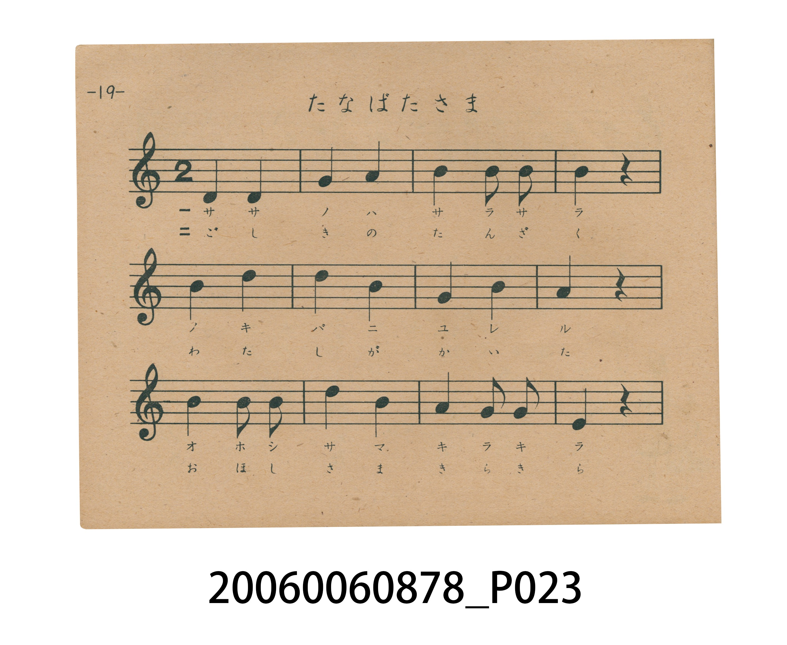
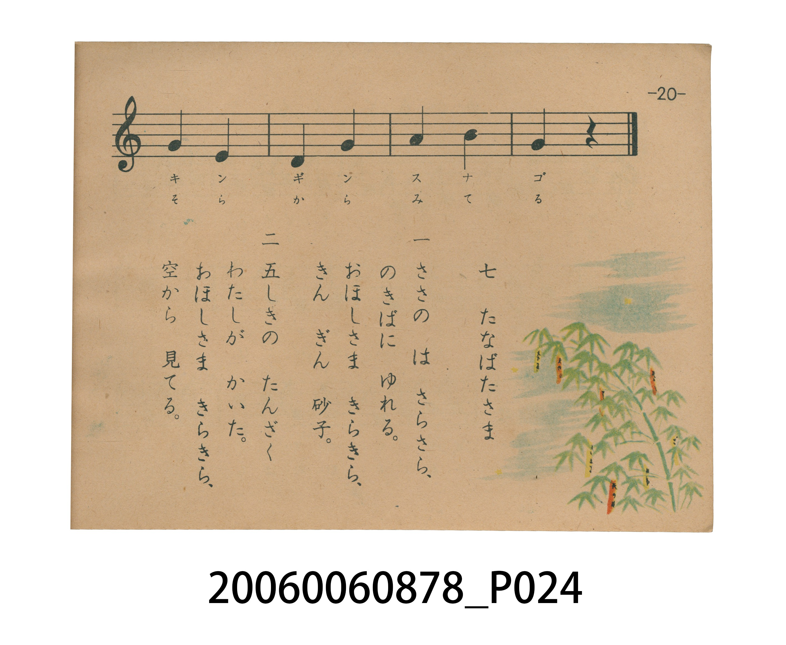

# たなばたさま（七夕樣）

> Re:Shōka 使用 AI 協助辨識與重建樂譜，可能會有錯誤。歡迎[回報](https://github.com/TMDLang/reshoka/issues)。

- **鋼琴伴奏版**：<br><audio controls src="tanabatasama.mp3"></audio>
- **NEUTRINO 歌聲合成版**：<br><audio controls src="tanabatasama_neutrino.mp3"></audio>

- 日治時期國民學校唱歌（うたのほん 下・第七課）
- 國立臺灣歷史博物館典藏

## 說明


- 出處：臺灣總督府編《うたのほん 下》（國民學校初等科第二學年用），第七課〈たなばたさま〉（七夕樣），原書第 19–20 頁。
- 調性與拍號：ト調（G 大調五聲音階，原書五線譜省略調號，實際音高終止於 G 音），2/4 拍，速度 != 96。
- 背景與曲風：權藤花代、林柳波作詞，下總皖一作曲，為日本至今傳唱最廣的經典七夕童謠。旋律由低音 ソ（D4）輕柔上行，描繪竹葉在屋簷下沙沙搖曳、五色短冊隨風飄動，以及夜空中如金銀砂子般閃爍的星辰。
- 版本說明：本檔案為原書單聲部五線譜旋律之忠實數位化版本。

### 編曲說明（鋼琴伴奏版）：

1. 前奏 (Intro, 4 小節)：擷取主旋律核心樂句作為導奏，建立調性與拍感。
2. 主歌伴奏 (Tanabatasama)：右手 (PianoRH) 演奏原書歌唱主旋律；左手 (PianoLH)
依國民學校低學年教材純樸明朗之風格配以和聲伴奏。


## 歌詞

```text
一　ささの　は　さらさら、
のきばに　ゆれる。
おほしさま　きらきら、
きん　ぎん　砂子。

二　五しきの　たんざく
わたしが　かいた。
おほしさま　きらきら、
空から　見てる。
```

## ABC

<div class="abc-score" data-abc-src="tanabatasama.abc" aria-label="五線譜載入中"></div>

[下載 ABC 原始檔](tanabatasama.abc)

## TMD 檔案連結

- [主旋律 TMD 檔案](tanabatasama.tmd) [[在 TMD Studio 編輯](https://tmdlang.github.io/Tmd-TS/#tmd=s7IKdvYPcrWy4qpTUCpJTLdSyC_KTM_MsypJzCzOyI8H4vLE-NzEzLycxLwUJbiq5PycnNTkksz8PKvSksS8_Iz8PIRkWX5OaW6qlRFCpDi_tCg5Fa40Pj0VXS6-IDE91SrAwMhYF0iYIKQLivLLUvMS84DagW4qTwRqBgoU5eUXAU3JSy1KzEGoTS3LTEkFqSwoysxNLKqMT8lPBrokrwTJbalFxSBXl-UnI-vMLyrJyE8vSizIqLTKyCwuAYYCUD4-OzEvEaGoJCMV6K201OKSzDKQZi0thceN8x83rnrcuAHMmPq4cd_7PR1PdjQ_XTL12YrF7_d0KmhpcSnaKliacdnbKrhz2Rjpm9iBDHw2femzTbufzWx6Nmf-0zndzzZMfLp2x7MFC59O2fhsbQ_QkMeNbWAz1z1u3P24abLCkx3dj5t3P1-zBmj6i1WbgEaDHQbU-3x194v2Xc8bFz9bu_1p_6anvbOed658uWTF09YdL6b3K3Fx6Wsp2FILcCkoKDxumPBs9qbns9e9WLXq2Yy-xw0TwaLNu5-273oxc-r7PbMg7nm-Y-_zuYuf7przfPuKxw1d2HzU0A30Kor_O-Y-X9v5fPlEkE939QAFn-7c8nzKCqB_3-_pgXv_cQMwgNCD_nEDUA1K6AO1PO2b_2z2DqBGBUPLRw2TjQwUXi5ofNzQBHXyi1X7nzUsf9HR_qy798XM-UC3P27uAAoCDXJXeLpkOZD5ZNeUF42bXs7f_HJWH9xAoODz7bNerJ3zfE7j86lLgcrAunuerl_2ctZskOLVM55vbXq2dtGzaXsU3BWAIhD3ABOAAtAuIOtlw_ynu5YpgFMHkoOae57NXA9y0OxNLxcB_T3r2ZquF9OXvOja-GT34scNjc_mTX82f_OzzYue7J3zYuU8oEHAgAQF9axpT3Y0AAWBGkFB1bQLlMbmrHnRvvnJ7q6nTZtBSWtOw9Pdi5_Panm-bTIweUCC6vnqpS_WLAC64Nn07qf7up9P2fhkbx_QvQqPm_YCg8HFBOjwF3umPps_5cmOrhcLgYmz51l___Odq56v3vliYufTOSuebux-vmE70BnPNs0EoQnTns3eDHQqKOQ6Nz2fv_ZpW9fLWSuA3nm5uOVpNzCF9DzZvfRpf9fTJXOer9z1ZMfap8uaXrZPfNnV8HxB09O1E150rHk5rfl5Ry_Qqc9mzH-xbwMigJ53doB8BU56oNCZs-bZqinPFnYAPQyJmqfT1oHiq3kFPI4gHnuys_vp_gXACHo2dceTvb1Pe6ZBjAIZDU3WEAOAGRAYsE9bVzyb1g6MCKDzQIxV816sXQ9M68AgQUtNQJFnfc3AMAE6RAFUhAFlQIUYOMI7wWYDY-ZxQwM4mQLROjAbaBhYpKkTSjY0gp0ByiC94HS9GqSiqe1xU8_jJmBegYRAIzAj7X7cOB2W5oFm9ILNAJMwM4CcyWC5PggDEq5QM4AOhngHGH6QSIREHDDxvJwPTPo9KHEKjc0mYEQA0dOGiUDPAGMHQoIUb9j4tLn_2aRJLyYAE2ELcjwCdcFDYFcP0BnAKAE7Heg_SCDMBzmvcdrjxn6wu5v6wbkZqAKk-nFj9-PGFpAICX4HJiiQPhC_4cUyoAHLEIGH7HGgU14u7H_auhaURGe1vFi58vm6bkhaBaXwGeufdUx8sWzVs87up-tXAxXgCYFnaxc_3Tfv6ZKVkMT8fE73i4nTn05cBPU-0GLKC14oUNDS5-IKAVZLSYklicWJuYlWAZnAStWhxqCmGmSRgo2Flh2YUaNgGq-gCyFqFAyBpBGYZQwkjYEQwjIAiYHV-xjWAMN_K5APIYG85j4Qr7kfwoPINa8Es0CyK1H1GwHFGqeA1DROh-ho7AXz1kF588FmTwaypoH5IHMh-qEOBjnIFKwYRIJ4EIdDWCDnozkX4sCmtVDnTgA7sBvKWwbmrYHyVmM6tgnkAIizQM4BORqY7qA8kCnAxIfkdBSnQhwICkUzuKNBDjQEQqAYKNDRg3YV2D2zgaztSME5Dxq4ID9AAnctzsDtArtpN9itIP5UMH8fcmA3dYJZIBM70d0MCkqwy6BJA8SHuBoR1OiOhjhrM9SRoJhE8HaCeSBHgXhbsDh4LtRJSEEK5-0HOx4USSDdIDmI7louLl07BeQkDjYQKKbMBQA)]
- [鋼琴伴奏 TMD 檔案](tanabatasama_piano.tmd) [[在 TMD Studio 編輯](https://tmdlang.github.io/Tmd-TS/#tmd=s7IKdvYPcrWy4qpTUCpJTLdSSM7PyUlNLsnMz7MqLUnMy8_Iz1OCS5bl55TmploZIUSK80uLklPhSuPTU9Hl4gsS01OtAgyMjHWBhAlCuqAovyw1LzEPqL0kMbM8EagZKFCUl18ENCUvtSgxB6E2tSwzJRWksqAoMzexqDI-JT8Z6JK8EiS3pRYVg1xdkAl0SnxiUVFiXnoqqpL8opKM_PSixIKMSquMzOKS_KLM5MSc-OzEvESEopIMoC6rtNTikswykBO0tBQeN85_3LjqceMGMGPq48Z97_d0PNnR_HTJ1GcrFr_f0wnkvuze83zClid7tjxd2v-8swMoqKClxaVoq2BpxmVvq-DOZWOkb2IHsuXZ9KXPNu1-NrPp2Zz5T-d0P9sw8enaHc8WLHw6ZeOztT1Aox43toEtWve4cffjpskKT3Z0P27e_XzNGqCVL1ZtAhoNdi1Q7_PV3S_adz1vXPxs7fan_Zue9s563rny5ZIVT1t3vJjer8TFpa-lYEstwKWgoPC4YcKz2Zuez173YtWqZzP6HjdMBIs2737avuvFzKnv98yCuOf5jr3P5y5-umvO8-0rHjd0YfNRQzfQqyj-75j7fG3n8-UTQT7d1QMUfLpzy_MpK8Dh2wP3_uMGYAChx8fjBlAcoEZJz9O--c9m7wBqVDC0fNQw2chA4eWCxscNTVAnv1i1_1nD8hcd7c-6e1_MnA90--PmDqAg0CB3hadLlgOZT3ZNedG46eX8zS9n9cENBAo-3z7rxdo5z-c0Pp-6FKgMrLvn6fplL2fNBilePeP51qZnaxc9m7ZHwV0BKAJxDzABKADtArJeNsx_umuZAjh1IDmouefZzPUgB83e9HIR0N-znq3pejF9yYuujU92L37c0Phs3vRn8zc_27zoyd45L1bOAxoEDEhQUM-a9mRHA1AQqBEUVE27QGlszpoX7Zuf7O562rQZlLTmNDzdvfj5rJbn2yYDkwckqJ6vXvpizQKgC55N7366r_v5lI1P9vYB3avwuGkvMBhcTIAOf7Fn6rP5U57s6HqxEJg4e5719z_fuer56p0vJnY-nbPi6cbu5xu2A53xbNNMEJow7dnszUCngkKuc9Pz-WuftnW9nLUC6J2Xi1uedgNTSM-T3Uuf9nc9XTLn-cpdT3asfbqs6WX7xJddDc8XND1dO-FFx5qX05qfd_QCnfpsxvwX-zYgAgiYmIA-hCQ9rFkOGGQgpQoKhnoKTzt7geIKGp55JUX5OgomCk839D9f36AJCtbJwNwCDLLdEG8_W7Dj6f7mZyuanvYvBQYiMPiebugD6gXF6e5doDyGlFKetcyHOkhBwUgPmJJ3AzMtxA0KGiHAkiQpsSSxODE3EWTR0_7Nzzq7FTQCQGVSkIemwrM9U4AKIekIqA8YL3BXvN8z--n2ZQjlPh6aEFuA4Mm-ucg5BRhJkNzxbOrMZ3MnPN8y5dmKHcAweTZn-pOd3cCwfrZgz8vWXlBAT-oBJmCI80DOhuZhuAOAqehp64pn09qBngPGBYixat6LteuBGRsYwGhZByjyrK8ZmACerZqiACrQgTKgIh0c8J1gs4HJ8HFDAzhPAtE6MBtoGFikqRNKNjSCnQEqDXrBmXg1SEVT2-OmnsdNwIIBEt2NwFJj9-PG6bAMDjSjF2wGmISZAeRMBsv1QRiQRAQ1A-hgiHeAUQFJsZBUCozkl_OB-bwHJQFDk24TMNUB0dOGiUDPAJMihAQp3rDxaXP_s0mTXkwA5rgW5EQL1AUPgV09QGcAkz_Y6UD_QQJhPsh5jdMeN_aD3d3UDy66gCpAqh83dj9ubAGJkOB3YO4B6QPxG14sAxqwDBF4yB4HOuXlwv6nrWtB-XFWy4uVK5-v64ZkTFB2nrH-WcfEF8tWARPe0_WrgQrwhMCztYuf7pv3dMlKSM59Pqf7xcTpTycugnofaDHltQwUKGjpc3GBs64VNPM41BjUVINzhI2Jlh2YUaNgqGAWD6RM44GsGgUjBWOwmIFCDVctinYfHNrjFaLNcmPBJgCZhqgskCyIATILOWdjcZEF3EigU3QhBMglukA3gVjGQNIY7DoQywAkBlbvY1gDTAxbgXwICeQ194F4zf0QHkSueSWYBZJdiarfCCjWOAWkpnE6REdjL5i3DsqbDzZ7MpA1DcwHmQvRD3UwyEGmYMUgEsSDOBzCAjkfzbkQBzathTp3AtiB3VDeMjBvDZS3GtOxTSAHQJwFcg7I0cBMAOWBTAHmBCSnozgV4kBQKJrBHQ1yoCE49oEpATNoV4HdMxvI2o4UnPOggQvyAyRw1-IM3C6wm3aD3QriTwXz9yEHdlMnmAUysRPdzaCgBLsMmjRAfIirEUGN7miIszZDHQmKSQRvJ5gHchSItwWLg-dCnYQUpHDefrDjQZEE0g2Sg-jGmsLxZBqU_IHJIKwSnMtMQVkPXa0JlpxoBmKBMyqxGRdaBOjaKYBLAQUgA9mD0T5AhRhiRmAxZS4A)]

## 分析

```text
================================================================================
📊 TMD Song Profile: [ たなばたさま（七夕樣） ]
================================================================================
⏱  Duration:       0:20 (20.0s), 16 measures total
🎼 Key & Tempo:    首調基準 G, != 96.0 BPM, <2/4>
   - 分析範圍：      由實際發聲的音符與和弦推測調性；播放脈絡另行呈現
🎤 人聲音域:    D4 (MIDI 62) – E5 (MIDI 76) [跨度: 14 個半音 / 1.2 個八度, 難度: moderate]
   - 最低音:  D4 in [Tanabatasama #1 @ m.1, 0:00]
   - 最高音: E5 in [Tanabatasama #1 @ m.10, 0:11]
   - 適合: soprano, mezzo-soprano, contralto, tenor, baritone, bass
🏛  結構:      Tanabatasama (20.0s)
⚡ 編曲密度:        Peak 1 軌道同時演奏
🗝  調性診斷：       G 大調（純淨自然大調，未偵測到可信轉調）
   - 風格氣質:    純淨自然大調（陽光明朗、易唱易記，無明顯調外色彩）
   - 轉調歷程:    全曲維持單一推測調性（未偵測到可信轉調）
   - 核心骨幹音:  B, D, G, A, E
   - 調性數值:    G 大調 [相關度: 0.81, 穩定度: Moderate, 自然音純度: 100.0%]
   - 候選調性 (K-S): G 大調 (0.81), B 小調 (0.77), D 大調 (0.70)
   - 五度圈歷程:   +1
   - 各段落調性細節:
     • [Tanabatasama #1]: G 大調 (r: 0.81, 自然音純度: 100.0%)

  [ 五度圈游移軌跡 ]
               C  
         F           [G ]*
      Bb               D  
      Eb               A  
         Ab           E  
            Db       B  
               F# 
     (* = active key center)

  [ 十二半音累積音高分佈 ]
     C  :                            0.0%
     C# :                            0.0%
     D  : █████████████████████     25.0%
     D# :                            0.0%
     E  : █████████                 10.7%
     F  :                            0.0%
     F# :                            0.0%
     G  : ██████████████████        21.4%
     G# :                            0.0%
     A  : ████████████              14.3%
     A# :                            0.0%
     B  : ████████████████████████  28.6%
--------------------------------------------------------------------------------
Assignment 軌道音域：
  - Piano         : D4 – E5 (14 個半音 / 1.2 個八度, 31 個音符)
================================================================================
```


## 原書掃描頁






