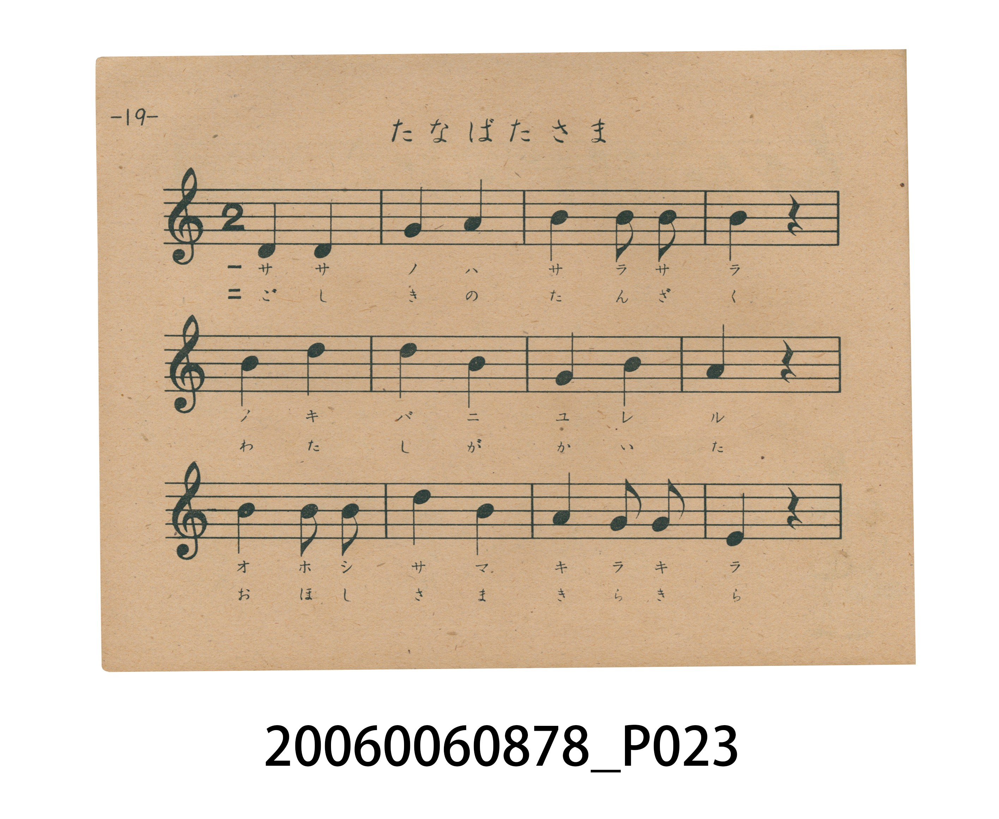
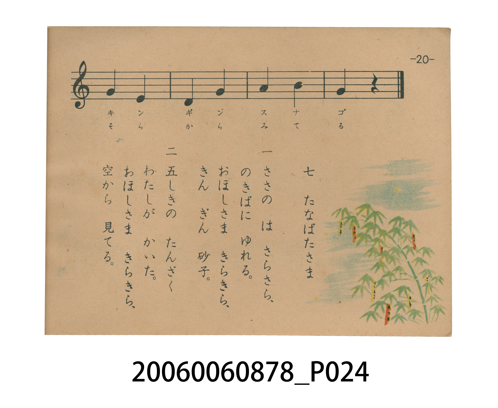

# たなばたさま（七夕樣）

> Re:Shoka 使用 AI 協助辨識與重建樂譜，可能會有錯誤。歡迎回報。

<audio controls src="tanabatasama.mp3"></audio>

- 日治時期國民學校唱歌（うたのほん 下・第七課）
- 國立臺灣歷史博物館典藏

## 說明

【曲目說明】
・出處：臺灣總督府編《うたのほん 下》（國民學校初等科第二學年用），第七課〈たなばたさま〉（七夕樣），原書第 19–20 頁。
・調性與拍號：ト調（G 大調五聲音階，原書五線譜省略調號，實際音高終止於 G 音），2/4 拍，速度 != 96。
・背景與曲風：權藤花代、林柳波作詞，下總皖一作曲，為日本至今傳唱最廣的經典七夕童謠。旋律由低音 ソ（D4）輕柔上行，描繪竹葉在屋簷下沙沙搖曳、五色短冊隨風飄動，以及夜空中如金銀砂子般閃爍的星辰。
・版本說明：本檔案為原書單聲部五線譜旋律之忠實數位化版本。

・編曲說明（鋼琴伴奏版）：
1. 前奏 (Intro, 4 小節)：擷取主旋律核心樂句作為導奏，建立調性與拍感。
2. 主歌伴奏 (Tanabatasama)：右手 (PianoRH) 演奏原書歌唱主旋律；左手 (PianoLH)
依國民學校低學年教材純樸明朗之風格配以和聲伴奏。

## 歌詞

```text
一　ささの　は　さらさら、
のきばに　ゆれる。
おほしさま　きらきら、
きん　ぎん　砂子。

二　五しきの　たんざく
わたしが　かいた。
おほしさま　きらきら、
空から　見てる。
```

## ABC

```abc
X:1
T:たなばたさま（七夕樣）
M:2/4
L:1/16
Q:1/4=96
K:G
V:V1 name="Piano" snm="Pia"
[V:V1]
D4 D4 | G4 A4 | B4 B2 B2 | B4 z4 |
B4 d4 | d4 B4 | G4 B4 | A4 z4 |
d4 B2 B2 | e4 d4 | A4 G2 G2 | E4 z4 |
G4 E4 | D4 G4 | A4 B4 | G4 z4 |
```

## TMD 檔案連結

- [主旋律 TMD 檔案](tanabatasama.tmd) [[在 TMD Studio 編輯](https://tmdlang.github.io/Tmd-TS/#tmd=s7IKdvYPcrWy4tLSUnjcOP9x46rHjRvAjKmPG_e939PxZEfz0yVTn61Y_H5Pp4KWFpeirYKlGZe9rYI7l42RvokdV52C0rPpS59t2v1sZtOzOfOfzul-tmHi07U7ni1Y-HTKxmdre4CGPG5sA5u57nHj7sdNkxWe7Oh-3Lz7-Zo1QNNfrNoENFoJZA5Q7_PV3S_adz1vXPxs7fan_Zue9s563rny5ZIVT1t3vJjer8TFpa-lYEstwKWgoPC4YcKz2Zuez173YtWqZzP6HjdMBIs2737avuvFzKnv98yCuOf5jr3P5y5-umvO8-0rHjd0YfNRQzfQqyj-75j7fG3n8-UTQT7d1QMUfLpzy_MpK4D-fb-nB-79xw3AAEIP-scNQDUooQ_U8rRv_rPZO4AaFQwtHzVMNjJQeLmg8XFDE9TJL1btf9aw_EVH-7Pu3hcz5wPd_ri5AygINMhd4emS5UDmk11TXjRuejl_88tZfXADgYLPt896sXbO8zmNz6cuBSoD6-55un7Zy1mzQYpXz3i-tenZ2kXPpu1RcFcAikDcA0wACkC7gKyXDfOf7lqmAE4dSA5q7nk2cz3IQbM3vVwE9PesZ2u6Xkxf8qJr45Pdix83ND6bN_3Z_M3PNi96snfOi5XzgAYBAxIU1LOmPdnRABQEagQFVdMuUBqbs-ZF--Ynu7ueNm0GJa05DU93L34-q-X5tsnA5AEJquerl75YswDogmfTu5_u634-ZeOTvX1A9yo8btoLDAYXE6DDX-yZ-mz-lCc7ul4sBCbOnmf9_c93rnq-eueLiZ1P56x4urH7-YbtQGc82zQThCZMezZ7M9CpoJDr3PR8_tqnbV0vZ60Aeufl4pan3cAU0vNk99Kn_V1Pl8x5vnLXkx1rny5retk-8WVXw_MFTU_XTnjRsebltObnHb1Apz6bMf_Fvg2IAHre2QHyFTjpgUJnzppnq6Y8W9gB9DAkap5OWweKr-YV8DiCeOzJzu6n-xcAI-jZ1B1P9vY-7ZkGMQpkNDRZQwwAZkBgwD5tXfFsWjswIoDOAzFWzXuxdj0wrQODBC01AUWe9TUDwwToEIUAAyNjoAyQAoUbEIHNBsbM44YGcDIFonVgNtAwsEhTJ5RsaAQ7A5RBesHpejVIRVPb46aex03AvAIJgUZgRtr9uHE6LM0DzegFmwEmYWYAOZPBcn0QBiRcoWYAHQzxDjD8IJEIiThg4nk5H5j0e1DiFBqbTcCIAKKnDROBngHGDoQEKd6w8Wlz_7NJk15MACbCFuR4BOqCh8CuHqAzgFECdjrQf5BAmA9yXuO0x439YHc39YNzM1AFSPXjxu7HjS0gERL8DkxQIH0gfsOLZUADliECD9njQKe8XNj_tHUtKInOanmxcuXzdd2QtApK4TPWP-uY-GLZqmed3U_XrwYqwBMCz9Yufrpv3tMlKyGJ-fmc7hcTpz-duAjqfaDFlBe8UKCgpc_FFZKYl5iUWJJYnJibaBWQmZiX71BjUKNQDbJJwcZCyw7MABb7QBdaAQN1KwQ39wFxv0INlLcSTgNFQHJNa4H0BCDuBossA-I1QLwaZCfMwF09QAMbpwDxdFAqA6VWkOLG-UDtk4H0NCCGWNEPEQWr6wGr6QbiFrAo1MAaBdN4BV0IUaNgCCSNwCxjIGkMhBCWAUgMqh7ENwWrAZEgHkQfhAXSDVGNFgCrgN6YDaS3Q708D-xCkHdBgQChYSKgcm8dmAaJ7ASyuoD0FsxAAAo37oZ6cCoQ7wN7EhgkTZ1wGiQyFyoC9D5UZD8QA0O3qRspIOBeNoN7EeQdQyAEioFCCDkcQH4GC0KDEMSHaECECUR9LReXrp0CcooB8ZW5uAA)]
- [鋼琴伴奏 TMD 檔案](tanabatasama_piano.tmd) [[在 TMD Studio 編輯](https://tmdlang.github.io/Tmd-TS/#tmd=s7IKdvYPcrWy4tLSUnjcOP9x46rHjRvAjKmPG_e939PxZEfz0yVTn61Y_H5PJ5D7snvP8wlbnuzZ8nRp__PODqCggpYWl6KtgqUZl72tgjuXjZG-iR1XnYLSs-lLn23a_Wxm07M585_O6X62YeLTtTueLVj4dMrGZ2t7gEY9bmwDW7TucePux02TFZ7s6H7cvPv5mjVAK1-s2gQ0WglkDlDv89XdL9p3PW9c_Gzt9qf9m572znreufLlkhVPW3e8mN6vxMWlr6VgSy3ApaCg8LhhwrPZm57PXvdi1apnM_oeN0wEizbvftq-68XMqe_3zIK45_mOvc_nLn66a87z7SseN3Rh81FDN9CrKP7vmPt8befz5RNBPt3VAxR8unPL8ykrwOHbA_f-4wZgAKHHx-MGUBygRknP0775z2bvAGpUMLR81DDZyEDh5YLGxw1NUCe_WLX_WcPyFx3tz7p7X8ycD3T74-YOoCDQIHeFp0uWA5lPdk150bjp5fzNL2f1wQ0ECj7fPuvF2jnP5zQ-n7oUqAysu-fp-mUvZ80GKV494_nWpmdrFz2btkfBXQEoAnEPMAEoAO0Csl42zH-6a5kCOHUgOai559nM9SAHzd70chHQ37Oerel6MX3Ji66NT3YvftzQ-Gze9GfzNz_bvOjJ3jkvVs4DGgQMSFBQz5r2ZEcDUBCoERRUTbtAaWzOmhftm5_s7nratBmUtOY0PN29-PmslufbJgOTBySonq9e-mLNAqALnk3vfrqv-_mUjU_29gHdq_C4aS8wGFxMgA5_sWfqs_lTnuzoerEQmDh7nvX3P9-56vnqnS8mdj6ds-Lpxu7nG7YDnfFs00wQmjDt2ezNQKeCQq5z0_P5a5-2db2ctQLonZeLW552A1NIz5PdS5_2dz1dMuf5yl1Pdqx9uqzpZfvEl10Nzxc0PV074UXHmpfTmp939AKd-mzG_Bf7NiACCJiYgD6EJD2sWQ4YZCClCgqGegpPO3uB4goannklRfk6CiYKTzf0P1_foAkK1snA3AIMst0Qbz9bsOPp_uZnK5qe9i8FBiIw-J5u6APqBcXp7l2gPIaUUp61zIc6SEHBSA-YkncDMy3EDQoaIYl5iUmJJYnFibmJIIue9m9-1tmtoBGQmZiXH-ShqfBszxSgQkg6AuoDxgvcFe_3zH66fRlCuY-HJsQWIHiyby5yTgFGEiR3PJs689ncCc-3THm2YgcwTJ7Nmf5kZzcwrJ8t2POytRcU0JN6gAkY4jyQs6F5GO4AYCp62rri2bR2oOeAcQFirJr3Yu16YMYGBjBa1gGKPOtrBiaAZ6umKAQYGBkDZYAUKJEAEdhsYDJ83NAAzpNAtA7MBhoGFmnqhJINjWBngEqDXnAmXg1S0dT2uKnncROwYIBEdyOw1Nj9uHE6LIMDzegFmwEmYWYAOZPBcn0QBiQRQc0AOhjiHWBUQFIsJJUCI_nlfGA-70FJwNCk2wRMdUD0tGEi0DPApAghQYo3bHza3P9s0qQXE4A5rgU50QJ1wUNgVw_QGcDkD3Y60H-QQJgPcl7jtMeN_WB3N_WDiy6gCpDqx43djxtbQCIk-B2Ye0D6QPyGF8uABixDBB6yx4FOebmw_2nrWlB-nNXyYuXK5-u6IRkTlJ1nrH_WMfHFslXAhPd0_WqgAjwh8Gzt4qf75j1dshKSc5_P6X4xcfrTiYug3gdaTHktAwUKWvpcXOCsawXNPA41BjUK1eAsYWOhZQdm1CgYKugqmMUDiRoFUxAF4tcoGAFJYzALxDcAsbhqUczzQTHPBGFevEK0WW4s2Dgg0xCVBZIFMUCGIed1fG4EVsHAALQCxvlWCG7uA-J-oGkQ3ko4DRQByTWtBdITgLgbLLIMiNcA8WpQkMAM3NUDNLBxChBPB2UCUGYCKW6cD9Q-GUhPA2KIFf0QUbC6HrCabiBuAYtCDYQGHZiAhBgo_GrAIWgMhBAWJBQh6kF8U0igo4Q0hAXSDVGNFgCrgN6YDaS3Q708D-xCkHdBgQChYSKgOmgdmAaJ7ASyuoD0FsxAAAo37oZ6cCoQ7wN7EhgkTZ1wGiQyFyoC9D5UZD8QA0O3qRspIOBeNoN7EeQdQyAEioFCCDkcSEp9mAkGXyJESW-YDMIqwanWFJSU0dWaYEnZZiAWOOETmxEMIL7StVMAZysFIAPZh9j4ylxcAA)]

## 分析

```text
================================================================================
📊 TMD Song Profile: [ たなばたさま（七夕樣） ]
================================================================================
⏱  Duration:       0:20 (20.0s), 16 measures total
🎼 Key & Tempo:    首調基準 G, != 96.0 BPM, <2/4>
   - 分析範圍：      由實際發聲的音符與和弦推測調性；播放脈絡另行呈現
🎤 人聲音域:    D4 (MIDI 62) – E5 (MIDI 76) [跨度: 14 個半音 / 1.2 個八度, 難度: moderate]
   - 最低音:  D4 in [Tanabatasama #1 @ m.1, 0:00]
   - 最高音: E5 in [Tanabatasama #1 @ m.10, 0:11]
   - 適合: soprano, mezzo-soprano, contralto, tenor, baritone, bass
🏛  結構:      Tanabatasama (20.0s)
⚡ 編曲密度:        Peak 1 軌道同時演奏
🗝  調性診斷：       G 大調（純淨自然大調，未偵測到可信轉調）
   - 風格氣質:    純淨自然大調（陽光明朗、易唱易記，無明顯調外色彩）
   - 轉調歷程:    全曲維持單一推測調性（未偵測到可信轉調）
   - 核心骨幹音:  B, D, G, A, E
   - 調性數值:    G 大調 [相關度: 0.81, 穩定度: Moderate, 自然音純度: 100.0%]
   - 候選調性 (K-S): G 大調 (0.81), B 小調 (0.77), D 大調 (0.70)
   - 五度圈歷程:   +1
   - 各段落調性細節:
     • [Tanabatasama #1]: G 大調 (r: 0.81, 自然音純度: 100.0%)

  [ 五度圈游移軌跡 ]
               C  
         F           [G ]*
      Bb               D  
      Eb               A  
         Ab           E  
            Db       B  
               F# 
     (* = active key center)

  [ 十二半音累積音高分佈 ]
     C  :                            0.0%
     C# :                            0.0%
     D  : █████████████████████     25.0%
     D# :                            0.0%
     E  : █████████                 10.7%
     F  :                            0.0%
     F# :                            0.0%
     G  : ██████████████████        21.4%
     G# :                            0.0%
     A  : ████████████              14.3%
     A# :                            0.0%
     B  : ████████████████████████  28.6%
--------------------------------------------------------------------------------
Assignment 軌道音域：
  - Piano         : D4 – E5 (14 個半音 / 1.2 個八度, 31 個音符)
================================================================================
```


## 原書掃描頁






