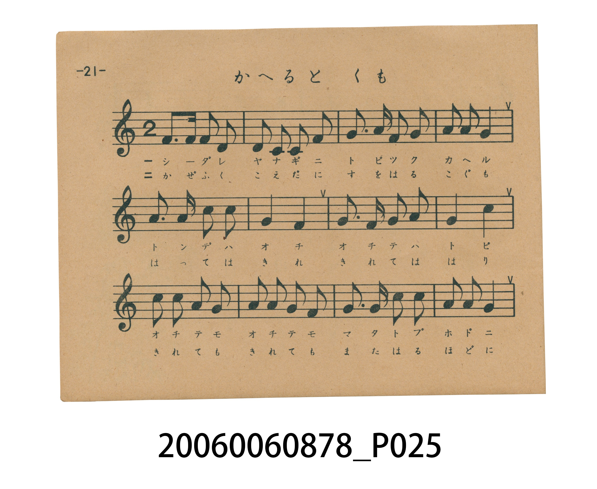
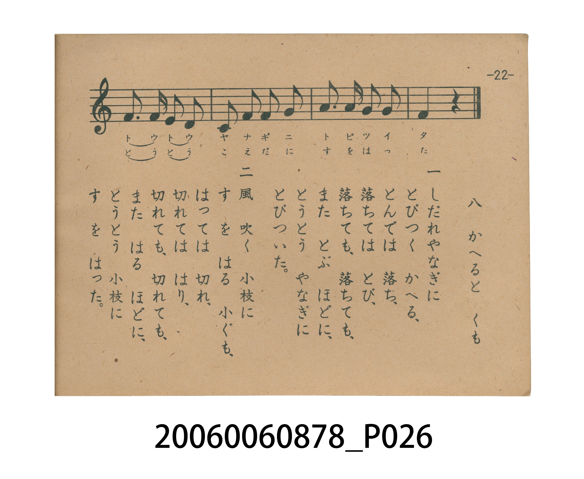

# かへると くも（青蛙與蜘蛛）

> Re:Shoka 使用 AI 辨識樂譜，可能會有錯誤。歡迎回報。

<audio controls src="kaeru_to_kumo.mp3"></audio>

- 日治時期國民學校唱歌（うたのほん 下・第八課）
- 國立臺灣歷史博物館典藏

## 說明

【曲目說明】
・出處：臺灣總督府編《うたのほん 下》（國民學校初等科第二學年用），第八課〈かへると くも〉（青蛙與蜘蛛），原書第 21–22 頁。
・調性與拍號：ト調（G 大調，原書五線譜省略調號，實際音高終止於 G 音），2/4 拍，速度 != 104。
・背景與曲風：第一節取材自小野道風「柳に蛙」的典故，描寫青蛙屢敗屢跳、終於躍上垂柳的毅力；第二節描寫風中小蜘蛛吐絲結網、斷了又結直到織成蜘蛛網的恆心，藉由附點八分音符與跳進音型生動刻畫跳躍與拉絲的動作。
・版本說明：本檔案為原書單聲部五線譜旋律之忠實數位化版本。

・編曲說明（鋼琴伴奏版）：
1. 前奏 (Intro, 4 小節)：擷取主旋律核心樂句作為導奏，建立調性與拍感。
2. 主歌伴奏 (KaeruToKumo)：右手 (PianoRH) 演奏原書歌唱主旋律；左手 (PianoLH)
依國民學校低學年教材純樸明朗之風格配以和聲伴奏。

## 跨冊／重複收錄參照

> 同曲（文部省『新訂尋常小學唱歌』第二學年〈かへるとくも〉；《新定兒童唱歌》第二學年與臺灣總督府《うたのほん》下卷共用教材）

- **[同曲]** 《新定兒童唱歌》尋常科第二學年用（2020.006.0847.0002）：[**〈カヘル ト クモ〉**](../../../shintei_jido_shoka/grade_2_2020.006.0847.0002/1_05_kaeru_to_kumo/index.md)（`G` / `2/4` — [原始 TMD](../../../shintei_jido_shoka/grade_2_2020.006.0847.0002/1_05_kaeru_to_kumo/kaeru_to_kumo.tmd)）
- 總表：[跨冊重複與同名歌曲總索引](../../../duplicate_songs.md)

## 歌詞

```text
一　しだれやなぎに　とびつく　かへる、
とんで　は　落ち、落ちて　は　とび、
落ちて　も、落ちて　も、また　とぶ　ほどに、
とうとう　やなぎに　とびついた。

二　風　吹く　小枝に　すを　はる　小ぐも、
はって　は　切れ、切れて　は　はり、
切れて　も、切れて　も、また　はる　ほどに、
とうとう　小枝に　すを　はった。
```

## ABC

```abc
X:1
T:かへると くも（青蛙與蜘蛛）
M:2/4
L:1/16
Q:1/4=104
K:G
V:V1 name="Piano" snm="Pia"
[V:V1]
G3 G G2 E2 | D2 D2 E2 G2 | A3 B A2 G2 | A2 A2 A4 |
B3 B d2 d2 | A4 G4 | A3 G A2 B2 | A4 d4 |
d2 d2 B2 A2 | B2 B2 A2 G2 | A3 A d2 d2 | B2 B2 A4 |
G3 G E2 D2 | E2 G2 A2 A2 | B3 B A2 A2 | G4 z4 |
```

## TMD 檔案連結

- [主旋律 TMD 檔案](kaeru_to_kumo.tmd) [[在 TMD Studio 編輯](https://tmdlang.github.io/Tmd-TS/#tmd=s7IKdvYPcrWy4tLSUnjc2P24ccfjJiC5Asjpf9zU9H5Px8u5k17Mnvmio_3FnBkvZs9-v6dTQUuLS9FWwdDAhMveVsGdy8ZI38SOq05B6dn0pc827X42s-nZnPlP53Q_2zDx6dodzxYsfDpl47O1PUCzHje2PW6c_7hx3ePG3Y-bJis82dH9uHn38zVrnraufrFqE9BsJZA5QL3PV3e_aN_1vHHxs7Xbn_Zveto763nnypdLVjxt3fFier8SF5e-loIttQCXgoLC44YJz2Zvej573YtVq57N6HvcMBEs2rz7afuuFzOnvt8zC-Ke5zv2Pp-7-OmuOc-3r3jc0IXNRw3dQK-i-L9j7vO1nc-XTwT69MmuHqDg051bnk9ZAfTv-z09cO8_bgAGEEYUPG4AKsISC0CdT_vmP5u9A6hfwcjwUcNkIyOFlwsaHzc0QV3-YtX-Zw3LgXqedfe-mDkf6IXHzR1AQaBx7gpPlywHM6GGPNk15fn2WS_Wznk-p_H51KVAKbCOnqfrl72cNfvl_M0vV894vrXp2dpFz6btUXBXAIpA3ACMewWg-UDWy4b5T3ctU4CkDCRXNPc8m7ke5IrZm14uAvp5FigUdjQ8X9_wtH_as7kTXrSverqh_2V738vGyUAFjxt6ns3f_LhxNdC_jxt6n89qAcb5s6mtQBue9fc_Xb8aEhRPNy56NnU6kHyxffPjhkaQ26btebGr98mOrqfzmoAmADU-W9_6tAsYVrMh4Q60EWrCohVPdqwFWgoJzKcTJjzfuun51gnPtwHjoPHZtO1PdrU97e8Aicze8rRjw_OdU551TIAoBqoBmdzY9nR_M9BJL6Z3Pp-y8eXMlpe75wFj8WlHGzBknq9ZBoqp7ZtfNmwCcp_O634-Zf7T7qlPO3Y_n7oaKA50JzhaOkH2Aj3YPfXJ3jmIIHve2fFszhpIQgSGF5D9bNWUZws7njftgsTW02nrXjRuetm8Ah5tz6Z3P93X_WRn99P9C4Bx9mzqjid7e5_2TIMYBTIamsghBgCz44uVQAeveDatHegSYGiAGKvmvVi7HpjygQkELVEBRZ71NQNDD-gQhQADI1OgDJAyA6eBTrDZwCh93NDwuHH648YFj5t6Hje1PG5c9bixDxiTYPEVjxuBsboElKhBXFg6b2gEOwwo3TT5ceNysBzQDQ0vJux93LgQKA1lNC6DS0HNguhEkQblFlQNYJHHjftAmRSqcxuYsftx40qw0-D2g3IymARpw-V4oDjQIHBEAcMEEmLAKHo6YeKLidMhCQ8Yv6BE2LcbGLOQtApKJzBBYLp61tcJLCae7APa1AhnA8XhakD5bsPG5-umI6tEE3mycz4wxJ-29b7Yuh2oEZQ75jQ83dcDzQhgo4DJGOieZ_PmAl0Mj6ZdPUAfgfNZw9MJOyHRAcwKIFVQz8583DQJGtigCALJPm6cAAlKSGCtf9y4GDlGnna0g6Ic6EgIAyWygKZ0QXWiSIPNwxRBiiyo_QQiC6fjQW7EGllzVgD9D_T8s-4mUO4D6l-xE2jEy2mTIYUARBBW0vYA8ykwkIFZFRR307YDowBSSoDiAlxQQBQgYg2mBpkLjy-IFWjxBXQSsjOe7tkKNBBoOLzMgcYg0CeUV3dQoKClz8XlnZhaVBqS712am28VkJmYl-9QY1CjUA2ySMHGQssOzADWtUC3WwEDfjoQL1AAxhgQtyjUAHmrgLgPiFcD1YH4oGprMxAvAVVfYJFuIN4BVN8NshBm3K4ekHEgqTlAvBWueDIQd0AsARoJEpkJ1DoJlObARsDUTADymmAG1ihoGCro6ioYaqpq6OpqKhgqmMUDBU3jQQjINASpMAKpMIaqMAKLGYGhrkINOGcgeRPoCWBdDiyOwPaC7OwC4oUgRUg8YKqFy0O8rYDpRVAyhKuE6O4FByDMLAgP2SyQT7sQZgHdbozsdlMgBLkd6F-Q26E-g_ndSMEYKmuKzWdILgeGH5pfoCL7gHg-1E_bwCK7gXglOEYw_IfkfKh2TBGYgYgoxDAQGFtAaAx0eA2QBNGISDNC8ThEFlukAYsDGAUOWmAKRU6f6KkTkn7ngyMCS8RhGIcvbYIiGaIIzTz0pAlMjcA0WQNJlaDUhx67EDFQzBqAPVnLxaVrp4CUTUFcZS4A)]
- [鋼琴伴奏 TMD 檔案](kaeru_to_kumo_piano.tmd) [[在 TMD Studio 編輯](https://tmdlang.github.io/Tmd-TS/#tmd=s7IKdvYPcrWy4tLSUnjc2P24ccfjJiC5Asjpf9zU9H5Px8u5k17Mnvmio_3FnBkvZs9-v6cTJNi95_mELU_2bHm6tP95ZwdQUEFLi0vRVsHQwITL3lbBncvGSN_EjqtOQenZ9KXPNu1-NrPp2Zz5T-d0P9sw8enaHc8WLHw6ZeOztT1Asx43tj1unP-4cd3jxt2PmyYrPNnR_bh59_M1a562rn6xahPQbCWQOUC9z1d3v2jf9bxx8bO125_2b3raO-t558qXS1Y8bd3xYnq_EheXvpaCLbUAl4KCwuOGCc9mb3o-e92LVauezeh73DARLNq8-2n7rhczp77fMwvinuc79j6fu_jprjnPt6943NCFzUcN3UCvovi_Y-7ztZ3Pl08E-vTJrh6g4NOdW55PWQEO4B649x83AAMII14eN4BjAUvU9Dztm_9s9g6gfgUjw0cNk42MFF4uaHzc0AR1-YtV-581LAfqedbd-2LmfKAXHjd3AAWBxrkrPF2yHMyEGvJk15Tn22e9WDvn-ZzG51OXAqXAOnqerl_2ctbsl_M3v1w94_nWpmdrFz2btkfBXQEoAnEDMO4VgOYDWS8b5j_dtUwBkjKQXNHc82zmepArZm96uQjo51mgUNjR8Hx9w9P-ac_mTnjRvurphv6X7X0vGycDFTxu6Hk2f_PjxtVA_z5u6H0-qwUY58-mtgJteNbf_3T9akhQPN246NnU6UDyxfbNjxsaQW6btufFrt4nO7qezmsCmgDU-Gx969MuYFjNhoQ70EaoCYtWPNmxFmgpJDCfTpjwfOum51snPN8GjIPGZ9O2P9nV9rS_AyQye8vTjg3Pd0551jEBohioBmRyY9vT_c1AJ72Y3vl8ysaXM1te7p4HjMWnHW3AkHm-ZhkoprZvftmwCch9Oq_7-ZT5T7unPu3Y_XzqaqA40J3gaOkE2Qv0YPfUJ3vnIIIMmLSAgQVJiFhzIDAQQUoVFAz1FJ529gLFFTQ880qK8nUUTBSA_gL6VBOo5tlkYN6Z9mTH7mfTu5_u6362YAfQ0c9WND3tXwq073nTrqcb-oB6QdG8excoxyElmGct86EOUlAw0gOm693ALAxxg4KGd2JqUWlIvndpbj7Inqf9m591ditoBGQm5uUHeWgqPNszBagOkrKA2oD5H-4IYGw83b4ModzHQxNiCRA82TcXOds82dsHySrPps4EppPnW6Y8W7EDGCTP5kx_srMbGInPFux52dr7ZPfSp5N6XjRugrgO5GpohoY74MVKYOSseDatHeg3YMyDGKvmvVi7HpjLgeGLloGAIs_6moEp5dmqKQoBBkamQBkgZQYO906w2cDk-7ih4XHj9MeNCx439TxuanncuOpxYx8w1YLFVzxuBKbgJaAMDOLC8nRDI9hhQOmmyY8bl4PlgG5oeDFh7-PGhUBpKKNxGVwKahZEJ4o0qGRA1QAWedy4D1QgQXVuAzN2P25cCXYa3H5QqQUmQdpwOR4oDksDwDCBhBgotidMfDFxOiSTAdMyKMP17QamYki-BOUJmCAwDz3r6wQWiU_2AW1qhLOB4nA1oMS3YePzddORVaKJPNk5HxjiT9t6X2zdDtQIKgnmNDzd1wPN9GCjgFkW6J5n8-YCXQyPpl09QB-By5SGpxN2QqIDmD1AqqCenfm4aRI0sEERBJJ93DgBEpSQwFr_uHExcow87WgHRTnQkRAGSmQBTemC6kSRBpuHKYIUWVD7CUQWTseD3Ig1suasAPof6Pln3U2gkgaof8VOoBEvp02GFHgQQVit0gMsk4CBDCyWQHE3bTswCiAlIiguwIUiRAEi1mBqkLnw-IJYgRZfQCchO-Ppnq1AA4GGw8tXaAwCfUJ51Q4FClr6XFzgEtIKWkg51BjUKFSDix4bCy07MKNGQcNQQVdXwVBTVUNXV1PBLF7BNB4oCqQNFYyAEKjAGKTAGKoAIgbUo2AAxDVctSiW-KBYYgK3xDBeIdowFmJutCmIARKBM0BSIJOQCll8jgY2hICBbQVMKdOBeIECMIkBcQvQMGC2BuI-IF4NthfSptgMxEtAbQuwSDcQ7wCq7waFEMy4XT0g40BSc4B4K1zxZCDugFgCNBIkMhOodRIok4CNgKmZAOQ1wQxED1RDkLdrQAELROCQBaowQg1VkBgobIHCwLBA8ybQE8CGFrD8BNsLsrMLiBeCaxAED5jN4PIQbytgehGUb-AqIbp7wQEIMwvCQzYL5NMuhFnoKcIUCEFuB_oX5Haoz2B-N1IwhsqaYvMZksuB4YfmF6jIPiCeD_XTNrDIbiBeCY4RDP8hOR-qHVMEZiAiCjEMBMYWEBqDE7sxmEZEmhGKxyGy2CINWH7BKHDQAlMocvpET52Q9Dsf2jDA8BiGcfjSJiiSIYrQzKNGfsfIpQRzPdAKLAxQ9idOJbh8QKhEKTcQKmFSSCrNcnEWOgYQz-jaKYDLLwUgA8ljWLjKXAA)]

## 分析

```text
================================================================================
📊 TMD Song Profile: [ かへると くも（青蛙與蜘蛛） ]
================================================================================
⏱  Duration:       0:18 (18.5s), 16 measures total
🎼 Key & Tempo:    首調基準 G, != 104.0 BPM, <2/4>
   - 分析範圍：      由實際發聲的音符與和弦推測調性；播放脈絡另行呈現
🎤 人聲音域:    D4 (MIDI 62) – D5 (MIDI 74) [跨度: 12 個半音 / 1.0 個八度, 難度: easy]
   - 最低音:  D4 in [KaeruToKumo #1 @ m.2, 0:01]
   - 最高音: D5 in [KaeruToKumo #1 @ m.5, 0:05]
   - 適合: soprano, mezzo-soprano, contralto, tenor, baritone, bass
🏛  結構:      KaeruToKumo (18.5s)
⚡ 編曲密度:        Peak 1 軌道同時演奏
🗝  調性診斷：       D 大調（純淨自然大調，未偵測到可信轉調）
   - 風格氣質:    純淨自然大調（陽光明朗、易唱易記，無明顯調外色彩）
   - 轉調歷程:    全曲維持單一推測調性（未偵測到可信轉調）
   - 核心骨幹音:  A, G, D, B, E
   - 調性數值:    D 大調 [相關度: 0.73, 穩定度: Moderate, 自然音純度: 100.0%]
   - 候選調性 (K-S): D 大調 (0.73), G 大調 (0.61), A 大調 (0.57)
   - 五度圈歷程:   +2
   - 各段落調性細節:
     • [KaeruToKumo #1]: D 大調 (r: 0.73, 自然音純度: 100.0%)

  [ 五度圈游移軌跡 ]
               C  
         F            G  
      Bb              [D ]*
      Eb               A  
         Ab           E  
            Db       B  
               F# 
     (* = active key center)

  [ 十二半音累積音高分佈 ]
     C  :                            0.0%
     C# :                            0.0%
     D  : ███████████               17.7%
     D# :                            0.0%
     E  : ████                       6.5%
     F  :                            0.0%
     F# :                            0.0%
     G  : ██████████████            21.8%
     G# :                            0.0%
     A  : ████████████████████████  37.1%
     A# :                            0.0%
     B  : ███████████               16.9%
--------------------------------------------------------------------------------
Assignment 軌道音域：
  - Piano         : D4 – D5 (12 個半音 / 1.0 個八度, 55 個音符)
================================================================================
```


## 原書掃描頁






