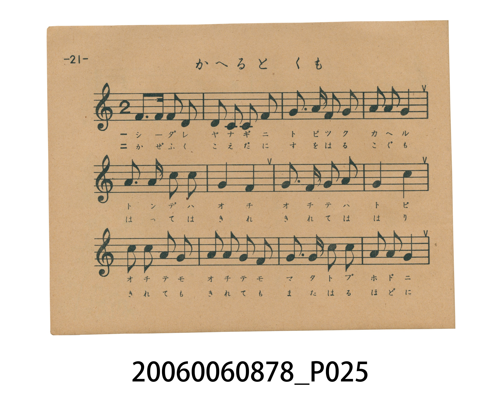
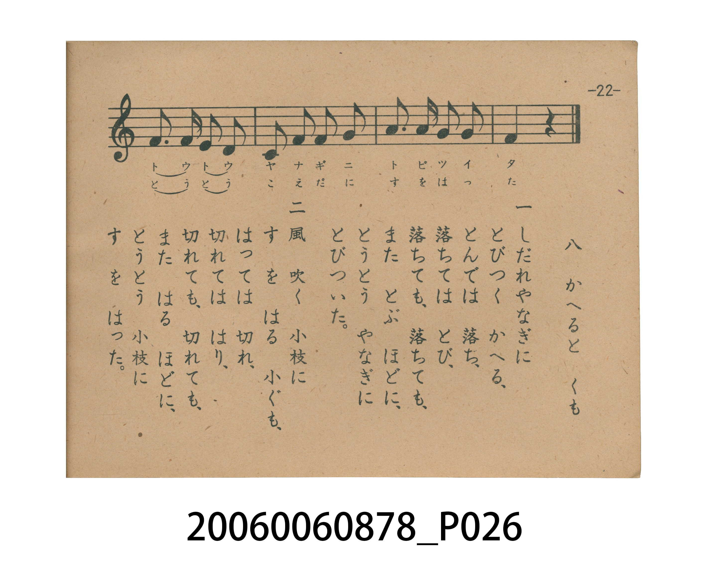

# かへると くも（青蛙與蜘蛛）

> Re:Shōka 使用 AI 協助辨識與重建樂譜，可能會有錯誤。歡迎回報。

- **鋼琴伴奏版**：<br><audio controls src="kaeru_to_kumo.mp3"></audio>
- **NEUTRINO 歌聲合成版**：<br><audio controls src="kaeru_to_kumo_neutrino.mp3"></audio>

- 日治時期國民學校唱歌（うたのほん 下・第八課）
- 國立臺灣歷史博物館典藏

## 說明


- 出處：臺灣總督府編《うたのほん 下》（國民學校初等科第二學年用），第八課〈かへると くも〉（青蛙與蜘蛛），原書第 21–22 頁。
- 調性與拍號：ト調（G 大調五聲音階，原書五線譜省略調號，實際音高終止於 G 音），2/4 拍，速度 != 104。
- 背景與曲風：第一節取材自小野道風「柳に蛙」的典故，描寫青蛙屢敗屢跳、終於躍上垂柳的毅力；第二節描寫風中小蜘蛛吐絲結網、斷了又結直到織成蜘蛛網的恆心，藉由附點八分音符與跳進音型生動刻畫跳躍與拉絲的動作。
- 版本說明：本檔案為原書單聲部五線譜旋律之忠實數位化版本。

### 編曲說明（鋼琴伴奏版）：

1. 前奏 (Intro, 4 小節)：擷取主旋律核心樂句作為導奏，建立調性與拍感。
2. 主歌伴奏 (KaeruToKumo)：右手 (PianoRH) 演奏原書歌唱主旋律；左手 (PianoLH)
依國民學校低學年教材純樸明朗之風格配以和聲伴奏。


## 歌詞

```text
一　しだれやなぎに　とびつく　かへる、
とんで　は　落ち、落ちて　は　とび、
落ちて　も、落ちて　も、また　とぶ　ほどに、
とうとう　やなぎに　とびついた。

二　風　吹く　小枝に　すを　はる　小ぐも、
はって　は　切れ、切れて　は　はり、
切れて　も、切れて　も、また　はる　ほどに、
とうとう　小枝に　すを　はった。
```

## ABC

<div class="abc-score" data-abc-src="kaeru_to_kumo.abc" aria-label="五線譜載入中"></div>

[下載 ABC 原始檔](kaeru_to_kumo.abc)

## TMD 檔案連結

- [主旋律 TMD 檔案](kaeru_to_kumo.tmd) [[在 TMD Studio 編輯](https://tmdlang.github.io/Tmd-TS/#tmd=s7IKdvYPcrWy4qpTUCpJTLdSyC_KTM_Ms8rNz0sqLc7IV-LS0lJ43Nj9uHHH4yYguQLI6X_c1PR-T8fLuZNezJ75oqP9xZwZL2bPfr-nU0FLi0vRVsHQwITL3lbBncvGSN_EDmTys-lLn23a_Wxm07M585_O6X62YeLTtTueLVj4dMrGZ2t7gGY9bmx73Dj_ceO6x427HzdNVniyo_tx8-7na9Y8bV39YtUmoNlKIHOAep-v7n7Rvut54-Jna7c_7d_0tHfW886VL5eseNq648X0fiUuLn0tBVtqAS4FBYXHDROezd70fPa6F6tWPZvR97hhIli0effT9l0vZk59v2cWxD3Pd-x9Pnfx011znm9f8bihC5uPGrqBXkXxf8fc52s7ny-fCPTpk109QMGnO7c8n7IC6N_3e3rg3n_cAAwgjCh43ABUhCUWgDqf9s1_NnsHUL-CkeGjhslGRgovFzQ-bmiCuvzFqv3PGpYD9Tzr7n0xcz7QC4-bO4CCQOPcFZ4uWQ5kPtk15UXjppfzN7-c1Qc3ECj4fPusF2vnPJ_T-HzqUqAysO6ep-uXvZw1G6R49YznW5uerV30bNoeBXcFoAjEPcB0oAC0C8h62TD_6a5lCpBUguSi5p5nM9eDXDR708tFQP_PAoXIjobn6xue9k97NnfCi_ZVTzf0v2zve9k4GajgcUPPs_mbHzeuBvr9cUPv81ktwPh_NrUVaMOz_v6n61dDguXpxkXPpk4Hki-2b37c0Ahy27Q9L3b1PtnR9XReE9AEoMZn61ufdgHDbTYkDoA2Qk1YtOLJjrVASyEB-3TChOdbNz3fOuH5NmB8ND6btv3Jrran_R0gkdlbnnZseL5zyrOOCRDFQDUgkxvbnu5vBjrpxfTO51M2vpzZ8nL3PGCMPu1oA4bM8zXLQLG2ffPLBlA4P53X_XzK_KfdU5927H4-dTVQHOhOcBR1guwFerB76pO9cxBB9ryz49mcNZBECQwvIPvZqinPFnY8b9oFia2n09aBorB5BTzank3vfrqv-8nO7qf7FwDj7NnUHU_29j7tmQYxCmQ0NMFDDABmzRcrgQ5e8WxaO9AlwNAAMVbNe7F2PTAXABMLWgIDijzrawaGHtAhCgEGRqZAGSBlBk4DnWCzgVH6uKHhceP0x40LHjf1PG5qedy46nFjHzAmweIrHjcCY3UJKIGDuLA039AIdhhQumny48blYDmgGxpeTNj7uHEhUBrKaFwGl4KaBdGJIg3KOagawCKPG_eBMixU5zYwY_fjxpVgp8HtB-VqMAnShsvxQHGgQeCIAoYJJMSAUfR0wsQXE6dDEh4wfkGJsG83MGYhaRWUTmCCwHT1rK8TWGQ82Qe0qRHOBorD1YDy3YaNz9dNR1aJJvJk53xgiD9t632xdTtQIyh3zGl4uq8HmhHARgGTMdA9z-bNBboYHk27eoA-AuezhqcTdkKiA5gVQKqgnp35uGkSNLBBEQSSfdw4ARKUkMBa_7hxMXKMPO1oB0U50JEQBkpkAU3pgupEkQabhymCFFlQ-wlEFk7Hg9yINbLmrAD6H-j5Z91NoNwH1L9iJ9CIl9MmQwoBiCCs1O0B5lNgIAOzKijupm0HRgGklADFBbiggChAxBpMDTIXHl8QK9DiC-gkZGc83bMVaCDQcHiZA41BoE8or_qgQEFLn4vLOzG1qDQk37s0N98qIDMxL9-hxqCmGmSPgo2hmZYdmFWjYKigC4SGYNosHkjUKJiCKDABFgDJ1CgYgdUZg2mECAyDYA3YRB_DGoXHTduhYo-bG8DkGrCOx81LwLwuENm0Dszuhsp0QNVPBuIWsPx6iEzTarD4DDAJYiPZZQSUbwSZAJRrnAPEW8GsfojOxslgHshkYMkFJkH6QTIzIXqaJoGSPJgFdQdUzwSwWBPcNmhgGUMDwRQUQEjBAgkSsFKoiCGYBqlHqAHpQAsouLc3A3E7mAV1fNMqeBA2ws2GiYLEHje3IauHmgQJQsxAAnkS5LHFQLwMzIIGb2MvTF9TD8IeqChIDF09xCSQHCgaUYIHFiwgb4M8DQkwGA85HRkhBSGyGvR0BPIuJABg3l2EFBBYZZrnQZ23Hxooj5unQWVmg3mdYBKSalADCeRpSDBAPQ1OAfhl9kEDdj5GStoNFl8JJhHpFi3bgXMYOK_VIHIbLFchEhxCBJbQDDBDC5aYmpbBfA5kkZ7vQGpBIbwfu03gkFoB9XUblA1ikZzngIkRIjMfw6ZaLi5dOwWkIgxsN1BImQsA)]
- [鋼琴伴奏 TMD 檔案](kaeru_to_kumo_piano.tmd) [[在 TMD Studio 編輯](https://tmdlang.github.io/Tmd-TS/#tmd=s7IKdvYPcrWy4tLSUnjc2P24ccfjJiC5Asjpf9zU9H5Px8u5k17Mnvmio_3FnBkvZs9-v6cTJNi95_mELU_2bHm6tP95ZwdQUEFLi0vRVsHQwITL3lbBncvGSN_EjqtOQenZ9KXPNu1-NrPp2Zz5T-d0P9sw8enaHc8WLHw6ZeOztT1Asx43tj1unP-4cd3jxt2PmyYrPNnR_bh59_M1a562rn6xahPQbCWQOUC9z1d3v2jf9bxx8bO125_2b3raO-t558qXS1Y8bd3xYnq_EheXvpaCLbUAl4KCwuOGCc9mb3o-e92LVauezeh73DARLNq8-2n7rhczp77fMwvinuc79j6fu_jprjnPt6943NCFzUcN3UCvovi_Y-7ztZ3Pl08E-vTJrh6g4NOdW55PWQEO4B649x83AAMII14eN4BjAUvU9Dztm_9s9g6gfgUjw0cNk42MFF4uaHzc0AR1-YtV-581LAfqedbd-2LmfKAXHjd3AAWBxrkrPF2yHMh8smvKi8ZNL-dvfjmrD24gUPD59lkv1s55Pqfx-dSlQGVg3T1P1y97OWs2SPHqGc-3Nj1bu-jZtD0K7gpAEYh7gOlAAWgXkPWyYf7TXcsUIKkEyUXNPc9mrge5aPaml4uA_p8FCpEdDc_XNzztn_Zs7oQX7auebuh_2d73snEyUMHjhp5n8zc_blwN9Pvjht7ns1qA8f9saivQhmf9_U_Xr4YEy9ONi55NnQ4kX2zf_LihEeS2aXte7Op9sqPr6bwmoAlAjc_Wtz7tAobbbEgcAG2EmrBoxZMda4GWQgL26YQJz7duer51wvNtwPhofDZt-5NdbU_7O0Ais7c87djwfOeUZx0TIIqBakAmN7Y93d8MdNKL6Z3Pp2x8ObPl5e55wBh92tEGDJnna5aBYm375pcNoHB-Oq_7-ZT5T7unPu3Y_XzqaqA40J3gKOoE2Qv0YPfUJ3vnIIIMmMyAgQVJlFhzIzAQQUoVFAz1FJ529gLFFTQ880qK8nUUTBSA_gL6VBOo5tlkYD6a9mTH7mfTu5_u6362YAfQ0c9WND3tXwq073nTrqcb-oB6QdG8exco9yElnmct86EOUlAw0gOm8d3A7Axxg4KGd2JqUWlIvndpbj7Inqf9m591ditoBGQm5uUHeWgqPNszBagOkrKA2oBlAdwRwNh4un0ZQrmPhybEEiB4sm8uchZ6srcPkm2eTZ0JTCfPt0x5tmIHMEiezZn-ZGc3MBKfLdjzsrX3ye6lTyf1AJM0xHUgV0MzN9wBL1YCI2fFs2ntQL8BYx7EWDXvxdr1wBwPDF-0zAQUedbXDEwpz1ZNUQgwMDIFygApM3C4d4LNBibfxw0NjxunP25c8Lip53FTy-PGVY8b-4CpFiy-4nEjMAUvAWVmEBeWvxsawQ4DSjdNfty4HCwHdEPDiwl7HzcuBEpDGY3L4FJQsyA6UaRBpQSqBrDI48Z9oMIJqnMbmLH7ceNKsNPg9oNKMDAJ0obL8UBxWBoAhgkkxECxPWHii4nTIZkMmJZBGa5vNzAVQ_IlKE_ABIF56FlfJ7B4fLIPaFMjnA0Uh6sBJb4NG5-vm46sEk3kyc75wBB_2tb7Yut2oEZQSTCn4em-HmimBxsFzLJA9zybNxfoYng07eoB-ghcpjQ8nbATEh3A7AFSBfXszMdNk6CBDYogkOzjxgmQoIQE1vrHjYuRY-RpRzsoyoGOhDBQIgtoShdUJ4o02DxMEaTIgtpPILJwOh7kRqyRNWcF0P9Azz_rbgKVNED9K3YCjXg5bTKkwIMIwmqYHmCZBAxkYLEEirtp24FRACkRQXEBLhQhChCxBlODzIXHF8QKtPgCOgnZGU_3bAUaCDQcXr5CYxDoE8qreShQ0NLn4gKXkFbQQsqhxqCmGlzy2BiaadmBWTUKhgq6QGioYBYPpExBRA2EDZIwguIaBWOwMmMkEYhGXQUDKF3DVYtioQ-yhSYI--IVog1jgQyTeCDLNBfEBIkhWCBZkFlIRS5xXgDRYKfXQDwCJuB-qQG7G-YHhAgMQ_wAMtHHsEbhcdN2qNjj5gYwuQas43HzEjCvC0Q2rQOzu6EyHVD1k4G4BSy_HiLTtBosPgNMgthIdhkB5RtBJgDlGucA8VYwqx-is3EymAcyGVjwgkmQfpDMTIiepkmgHAtmQd0B1TMBLNYEtw0aWLCINAUFEFKwQIIErBQqYgimQeoRakA60AIK7u3NQNwOZkEd37QKHoSNcLNhoiCxx81tyOqhJkGCEDOQQJ4EeWwxEC8Ds6DB29gL09fUg7AHKgoSQ1cPMQkkB4pGlOCBBQvI24iUD-MhpyMjpCBEVoOejkDehQQAzLuLkAICq0zzPKjz9kMD5XHzNKjMbDCvE0xCUg1qIIE8DQkGqKfBKQC_zD5owM7HSEm7weIrwSQi3VK_5MBITE3LYD4HskjPdyC1oBDej90mcEitgPq6DcoGsUjOc8DECJGZj2ETthKMUJloCioTsbHApSPRqsElKJpiLLrgxS6SWjNwMYyrbDaA-EvXTgFc0CsAGUh-jPYBGosuZAQWUuYCAA)]

## 分析

```text
================================================================================
📊 TMD Song Profile: [ かへると くも（青蛙與蜘蛛） ]
================================================================================
⏱  Duration:       0:18 (18.5s), 16 measures total
🎼 Key & Tempo:    首調基準 G, != 104.0 BPM, <2/4>
   - 分析範圍：      由實際發聲的音符與和弦推測調性；播放脈絡另行呈現
🎤 人聲音域:    D4 (MIDI 62) – D5 (MIDI 74) [跨度: 12 個半音 / 1.0 個八度, 難度: easy]
   - 最低音:  D4 in [KaeruToKumo #1 @ m.2, 0:01]
   - 最高音: D5 in [KaeruToKumo #1 @ m.5, 0:05]
   - 適合: soprano, mezzo-soprano, contralto, tenor, baritone, bass
🏛  結構:      KaeruToKumo (18.5s)
⚡ 編曲密度:        Peak 1 軌道同時演奏
🗝  調性診斷：       D 大調（純淨自然大調，未偵測到可信轉調）
   - 風格氣質:    純淨自然大調（陽光明朗、易唱易記，無明顯調外色彩）
   - 轉調歷程:    全曲維持單一推測調性（未偵測到可信轉調）
   - 核心骨幹音:  A, G, D, B, E
   - 調性數值:    D 大調 [相關度: 0.73, 穩定度: Moderate, 自然音純度: 100.0%]
   - 候選調性 (K-S): D 大調 (0.73), G 大調 (0.61), A 大調 (0.57)
   - 五度圈歷程:   +2
   - 各段落調性細節:
     • [KaeruToKumo #1]: D 大調 (r: 0.73, 自然音純度: 100.0%)

  [ 五度圈游移軌跡 ]
               C  
         F            G  
      Bb              [D ]*
      Eb               A  
         Ab           E  
            Db       B  
               F# 
     (* = active key center)

  [ 十二半音累積音高分佈 ]
     C  :                            0.0%
     C# :                            0.0%
     D  : ███████████               17.7%
     D# :                            0.0%
     E  : ████                       6.5%
     F  :                            0.0%
     F# :                            0.0%
     G  : ██████████████            21.8%
     G# :                            0.0%
     A  : ████████████████████████  37.1%
     A# :                            0.0%
     B  : ███████████               16.9%
--------------------------------------------------------------------------------
Assignment 軌道音域：
  - Piano         : D4 – D5 (12 個半音 / 1.0 個八度, 55 個音符)
================================================================================
```


## 原書掃描頁






