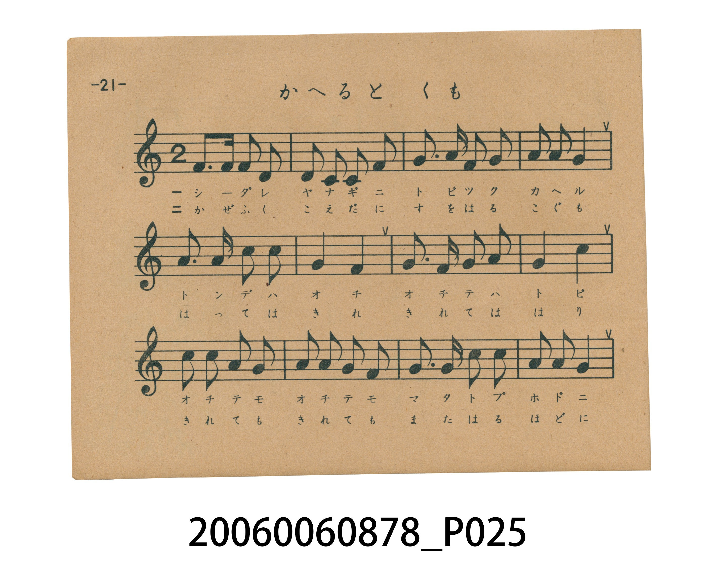
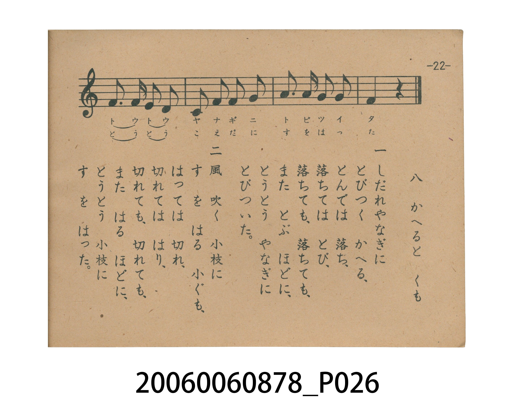

# かへると くも（青蛙與蜘蛛）

> Re:Shōka 使用 AI 協助辨識與重建樂譜，可能會有錯誤。歡迎回報。

- **鋼琴伴奏版**：<br><audio controls src="kaeru_to_kumo.mp3"></audio>
- **NEUTRINO 歌聲合成版**：<br><audio controls src="kaeru_to_kumo_neutrino.mp3"></audio>

- 日治時期國民學校唱歌（うたのほん 下・第八課）
- 國立臺灣歷史博物館典藏

## 說明


- 出處：臺灣總督府編《うたのほん 下》（國民學校初等科第二學年用），第八課〈かへると くも〉（青蛙與蜘蛛），原書第 21–22 頁。
- 調性與拍號：ト調（G 大調五聲音階，原書五線譜省略調號，實際音高終止於 G 音），2/4 拍，速度 != 104。
- 背景與曲風：第一節取材自小野道風「柳に蛙」的典故，描寫青蛙屢敗屢跳、終於躍上垂柳的毅力；第二節描寫風中小蜘蛛吐絲結網、斷了又結直到織成蜘蛛網的恆心，藉由附點八分音符與跳進音型生動刻畫跳躍與拉絲的動作。
- 版本說明：本檔案為原書單聲部五線譜旋律之忠實數位化版本。

### 編曲說明（鋼琴伴奏版）：

1. 前奏 (Intro, 4 小節)：擷取主旋律核心樂句作為導奏，建立調性與拍感。
2. 主歌伴奏 (KaeruToKumo)：右手 (PianoRH) 演奏原書歌唱主旋律；左手 (PianoLH)
依國民學校低學年教材純樸明朗之風格配以和聲伴奏。


## 歌詞

```text
一　しだれやなぎに　とびつく　かへる、
とんで　は　落ち、落ちて　は　とび、
落ちて　も、落ちて　も、また　とぶ　ほどに、
とうとう　やなぎに　とびついた。

二　風　吹く　小枝に　すを　はる　小ぐも、
はって　は　切れ、切れて　は　はり、
切れて　も、切れて　も、また　はる　ほどに、
とうとう　小枝に　すを　はった。
```

## ABC

<div class="abc-score" data-abc-src="kaeru_to_kumo.abc" aria-label="五線譜載入中"></div>

[下載 ABC 原始檔](kaeru_to_kumo.abc)

## TMD 檔案連結

- [主旋律 TMD 檔案](kaeru_to_kumo.tmd) [[在 TMD Studio 編輯](https://tmdlang.github.io/Tmd-TS/#tmd=s7IKdvYPcrWy4qpTUCpJTLdSyC_KTM_Ms8rNz0sqLc7IV4JLJOfn5KQml2Tm51mVliTm5Wfk5yEky_JzSnNTrYwQIsX5pUXJqXCl8emp6HLxBYnpqVYBBkamukDCDCFdUJRflpqXmAfUXpKYWZ4I1AwUKMrLLwKakpdalJiDUJtalpmSClJZUJSZm1hUGZ-Snwx0SV4JkttSi4pBri7LT0bWmV9UkpGfXpRYkFFplZFZXAL0OFA-PjsxLxGhqCQjFeitxDyg2TnFSlxaWgqPG7sfN-543AQkVwA5_Y-bmt7v6Xg5d9KL2TNfdLS_mDPjxezZ7_d0KmhpcSnaKhgamHDZ2yq4c9kY6ZvYgcx9Nn3ps027n81sejZn_tM53c82THy6dsezBQufTtn4bG0P0KzHjW2PG-c_blz3uHH346bJCk92dD9u3v18zZqnratfrNoENBvsPqDe56u7X7Tvet64-Nna7U_7Nz3tnfW8c-XLJSuetu54Mb1fiYtLX0vBllqAS0FB4XHDhGezNz2fve7FqlXPZvQ9bpgIFm3e_bR914uZU9_vmQVxz_Mde5_PXfx015zn21c8bujC5qOGbqBXUfzfMff52s7nyycCffpkVw9Q8OnOLc-nrAD69_2eHrj3HzcAAwgjCh43ABVhiQWgzqd985_N3gHUr2Bk-KhhspGRwssFjY8bmqAuf7Fq_7OG5UA9z7p7X8ycD_TC4-YOoCDQOHeFp0uWA5lPdk150bjp5fzNL2f1wQ0ECj7fPuvF2jnP5zQ-n7oUqAysu-fp-mUvZ80GKV494_nWpmdrFz2btkfBXQEoAnEPMB0oAO0Csl42zH-6a5kCJJUguai559nM9SAXzd70chHQ_7NAIbKj4fn6hqf9057NnfCifdXTDf0v2_teNk4GKnjc0PNs_ubHjauBfn_c0Pt8Vgsw_p9NbQXa8Ky__-n61ZBgebpx0bOp04Hki-2bHzc0gtw2bc-LXb1PdnQ9ndcENAGo8dn61qddwHCbDYkDoI1QExateLJjLdBSSMA-nTDh-dZNz7dOeL4NGB-Nz6Ztf7Kr7Wl_B0hk9panHRue75zyrGMCRDFQDcjkxran-5uBTnoxvfP5lI0vZ7a83D0PGKNPO9qAIfN8zTJQrG3f_LIBFM5P53U_nzL_affUpx27n09dDRQHuhMcRZ0ge4Ee7J76ZO8cRJA97-x4NmcNJFECwwvIfrZqyrOFHc-bdkFi6-m0daAobF4Bj7Zn07uf7ut-srP76f4FwDh7NnXHk729T3umQYwCGQ1N8BADgFnzxUqgg1c8m9YOdAkwNECMVfNerF0PzAXAxIKWwIAiz_qagaEHdIgCqIwDyoBKOXAa6ASbDYzSxw0NjxunP25c8Lip53FTy-PGVY8b-4AxCRZf8bgRGKtLQAkcxIWl-YZGsMOA0k2THzcuB8sB3dDwYsLex40LgdJQRuMyuBTULIhOFGlQzkHVABZ53LgPlGGhOreBGbsfN64EOw1uPyhXg0mQNlyOB4oDDQJHFDBMICEGjKKnEya-mDgdkvCA8QtKhH27gTELSaugdAITBKarZ32dwCLjyT6gTY1wNlAcrgaU7zZsfL5uOrJKNJEnO-cDQ_xpW--LrduBGkG5Y07D03090IwANgqYjIHueTZvLtDF8Gja1QP0ETifNTydsBMSHcCsAFIF9ezMx02ToIENiiCQ7OPGCZCghATW-seNi5Fj5GlHOyjKgY6EMFAiC2hKF1QnijTYPEwRpMiC2k8gsnA6HuRGrJE1ZwXQ_0DPP-tuAuU-oP4VO4FGvJw2GVIIQARhpW4PMJ8CAxmYVUFxN207MAogpQQoLsAFBUQBItZgapC58PiCWIEWX0AnITvj6Z6tQAOBhsPLHGgMAn1CedUHBQpa-lxc3ompRaUh-d6luflWAZnAxo1DjUFNNcgeBRtDMy07MKtGwVBBFwgNwbRZPJCoUTAFUWACLACSqVEwAqszBtMIERgGwRqwiT6GNQqPm7ZDxR43N4DJNWAdj5uXgHldILJpHZjdDZXpgKqfDMQtYPn1EJmm1WDxGWASxEayywgo3wgyASjXOAeIt4JZ_RCdjZPBPJDJwJILTIL0g2RmQvQ0TQIleTAL6g6onglgsSa4bdDAMoYGgikogJCCBRIkYKVQEUMwDVKPUAPSgRZQcG9vBuJ2MAvq-KZV8CBshJsNEwWJPW5uQ1YPNQkShJiBBPIkyGOLgXgZmAUN3sZemL6mHoQ9UFGQGLp6iEkgOVA0ogQPLFhA3gZ5GhJgMB5yOjJCCkJkNejpCORdSADAvLsIKSCwyjTPgzpvPzRQHjdPg8rMBvM6wSQk1aAGEsjTkGCAehqcAvDL7IMG7HyMlLQbLL4STCLSLVq2A-cwcF6rQeQ2WK5CJDiECCyhGWCGFiwxNS2D-RzIIj3fgdSCQng_dpvAIbUC6us2KBvEIjnPARMjRGY-hk21XFy6dgpIRRjYbqCQMhcA)]
- [鋼琴伴奏 TMD 檔案](kaeru_to_kumo_piano.tmd) [[在 TMD Studio 編輯](https://tmdlang.github.io/Tmd-TS/#tmd=s7IKdvYPcrWy4qpTUCpJTLdSSM7PyUlNLsnMz7MqLUnMy8_Iz1OCS5bl55TmploZIUSK80uLklPhSuPTU9Hl4gsS01OtAgyMTHWBhBlCuqAovyw1LzEPqL0kMbM8EagZKFCUl18ENCUvtSgxB6E2tSwzJRWksqAoMzexqDI-JT8Z6JK8EiS3pRYVg1xdkAl0SnxiUVFiXnoqqpL8opKM_PSixIKMSquMzOKS_KLM5MSc-OzEvESEopIMoC6rxDygPTnFSlxaWgqPG7sfN-543AQkVwA5_Y-bmt7v6Xg5d9KL2TNfdLS_mDPjxezZ7_d0ggS79zyfsOXJni1Pl_Y_7-wACipoaXEp2ioYGphw2dsquHPZGOmb2IEsezZ96bNNu5_NbHo2Z_7TOd3PNkx8unbHswULn07Z-GxtD9Csx41tjxvnP25c97hx9-OmyQpPdnQ_bt79fM2ap62rX6zaBDQb7Gig3ueru1-073reuPjZ2u1P-zc97Z31vHPlyyUrnrbueDG9X4mLS19LwZZagEtBQeFxw4Rnszc9n73uxapVz2b0PW6YCBZt3v20fdeLmVPf75kFcc_zHXufz138dNec59tXPG7owuajhm6gV1H83zH3-drO58snAn36ZFcPUPDpzi3Pp6wAB3AP3PuPG4ABhBEvjxvAsYAlanqe9s1_NnsHUL-CkeGjhslGRgovFzQ-bmiCuvzFqv3PGpYD9Tzr7n0xcz7QC4-bO4CCQOPcFZ4uWQ5kPtk15UXjppfzN7-c1Qc3ECj4fPusF2vnPJ_T-HzqUqAysO6ep-uXvZw1G6R49YznW5uerV30bNoeBXcFoAjEPcB0oAC0C8h62TD_6a5lCpBUguSi5p5nM9eDXDR708tFQP_PAoXIjobn6xue9k97NnfCi_ZVTzf0v2zve9k4GajgcUPPs_mbHzeuBvr9cUPv81ktwPh_NrUVaMOz_v6n61dDguXpxkXPpk4Hki-2b37c0Ahy27Q9L3b1PtnR9XReE9AEoMZn61ufdgHDbTYkDoA2Qk1YtOLJjrVASyEB-3TChOdbNz3fOuH5NmB8ND6btv3Jrran_R0gkdlbnnZseL5zyrOOCRDFQDUgkxvbnu5vBjrpxfTO51M2vpzZ8nL3PGCMPu1oA4bM8zXLQLG2ffPLBlA4P53X_XzK_KfdU5927H4-dTVQHOhOcBR1guwFerB76pO9cxBBBkxmwMCCJEqsuREYiCClCgqGegpPO3uB4goannklRfk6CiYKQH8BfaoJVPNsMjAfTXuyY_ez6d1P93U_W7AD6OhnK5qe9i8F2ve8adfTDX1AvaBo3r0LlPuQEs-zlvlQBykoGOkB0_huYHaGuEFBwzsxtag0JN-7NDcfZM_T_s3POrsVNAJAZVaQh6bCsz1TgOogKQuoDVgWwB0BjI2n25chlPt4aEIsAYIn--YiZ6Ene_sg2ebZ1JnAdPJ8y5RnK3YAg-TZnOlPdnYDI_HZgj0vW3uf7F76dFIPMElDXAdyNTRzwx3wYiUwclY8m9YO9Bsw5kGMVfNerF0PzPHA8EXLTECRZ33NwJTybNUUBVCBD5QBFfngcO8Emw1Mvo8bGh43Tn_cuOBxU8_jppbHjaseN_YBUy1YfMXjRmAKXgLKzCAuLH83NIIdBpRumvy4cTlYDuiGhhcT9j5uXAiUhjIal8GloGZBdKJIg0oJVA1gkceN-0CFE1TnNjBj9-PGlWCnwe0HlWBgEqQNl-OB4rA0AAwTSIiBYnvCxBcTp0MyGTAtgzJc325gKobkS1CegAkC89Czvk5g8fhkH9CmRjgbKA5XA0p8GzY-XzcdWSWayJOd84Eh_rSt98XW7UCNoJJgTsPTfT3QTA82Cphlge55Nm8u0MXwaNrVA_QRuExpeDphJyQ6gNkDpArq2ZmPmyZBAxsUQSDZx40TIEEJCaz1jxsXI8fI0452UJQDHQlhoEQW0JQuqE4UabB5mCJIkQW1n0Bk4XQ8yI1YI2vOCqD_gZ5_1t0EKmmA-lfsBBrxctpkSIEHEYTVMD3AMgkYyMBiCRR307YDowBSIoLiAlwoQhQgYg2mBpkLjy-IFWjxBXQSsjOe7tkKNBBoOLx8hcYg0CeUV_NQoKClz8UFLiGtoIWUQ41BTTW45LExNNOyA7NqFAwVdIHQUMEsHkiZgogaCBskYQTFNQrGYGXGSCIQjboKBlC6hqsWxUIfZAtNEPbFK0QbxgIZJvFAlmkuiAkSQ7BAsiCzkIpc4rwAosFOr4F4BEzA_VIDdjfMDwgRGIb4AWSij2GNwuOm7VCxx80NYHINWMfj5iVgXheIbFoHZndDZTqg6icDcQtYfj1Epmk1WHwGmASxkewyAso3gkwAyjXOAeKtYFY_RGfjZDAPZDKw4AWTIP0gmZkQPU2TQDkWzIK6A6pnAlisCW4bNLBgEWkKCiCkYIEECVgpVMQQTIPUI9SAdKAFFNzbm4G4HcyCOr5pFTwIG-Fmw0RBYo-b25DVQ02CBCFmIIE8CfLYYiBeBmZBg7exF6avqQdhD1QUJIauHmISSA4UjSjBAwsWkLcRKR_GQ05HRkhBiKwGPR2BvAsJAJh3FyEFBFaZ5nlQ5-2HBsrj5mlQmdlgXieYhKQa1EACeRoSDFBPg1MAfpl90ICdj5GSdoPFV4JJRLqlfsmBkZialsF8DmSRnu9AakEhvB-7TeCQWgH1dRuUDWKRnOeAiREiMx_DJmwlGKEy0RRUJmJjgUtHolWDS1A0xVh0wYtdJLVm4GIYV9lsAPGXrp0CuKBXADKQ_BjtAzQWXcgILKTMBQA)]

## 分析

```text
================================================================================
📊 TMD Song Profile: [ かへると くも（青蛙與蜘蛛） ]
================================================================================
⏱  Duration:       0:18 (18.5s), 16 measures total
🎼 Key & Tempo:    首調基準 G, != 104.0 BPM, <2/4>
   - 分析範圍：      由實際發聲的音符與和弦推測調性；播放脈絡另行呈現
🎤 人聲音域:    D4 (MIDI 62) – D5 (MIDI 74) [跨度: 12 個半音 / 1.0 個八度, 難度: easy]
   - 最低音:  D4 in [KaeruToKumo #1 @ m.2, 0:01]
   - 最高音: D5 in [KaeruToKumo #1 @ m.5, 0:05]
   - 適合: soprano, mezzo-soprano, contralto, tenor, baritone, bass
🏛  結構:      KaeruToKumo (18.5s)
⚡ 編曲密度:        Peak 1 軌道同時演奏
🗝  調性診斷：       D 大調（純淨自然大調，未偵測到可信轉調）
   - 風格氣質:    純淨自然大調（陽光明朗、易唱易記，無明顯調外色彩）
   - 轉調歷程:    全曲維持單一推測調性（未偵測到可信轉調）
   - 核心骨幹音:  A, G, D, B, E
   - 調性數值:    D 大調 [相關度: 0.73, 穩定度: Moderate, 自然音純度: 100.0%]
   - 候選調性 (K-S): D 大調 (0.73), G 大調 (0.61), A 大調 (0.57)
   - 五度圈歷程:   +2
   - 各段落調性細節:
     • [KaeruToKumo #1]: D 大調 (r: 0.73, 自然音純度: 100.0%)

  [ 五度圈游移軌跡 ]
               C  
         F            G  
      Bb              [D ]*
      Eb               A  
         Ab           E  
            Db       B  
               F# 
     (* = active key center)

  [ 十二半音累積音高分佈 ]
     C  :                            0.0%
     C# :                            0.0%
     D  : ███████████               17.7%
     D# :                            0.0%
     E  : ████                       6.5%
     F  :                            0.0%
     F# :                            0.0%
     G  : ██████████████            21.8%
     G# :                            0.0%
     A  : ████████████████████████  37.1%
     A# :                            0.0%
     B  : ███████████               16.9%
--------------------------------------------------------------------------------
Assignment 軌道音域：
  - Piano         : D4 – D5 (12 個半音 / 1.0 個八度, 55 個音符)
================================================================================
```


## 原書掃描頁






