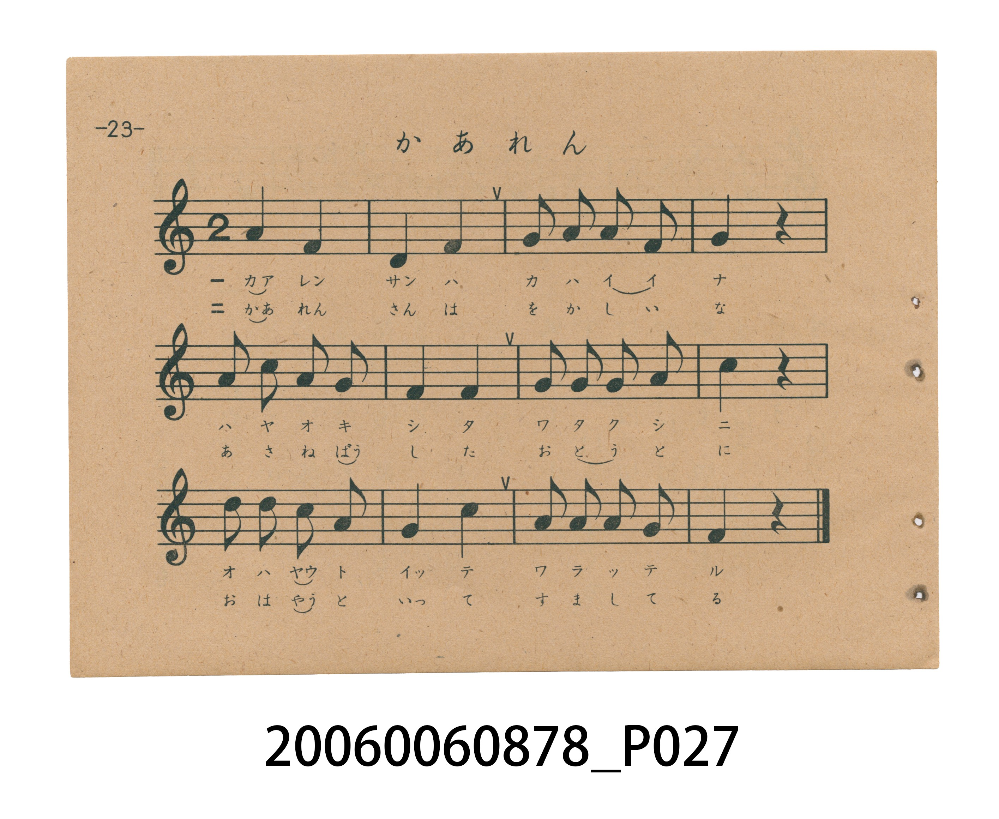
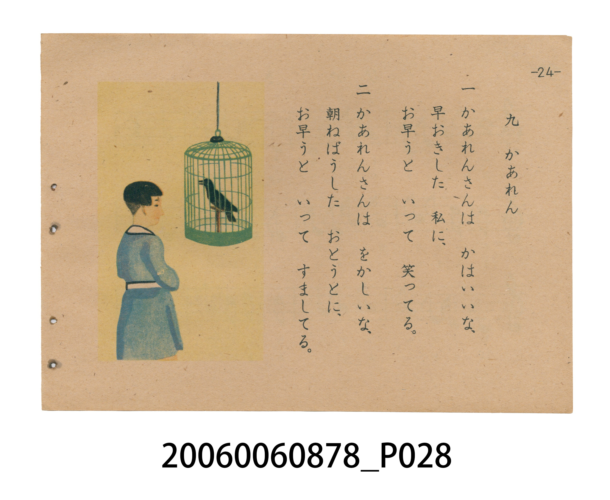

# かあれん（加令／八哥）

<audio controls src="kaaren.mp3"></audio>

- 日治時期國民學校唱歌（うたのほん 下・第九課）
- 國立臺灣歷史博物館典藏

## 說明

【曲目說明】
・出處：臺灣總督府編《うたのほん 下》（國民學校初等科第二學年用），第九課〈かあれん〉（加令／八哥），原書第 23–24 頁。
・調性與拍號：ヘ調（F 大調，原書五線譜省略調號，實際音高終止於 F 音），2/4 拍，速度 != 104。
・背景與曲風：本曲為臺灣總督府專為臺灣學童編纂之**臺灣鄉土特色曲目**（日本內地版文部省《うたのほん 下》無此曲）。曲名「かあれん」源自臺語「加令」（ka-lîng，即八哥，臺灣民間常見、善於模仿人語的籠養鳥）。第一節寫八哥對早起的「我」笑著說早安（「お早う」），第二節則幽默描寫八哥對睡懶覺的弟弟也一本正經地說「お早う」，第 24 頁並繪有學童凝望竹籠中八哥的生動插圖。
・版本說明：本檔案為原書單聲部五線譜旋律之忠實數位化版本。

・編曲說明（鋼琴伴奏版）：
1. 前奏 (Intro, 4 小節)：擷取主旋律核心樂句作為導奏，建立調性與拍感。
2. 主歌伴奏 (Kaaren)：右手 (PianoRH) 演奏原書歌唱主旋律；左手 (PianoLH)
依國民學校低學年教材純樸明朗之風格配以和聲伴奏。

## 歌詞

```text
一　かあれんさんは　かはいいな、
早おきした　私に、
お早うと　いって　笑ってる。

二　かあれんさんは　をかしいな、
朝ねばうした　おとうとに、
お早うと　いって　すましてる。
```

## ABC

```abc
X:1
T:かあれん（加令／八哥）
M:2/4
L:1/16
Q:1/4=104
K:F
V:V1 name="Piano" snm="Pia"
[V:V1]
A4 F4 | D4 F4 | G2 A2 G2 F2 | G4 z4 |
A2 c2 A2 G2 | F4 F4 | G2 G2 G2 A2 | c4 z4 |
d2 d2 c2 A2 | G4 c4 | A2 A2 A2 G2 | F4 z4 |
```

## TMD 檔案連結

- [主旋律 TMD 檔案](kaaren.tmd) [[在 TMD Studio 編輯](https://tmdlang.github.io/Tmd-TS/#tmd=s7IKdvYPcrWy4tLSUnjc2P24selxU8_jpsnv93Q87VrwZPeS93v6n7aufjp56fs9nQpaWlyKtgqGBiZc9rYKblw2Rvomdlx1CkrPpi99tmn3s5lNz-bMfzqn-9mGiU_X7ni2YOHTKRufre0BmvW4se1x4_zHjeseN-4Gmq7wZEf34-bdz9esebJz7otVm4BmK4HMAep9vrr7Rfuu542Ln63d_rR_09PeWc87V75csuJp644X0_uVuLj0tRRsqQW4FBQUHjdMeDZ70_PZ616sWvVsRt_jholg0ebdT9t3vZg59f2eWRD3PN-x9_ncxU93zXm-fcXjhi5sPmroBgUbsv875j5f2_l8-USQT3f1AAWf7tzyfMoKoH_f7-mBe_9xAzCAEGH_uAEoiyX4gVqe9s1_NnsHUKOCkfGjhslGJgovFzQ-bmiCOvnFqv3PGpa_6Gh_1t37YuZ8oNsfN88ACgKNc1N4umQ5mAk15MmuKc-3z3qxds7zOY3Ppy4FSoF19Dxdv-zlrNkv529-uXrG861Nz9YuejZtj4KbAlAE4gZgpCsAzQeyXjbMf7prmQIkSSC5ornn2cz1IFfM3vRyEdCzs57NWQMK46ZdaEH5dEMHXBAYOM9XLwUG7vNdTU92dmtpQYRftnQ-nTP_eefOF52bIPGkpQX0DijFzVnztHX50zkbnnd2PJvW_rJ5BdAnOGPmecvCZ2uXAE0AegLoVCDj6YTexw09qAHf-2zXhBftq4BWv1g1DygLiQSgONDK7ETdnMPr8tJBYdS7GRYrPdDUumHiy2mTn-7Y8WIZ0LbGp9NagKH2bMXCJ7v3P9kFMuz5rJbnGxe8XNL1cjMoLoFOAEX_jobn6xuerl8NMe3pht5n01e-2LodqBho-bOOiUCbn6-Z-GLidFDinL7y6TpQygC7ugvIBfkU5DRYYtrVAzKts_3pzr0vd8941t-PbPLzuQuftW97sWwX0PCne-YD0ZOd84EOAMXN2sXPt00GhiTQFgzDQSYrQBLakx3Lnu9c9WxOJySunrbPfTZn9vPVO4Eee7JjLcQmkD-nzH_aPfVZ_6Snc6YhUgUoluasgWQyaJJYNeXZQlACgCTIp9PWvWjcBIxGeMp8Nr376b5uYGJ4un8BMFk-m7rjyd7epz3TIEaBjIZmYIgBwKLmxcp5T1tXAFMDMPUBnQRirJr3Yu16YK4GBhxavgElo75mYDABHaIQYGBkDpQBUhbgAO0Emw0Mn8cNDShppHEqmAQaCRFf_7ixBYyAQdcI0gMOO2Aq7H3cOB2UEBsani9vfNy4GiqNCN1GYDkCNAOodfHjxmUgdWsmQtlNwEQEDjigGyE-AAYZJICB6edxwxRYwpz6HFji9q9_1jL76cQGUMrc0AtMLfBUBExCoCS6ahUwZEEpCpyEIInq6aRVQAS0Bu7XXT34_No0CSwF9BKyX-fMfdy49nHjBrB_oN4F-34F1IfE-Ptx48zHjfvA-kn0OjAtvti2GM3rT3Z0YSZ2oAJgescMiReL5z7ZOwc5H4CCbQWwOJoADRugUyivaaBAQUufi8s7MbEoNc8qIDMxL9-hxqBGoRpkh4KNhZYdmAGs4YDusYLWxwqQuFCoAfJB0QGk1gMVgbjdYDYwJMEYJLIKpB8IgNbATNrVQ9ikpklQ06bjMqlGwVhBV8EQiGsUzOLhTCOgsBGQDWLpKhiAxMBpCckPQAc2gRzYBcS9YKNBlswHGw6yuh_Me9wIoqeD5Vfj8gTQB41TgXgtEINSHIppIDbIDlDCA1FQITTDQP4wBTu6BuwFmDdA0BjIMsXlDZDRYK_AjAcZDkrCQGoZwitNnTAhkEA3Lp8QYVrjTCDeB_UginFwr5gBIcgzkNAHOR3kPRCEeQ_ilVouLl07BUiyA7GUuQA)]
- [鋼琴伴奏 TMD 檔案](kaaren_piano.tmd) [[在 TMD Studio 編輯](https://tmdlang.github.io/Tmd-TS/#tmd=s7IKdvYPcrWy4tLSUnjc2P24selxU8_jpsnv93Q87VrwZPeS93v6n7aufjp56fs9nUDBl917nk_Y8mTPlqdL-593dgAFFbS0uBRtFQwNTLjsbRXcuGyM9E3suOoUlJ5NX_ps0-5nM5uezZn_dE73sw0Tn67d8WzBwqdTNj5b2wM063Fj2-PG-Y8b1z1u3A20UuHJju7Hzbufr1nzZOfcF6s2Ac1WApkD1Pt8dfeL9l3PGxc_W7v9af-mp72znneufLlkxdPWHS-m9ytxcelrKdhSC3ApKCg8bpjwbPam57PXvVi16tmMvscNE8Gizbuftu96MXPq-z2zIO55vmPv87mLn-6a83z7iscNXdh81NANCktk_3fMfb628_nyiSCf7uoBCj7dueX5lBXgAO6Be_9xAzCAEBHyuAEU_NjipOdp3_xns3cANSoYGT9qmGxkovByQePjhiaok1-s2v-sYfmLjvZn3b0vZs4Huv1x8wygINA4N4WnS5aDmVBDnuya8nz7rBdr5zyf0_h86lKgFFhHz9P1y17Omv1y_uaXq2c839r0bO2iZ9P2KLgpAEUgbgBGugLQfCDrZcP8p7uWKUCSBJIrmnuezVwPcsXsTS8XAT0769mcNaAwbtqFFpRPN3TABYGB83z1UmDgPt_V9GRnt5YWRPhlS-fTOfOfd-580bkJEk9aWkDvgFLcnDVPW5c_nbMBmDifTWt_2bwC6BOcMfO8ZeGztUuAJgA9AXQqkPF0Qu_jhh7UgO99tmvCi_ZVQKtfrJoHlIVEAlAcaGV2om7O4XV56aAw6t0Mi5UeaGrdMPHltMlPd-x4sQxoW-PTaS3AUHu2YuGT3fuf7AIZ9nxWy_ONC14u6Xq5GRSXQCeAon9Hw_P1DU_Xr4aY9nRD77PpK19s3Q5UDLT8WcdEoM3P10x8MXE6KHFOX_l0HShlgF3dBeSCfApyGiwx7eoBmdbZ_nTn3pe7Zzzr70c2-fnchc_at71Ytgto-NM984Hoyc75QAeA4mbt4ufbJgNDEmgLhuEgkxUgCe3JjmXPd656NqcTEldP2-c-mzP7-eqdQI892bEWYhPIn1PmP-2e-qx_0tM50xCpAhizwECHZDKspQswnYCUKigY6ik87ewFiitoeOaVFOXrKJgoPN3QD_SbJigtTQaWC9Oe7Nj9bHr3033dzxbseLq_-dmKpqf9S5_snQNMTk839AH1gmJp9y5QaYKUJ561zIc6SEHBSA-YMnYDiyeIGxQ0vBMTi1LzQFY87d_8rLNbQSMgMzEvP8hDU-HZnilAJZB8A9QBLNbg9r_fM_vp9mUI5T4emhDzgeDJvrnIpcGTvX2QEuDZ1JnP5k54vmXKsxU7gKHxbM50YIIH5pRnC_a8bO19snvp00k9Lxo3QRwGcjC0nII74MXKeU9bVwATPdBbwJAHMVbNe7F2PbDwAgYtWvEAyi19zcDU8GzVFIUAAyNzoAyQsgAHeSfYbGAyeNzQgJIVGqeCSaCREPH1jxtbwAiYQhpBesBJBJjZeh83Tgflt4aG58sbHzeuhkojElEjsLgEmgHUuvhx4zKQujUToewmYF4BRwfQjRAfgEIfnI6A2eRxwxRY_pv6HFix9K9_1jL76cQGUNRu6AVmCnhmAeYUUE5ctQoYaqCMA84pkLzzdNIqIAJaA_frrh58fm2aBJYCegnZr3PmPm5c-7hxA9g_UO-Cfb8C6kNi_P24cebjxn1g_SR6HZjlXmxbjOb1Jzu6MPM0UAEwW2OGxIvFc4G5Azm7g4JtBbDUnQANG6BTKK9QoUBBS5-LC5x3raB5yKHGoEahGpwzbCy07MCMGgUzIDRVMAayjBR0gSxdIMsYDI2ALEMg3wAkxlWLYpoPimkmcNNM4hWiDWOBDFMgwxTEMERmgKRAJkHyOT6HAZsYwJCygraSFCCpBGgKJKEAqfVg-4DSYDYwjsEYJLIKmvWBAQAzaVcPYZOaJkFNm47LJFDA6IKDBBhs8XCmETisDKEhCAktND8AHdgEcmAXEPeCjQZZMh9sOMjqfjDvcSOIng6WX43LE0AfNE4F4rVADMoLKKaB2CA7QFkCREGF0AwD-QMU5bAIhnkDBEEJAZQIsHoDZDTYKzDjQYaDMheQWobwSlMnTAgk0I3LJ0SY1jgTiPdBPYhiHNwrJKRf5FSHKwHDUikoghEpGSVJI6lESdg4VeLPFAYQx-naKYDzlwKQAXEoKkuZCwA)]

## 分析

```text
================================================================================
📊 TMD Song Profile: [ かあれん（加令／八哥） ]
================================================================================
⏱  Duration:       0:13 (13.8s), 12 measures total
🎼 Key & Tempo:    首調基準 F, != 104.0 BPM, <2/4>
   - 分析範圍：      由實際發聲的音符與和弦推測調性；播放脈絡另行呈現
🎤 人聲音域:    D4 (MIDI 62) – D5 (MIDI 74) [跨度: 12 個半音 / 1.0 個八度, 難度: easy]
   - 最低音:  D4 in [Kaaren #1 @ m.2, 0:01]
   - 最高音: D5 in [Kaaren #1 @ m.9, 0:09]
   - 適合: soprano, mezzo-soprano, contralto, tenor, baritone, bass
🏛  結構:      Kaaren (13.8s)
⚡ 編曲密度:        Peak 1 軌道同時演奏
🗝  調性診斷：       F 大調（純淨自然大調，未偵測到可信轉調）
   - 風格氣質:    純淨自然大調（陽光明朗、易唱易記，無明顯調外色彩）
   - 轉調歷程:    全曲維持單一推測調性（未偵測到可信轉調）
   - 核心骨幹音:  F, G, A, C, D
   - 調性數值:    F 大調 [相關度: 0.75, 穩定度: Moderate, 自然音純度: 100.0%]
   - 候選調性 (K-S): F 大調 (0.75), C 大調 (0.65), D 小調 (0.56)
   - 五度圈歷程:   -1
   - 各段落調性細節:
     • [Kaaren #1]: F 大調 (r: 0.75, 自然音純度: 100.0%)

  [ 五度圈游移軌跡 ]
               C  
        [F ]*          G  
      Bb               D  
      Eb               A  
         Ab           E  
            Db       B  
               F# 
     (* = active key center)

  [ 十二半音累積音高分佈 ]
     C  : █████████████             14.3%
     C# :                            0.0%
     D  : █████████                  9.5%
     D# :                            0.0%
     E  :                            0.0%
     F  : ████████████████████████  26.2%
     F# :                            0.0%
     G  : ████████████████████████  26.2%
     G# :                            0.0%
     A  : ██████████████████████    23.8%
     A# :                            0.0%
     B  :                            0.0%
--------------------------------------------------------------------------------
Assignment 軌道音域：
  - Piano         : D4 – D5 (12 個半音 / 1.0 個八度, 31 個音符)
================================================================================
```


## 原書掃描頁






