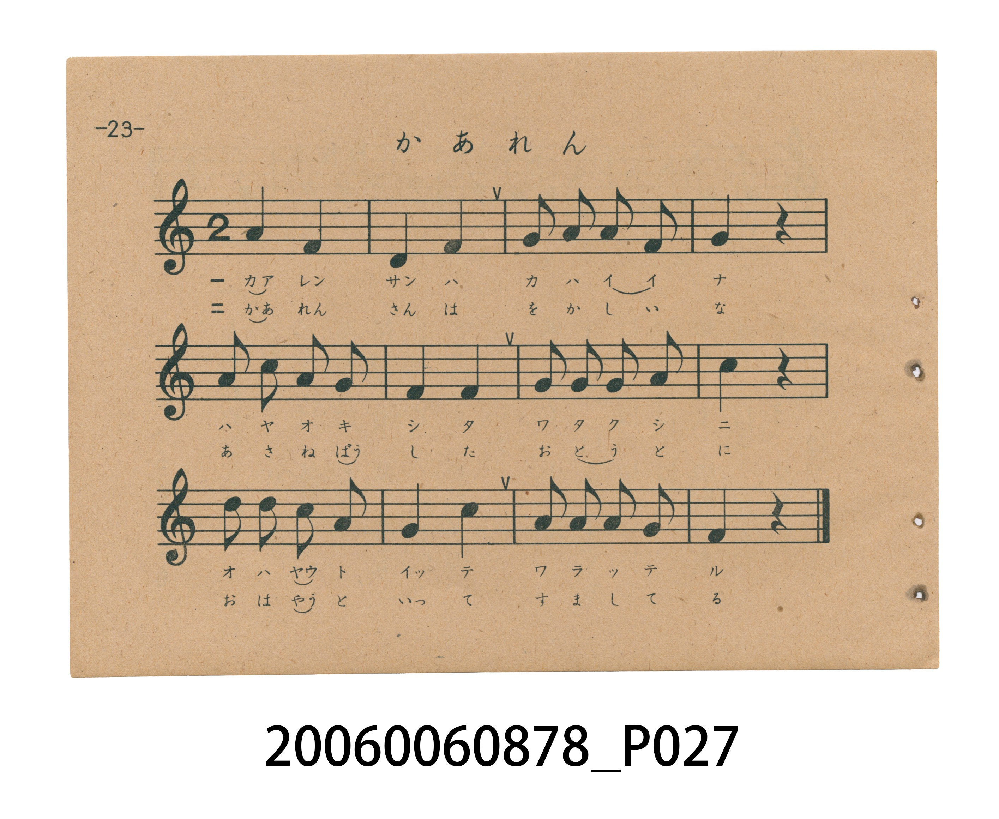
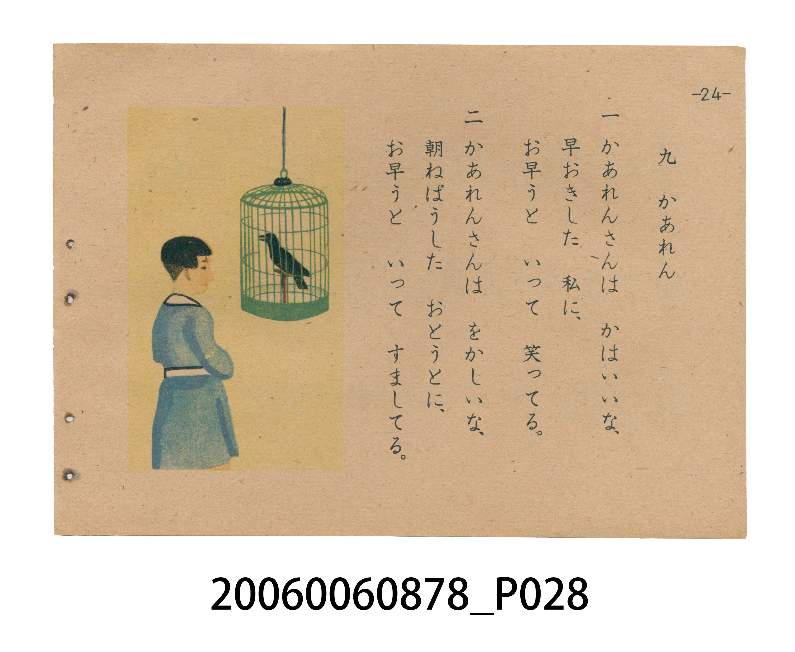

# かあれん（加令／八哥）

> Re:Shōka 使用 AI 協助辨識與重建樂譜，可能會有錯誤。歡迎回報。

- **NEUTRINO 歌聲合成版**：<br><audio controls src="kaaren_neutrino.mp3"></audio>
- **鋼琴伴奏版**：<br><audio controls src="kaaren.mp3"></audio>


- 江尚文 作詞（新竹女子公學校・懸賞募集入選）
- 日治時期國民學校唱歌（うたのほん 下・第九課）
- 國立臺灣歷史博物館典藏

## 說明


- 出處：臺灣總督府編《うたのほん 下》（國民學校初等科第二學年用），第九課〈かあれん〉（加令／八哥），原書第 23–24 頁。
- 調性與拍號：ヘ調（F 大調五聲音階，原書五線譜省略調號，實際音高終止於 F 音），2/4 拍，速度 != 104。
- 背景與曲風：本曲為臺灣總督府專為臺灣學童編纂之**臺灣鄉土特色曲目**（日本內地版文部省《うたのほん 下》無此曲）。曲名「かあれん」源自臺語「加令」（ka-lîng，即八哥，臺灣民間常見、善於模仿人語的籠養鳥）。第一節寫八哥對早起的「我」笑著說早安（「お早う」），第二節則幽默描寫八哥對睡懶覺的弟弟也一本正經地說「お早う」，第 24 頁並繪有學童凝望竹籠中八哥的生動插圖。
- 版本說明：本檔案為原書單聲部五線譜旋律之忠實數位化版本。

### 編曲說明（鋼琴伴奏版）：

1. 前奏 (Intro, 4 小節)：擷取主旋律核心樂句作為導奏，建立調性與拍感。
2. 主歌伴奏 (Kaaren)：右手 (PianoRH) 演奏原書歌唱主旋律；左手 (PianoLH)
依國民學校低學年教材純樸明朗之風格配以和聲伴奏。


## 歌詞

```text
一　かあれんさんは　かはいいな、
早おきした　私に、
お早うと　いって　笑ってる。

二　かあれんさんは　をかしいな、
朝ねばうした　おとうとに、
お早うと　いって　すましてる。
```

## ABC

```abc
X:1
T:かあれん（加令／八哥）
M:2/4
L:1/16
Q:1/4=104
K:F
V:V1 name="Piano" snm="Pia"
[V:V1]
A4 F4 | D4 F4 | G2 A2 A2 F2 | G4 z4 |
w: 1.~カア レン | サン ハ | カ ハ イ イ | ナ
w: 2.~かあ れん | さん は | を か し い | な
A2 c2 A2 G2 | F4 F4 | G2 G2 G2 A2 | c4 z4 |
w: 1.~ハ ヤ オ キ | シ タ | ワ タ ク シ | ニ
w: 2.~あ さ ね ばう | し た | お と う と | に
d2 d2 c2 A2 | G4 c4 | A2 A2 A2 G2 | F4 z4 |
w: 1.~オ ハ ヤウ ト | イッ テ | ワ ラ ッ テ | ル
w: 2.~お は やう と | いっ て | す ま し て | る
```

## TMD 檔案連結

- [主旋律 TMD 檔案](kaaren.tmd) [[在 TMD Studio 編輯](https://tmdlang.github.io/Tmd-TS/#tmd=s7IKdvYPcrWy4qpTUCpJTLdSyC_KTM_Ms8rNz0sqLc7IV0KXKEnMLE_Mi89PS8tMzkzMwSWfnJ9XklpcEm9oaWysxKWlpfC4sftxY9Pjpp7HTZPf7-l42rXgye4l7_f0P21d_XTy0vd7OhW0tLgUbRUMDUy47G0V3LhsjPRN7ECmP9s4_-mGWc-mtSs82Tvnxcp5QN3Ppm14vnrn06Wbn66d8LR1zdO1O54tWPi4efez9h0vNs972j3_5ey2p61LXzbuABoMduKz6Uufbdr9bGbTsznzn87pfrZhIkTT0ykbn63tARr5uLHtceP8x43rHjfuBjpR4cmObqCBz9esebJz7otVm2DmAPU-X939on3X88bFz9Zuf9q_6WnvrOedK18uWfG0dceL6f1KXFz6Wgq21AJcCgoKjxsmPJu96fnsdS9WrXo2o-9xw0SwaPPup-27Xsyc-n7PLIh7nu_Y-3zu4qe75jzfvuJxQxc2HzV0g8Ie2f8dc5-v7Xy-fCLIp7t6gIJPd255PmUF0L_v9_TAvf-4ARhAiAh83ACUxRKHQC1P--Y_m70DqFHByPhRw2QjE4WXCxofNzRBnfxi1f5nDctfdLQ_6-59MXM-0O2Pm2cABYHGuSk8XbIcyHyya8qLxk0v529-OasPbiBQ8Pn2WS_Wznk-p_H51KVAZWDdPU_XL3s5azZI8eoZz7c2PVu76Nm0PQpuCkARiHuAqUgBaBeQ9bJh_tNdyxQgaQzJRc09z2auB7lo9qaXi4Aen_VszhpQeDftQgvWpxs64ILAgHq-eikwoJ_vanqys1tLCyL8sqXz6Zz5zzt3vujcBIkzLS1QegWmvjlrnrYufzpnw_NOYPJtf9m8AugTnLH0vGXhs7VLgCYAPQF0KpDxdELv44Ye1EjofbZrwov2VUCrX6yaB5SFRAhQHGhldqJuzuF1eemgMOrdDIuhHmjK3TDx5bTJT3fseLEMaFvj02ktwFB7tmLhk93A0AcZ9nxWy_ONC14u6Xq5GRSvQCeAksKOhufrG56uXw0x7emG3mfTV77Yuh2oGGj5s46JQJufr5n4YuJ0UEKdvvLpOlAqAbu6C8gF-RTkNFjC2tUDMq2z_enOvS93z3jW349s8vO5C5-1b3uxbBfQ8Kd75gPRk53zgQ4Axc3axc-3TQaGJNAWDMNBJitAEt2THcue71z1bE4nJK6ets99Nmc2sNgAeuzJjrUQm0D-nDL_affUZ_2Tns6ZhkgVoFiaswaS4aBJYtWUZwtBCQCSIJ9OWwdKpc0r4Cnz2fTup_u6gYnh6f4FwGT5bOqOJ3t7n_ZMgxgFMhqamSEGAIsdYGH2tHUFMDUAUx_QSSDGqnkv1q4H5nBgwKHlIVAy6msGBhPQIQoBBkbmQBkgZQEO0E6w2cDwedzQgJJGGqeCSaCREPH1jxtbwAgYdI0gPeCwA6bC3seN00EJsaHh-fLGx42rodKI0G0ElilAM4BaFz9uXAZSt2YilN0ETETggAO6EeIDYJBBAhiYfh43TIElzKnPgaVv__pnLbOfTmwApcwNvcDUAk9FwCQESqKrVgFDFpSiwEkIkqieTloFREBr4H7d1YPPr02TwFJALyH7dc7cx41rHzduAPsH6l2w71dAfUiMvx83znzcuA-sn0SvA9Pii22L0bz-ZEcXZmIHKgCmd8yQeLF4LrASRM4HoGBbASyOJkDDBugUymsdKFDQ0ufi8k5MLErNswrITMzLd6gxqKkGWaFgY6FlB2bUKBgr6CoYAnGNglk8nGkEFDYGskEsXQUDkBhYuY9hjcLjptWPmxYBhR43r3ncvBms_nHTVgjzcXM_VGA1mP24aQkYA0Wau1CNMgKKgeMfpA2cBCA6wekAJNa4HmrUJJBCIJ4OxC1gJavgRsF9YQrERkAWyAMwT4CgMZBliukJkNuaQW5bBcRrwdZsBztkP8TS5vVg9uMmEL0dLNKNxf1NIPcC8VogBqVLsOumg10_H-qdLiBeAcRtYBokshrd9WZACHI_JLhBrgX5CARhPkKPAqCrIT543LQMSHWAPbDkcXMzOA7aEH5oXgnEzWAxkAjCaoQfQA4E-RKYRxBuBGUYsDeWQb0xE4j3QSNhGdg6RHjUcnHp2ilAkhrYYCBPmQsA)]
- [鋼琴伴奏 TMD 檔案](kaaren_piano.tmd) [[在 TMD Studio 編輯](https://tmdlang.github.io/Tmd-TS/#tmd=s7IKdvYPcrWy4tLSUnjc2P24selxU8_jpsnv93Q87VrwZPeS93v6n7aufjp56fs9nUDBl917nk_Y8mTPlqdL-593dgAFFbS0uBRtFQwNTLjsbRXcuGyM9E3suOoUlJ5NX_ps0-5nM5uezZn_dE73sw0Tn67d8WzBwqdTNj5b2wM063Fj2-PG-Y8b1z1u3A20UuHJju7Hzbufr1nzZOfcF6s2Ac1WApkD1Pt8dfeL9l3PGxc_W7v9af-mp72znneufLlkxdPWHS-m9ytxcelrKdhSC3ApKCg8bpjwbPam57PXvVi16tmMvscNE8Gizbuftu96MXPq-z2zIO55vmPv87mLn-6a83z7iscNXdh81NANCktk_3fMfb628_nyiSCf7uoBCj7dueX5lBXgAO6Be_9xAzCAEBHyuAEU_NjipOdp3_xns3cANSoYGT9qmGxkovByQePjhiaok1-s2v-sYfmLjvZn3b0vZs4Huv1x8wygINA4N4WnS5YDmU92TXnRuOnl_M0vZ_XBDQQKPt8-68XaOc_nND6fuhSoDKy75-n6ZS9nzQYpXj3j-damZ2sXPZu2R8FNASgCcQ8wASgA7QKyXjbMf7prmQIkeSC5qLnn2cz1IBfN3vRyEdDjs57NWQMK76ZdaMH6dEMHXBAYUM9XLwUG9PNdTU92dmtpQYRftnQ-nTP_eefOF52bIHGmpQX0Gij1zVnztHX50zkbgAn12bT2l80rgD7BGUvPWxY-W7sEaALQE0CnAhlPJ_Q-buhBjYTeZ7smvGhfBbT6xap5QFlIhADFgVZmJ-rmHF6Xlw4Ko97NsBjqgabcDRNfTpv8dMeOF8uAtjU-ndYCDLVnKxY-2Q0MfZBhz2e1PN-44OWSrpebQfEKdAIoKexoeL6-4en61RDTnm7ofTZ95Yut24GKgZY_65gItPn5mokvJk4HJdTpK5-uA6USsKu7gFyQT0FOgyWsXT0g0zrbn-7c-3L3jGf9_cgmP5-78Fn7thfLdgENf7pnPhA92Tkf6ABQ3Kxd_HzbZGBIAm3BMBxksgIk0T3Zsez5zlXP5nRC4upp-9xnc2Y_X70T6LEnO9ZCbAL5c8r8p91Tn_VPejpnGiJVAGMWGOiQDIe1pAGmE5BSBQVDPYWnnb1AcQUNz7ySonwdBROFpxv6gX7TBKWlycAyYtqTHbufTe9-uq_72YIdT_c3P1vR9LR_6ZO9c4DJ6emGPqBeUCzt3gUqWZDyx7OW-VAHKSgY6QFTxm5gUQVxg4KGd2JiUWoeyIqn_ZufdXYraARkJublB3loKjzbMwWoBJJvgDqARRzc_vd7Zj_dvgyh3MdDE2I-EDzZNxe5ZHiytw9SGjybOvPZ3AnPt0x5tmIHMDSezZkOTPDAnPJswZ6Xrb1Pdi99OqkHmGEhDgM5GFpmwR3wYuW8p60rgIke6C1gyIMYq-a9WLseWJABgxatqADllr5mYGp4tmqKQoCBkTlQBkhZgIO8E2w2MBk8bmhAyQqNU8Ek0EiI-PrHjS1gBEwhjSA94CQCzGy9jxung_JbQ8Pz5Y2PG1dDpRGJqBFYdALNAGpd_LhxGUjdmolQdhMwr4CjA-hGiA9AoQ9OR8Bs8rhhCiz_TX0OrGT61z9rmf10YgMoajf0AjMFPLMAcwooJ65aBQw1UMYB5xRI3nk6aRUQAa2B-3VXDz6_Nk0CSwG9hOzXOXMfN6593LgB7B-od8G-XwH1ITH-ftw483HjPrB-Er0OzHIvti1G8_qTHV2YeRqoAJitMUPixeK5wNyBnN1BwbYCWOpOgIYN0CmUV65QoKClz8UFzrtW0DzkUGNQUw3OGDYWWnZgRo2CGRCaKhgDWUYKukCWLpBlDIZGQJYhkG8AEuOqRTHMB9kwE4Rh8fEK0YaxQJYpiGUKYhkiM0ByIKMg-Ryvw4yB1oKsB5kKZxqBXWYIdS3EZSDlPoY1Co-bVj9uWgQUety85nHzZrD6x01bIczHzf1QgdVg9uOmJWAMFGnuQjXKCCgGTpkgbeDECdEJTqEgscb1UKMmgRQC8XQgbgErWQU3Cu4LUODCghLmCRAEBTkouNE8AXJbM8htq4B4Ldia7WCH7IdY2rwezH7cBKK3g0W6sbi_CeReIF4LxKAcA3bddLDr50O90wXEK4C4DUyDRFaju57YxIGIAqCrIT543LQMSHWAPbDkcXMzOA7aEH5oXgnEzWAxkAjCaoQfQA4E-RKYexFuBGVlsDeWQb0xE4j3QSNhGdg6RHigpTQcqRaWMNGTL2pCRlKMkpzxqCWUHQwgTtS1UwBnLQUgA-LcaB-gLiSeEZinzAUA)]

## 分析

```text
================================================================================
📊 TMD Song Profile: [ かあれん（加令／八哥） ]
================================================================================
⏱  Duration:       0:13 (13.8s), 12 measures total
🎼 Key & Tempo:    首調基準 F, != 104.0 BPM, <2/4>
   - 分析範圍：      由實際發聲的音符與和弦推測調性；播放脈絡另行呈現
🎤 人聲音域:    D4 (MIDI 62) – D5 (MIDI 74) [跨度: 12 個半音 / 1.0 個八度, 難度: easy]
   - 最低音:  D4 in [Kaaren #1 @ m.2, 0:01]
   - 最高音: D5 in [Kaaren #1 @ m.9, 0:09]
   - 適合: soprano, mezzo-soprano, contralto, tenor, baritone, bass
🏛  結構:      Kaaren (13.8s)
⚡ 編曲密度:        Peak 1 軌道同時演奏
🗝  調性診斷：       F 大調（純淨自然大調，未偵測到可信轉調）
   - 風格氣質:    純淨自然大調（陽光明朗、易唱易記，無明顯調外色彩）
   - 轉調歷程:    全曲維持單一推測調性（未偵測到可信轉調）
   - 核心骨幹音:  F, A, G, C, D
   - 調性數值:    F 大調 [相關度: 0.76, 穩定度: Moderate, 自然音純度: 100.0%]
   - 候選調性 (K-S): F 大調 (0.76), C 大調 (0.62), A 小調 (0.60)
   - 五度圈歷程:   -1
   - 各段落調性細節:
     • [Kaaren #1]: F 大調 (r: 0.76, 自然音純度: 100.0%)

  [ 五度圈游移軌跡 ]
               C  
        [F ]*          G  
      Bb               D  
      Eb               A  
         Ab           E  
            Db       B  
               F# 
     (* = active key center)

  [ 十二半音累積音高分佈 ]
     C  : █████████████             14.3%
     C# :                            0.0%
     D  : █████████                  9.5%
     D# :                            0.0%
     E  :                            0.0%
     F  : ████████████████████████  26.2%
     F# :                            0.0%
     G  : ██████████████████████    23.8%
     G# :                            0.0%
     A  : ████████████████████████  26.2%
     A# :                            0.0%
     B  :                            0.0%
--------------------------------------------------------------------------------
Assignment 軌道音域：
  - Piano         : D4 – D5 (12 個半音 / 1.0 個八度, 31 個音符)
================================================================================
```


## 原書掃描頁






