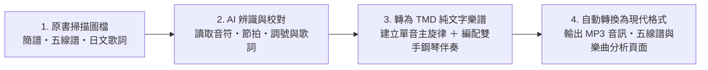

# 內容產生過程

本專案透過以下流程，將百年前的課本掃描頁轉化為現代可以直接使用的數位樂譜與音訊：

## 1. AI 辨識原書樂譜與歌詞

- **樂譜判讀**：原書低中年級多採用數字簡譜，高年級與高等科則採用五線譜，包含二部輪唱與合唱譜。先透過多模態 AI 讀取掃描圖檔中的調號、拍號、速度、各小節音高與節奏時值，再人工校對小節數與拍數。
- **歌詞轉錄**：同步轉錄原書上的片假名、平假名與漢字歌詞，保留當時的歷史假名寫法，並記錄原書頁碼與掃描圖檔，方便對照原始影像。

## 2. 轉換成 TMD 格式與編配鋼琴伴奏

- **原曲主旋律檔**：將辨識出的單聲部或合唱旋律寫成標準 TMD 純文字樂譜檔（`.tmd`），並自動檢查每個小節的拍數。
- **雙手鋼琴伴奏檔**：原書多數曲目只有單行歌唱旋律。為了讓歌曲可以直接試聽，另外編寫包含前奏、右手主旋律與左手和聲伴奏的雙手鋼琴版本（`*_piano.tmd`）。

## 3. 自動輸出為現代格式

完成 TMD 樂譜後，由自動化腳本統一輸出：

- **MP3 伴奏音訊**：將雙手鋼琴伴奏譜合成音訊。
- **互動式五線譜**：轉為 ABC 記譜格式（`.abc`），由瀏覽器透過 `abcjs` 繪製向量五線譜。
- **單曲音域與調性報告**：自動分析歌曲長度、最高音、最低音範圍及音高分布。

## 4. 工具與資料原則

TMD 是本計畫的底層樂譜來源格式。音符、節奏與和弦以純文字檔案儲存，方便閱讀、Git 版本管理，以及轉換成五線譜、MIDI 或音訊。網站使用的 metadata 與統計資料則由 TMD 和其他來源檔案重新產生。

原書影像樂譜辨識、日文歌詞轉錄、TMD 轉換與雙手鋼琴伴奏編曲，使用 Google Antigravity／Gemini 輔助完成；AI 產生的結果仍須以原書掃描、節拍檢查與人工校對確認。
