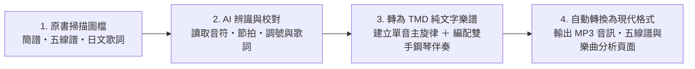

# 內容產生過程

本專案透過以下流程，將百年前的課本掃描頁轉化為現代可以直接使用的數位樂譜與音訊：

## 防止 AI 幻覺：從圖像到 TMD

這個流程不是請 AI 憑歌名或記憶補出一首歌，而是把原書掃描圖檔當成唯一的事實來源，再用切片、結構檢查與人工回看逐層限制錯誤。

- **圖像是唯一真相**：圖上沒有的音符、休止符、反覆記號或歌詞，不由模型自行補全。
- **阻斷旋律先驗**：不因為歌名熟悉，就把模型記憶中的版本套回原書；每個音符都必須回到對應的局部掃描確認。
- **高解析局部切片**：使用 `shoka-score-grounding` skill 提供的 `slice_score.py`，將整頁切成單行五線譜與歌詞區域，避免縮圖下採樣造成的符頭、加線與墨暈誤讀。
- **雙通道轉錄**：先遮蔽歌詞，單獨判定五線位置、符頭、符桿與節奏；再檢查歌詞排版、反覆記號、雙層歌詞與歷史假名遣，避免用歌詞反過來「修正」看不清楚的音符。
- **保留原貌**：戰前歷史假名遣、舊字體、大字拗音與無濁點等，原則上照原書保存，不自動現代化。

遇到模糊小節時，流程要求回到原始切片重新確認，而不是用「旋律應該是這樣」來填空。這也是主旋律 TMD 與伴奏 TMD 分開保存的原因：原始轉錄可以獨立校對，伴奏則是後續編配結果。

## 1. AI 辨識原書樂譜與歌詞

- **樂譜判讀**：原書低中年級多採用數字簡譜，高年級與高等科則採用五線譜，包含二部輪唱與合唱譜。先透過多模態 AI 讀取掃描圖檔中的調號、拍號、速度、各小節音高與節奏時值，再人工校對小節數與拍數。
- **歌詞轉錄**：同步轉錄原書上的片假名、平假名與漢字歌詞，保留當時的歷史假名寫法，並記錄原書頁碼與掃描圖檔，方便對照原始影像。

## 2. 轉換成 TMD 格式與編配鋼琴伴奏

- **原曲主旋律檔**：將辨識出的單聲部或合唱旋律寫成標準 TMD 純文字樂譜檔（`.tmd`），並自動檢查每個小節的拍數。
- **雙手鋼琴伴奏檔**：原書多數曲目只有單行歌唱旋律。為了讓歌曲可以直接試聽，另外編寫包含前奏、右手主旋律與左手和聲伴奏的雙手鋼琴版本（`*_piano.tmd`）。

## 3. 自動輸出為現代格式

完成 TMD 樂譜後，由自動化腳本統一輸出：

- **MP3 伴奏音訊**：將雙手鋼琴伴奏譜合成音訊。
- **互動式五線譜**：轉為 ABC 記譜格式（`.abc`），由瀏覽器透過 `abcjs` 繪製向量五線譜。
- **單曲音域與調性報告**：自動分析歌曲長度、最高音、最低音範圍及音高分布。

## 4. 自動化驗證與錯誤隔離

完成轉錄後，使用多層驗證，而不是只看網頁能不能產生：

1. **TMD 結構檢查**：`tmd check` 檢查語法、拍號、小節時值、歌詞格數、歌詞段落與播放順序，確認樂譜在語言層面可以被解析。
2. **防幻覺常理審查**：`shoka-score-grounding` skill 的 `audit_score.py` 會檢查異常大跳、童聲音域、歌詞與發聲音符的對位，以及反覆與雙層歌詞結構；同時會檢查相應的鋼琴伴奏和聲。出現警示時，應回看原始局部切片，而不是直接接受修正。
3. **衍生檔重新產生**：`scripts/generate_song_markdown.py` 從 TMD 產生 ABC、歌曲頁、音域與調性資料；批次處理時會收集失敗項目，避免一首壞檔案中斷整批工作。
4. **歌聲與伴奏對齊**：`scripts/render_neutrino_mix.py` 會先把 TMD 匯出成 MusicXML，找出所有含歌詞聲部，將前奏或間奏中沒有歌詞的音符轉成休止符，再根據 NEUTRINO timing 對齊人聲與伴奏。批次模式遇到單曲錯誤會記錄並跳過，最後列出失敗清單。

這些檢查各自處理不同類型的問題：編譯器抓結構錯誤，審查工具抓可疑的音樂結果，人工回看負責判定圖像證據，音訊工具則確認實際演奏流程沒有失去時間軸。它們不是保證 AI 永遠不錯，而是讓錯誤更容易被定位、被發現、被修正。

## 5. 工具與資料原則

TMD 是本計畫的底層樂譜來源格式。音符、節奏與和弦以純文字檔案儲存，方便閱讀、Git 版本管理，以及轉換成五線譜、MIDI 或音訊。網站使用的 metadata 與統計資料則由 TMD 和其他來源檔案重新產生。

原書影像樂譜辨識、日文歌詞轉錄、TMD 轉換與雙手鋼琴伴奏編曲，使用 Google Antigravity／Gemini 輔助完成；AI 產生的結果仍須以原書掃描、節拍檢查與人工校對確認。

## 附註

- **關於 TMD 格式**：本計畫使用 [TMD（Timebase Markdown / Textual Music Description）](https://tmdlang.github.io/) 作為底層的樂譜紀錄格式。TMD 是一種概念接近「純文字簡譜＋Markdown」的音樂記述語言，所有音符、節奏與和弦都以純文字檔案（`.tmd`）儲存，不僅容易閱讀與透過 Git 進行版本管理，也能隨時透過工具自動轉出成五線譜、MIDI 或音訊檔。
- **TMD 檔案授權**：Re:shōka 中的 TMD 檔案，包含原始版本與伴奏版本，均以 [MIT License](https://opensource.org/license/mit/) 授權。
- **AI 辨識與轉換工具**：本專案之原書掃描影像樂譜辨識、日文歌詞轉錄、TMD 格式轉換以及雙手鋼琴伴奏編曲，係使用 **Google Antigravity / Gemini** 輔助完成。
